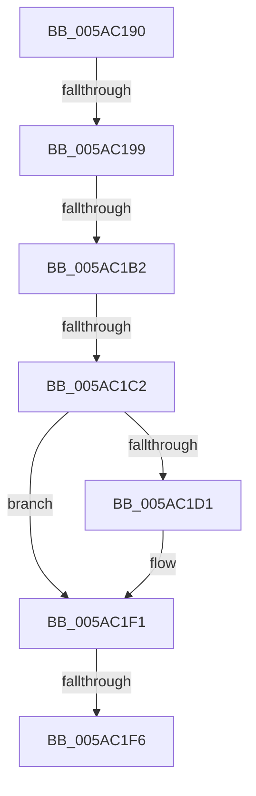

# _asan_allocas_unpoison

- RVA: `0x005AC190`–`0x005AC215` (길이 `133` bytes)
- VA: `0x00000001405AC190`
- 실행 섹션: `.text`
- PDB 이름 있음: `예`; PDB Function 태그: `아니요`
- unwind 정보 RVA: `0x000C9488`
- 디코드: `31`개 명령, `133/133` bytes 표시
- 미해석 바이트: `0` (있으면 어셈블리에 `.byte`로 보존)

> 이 문서는 커널 이미지의 기계어와 PDB 기호를 분석해 생성했습니다. 4번과 5번은 함수 원형과 자료형을 바이너리 사용 방식에서 추정한 C 해석이며 원본 소스 복구 결과는 아닙니다.

## 1. Dependencies

- 직접 호출 지점: **2**; 고유 호출 대상: **1**
- 직접 호출자로 확인된 함수: **0**
- RIP 상대 이미지 참조: **1**

### Outgoing calls
- `0x005AC1EB` → [KeBugCheckEx](../4F/KeBugCheckEx_function_004FD660.md) (function, `0x004FD660`)
- `0x005AC20F` → [KeBugCheckEx](../4F/KeBugCheckEx_function_004FD660.md) (function, `0x004FD660`)

### Direct callers
- 이 함수 시작 RVA로 연결되는 직접 call은 확인되지 않았습니다. 간접 호출은 완전히 역산할 수 없습니다.

### Static image references
- `0x005AC1B5` → RVA `0x00FCEC68` (`ALMOSTRO`; read)

## 2. Other-region calls and transfers

- 다른 실행 섹션으로 향하는 call: **0**
- call이 아닌 외부 분기/꼬리 이동: **4**
  - `0x005AC193` → [sub_005AC24C + 0x11](Unknown_function_005AC24C.md) (`tail-transfer`)
  - `0x005AC1AC` → [sub_005AC24C + 0x7](Unknown_function_005AC24C.md) (`tail-transfer`)
  - `0x005AC1BC` → [sub_005AC24C + 0x7](Unknown_function_005AC24C.md) (`tail-transfer`)
  - `0x005AC1F4` → [sub_005AC215](Unknown_function_005AC215.md) (`tail-transfer`)

## 3. Assembly (complete function range)

```asm
005AC190  48 85 C9                        test rcx, rcx
005AC193  0F 84 C4 00 00 00               je 0x1405ac25d
005AC199  48 89 5C 24 10                  mov qword ptr [rsp + 0x10], rbx
005AC19E  57                              push rdi
005AC19F  48 83 EC 30                     sub rsp, 0x30
005AC1A3  48 8B FA                        mov rdi, rdx
005AC1A6  48 8B D9                        mov rbx, rcx
005AC1A9  48 3B CA                        cmp rcx, rdx
005AC1AC  0F 87 A1 00 00 00               ja 0x1405ac253
005AC1B2  48 2B F9                        sub rdi, rcx
005AC1B5  80 3D AC 2A A2 00 00            cmp byte ptr [rip + 0xa22aac], 0
005AC1BC  0F 84 91 00 00 00               je 0x1405ac253
005AC1C2  48 B8 00 00 00 00 00 80 FF FF   movabs rax, 0xffff800000000000
005AC1CC  48 3B C8                        cmp rcx, rax
005AC1CF  73 20                           jae 0x1405ac1f1
005AC1D1  BA 02 00 00 00                  mov edx, 2
005AC1D6  48 C7 44 24 20 00 00 00 00      mov qword ptr [rsp + 0x20], 0
005AC1DF  4C 8B C9                        mov r9, rcx
005AC1E2  B9 F1 01 00 00                  mov ecx, 0x1f1
005AC1E7  44 8D 42 FF                     lea r8d, [rdx - 1]
005AC1EB  E8 70 14 F5 FF                  call 0x1404fd660
005AC1F0  CC                              int3
005AC1F1  F6 C3 07                        test bl, 7
005AC1F4  74 1F                           je 0x1405ac215
005AC1F6  BA 02 00 00 00                  mov edx, 2
005AC1FB  48 C7 44 24 20 08 00 00 00      mov qword ptr [rsp + 0x20], 8
005AC204  44 8B C2                        mov r8d, edx
005AC207  4C 8B CB                        mov r9, rbx
005AC20A  B9 F1 01 00 00                  mov ecx, 0x1f1
005AC20F  E8 4C 14 F5 FF                  call 0x1404fd660
005AC214  CC                              int3
```

## 4. C-style interpretation (structured pseudocode)

```c
__int64 __fastcall _asan_allocas_unpoison(__int64 a1, __int64 a2)
{
    __int64 result;
    __int64 v_rdi;
    __int64 v_rsp;
    unsigned __int64 v_stack_m18;
    unsigned __int64 v_stack_p10;

    v_stack_p10 = v_rbx;
    v_rsp = (v_rsp) - (48);
    v_rdi = (a2) - (a1);
    if (a1 < result) {
        a2 = 2;
        v_stack_m18 = 0;
        a4 = a1;
        a1 = 497;
        a3 = a2 - 1;
        result = KeBugCheckEx(a1, a2, a3, a4);
    }
    v_stack_m18 = 8;
    result = KeBugCheckEx(497, 2, 2, a1);
    return result;
}
```

## 5. (Beta) C Style

```c
int64_t _asan_allocas_unpoison(int64_t Arg1, int64_t Arg2)
{
    int64_t result;
    int64_t local_rdi;
    int64_t local_rsp;
    uint64_t v_stack_m18;
    uint64_t v_stack_p10;

    v_stack_p10 = local_rbx;
    local_rsp = (local_rsp) - (48);
    local_rdi = (Arg2) - (Arg1);
    if (Arg1 < result) {
        Arg2 = 2;
        v_stack_m18 = 0;
        a4 = Arg1;
        Arg1 = 497;
        a3 = Arg2 - 1;
        result = KeBugCheckEx(Arg1, Arg2, a3, a4);
    }
    v_stack_m18 = 8;
    result = KeBugCheckEx(497, 2, 2, Arg1);
    return result;
}
```

## 6. Execution-region graph

[열기: 2D/3D 그래프와 함수 탐색 컨트롤 패널](../../../control-panel.html?section=text&rva=0x005AC190&view=graph)

- 2D 그래프는 위에서 아래로 흐르고, 3D 그래프는 빈 공간을 드래그해 회전합니다. Shift+드래그는 이동, 휠은 확대·축소, 함수 노드 선택은 대상 보고서 이동입니다.

### Static fallback


