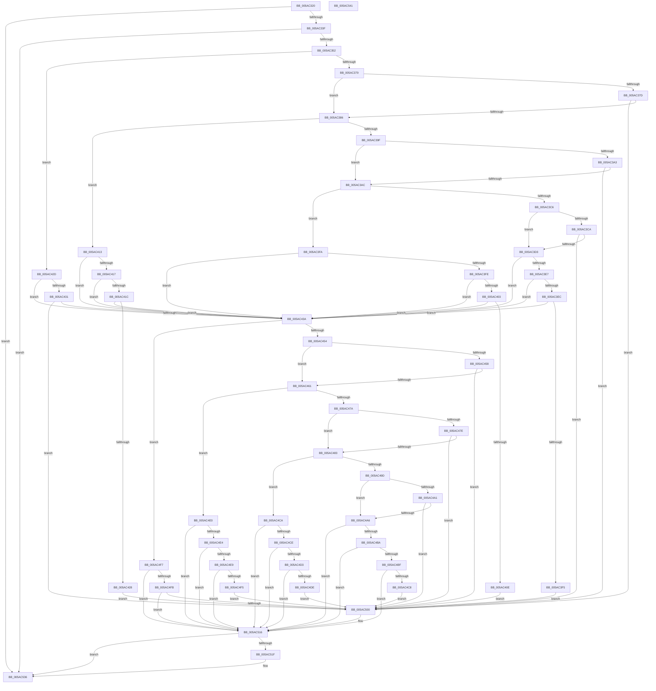

# _asan_load16

- RVA: `0x005AC320`–`0x005AC542` (길이 `546` bytes)
- VA: `0x00000001405AC320`
- 실행 섹션: `.text`
- PDB 이름 있음: `예`; PDB Function 태그: `아니요`
- unwind 정보 RVA: `0x0006E5F8`
- 디코드: `172`개 명령, `546/546` bytes 표시
- 미해석 바이트: `0` (있으면 어셈블리에 `.byte`로 보존)

> 이 문서는 커널 이미지의 기계어와 PDB 기호를 분석해 생성했습니다. 4번과 5번은 함수 원형과 자료형을 바이너리 사용 방식에서 추정한 C 해석이며 원본 소스 복구 결과는 아닙니다.

## 1. Dependencies

- 직접 호출 지점: **2**; 고유 호출 대상: **2**
- 직접 호출자로 확인된 함수: **0**
- RIP 상대 이미지 참조: **3**

### Outgoing calls
- `0x005AC511` → [KasaniReport](KasaniReport_function_005AB0B0.md) (function, `0x005AB0B0`)
- `0x005AC531` → [KcsanValidateAddress](KcsanValidateAddress_function_005AF5E0.md) (function, `0x005AF5E0`)

### Direct callers
- 이 함수 시작 RVA로 연결되는 직접 call은 확인되지 않았습니다. 간접 호출은 완전히 역산할 수 없습니다.

### Static image references
- `0x005AC32A` → RVA `0x00FCEC6A` (`ALMOSTRO`; read)
- `0x005AC352` → RVA `0x00FC6ED8` (`ALMOSTRO`; read)
- `0x005AC516` → RVA `0x00F8A7E8` (`.data`; read)

## 2. Other-region calls and transfers

- 다른 실행 섹션으로 향하는 call: **0**
- 별도 외부 분기/꼬리 이동을 확인하지 못했습니다.

## 3. Assembly (complete function range)

```asm
005AC320  48 89 5C 24 08                  mov qword ptr [rsp + 8], rbx
005AC325  57                              push rdi
005AC326  48 83 EC 30                     sub rsp, 0x30
005AC32A  80 3D 39 29 A2 00 00            cmp byte ptr [rip + 0xa22939], 0
005AC331  48 8B D9                        mov rbx, rcx
005AC334  48 8B 7C 24 38                  mov rdi, qword ptr [rsp + 0x38]
005AC339  0F 84 F7 01 00 00               je 0x1405ac536
005AC33F  48 B8 00 00 00 00 00 80 FF FF   movabs rax, 0xffff800000000000
005AC349  48 3B C8                        cmp rcx, rax
005AC34C  0F 82 E4 01 00 00               jb 0x1405ac536
005AC352  4C 8B 05 7F AB A1 00            mov r8, qword ptr [rip + 0xa1ab7f]
005AC359  49 B9 00 00 00 00 00 80 00 00   movabs r9, 0x800000000000
005AC363  4A 8D 04 09                     lea rax, [rcx + r9]
005AC367  48 C1 E8 03                     shr rax, 3
005AC36B  42 0F B6 0C 00                  movzx ecx, byte ptr [rax + r8]
005AC370  F6 C3 07                        test bl, 7
005AC373  0F 86 B4 00 00 00               jbe 0x1405ac42d
005AC379  84 C9                           test cl, cl
005AC37B  74 09                           je 0x1405ac386
005AC37D  80 F9 08                        cmp cl, 8
005AC380  0F 8C 7A 01 00 00               jl 0x1405ac500
005AC386  48 8D 53 04                     lea rdx, [rbx + 4]
005AC38A  4A 8D 04 0A                     lea rax, [rdx + r9]
005AC38E  48 C1 E8 03                     shr rax, 3
005AC392  42 0F B6 0C 00                  movzx ecx, byte ptr [rax + r8]
005AC397  8B C2                           mov eax, edx
005AC399  24 07                           and al, 7
005AC39B  3C 04                           cmp al, 4
005AC39D  76 74                           jbe 0x1405ac413
005AC39F  84 C9                           test cl, cl
005AC3A1  74 09                           je 0x1405ac3ac
005AC3A3  80 F9 08                        cmp cl, 8
005AC3A6  0F 8C 54 01 00 00               jl 0x1405ac500
005AC3AC  48 83 C2 02                     add rdx, 2
005AC3B0  4A 8D 04 0A                     lea rax, [rdx + r9]
005AC3B4  48 C1 E8 03                     shr rax, 3
005AC3B8  42 0F B6 0C 00                  movzx ecx, byte ptr [rax + r8]
005AC3BD  8B C2                           mov eax, edx
005AC3BF  83 E0 07                        and eax, 7
005AC3C2  3C 06                           cmp al, 6
005AC3C4  76 34                           jbe 0x1405ac3fa
005AC3C6  84 C9                           test cl, cl
005AC3C8  74 09                           je 0x1405ac3d3
005AC3CA  80 F9 08                        cmp cl, 8
005AC3CD  0F 8C 2D 01 00 00               jl 0x1405ac500
005AC3D3  48 FF C2                        inc rdx
005AC3D6  4A 8D 04 0A                     lea rax, [rdx + r9]
005AC3DA  48 C1 E8 03                     shr rax, 3
005AC3DE  42 0F B6 0C 00                  movzx ecx, byte ptr [rax + r8]
005AC3E3  84 C9                           test cl, cl
005AC3E5  74 53                           je 0x1405ac43a
005AC3E7  80 F9 08                        cmp cl, 8
005AC3EA  7D 4E                           jge 0x1405ac43a
005AC3EC  80 E2 07                        and dl, 7
005AC3EF  FE C2                           inc dl
005AC3F1  3A D1                           cmp dl, cl
005AC3F3  7E 45                           jle 0x1405ac43a
005AC3F5  E9 06 01 00 00                  jmp 0x1405ac500
005AC3FA  84 C9                           test cl, cl
005AC3FC  74 3C                           je 0x1405ac43a
005AC3FE  80 F9 08                        cmp cl, 8
005AC401  7D 37                           jge 0x1405ac43a
005AC403  FE C2                           inc dl
005AC405  80 E2 07                        and dl, 7
005AC408  FE C2                           inc dl
005AC40A  3A D1                           cmp dl, cl
005AC40C  7E 2C                           jle 0x1405ac43a
005AC40E  E9 ED 00 00 00                  jmp 0x1405ac500
005AC413  84 C9                           test cl, cl
005AC415  74 23                           je 0x1405ac43a
005AC417  80 F9 08                        cmp cl, 8
005AC41A  7D 1E                           jge 0x1405ac43a
005AC41C  80 C2 03                        add dl, 3
005AC41F  80 E2 07                        and dl, 7
005AC422  FE C2                           inc dl
005AC424  3A D1                           cmp dl, cl
005AC426  7E 12                           jle 0x1405ac43a
005AC428  E9 D3 00 00 00                  jmp 0x1405ac500
005AC42D  84 C9                           test cl, cl
005AC42F  74 09                           je 0x1405ac43a
005AC431  80 F9 08                        cmp cl, 8
005AC434  0F 8C C6 00 00 00               jl 0x1405ac500
005AC43A  48 8D 53 08                     lea rdx, [rbx + 8]
005AC43E  4A 8D 04 0A                     lea rax, [rdx + r9]
005AC442  48 C1 E8 03                     shr rax, 3
005AC446  42 0F B6 0C 00                  movzx ecx, byte ptr [rax + r8]
005AC44B  F6 C2 07                        test dl, 7
005AC44E  0F 86 A3 00 00 00               jbe 0x1405ac4f7
005AC454  84 C9                           test cl, cl
005AC456  74 09                           je 0x1405ac461
005AC458  80 F9 08                        cmp cl, 8
005AC45B  0F 8C 9F 00 00 00               jl 0x1405ac500
005AC461  48 83 C2 04                     add rdx, 4
005AC465  4A 8D 04 0A                     lea rax, [rdx + r9]
005AC469  48 C1 E8 03                     shr rax, 3
005AC46D  42 0F B6 0C 00                  movzx ecx, byte ptr [rax + r8]
005AC472  8B C2                           mov eax, edx
005AC474  24 07                           and al, 7
005AC476  3C 04                           cmp al, 4
005AC478  76 66                           jbe 0x1405ac4e0
005AC47A  84 C9                           test cl, cl
005AC47C  74 05                           je 0x1405ac483
005AC47E  80 F9 08                        cmp cl, 8
005AC481  7C 7D                           jl 0x1405ac500
005AC483  48 83 C2 02                     add rdx, 2
005AC487  4A 8D 04 0A                     lea rax, [rdx + r9]
005AC48B  48 C1 E8 03                     shr rax, 3
005AC48F  42 0F B6 0C 00                  movzx ecx, byte ptr [rax + r8]
005AC494  8B C2                           mov eax, edx
005AC496  83 E0 07                        and eax, 7
005AC499  3C 06                           cmp al, 6
005AC49B  76 2D                           jbe 0x1405ac4ca
005AC49D  84 C9                           test cl, cl
005AC49F  74 05                           je 0x1405ac4a6
005AC4A1  80 F9 08                        cmp cl, 8
005AC4A4  7C 5A                           jl 0x1405ac500
005AC4A6  48 FF C2                        inc rdx
005AC4A9  4A 8D 04 0A                     lea rax, [rdx + r9]
005AC4AD  48 C1 E8 03                     shr rax, 3
005AC4B1  42 0F B6 0C 00                  movzx ecx, byte ptr [rax + r8]
005AC4B6  84 C9                           test cl, cl
005AC4B8  74 5C                           je 0x1405ac516
005AC4BA  80 F9 08                        cmp cl, 8
005AC4BD  7D 57                           jge 0x1405ac516
005AC4BF  80 E2 07                        and dl, 7
005AC4C2  FE C2                           inc dl
005AC4C4  3A D1                           cmp dl, cl
005AC4C6  7E 4E                           jle 0x1405ac516
005AC4C8  EB 36                           jmp 0x1405ac500
005AC4CA  84 C9                           test cl, cl
005AC4CC  74 48                           je 0x1405ac516
005AC4CE  80 F9 08                        cmp cl, 8
005AC4D1  7D 43                           jge 0x1405ac516
005AC4D3  FE C2                           inc dl
005AC4D5  80 E2 07                        and dl, 7
005AC4D8  FE C2                           inc dl
005AC4DA  3A D1                           cmp dl, cl
005AC4DC  7E 38                           jle 0x1405ac516
005AC4DE  EB 20                           jmp 0x1405ac500
005AC4E0  84 C9                           test cl, cl
005AC4E2  74 32                           je 0x1405ac516
005AC4E4  80 F9 08                        cmp cl, 8
005AC4E7  7D 2D                           jge 0x1405ac516
005AC4E9  80 C2 03                        add dl, 3
005AC4EC  80 E2 07                        and dl, 7
005AC4EF  FE C2                           inc dl
005AC4F1  3A D1                           cmp dl, cl
005AC4F3  7E 21                           jle 0x1405ac516
005AC4F5  EB 09                           jmp 0x1405ac500
005AC4F7  84 C9                           test cl, cl
005AC4F9  74 1B                           je 0x1405ac516
005AC4FB  80 F9 08                        cmp cl, 8
005AC4FE  7D 16                           jge 0x1405ac516
005AC500  45 33 C0                        xor r8d, r8d
005AC503  88 4C 24 20                     mov byte ptr [rsp + 0x20], cl
005AC507  4C 8B CF                        mov r9, rdi
005AC50A  48 8B CB                        mov rcx, rbx
005AC50D  41 8D 50 10                     lea edx, [r8 + 0x10]
005AC511  E8 9A EB FF FF                  call 0x1405ab0b0
005AC516  80 3D CB E2 9D 00 00            cmp byte ptr [rip + 0x9de2cb], 0
005AC51D  74 17                           je 0x1405ac536
005AC51F  45 33 C9                        xor r9d, r9d
005AC522  48 89 7C 24 20                  mov qword ptr [rsp + 0x20], rdi
005AC527  45 33 C0                        xor r8d, r8d
005AC52A  48 8B CB                        mov rcx, rbx
005AC52D  41 8D 51 10                     lea edx, [r9 + 0x10]
005AC531  E8 AA 30 00 00                  call 0x1405af5e0
005AC536  48 8B 5C 24 40                  mov rbx, qword ptr [rsp + 0x40]
005AC53B  48 83 C4 30                     add rsp, 0x30
005AC53F  5F                              pop rdi
005AC540  C3                              ret
005AC541  CC                              int3
```

## 4. C-style interpretation (structured pseudocode)

```c
__int64 __fastcall _asan_load16(__int64 a1)
{
    __int64 result;
    __int64 v_rsp;
    unsigned __int8 v_stack_m18;
    unsigned __int64 v_stack_p0;
    unsigned __int64 v_stack_p8;

    v_stack_p8 = v_rbx;
    v_rsp = (v_rsp) - (48);
    if ((*(unsigned __int8 *)(v_rip + 10627385)) == 0) goto loc_005AC536;
    if (a1 < result) goto loc_005AC536;
    result = (a1 + a4 * 1) >> (3);
    if (condition_is_below_or_equal) goto loc_005AC42D;
    if ((unsigned __int8)(*(unsigned __int8 *)(result + *(unsigned __int64 *)(v_rip + 10595199) * 1)) == 0) goto loc_005AC386;
    if (((unsigned __int8)(*(unsigned __int8 *)(result + *(unsigned __int64 *)(v_rip + 10595199) * 1))) < 8) goto loc_005AC500;
loc_005AC386:
    result = (a1 + 4 + a4 * 1) >> (3);
    result = (unsigned __int8)(((unsigned int)((unsigned int)(a1 + 4))) & (7));
    if (((unsigned __int8)(result)) <= 4) goto loc_005AC413;
    if ((unsigned __int8)(*(unsigned __int8 *)(result + *(unsigned __int64 *)(v_rip + 10595199) * 1)) == 0) goto loc_005AC3AC;
    if (((unsigned __int8)(*(unsigned __int8 *)(result + *(unsigned __int64 *)(v_rip + 10595199) * 1))) < 8) goto loc_005AC500;
loc_005AC3AC:
    a2 = (a1 + 4) + (2);
    result = (a2 + a4 * 1) >> (3);
    result = (unsigned int)(((unsigned int)((unsigned int)(a2))) & (7));
    if (((unsigned __int8)(result)) <= 6) goto loc_005AC3FA;
    if ((unsigned __int8)(*(unsigned __int8 *)(result + *(unsigned __int64 *)(v_rip + 10595199) * 1)) == 0) goto loc_005AC3D3;
    if (((unsigned __int8)(*(unsigned __int8 *)(result + *(unsigned __int64 *)(v_rip + 10595199) * 1))) < 8) goto loc_005AC500;
loc_005AC3D3:
    a2 = (a2) + 1;
    result = (a2 + a4 * 1) >> (3);
    if ((unsigned __int8)(*(unsigned __int8 *)(result + *(unsigned __int64 *)(v_rip + 10595199) * 1)) == 0) goto loc_005AC43A;
    if (((unsigned __int8)(*(unsigned __int8 *)(result + *(unsigned __int64 *)(v_rip + 10595199) * 1))) >= 8) goto loc_005AC43A;
    a2 = (unsigned __int8)((a2) & (7));
    a2 = (unsigned __int8)((a2) + 1);
    if (((unsigned __int8)(a2)) <= ((unsigned __int8)(*(unsigned __int8 *)(result + *(unsigned __int64 *)(v_rip + 10595199) * 1)))) goto loc_005AC43A;
    goto loc_005AC500;
loc_005AC3FA:
    if ((unsigned __int8)(*(unsigned __int8 *)(result + *(unsigned __int64 *)(v_rip + 10595199) * 1)) == 0) goto loc_005AC43A;
    if (((unsigned __int8)(*(unsigned __int8 *)(result + *(unsigned __int64 *)(v_rip + 10595199) * 1))) >= 8) goto loc_005AC43A;
    a2 = (unsigned __int8)((a2) + 1);
    a2 = (unsigned __int8)((a2) & (7));
    a2 = (unsigned __int8)((a2) + 1);
    if (((unsigned __int8)(a2)) <= ((unsigned __int8)(*(unsigned __int8 *)(result + *(unsigned __int64 *)(v_rip + 10595199) * 1)))) goto loc_005AC43A;
    goto loc_005AC500;
loc_005AC413:
    if ((unsigned __int8)(*(unsigned __int8 *)(result + *(unsigned __int64 *)(v_rip + 10595199) * 1)) == 0) goto loc_005AC43A;
    if (((unsigned __int8)(*(unsigned __int8 *)(result + *(unsigned __int64 *)(v_rip + 10595199) * 1))) >= 8) goto loc_005AC43A;
    a2 = (unsigned __int8)((a2) + (3));
    a2 = (unsigned __int8)((a2) & (7));
    a2 = (unsigned __int8)((a2) + 1);
    if (((unsigned __int8)(a2)) <= ((unsigned __int8)(*(unsigned __int8 *)(result + *(unsigned __int64 *)(v_rip + 10595199) * 1)))) goto loc_005AC43A;
    goto loc_005AC500;
loc_005AC42D:
    if ((unsigned __int8)(*(unsigned __int8 *)(result + *(unsigned __int64 *)(v_rip + 10595199) * 1)) == 0) goto loc_005AC43A;
    if (((unsigned __int8)(*(unsigned __int8 *)(result + *(unsigned __int64 *)(v_rip + 10595199) * 1))) < 8) goto loc_005AC500;
loc_005AC43A:
    result = (a1 + 8 + a4 * 1) >> (3);
    if (condition_is_below_or_equal) goto loc_005AC4F7;
    if ((unsigned __int8)(*(unsigned __int8 *)(result + *(unsigned __int64 *)(v_rip + 10595199) * 1)) == 0) goto loc_005AC461;
    if (((unsigned __int8)(*(unsigned __int8 *)(result + *(unsigned __int64 *)(v_rip + 10595199) * 1))) < 8) goto loc_005AC500;
loc_005AC461:
    a2 = (a1 + 8) + (4);
    result = (a2 + a4 * 1) >> (3);
    result = (unsigned __int8)(((unsigned int)((unsigned int)(a2))) & (7));
    if (((unsigned __int8)(result)) <= 4) goto loc_005AC4E0;
    if ((unsigned __int8)(*(unsigned __int8 *)(result + *(unsigned __int64 *)(v_rip + 10595199) * 1)) == 0) goto loc_005AC483;
    if (((unsigned __int8)(*(unsigned __int8 *)(result + *(unsigned __int64 *)(v_rip + 10595199) * 1))) < 8) goto loc_005AC500;
loc_005AC483:
    a2 = (a2) + (2);
    result = (a2 + a4 * 1) >> (3);
    result = (unsigned int)(((unsigned int)((unsigned int)(a2))) & (7));
    if (((unsigned __int8)(result)) <= 6) goto loc_005AC4CA;
    if ((unsigned __int8)(*(unsigned __int8 *)(result + *(unsigned __int64 *)(v_rip + 10595199) * 1)) == 0) goto loc_005AC4A6;
    if (((unsigned __int8)(*(unsigned __int8 *)(result + *(unsigned __int64 *)(v_rip + 10595199) * 1))) < 8) goto loc_005AC500;
loc_005AC4A6:
    a2 = (a2) + 1;
    result = (a2 + a4 * 1) >> (3);
    if ((unsigned __int8)(*(unsigned __int8 *)(result + *(unsigned __int64 *)(v_rip + 10595199) * 1)) == 0) goto loc_005AC516;
    if (((unsigned __int8)(*(unsigned __int8 *)(result + *(unsigned __int64 *)(v_rip + 10595199) * 1))) >= 8) goto loc_005AC516;
    a2 = (unsigned __int8)((a2) & (7));
    a2 = (unsigned __int8)((a2) + 1);
    if (((unsigned __int8)(a2)) <= ((unsigned __int8)(*(unsigned __int8 *)(result + *(unsigned __int64 *)(v_rip + 10595199) * 1)))) goto loc_005AC516;
    goto loc_005AC500;
loc_005AC4CA:
    if ((unsigned __int8)(*(unsigned __int8 *)(result + *(unsigned __int64 *)(v_rip + 10595199) * 1)) == 0) goto loc_005AC516;
    if (((unsigned __int8)(*(unsigned __int8 *)(result + *(unsigned __int64 *)(v_rip + 10595199) * 1))) >= 8) goto loc_005AC516;
    a2 = (unsigned __int8)((a2) + 1);
    a2 = (unsigned __int8)((a2) & (7));
    a2 = (unsigned __int8)((a2) + 1);
    if (((unsigned __int8)(a2)) <= ((unsigned __int8)(*(unsigned __int8 *)(result + *(unsigned __int64 *)(v_rip + 10595199) * 1)))) goto loc_005AC516;
    goto loc_005AC500;
loc_005AC4E0:
    if ((unsigned __int8)(*(unsigned __int8 *)(result + *(unsigned __int64 *)(v_rip + 10595199) * 1)) == 0) goto loc_005AC516;
    if (((unsigned __int8)(*(unsigned __int8 *)(result + *(unsigned __int64 *)(v_rip + 10595199) * 1))) >= 8) goto loc_005AC516;
    a2 = (unsigned __int8)((a2) + (3));
    a2 = (unsigned __int8)((a2) & (7));
    a2 = (unsigned __int8)((a2) + 1);
    if (((unsigned __int8)(a2)) <= ((unsigned __int8)(*(unsigned __int8 *)(result + *(unsigned __int64 *)(v_rip + 10595199) * 1)))) goto loc_005AC516;
    goto loc_005AC500;
loc_005AC4F7:
    if ((unsigned __int8)(*(unsigned __int8 *)(result + *(unsigned __int64 *)(v_rip + 10595199) * 1)) == 0) goto loc_005AC516;
    if (((unsigned __int8)(*(unsigned __int8 *)(result + *(unsigned __int64 *)(v_rip + 10595199) * 1))) < 8) {
        a3 = 0;
        v_stack_m18 = (unsigned __int8)(*(unsigned __int8 *)(result + *(unsigned __int64 *)(v_rip + 10595199) * 1));
        a4 = v_stack_p0;
        a1 = a1;
        a2 = a3 + 16;
        result = KasaniReport(a1, a2, a3, a4);
    }
    if ((*(unsigned __int8 *)(v_rip + 10347211)) != 0) {
        a4 = 0;
        v_stack_m18 = v_stack_p0;
        a3 = 0;
        a1 = a1;
        a2 = a4 + 16;
        result = KcsanValidateAddress(a1, a2, a3, a4);
    }
    v_rsp = (v_rsp) + (48);
    return result;
}
```

## 5. (Beta) C Style

```c
int64_t _asan_load16(int64_t Arg1)
{
    int64_t result;
    int64_t local_rsp;
    uint8_t v_stack_m18;
    uint64_t v_stack_p0;
    uint64_t v_stack_p8;

    v_stack_p8 = local_rbx;
    local_rsp = (local_rsp) - (48);
    if ((*(uint8_t *)(v_rip + 0xA22939)) == 0) goto loc_005AC536;
    if (Arg1 < result) goto loc_005AC536;
    result = (Arg1 + a4 * 1) >> (3);
    if (condition_is_below_or_equal) goto loc_005AC42D;
    if ((uint8_t)(*(uint8_t *)(result + *(uint64_t *)(v_rip + 0xA1AB7F) * 1)) == 0) goto loc_005AC386;
    if (((uint8_t)(*(uint8_t *)(result + *(uint64_t *)(v_rip + 0xA1AB7F) * 1))) < 8) goto loc_005AC500;
loc_005AC386:
    result = (Arg1 + 4 + a4 * 1) >> (3);
    result = (uint8_t)(((uint32_t)((uint32_t)(Arg1 + 4))) & (7));
    if (((uint8_t)(result)) <= 4) goto loc_005AC413;
    if ((uint8_t)(*(uint8_t *)(result + *(uint64_t *)(v_rip + 0xA1AB7F) * 1)) == 0) goto loc_005AC3AC;
    if (((uint8_t)(*(uint8_t *)(result + *(uint64_t *)(v_rip + 0xA1AB7F) * 1))) < 8) goto loc_005AC500;
loc_005AC3AC:
    a2 = (Arg1 + 4) + (2);
    result = (a2 + a4 * 1) >> (3);
    result = (uint32_t)(((uint32_t)((uint32_t)(a2))) & (7));
    if (((uint8_t)(result)) <= 6) goto loc_005AC3FA;
    if ((uint8_t)(*(uint8_t *)(result + *(uint64_t *)(v_rip + 0xA1AB7F) * 1)) == 0) goto loc_005AC3D3;
    if (((uint8_t)(*(uint8_t *)(result + *(uint64_t *)(v_rip + 0xA1AB7F) * 1))) < 8) goto loc_005AC500;
loc_005AC3D3:
    a2 = (a2) + 1;
    result = (a2 + a4 * 1) >> (3);
    if ((uint8_t)(*(uint8_t *)(result + *(uint64_t *)(v_rip + 0xA1AB7F) * 1)) == 0) goto loc_005AC43A;
    if (((uint8_t)(*(uint8_t *)(result + *(uint64_t *)(v_rip + 0xA1AB7F) * 1))) >= 8) goto loc_005AC43A;
    a2 = (uint8_t)((a2) & (7));
    a2 = (uint8_t)((a2) + 1);
    if (((uint8_t)(a2)) <= ((uint8_t)(*(uint8_t *)(result + *(uint64_t *)(v_rip + 0xA1AB7F) * 1)))) goto loc_005AC43A;
    goto loc_005AC500;
loc_005AC3FA:
    if ((uint8_t)(*(uint8_t *)(result + *(uint64_t *)(v_rip + 0xA1AB7F) * 1)) == 0) goto loc_005AC43A;
    if (((uint8_t)(*(uint8_t *)(result + *(uint64_t *)(v_rip + 0xA1AB7F) * 1))) >= 8) goto loc_005AC43A;
    a2 = (uint8_t)((a2) + 1);
    a2 = (uint8_t)((a2) & (7));
    a2 = (uint8_t)((a2) + 1);
    if (((uint8_t)(a2)) <= ((uint8_t)(*(uint8_t *)(result + *(uint64_t *)(v_rip + 0xA1AB7F) * 1)))) goto loc_005AC43A;
    goto loc_005AC500;
loc_005AC413:
    if ((uint8_t)(*(uint8_t *)(result + *(uint64_t *)(v_rip + 0xA1AB7F) * 1)) == 0) goto loc_005AC43A;
    if (((uint8_t)(*(uint8_t *)(result + *(uint64_t *)(v_rip + 0xA1AB7F) * 1))) >= 8) goto loc_005AC43A;
    a2 = (uint8_t)((a2) + (3));
    a2 = (uint8_t)((a2) & (7));
    a2 = (uint8_t)((a2) + 1);
    if (((uint8_t)(a2)) <= ((uint8_t)(*(uint8_t *)(result + *(uint64_t *)(v_rip + 0xA1AB7F) * 1)))) goto loc_005AC43A;
    goto loc_005AC500;
loc_005AC42D:
    if ((uint8_t)(*(uint8_t *)(result + *(uint64_t *)(v_rip + 0xA1AB7F) * 1)) == 0) goto loc_005AC43A;
    if (((uint8_t)(*(uint8_t *)(result + *(uint64_t *)(v_rip + 0xA1AB7F) * 1))) < 8) goto loc_005AC500;
loc_005AC43A:
    result = (Arg1 + 8 + a4 * 1) >> (3);
    if (condition_is_below_or_equal) goto loc_005AC4F7;
    if ((uint8_t)(*(uint8_t *)(result + *(uint64_t *)(v_rip + 0xA1AB7F) * 1)) == 0) goto loc_005AC461;
    if (((uint8_t)(*(uint8_t *)(result + *(uint64_t *)(v_rip + 0xA1AB7F) * 1))) < 8) goto loc_005AC500;
loc_005AC461:
    a2 = (Arg1 + 8) + (4);
    result = (a2 + a4 * 1) >> (3);
    result = (uint8_t)(((uint32_t)((uint32_t)(a2))) & (7));
    if (((uint8_t)(result)) <= 4) goto loc_005AC4E0;
    if ((uint8_t)(*(uint8_t *)(result + *(uint64_t *)(v_rip + 0xA1AB7F) * 1)) == 0) goto loc_005AC483;
    if (((uint8_t)(*(uint8_t *)(result + *(uint64_t *)(v_rip + 0xA1AB7F) * 1))) < 8) goto loc_005AC500;
loc_005AC483:
    a2 = (a2) + (2);
    result = (a2 + a4 * 1) >> (3);
    result = (uint32_t)(((uint32_t)((uint32_t)(a2))) & (7));
    if (((uint8_t)(result)) <= 6) goto loc_005AC4CA;
    if ((uint8_t)(*(uint8_t *)(result + *(uint64_t *)(v_rip + 0xA1AB7F) * 1)) == 0) goto loc_005AC4A6;
    if (((uint8_t)(*(uint8_t *)(result + *(uint64_t *)(v_rip + 0xA1AB7F) * 1))) < 8) goto loc_005AC500;
loc_005AC4A6:
    a2 = (a2) + 1;
    result = (a2 + a4 * 1) >> (3);
    if ((uint8_t)(*(uint8_t *)(result + *(uint64_t *)(v_rip + 0xA1AB7F) * 1)) == 0) goto loc_005AC516;
    if (((uint8_t)(*(uint8_t *)(result + *(uint64_t *)(v_rip + 0xA1AB7F) * 1))) >= 8) goto loc_005AC516;
    a2 = (uint8_t)((a2) & (7));
    a2 = (uint8_t)((a2) + 1);
    if (((uint8_t)(a2)) <= ((uint8_t)(*(uint8_t *)(result + *(uint64_t *)(v_rip + 0xA1AB7F) * 1)))) goto loc_005AC516;
    goto loc_005AC500;
loc_005AC4CA:
    if ((uint8_t)(*(uint8_t *)(result + *(uint64_t *)(v_rip + 0xA1AB7F) * 1)) == 0) goto loc_005AC516;
    if (((uint8_t)(*(uint8_t *)(result + *(uint64_t *)(v_rip + 0xA1AB7F) * 1))) >= 8) goto loc_005AC516;
    a2 = (uint8_t)((a2) + 1);
    a2 = (uint8_t)((a2) & (7));
    a2 = (uint8_t)((a2) + 1);
    if (((uint8_t)(a2)) <= ((uint8_t)(*(uint8_t *)(result + *(uint64_t *)(v_rip + 0xA1AB7F) * 1)))) goto loc_005AC516;
    goto loc_005AC500;
loc_005AC4E0:
    if ((uint8_t)(*(uint8_t *)(result + *(uint64_t *)(v_rip + 0xA1AB7F) * 1)) == 0) goto loc_005AC516;
    if (((uint8_t)(*(uint8_t *)(result + *(uint64_t *)(v_rip + 0xA1AB7F) * 1))) >= 8) goto loc_005AC516;
    a2 = (uint8_t)((a2) + (3));
    a2 = (uint8_t)((a2) & (7));
    a2 = (uint8_t)((a2) + 1);
    if (((uint8_t)(a2)) <= ((uint8_t)(*(uint8_t *)(result + *(uint64_t *)(v_rip + 0xA1AB7F) * 1)))) goto loc_005AC516;
    goto loc_005AC500;
loc_005AC4F7:
    if ((uint8_t)(*(uint8_t *)(result + *(uint64_t *)(v_rip + 0xA1AB7F) * 1)) == 0) goto loc_005AC516;
    if (((uint8_t)(*(uint8_t *)(result + *(uint64_t *)(v_rip + 0xA1AB7F) * 1))) < 8) {
        a3 = 0;
        v_stack_m18 = (uint8_t)(*(uint8_t *)(result + *(uint64_t *)(v_rip + 0xA1AB7F) * 1));
        a4 = v_stack_p0;
        Arg1 = Arg1;
        a2 = a3 + 16;
        result = KasaniReport(Arg1, a2, a3, a4);
    }
    if ((*(uint8_t *)(v_rip + 0x9DE2CB)) != 0) {
        a4 = 0;
        v_stack_m18 = v_stack_p0;
        a3 = 0;
        Arg1 = Arg1;
        a2 = a4 + 16;
        result = KcsanValidateAddress(Arg1, a2, a3, a4);
    }
    local_rsp = (local_rsp) + (48);
    return result;
}
```

## 6. Execution-region graph

[열기: 2D/3D 그래프와 함수 탐색 컨트롤 패널](../../../control-panel.html?section=text&rva=0x005AC320&view=graph)

- 2D 그래프는 위에서 아래로 흐르고, 3D 그래프는 빈 공간을 드래그해 회전합니다. Shift+드래그는 이동, 휠은 확대·축소, 함수 노드 선택은 대상 보고서 이동입니다.

### Static fallback


