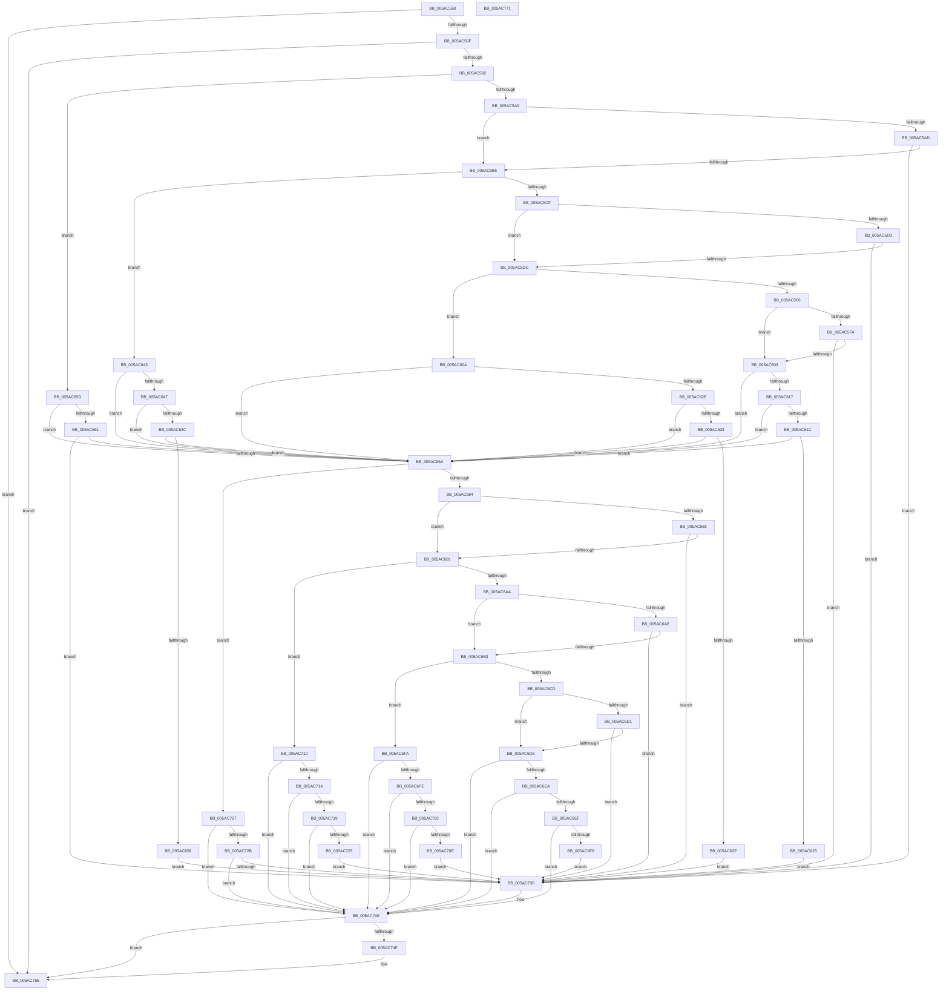

# _asan_load16_volatile

- RVA: `0x005AC550`–`0x005AC772` (길이 `546` bytes)
- VA: `0x00000001405AC550`
- 실행 섹션: `.text`
- PDB 이름 있음: `예`; PDB Function 태그: `아니요`
- unwind 정보 RVA: `0x0006E5F8`
- 디코드: `172`개 명령, `546/546` bytes 표시
- 미해석 바이트: `0` (있으면 어셈블리에 `.byte`로 보존)

> 이 문서는 커널 이미지의 기계어와 PDB 기호를 분석해 생성했습니다. 4번과 5번은 함수 원형과 자료형을 바이너리 사용 방식에서 추정한 C 해석이며 원본 소스 복구 결과는 아닙니다.

## 1. Dependencies

- 직접 호출 지점: **2**; 고유 호출 대상: **2**
- 직접 호출자로 확인된 함수: **0**
- RIP 상대 이미지 참조: **3**

### Outgoing calls
- `0x005AC741` → [KasaniReport](KasaniReport_function_005AB0B0.md) (function, `0x005AB0B0`)
- `0x005AC761` → [KcsanValidateAddress](KcsanValidateAddress_function_005AF5E0.md) (function, `0x005AF5E0`)

### Direct callers
- 이 함수 시작 RVA로 연결되는 직접 call은 확인되지 않았습니다. 간접 호출은 완전히 역산할 수 없습니다.

### Static image references
- `0x005AC55A` → RVA `0x00FCEC6A` (`ALMOSTRO`; read)
- `0x005AC582` → RVA `0x00FC6ED8` (`ALMOSTRO`; read)
- `0x005AC746` → RVA `0x00F8A7E8` (`.data`; read)

## 2. Other-region calls and transfers

- 다른 실행 섹션으로 향하는 call: **0**
- 별도 외부 분기/꼬리 이동을 확인하지 못했습니다.

## 3. Assembly (complete function range)

```asm
005AC550  48 89 5C 24 08                  mov qword ptr [rsp + 8], rbx
005AC555  57                              push rdi
005AC556  48 83 EC 30                     sub rsp, 0x30
005AC55A  80 3D 09 27 A2 00 00            cmp byte ptr [rip + 0xa22709], 0
005AC561  48 8B D9                        mov rbx, rcx
005AC564  48 8B 7C 24 38                  mov rdi, qword ptr [rsp + 0x38]
005AC569  0F 84 F7 01 00 00               je 0x1405ac766
005AC56F  48 B8 00 00 00 00 00 80 FF FF   movabs rax, 0xffff800000000000
005AC579  48 3B C8                        cmp rcx, rax
005AC57C  0F 82 E4 01 00 00               jb 0x1405ac766
005AC582  4C 8B 05 4F A9 A1 00            mov r8, qword ptr [rip + 0xa1a94f]
005AC589  49 B9 00 00 00 00 00 80 00 00   movabs r9, 0x800000000000
005AC593  4A 8D 04 09                     lea rax, [rcx + r9]
005AC597  48 C1 E8 03                     shr rax, 3
005AC59B  42 0F B6 0C 00                  movzx ecx, byte ptr [rax + r8]
005AC5A0  F6 C3 07                        test bl, 7
005AC5A3  0F 86 B4 00 00 00               jbe 0x1405ac65d
005AC5A9  84 C9                           test cl, cl
005AC5AB  74 09                           je 0x1405ac5b6
005AC5AD  80 F9 08                        cmp cl, 8
005AC5B0  0F 8C 7A 01 00 00               jl 0x1405ac730
005AC5B6  48 8D 53 04                     lea rdx, [rbx + 4]
005AC5BA  4A 8D 04 0A                     lea rax, [rdx + r9]
005AC5BE  48 C1 E8 03                     shr rax, 3
005AC5C2  42 0F B6 0C 00                  movzx ecx, byte ptr [rax + r8]
005AC5C7  8B C2                           mov eax, edx
005AC5C9  24 07                           and al, 7
005AC5CB  3C 04                           cmp al, 4
005AC5CD  76 74                           jbe 0x1405ac643
005AC5CF  84 C9                           test cl, cl
005AC5D1  74 09                           je 0x1405ac5dc
005AC5D3  80 F9 08                        cmp cl, 8
005AC5D6  0F 8C 54 01 00 00               jl 0x1405ac730
005AC5DC  48 83 C2 02                     add rdx, 2
005AC5E0  4A 8D 04 0A                     lea rax, [rdx + r9]
005AC5E4  48 C1 E8 03                     shr rax, 3
005AC5E8  42 0F B6 0C 00                  movzx ecx, byte ptr [rax + r8]
005AC5ED  8B C2                           mov eax, edx
005AC5EF  83 E0 07                        and eax, 7
005AC5F2  3C 06                           cmp al, 6
005AC5F4  76 34                           jbe 0x1405ac62a
005AC5F6  84 C9                           test cl, cl
005AC5F8  74 09                           je 0x1405ac603
005AC5FA  80 F9 08                        cmp cl, 8
005AC5FD  0F 8C 2D 01 00 00               jl 0x1405ac730
005AC603  48 FF C2                        inc rdx
005AC606  4A 8D 04 0A                     lea rax, [rdx + r9]
005AC60A  48 C1 E8 03                     shr rax, 3
005AC60E  42 0F B6 0C 00                  movzx ecx, byte ptr [rax + r8]
005AC613  84 C9                           test cl, cl
005AC615  74 53                           je 0x1405ac66a
005AC617  80 F9 08                        cmp cl, 8
005AC61A  7D 4E                           jge 0x1405ac66a
005AC61C  80 E2 07                        and dl, 7
005AC61F  FE C2                           inc dl
005AC621  3A D1                           cmp dl, cl
005AC623  7E 45                           jle 0x1405ac66a
005AC625  E9 06 01 00 00                  jmp 0x1405ac730
005AC62A  84 C9                           test cl, cl
005AC62C  74 3C                           je 0x1405ac66a
005AC62E  80 F9 08                        cmp cl, 8
005AC631  7D 37                           jge 0x1405ac66a
005AC633  FE C2                           inc dl
005AC635  80 E2 07                        and dl, 7
005AC638  FE C2                           inc dl
005AC63A  3A D1                           cmp dl, cl
005AC63C  7E 2C                           jle 0x1405ac66a
005AC63E  E9 ED 00 00 00                  jmp 0x1405ac730
005AC643  84 C9                           test cl, cl
005AC645  74 23                           je 0x1405ac66a
005AC647  80 F9 08                        cmp cl, 8
005AC64A  7D 1E                           jge 0x1405ac66a
005AC64C  80 C2 03                        add dl, 3
005AC64F  80 E2 07                        and dl, 7
005AC652  FE C2                           inc dl
005AC654  3A D1                           cmp dl, cl
005AC656  7E 12                           jle 0x1405ac66a
005AC658  E9 D3 00 00 00                  jmp 0x1405ac730
005AC65D  84 C9                           test cl, cl
005AC65F  74 09                           je 0x1405ac66a
005AC661  80 F9 08                        cmp cl, 8
005AC664  0F 8C C6 00 00 00               jl 0x1405ac730
005AC66A  48 8D 53 08                     lea rdx, [rbx + 8]
005AC66E  4A 8D 04 0A                     lea rax, [rdx + r9]
005AC672  48 C1 E8 03                     shr rax, 3
005AC676  42 0F B6 0C 00                  movzx ecx, byte ptr [rax + r8]
005AC67B  F6 C2 07                        test dl, 7
005AC67E  0F 86 A3 00 00 00               jbe 0x1405ac727
005AC684  84 C9                           test cl, cl
005AC686  74 09                           je 0x1405ac691
005AC688  80 F9 08                        cmp cl, 8
005AC68B  0F 8C 9F 00 00 00               jl 0x1405ac730
005AC691  48 83 C2 04                     add rdx, 4
005AC695  4A 8D 04 0A                     lea rax, [rdx + r9]
005AC699  48 C1 E8 03                     shr rax, 3
005AC69D  42 0F B6 0C 00                  movzx ecx, byte ptr [rax + r8]
005AC6A2  8B C2                           mov eax, edx
005AC6A4  24 07                           and al, 7
005AC6A6  3C 04                           cmp al, 4
005AC6A8  76 66                           jbe 0x1405ac710
005AC6AA  84 C9                           test cl, cl
005AC6AC  74 05                           je 0x1405ac6b3
005AC6AE  80 F9 08                        cmp cl, 8
005AC6B1  7C 7D                           jl 0x1405ac730
005AC6B3  48 83 C2 02                     add rdx, 2
005AC6B7  4A 8D 04 0A                     lea rax, [rdx + r9]
005AC6BB  48 C1 E8 03                     shr rax, 3
005AC6BF  42 0F B6 0C 00                  movzx ecx, byte ptr [rax + r8]
005AC6C4  8B C2                           mov eax, edx
005AC6C6  83 E0 07                        and eax, 7
005AC6C9  3C 06                           cmp al, 6
005AC6CB  76 2D                           jbe 0x1405ac6fa
005AC6CD  84 C9                           test cl, cl
005AC6CF  74 05                           je 0x1405ac6d6
005AC6D1  80 F9 08                        cmp cl, 8
005AC6D4  7C 5A                           jl 0x1405ac730
005AC6D6  48 FF C2                        inc rdx
005AC6D9  4A 8D 04 0A                     lea rax, [rdx + r9]
005AC6DD  48 C1 E8 03                     shr rax, 3
005AC6E1  42 0F B6 0C 00                  movzx ecx, byte ptr [rax + r8]
005AC6E6  84 C9                           test cl, cl
005AC6E8  74 5C                           je 0x1405ac746
005AC6EA  80 F9 08                        cmp cl, 8
005AC6ED  7D 57                           jge 0x1405ac746
005AC6EF  80 E2 07                        and dl, 7
005AC6F2  FE C2                           inc dl
005AC6F4  3A D1                           cmp dl, cl
005AC6F6  7E 4E                           jle 0x1405ac746
005AC6F8  EB 36                           jmp 0x1405ac730
005AC6FA  84 C9                           test cl, cl
005AC6FC  74 48                           je 0x1405ac746
005AC6FE  80 F9 08                        cmp cl, 8
005AC701  7D 43                           jge 0x1405ac746
005AC703  FE C2                           inc dl
005AC705  80 E2 07                        and dl, 7
005AC708  FE C2                           inc dl
005AC70A  3A D1                           cmp dl, cl
005AC70C  7E 38                           jle 0x1405ac746
005AC70E  EB 20                           jmp 0x1405ac730
005AC710  84 C9                           test cl, cl
005AC712  74 32                           je 0x1405ac746
005AC714  80 F9 08                        cmp cl, 8
005AC717  7D 2D                           jge 0x1405ac746
005AC719  80 C2 03                        add dl, 3
005AC71C  80 E2 07                        and dl, 7
005AC71F  FE C2                           inc dl
005AC721  3A D1                           cmp dl, cl
005AC723  7E 21                           jle 0x1405ac746
005AC725  EB 09                           jmp 0x1405ac730
005AC727  84 C9                           test cl, cl
005AC729  74 1B                           je 0x1405ac746
005AC72B  80 F9 08                        cmp cl, 8
005AC72E  7D 16                           jge 0x1405ac746
005AC730  45 33 C0                        xor r8d, r8d
005AC733  88 4C 24 20                     mov byte ptr [rsp + 0x20], cl
005AC737  4C 8B CF                        mov r9, rdi
005AC73A  48 8B CB                        mov rcx, rbx
005AC73D  41 8D 50 10                     lea edx, [r8 + 0x10]
005AC741  E8 6A E9 FF FF                  call 0x1405ab0b0
005AC746  80 3D 9B E0 9D 00 00            cmp byte ptr [rip + 0x9de09b], 0
005AC74D  74 17                           je 0x1405ac766
005AC74F  45 33 C0                        xor r8d, r8d
005AC752  48 89 7C 24 20                  mov qword ptr [rsp + 0x20], rdi
005AC757  41 B1 01                        mov r9b, 1
005AC75A  48 8B CB                        mov rcx, rbx
005AC75D  41 8D 50 10                     lea edx, [r8 + 0x10]
005AC761  E8 7A 2E 00 00                  call 0x1405af5e0
005AC766  48 8B 5C 24 40                  mov rbx, qword ptr [rsp + 0x40]
005AC76B  48 83 C4 30                     add rsp, 0x30
005AC76F  5F                              pop rdi
005AC770  C3                              ret
005AC771  CC                              int3
```

## 4. C-style interpretation (structured pseudocode)

```c
__int64 __fastcall _asan_load16_volatile(__int64 a1)
{
    __int64 result;
    __int64 v_rsp;
    unsigned __int8 v_stack_m18;
    unsigned __int64 v_stack_p0;
    unsigned __int64 v_stack_p8;

    v_stack_p8 = v_rbx;
    v_rsp = (v_rsp) - (48);
    if ((*(unsigned __int8 *)(v_rip + 10626825)) == 0) goto loc_005AC766;
    if (a1 < result) goto loc_005AC766;
    result = (a1 + a4 * 1) >> (3);
    if (condition_is_below_or_equal) goto loc_005AC65D;
    if ((unsigned __int8)(*(unsigned __int8 *)(result + *(unsigned __int64 *)(v_rip + 10594639) * 1)) == 0) goto loc_005AC5B6;
    if (((unsigned __int8)(*(unsigned __int8 *)(result + *(unsigned __int64 *)(v_rip + 10594639) * 1))) < 8) goto loc_005AC730;
loc_005AC5B6:
    result = (a1 + 4 + a4 * 1) >> (3);
    result = (unsigned __int8)(((unsigned int)((unsigned int)(a1 + 4))) & (7));
    if (((unsigned __int8)(result)) <= 4) goto loc_005AC643;
    if ((unsigned __int8)(*(unsigned __int8 *)(result + *(unsigned __int64 *)(v_rip + 10594639) * 1)) == 0) goto loc_005AC5DC;
    if (((unsigned __int8)(*(unsigned __int8 *)(result + *(unsigned __int64 *)(v_rip + 10594639) * 1))) < 8) goto loc_005AC730;
loc_005AC5DC:
    a2 = (a1 + 4) + (2);
    result = (a2 + a4 * 1) >> (3);
    result = (unsigned int)(((unsigned int)((unsigned int)(a2))) & (7));
    if (((unsigned __int8)(result)) <= 6) goto loc_005AC62A;
    if ((unsigned __int8)(*(unsigned __int8 *)(result + *(unsigned __int64 *)(v_rip + 10594639) * 1)) == 0) goto loc_005AC603;
    if (((unsigned __int8)(*(unsigned __int8 *)(result + *(unsigned __int64 *)(v_rip + 10594639) * 1))) < 8) goto loc_005AC730;
loc_005AC603:
    a2 = (a2) + 1;
    result = (a2 + a4 * 1) >> (3);
    if ((unsigned __int8)(*(unsigned __int8 *)(result + *(unsigned __int64 *)(v_rip + 10594639) * 1)) == 0) goto loc_005AC66A;
    if (((unsigned __int8)(*(unsigned __int8 *)(result + *(unsigned __int64 *)(v_rip + 10594639) * 1))) >= 8) goto loc_005AC66A;
    a2 = (unsigned __int8)((a2) & (7));
    a2 = (unsigned __int8)((a2) + 1);
    if (((unsigned __int8)(a2)) <= ((unsigned __int8)(*(unsigned __int8 *)(result + *(unsigned __int64 *)(v_rip + 10594639) * 1)))) goto loc_005AC66A;
    goto loc_005AC730;
loc_005AC62A:
    if ((unsigned __int8)(*(unsigned __int8 *)(result + *(unsigned __int64 *)(v_rip + 10594639) * 1)) == 0) goto loc_005AC66A;
    if (((unsigned __int8)(*(unsigned __int8 *)(result + *(unsigned __int64 *)(v_rip + 10594639) * 1))) >= 8) goto loc_005AC66A;
    a2 = (unsigned __int8)((a2) + 1);
    a2 = (unsigned __int8)((a2) & (7));
    a2 = (unsigned __int8)((a2) + 1);
    if (((unsigned __int8)(a2)) <= ((unsigned __int8)(*(unsigned __int8 *)(result + *(unsigned __int64 *)(v_rip + 10594639) * 1)))) goto loc_005AC66A;
    goto loc_005AC730;
loc_005AC643:
    if ((unsigned __int8)(*(unsigned __int8 *)(result + *(unsigned __int64 *)(v_rip + 10594639) * 1)) == 0) goto loc_005AC66A;
    if (((unsigned __int8)(*(unsigned __int8 *)(result + *(unsigned __int64 *)(v_rip + 10594639) * 1))) >= 8) goto loc_005AC66A;
    a2 = (unsigned __int8)((a2) + (3));
    a2 = (unsigned __int8)((a2) & (7));
    a2 = (unsigned __int8)((a2) + 1);
    if (((unsigned __int8)(a2)) <= ((unsigned __int8)(*(unsigned __int8 *)(result + *(unsigned __int64 *)(v_rip + 10594639) * 1)))) goto loc_005AC66A;
    goto loc_005AC730;
loc_005AC65D:
    if ((unsigned __int8)(*(unsigned __int8 *)(result + *(unsigned __int64 *)(v_rip + 10594639) * 1)) == 0) goto loc_005AC66A;
    if (((unsigned __int8)(*(unsigned __int8 *)(result + *(unsigned __int64 *)(v_rip + 10594639) * 1))) < 8) goto loc_005AC730;
loc_005AC66A:
    result = (a1 + 8 + a4 * 1) >> (3);
    if (condition_is_below_or_equal) goto loc_005AC727;
    if ((unsigned __int8)(*(unsigned __int8 *)(result + *(unsigned __int64 *)(v_rip + 10594639) * 1)) == 0) goto loc_005AC691;
    if (((unsigned __int8)(*(unsigned __int8 *)(result + *(unsigned __int64 *)(v_rip + 10594639) * 1))) < 8) goto loc_005AC730;
loc_005AC691:
    a2 = (a1 + 8) + (4);
    result = (a2 + a4 * 1) >> (3);
    result = (unsigned __int8)(((unsigned int)((unsigned int)(a2))) & (7));
    if (((unsigned __int8)(result)) <= 4) goto loc_005AC710;
    if ((unsigned __int8)(*(unsigned __int8 *)(result + *(unsigned __int64 *)(v_rip + 10594639) * 1)) == 0) goto loc_005AC6B3;
    if (((unsigned __int8)(*(unsigned __int8 *)(result + *(unsigned __int64 *)(v_rip + 10594639) * 1))) < 8) goto loc_005AC730;
loc_005AC6B3:
    a2 = (a2) + (2);
    result = (a2 + a4 * 1) >> (3);
    result = (unsigned int)(((unsigned int)((unsigned int)(a2))) & (7));
    if (((unsigned __int8)(result)) <= 6) goto loc_005AC6FA;
    if ((unsigned __int8)(*(unsigned __int8 *)(result + *(unsigned __int64 *)(v_rip + 10594639) * 1)) == 0) goto loc_005AC6D6;
    if (((unsigned __int8)(*(unsigned __int8 *)(result + *(unsigned __int64 *)(v_rip + 10594639) * 1))) < 8) goto loc_005AC730;
loc_005AC6D6:
    a2 = (a2) + 1;
    result = (a2 + a4 * 1) >> (3);
    if ((unsigned __int8)(*(unsigned __int8 *)(result + *(unsigned __int64 *)(v_rip + 10594639) * 1)) == 0) goto loc_005AC746;
    if (((unsigned __int8)(*(unsigned __int8 *)(result + *(unsigned __int64 *)(v_rip + 10594639) * 1))) >= 8) goto loc_005AC746;
    a2 = (unsigned __int8)((a2) & (7));
    a2 = (unsigned __int8)((a2) + 1);
    if (((unsigned __int8)(a2)) <= ((unsigned __int8)(*(unsigned __int8 *)(result + *(unsigned __int64 *)(v_rip + 10594639) * 1)))) goto loc_005AC746;
    goto loc_005AC730;
loc_005AC6FA:
    if ((unsigned __int8)(*(unsigned __int8 *)(result + *(unsigned __int64 *)(v_rip + 10594639) * 1)) == 0) goto loc_005AC746;
    if (((unsigned __int8)(*(unsigned __int8 *)(result + *(unsigned __int64 *)(v_rip + 10594639) * 1))) >= 8) goto loc_005AC746;
    a2 = (unsigned __int8)((a2) + 1);
    a2 = (unsigned __int8)((a2) & (7));
    a2 = (unsigned __int8)((a2) + 1);
    if (((unsigned __int8)(a2)) <= ((unsigned __int8)(*(unsigned __int8 *)(result + *(unsigned __int64 *)(v_rip + 10594639) * 1)))) goto loc_005AC746;
    goto loc_005AC730;
loc_005AC710:
    if ((unsigned __int8)(*(unsigned __int8 *)(result + *(unsigned __int64 *)(v_rip + 10594639) * 1)) == 0) goto loc_005AC746;
    if (((unsigned __int8)(*(unsigned __int8 *)(result + *(unsigned __int64 *)(v_rip + 10594639) * 1))) >= 8) goto loc_005AC746;
    a2 = (unsigned __int8)((a2) + (3));
    a2 = (unsigned __int8)((a2) & (7));
    a2 = (unsigned __int8)((a2) + 1);
    if (((unsigned __int8)(a2)) <= ((unsigned __int8)(*(unsigned __int8 *)(result + *(unsigned __int64 *)(v_rip + 10594639) * 1)))) goto loc_005AC746;
    goto loc_005AC730;
loc_005AC727:
    if ((unsigned __int8)(*(unsigned __int8 *)(result + *(unsigned __int64 *)(v_rip + 10594639) * 1)) == 0) goto loc_005AC746;
    if (((unsigned __int8)(*(unsigned __int8 *)(result + *(unsigned __int64 *)(v_rip + 10594639) * 1))) < 8) {
        a3 = 0;
        v_stack_m18 = (unsigned __int8)(*(unsigned __int8 *)(result + *(unsigned __int64 *)(v_rip + 10594639) * 1));
        a4 = v_stack_p0;
        a1 = a1;
        a2 = a3 + 16;
        result = KasaniReport(a1, a2, a3, a4);
    }
    if ((*(unsigned __int8 *)(v_rip + 10346651)) != 0) {
        a3 = 0;
        v_stack_m18 = v_stack_p0;
        a4 = 1;
        a1 = a1;
        a2 = a3 + 16;
        result = KcsanValidateAddress(a1, a2, a3, a4);
    }
    v_rsp = (v_rsp) + (48);
    return result;
}
```

## 5. (Beta) C Style

```c
int64_t _asan_load16_volatile(int64_t Arg1)
{
    int64_t result;
    int64_t local_rsp;
    uint8_t v_stack_m18;
    uint64_t v_stack_p0;
    uint64_t v_stack_p8;

    v_stack_p8 = local_rbx;
    local_rsp = (local_rsp) - (48);
    if ((*(uint8_t *)(v_rip + 0xA22709)) == 0) goto loc_005AC766;
    if (Arg1 < result) goto loc_005AC766;
    result = (Arg1 + a4 * 1) >> (3);
    if (condition_is_below_or_equal) goto loc_005AC65D;
    if ((uint8_t)(*(uint8_t *)(result + *(uint64_t *)(v_rip + 0xA1A94F) * 1)) == 0) goto loc_005AC5B6;
    if (((uint8_t)(*(uint8_t *)(result + *(uint64_t *)(v_rip + 0xA1A94F) * 1))) < 8) goto loc_005AC730;
loc_005AC5B6:
    result = (Arg1 + 4 + a4 * 1) >> (3);
    result = (uint8_t)(((uint32_t)((uint32_t)(Arg1 + 4))) & (7));
    if (((uint8_t)(result)) <= 4) goto loc_005AC643;
    if ((uint8_t)(*(uint8_t *)(result + *(uint64_t *)(v_rip + 0xA1A94F) * 1)) == 0) goto loc_005AC5DC;
    if (((uint8_t)(*(uint8_t *)(result + *(uint64_t *)(v_rip + 0xA1A94F) * 1))) < 8) goto loc_005AC730;
loc_005AC5DC:
    a2 = (Arg1 + 4) + (2);
    result = (a2 + a4 * 1) >> (3);
    result = (uint32_t)(((uint32_t)((uint32_t)(a2))) & (7));
    if (((uint8_t)(result)) <= 6) goto loc_005AC62A;
    if ((uint8_t)(*(uint8_t *)(result + *(uint64_t *)(v_rip + 0xA1A94F) * 1)) == 0) goto loc_005AC603;
    if (((uint8_t)(*(uint8_t *)(result + *(uint64_t *)(v_rip + 0xA1A94F) * 1))) < 8) goto loc_005AC730;
loc_005AC603:
    a2 = (a2) + 1;
    result = (a2 + a4 * 1) >> (3);
    if ((uint8_t)(*(uint8_t *)(result + *(uint64_t *)(v_rip + 0xA1A94F) * 1)) == 0) goto loc_005AC66A;
    if (((uint8_t)(*(uint8_t *)(result + *(uint64_t *)(v_rip + 0xA1A94F) * 1))) >= 8) goto loc_005AC66A;
    a2 = (uint8_t)((a2) & (7));
    a2 = (uint8_t)((a2) + 1);
    if (((uint8_t)(a2)) <= ((uint8_t)(*(uint8_t *)(result + *(uint64_t *)(v_rip + 0xA1A94F) * 1)))) goto loc_005AC66A;
    goto loc_005AC730;
loc_005AC62A:
    if ((uint8_t)(*(uint8_t *)(result + *(uint64_t *)(v_rip + 0xA1A94F) * 1)) == 0) goto loc_005AC66A;
    if (((uint8_t)(*(uint8_t *)(result + *(uint64_t *)(v_rip + 0xA1A94F) * 1))) >= 8) goto loc_005AC66A;
    a2 = (uint8_t)((a2) + 1);
    a2 = (uint8_t)((a2) & (7));
    a2 = (uint8_t)((a2) + 1);
    if (((uint8_t)(a2)) <= ((uint8_t)(*(uint8_t *)(result + *(uint64_t *)(v_rip + 0xA1A94F) * 1)))) goto loc_005AC66A;
    goto loc_005AC730;
loc_005AC643:
    if ((uint8_t)(*(uint8_t *)(result + *(uint64_t *)(v_rip + 0xA1A94F) * 1)) == 0) goto loc_005AC66A;
    if (((uint8_t)(*(uint8_t *)(result + *(uint64_t *)(v_rip + 0xA1A94F) * 1))) >= 8) goto loc_005AC66A;
    a2 = (uint8_t)((a2) + (3));
    a2 = (uint8_t)((a2) & (7));
    a2 = (uint8_t)((a2) + 1);
    if (((uint8_t)(a2)) <= ((uint8_t)(*(uint8_t *)(result + *(uint64_t *)(v_rip + 0xA1A94F) * 1)))) goto loc_005AC66A;
    goto loc_005AC730;
loc_005AC65D:
    if ((uint8_t)(*(uint8_t *)(result + *(uint64_t *)(v_rip + 0xA1A94F) * 1)) == 0) goto loc_005AC66A;
    if (((uint8_t)(*(uint8_t *)(result + *(uint64_t *)(v_rip + 0xA1A94F) * 1))) < 8) goto loc_005AC730;
loc_005AC66A:
    result = (Arg1 + 8 + a4 * 1) >> (3);
    if (condition_is_below_or_equal) goto loc_005AC727;
    if ((uint8_t)(*(uint8_t *)(result + *(uint64_t *)(v_rip + 0xA1A94F) * 1)) == 0) goto loc_005AC691;
    if (((uint8_t)(*(uint8_t *)(result + *(uint64_t *)(v_rip + 0xA1A94F) * 1))) < 8) goto loc_005AC730;
loc_005AC691:
    a2 = (Arg1 + 8) + (4);
    result = (a2 + a4 * 1) >> (3);
    result = (uint8_t)(((uint32_t)((uint32_t)(a2))) & (7));
    if (((uint8_t)(result)) <= 4) goto loc_005AC710;
    if ((uint8_t)(*(uint8_t *)(result + *(uint64_t *)(v_rip + 0xA1A94F) * 1)) == 0) goto loc_005AC6B3;
    if (((uint8_t)(*(uint8_t *)(result + *(uint64_t *)(v_rip + 0xA1A94F) * 1))) < 8) goto loc_005AC730;
loc_005AC6B3:
    a2 = (a2) + (2);
    result = (a2 + a4 * 1) >> (3);
    result = (uint32_t)(((uint32_t)((uint32_t)(a2))) & (7));
    if (((uint8_t)(result)) <= 6) goto loc_005AC6FA;
    if ((uint8_t)(*(uint8_t *)(result + *(uint64_t *)(v_rip + 0xA1A94F) * 1)) == 0) goto loc_005AC6D6;
    if (((uint8_t)(*(uint8_t *)(result + *(uint64_t *)(v_rip + 0xA1A94F) * 1))) < 8) goto loc_005AC730;
loc_005AC6D6:
    a2 = (a2) + 1;
    result = (a2 + a4 * 1) >> (3);
    if ((uint8_t)(*(uint8_t *)(result + *(uint64_t *)(v_rip + 0xA1A94F) * 1)) == 0) goto loc_005AC746;
    if (((uint8_t)(*(uint8_t *)(result + *(uint64_t *)(v_rip + 0xA1A94F) * 1))) >= 8) goto loc_005AC746;
    a2 = (uint8_t)((a2) & (7));
    a2 = (uint8_t)((a2) + 1);
    if (((uint8_t)(a2)) <= ((uint8_t)(*(uint8_t *)(result + *(uint64_t *)(v_rip + 0xA1A94F) * 1)))) goto loc_005AC746;
    goto loc_005AC730;
loc_005AC6FA:
    if ((uint8_t)(*(uint8_t *)(result + *(uint64_t *)(v_rip + 0xA1A94F) * 1)) == 0) goto loc_005AC746;
    if (((uint8_t)(*(uint8_t *)(result + *(uint64_t *)(v_rip + 0xA1A94F) * 1))) >= 8) goto loc_005AC746;
    a2 = (uint8_t)((a2) + 1);
    a2 = (uint8_t)((a2) & (7));
    a2 = (uint8_t)((a2) + 1);
    if (((uint8_t)(a2)) <= ((uint8_t)(*(uint8_t *)(result + *(uint64_t *)(v_rip + 0xA1A94F) * 1)))) goto loc_005AC746;
    goto loc_005AC730;
loc_005AC710:
    if ((uint8_t)(*(uint8_t *)(result + *(uint64_t *)(v_rip + 0xA1A94F) * 1)) == 0) goto loc_005AC746;
    if (((uint8_t)(*(uint8_t *)(result + *(uint64_t *)(v_rip + 0xA1A94F) * 1))) >= 8) goto loc_005AC746;
    a2 = (uint8_t)((a2) + (3));
    a2 = (uint8_t)((a2) & (7));
    a2 = (uint8_t)((a2) + 1);
    if (((uint8_t)(a2)) <= ((uint8_t)(*(uint8_t *)(result + *(uint64_t *)(v_rip + 0xA1A94F) * 1)))) goto loc_005AC746;
    goto loc_005AC730;
loc_005AC727:
    if ((uint8_t)(*(uint8_t *)(result + *(uint64_t *)(v_rip + 0xA1A94F) * 1)) == 0) goto loc_005AC746;
    if (((uint8_t)(*(uint8_t *)(result + *(uint64_t *)(v_rip + 0xA1A94F) * 1))) < 8) {
        a3 = 0;
        v_stack_m18 = (uint8_t)(*(uint8_t *)(result + *(uint64_t *)(v_rip + 0xA1A94F) * 1));
        a4 = v_stack_p0;
        Arg1 = Arg1;
        a2 = a3 + 16;
        result = KasaniReport(Arg1, a2, a3, a4);
    }
    if ((*(uint8_t *)(v_rip + 0x9DE09B)) != 0) {
        a3 = 0;
        v_stack_m18 = v_stack_p0;
        a4 = 1;
        Arg1 = Arg1;
        a2 = a3 + 16;
        result = KcsanValidateAddress(Arg1, a2, a3, a4);
    }
    local_rsp = (local_rsp) + (48);
    return result;
}
```

## 6. Execution-region graph

[열기: 2D/3D 그래프와 함수 탐색 컨트롤 패널](../../../control-panel.html?section=text&rva=0x005AC550&view=graph)

- 2D 그래프는 위에서 아래로 흐르고, 3D 그래프는 빈 공간을 드래그해 회전합니다. Shift+드래그는 이동, 휠은 확대·축소, 함수 노드 선택은 대상 보고서 이동입니다.

### Static fallback


