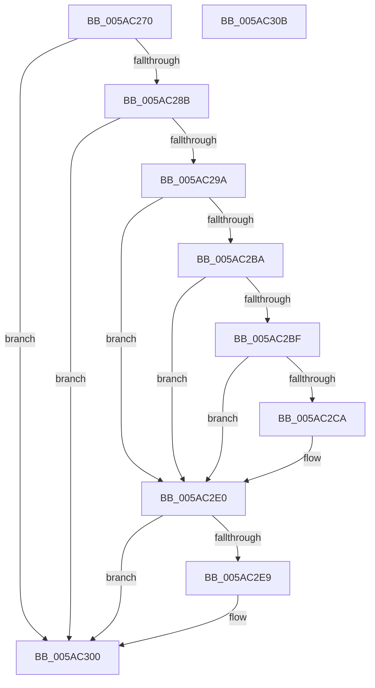

# _asan_load1

- RVA: `0x005AC270`–`0x005AC30C` (길이 `156` bytes)
- VA: `0x00000001405AC270`
- 실행 섹션: `.text`
- PDB 이름 있음: `예`; PDB Function 태그: `아니요`
- unwind 정보 RVA: `0x0006E5F8`
- 디코드: `43`개 명령, `156/156` bytes 표시
- 미해석 바이트: `0` (있으면 어셈블리에 `.byte`로 보존)

> 이 문서는 커널 이미지의 기계어와 PDB 기호를 분석해 생성했습니다. 4번과 5번은 함수 원형과 자료형을 바이너리 사용 방식에서 추정한 C 해석이며 원본 소스 복구 결과는 아닙니다.

## 1. Dependencies

- 직접 호출 지점: **2**; 고유 호출 대상: **2**
- 직접 호출자로 확인된 함수: **0**
- RIP 상대 이미지 참조: **3**

### Outgoing calls
- `0x005AC2DB` → [KasaniReport](KasaniReport_function_005AB0B0.md) (function, `0x005AB0B0`)
- `0x005AC2FB` → [KcsanValidateAddress](KcsanValidateAddress_function_005AF5E0.md) (function, `0x005AF5E0`)

### Direct callers
- 이 함수 시작 RVA로 연결되는 직접 call은 확인되지 않았습니다. 간접 호출은 완전히 역산할 수 없습니다.

### Static image references
- `0x005AC27A` → RVA `0x00FCEC6A` (`ALMOSTRO`; read)
- `0x005AC29A` → RVA `0x00FC6ED8` (`ALMOSTRO`; read)
- `0x005AC2E0` → RVA `0x00F8A7E8` (`.data`; read)

## 2. Other-region calls and transfers

- 다른 실행 섹션으로 향하는 call: **0**
- 별도 외부 분기/꼬리 이동을 확인하지 못했습니다.

## 3. Assembly (complete function range)

```asm
005AC270  48 89 5C 24 08                  mov qword ptr [rsp + 8], rbx
005AC275  57                              push rdi
005AC276  48 83 EC 30                     sub rsp, 0x30
005AC27A  80 3D E9 29 A2 00 00            cmp byte ptr [rip + 0xa229e9], 0
005AC281  48 8B D9                        mov rbx, rcx
005AC284  48 8B 7C 24 38                  mov rdi, qword ptr [rsp + 0x38]
005AC289  74 75                           je 0x1405ac300
005AC28B  48 B8 00 00 00 00 00 80 FF FF   movabs rax, 0xffff800000000000
005AC295  48 3B C8                        cmp rcx, rax
005AC298  72 66                           jb 0x1405ac300
005AC29A  48 8B 05 37 AC A1 00            mov rax, qword ptr [rip + 0xa1ac37]
005AC2A1  48 BA 00 00 00 00 00 80 00 00   movabs rdx, 0x800000000000
005AC2AB  48 03 D1                        add rdx, rcx
005AC2AE  48 C1 EA 03                     shr rdx, 3
005AC2B2  0F B6 0C 02                     movzx ecx, byte ptr [rdx + rax]
005AC2B6  84 C9                           test cl, cl
005AC2B8  74 26                           je 0x1405ac2e0
005AC2BA  80 F9 08                        cmp cl, 8
005AC2BD  7D 21                           jge 0x1405ac2e0
005AC2BF  0F B6 C3                        movzx eax, bl
005AC2C2  24 07                           and al, 7
005AC2C4  FE C0                           inc al
005AC2C6  3A C1                           cmp al, cl
005AC2C8  7E 16                           jle 0x1405ac2e0
005AC2CA  45 33 C0                        xor r8d, r8d
005AC2CD  88 4C 24 20                     mov byte ptr [rsp + 0x20], cl
005AC2D1  4C 8B CF                        mov r9, rdi
005AC2D4  48 8B CB                        mov rcx, rbx
005AC2D7  41 8D 50 01                     lea edx, [r8 + 1]
005AC2DB  E8 D0 ED FF FF                  call 0x1405ab0b0
005AC2E0  80 3D 01 E5 9D 00 00            cmp byte ptr [rip + 0x9de501], 0
005AC2E7  74 17                           je 0x1405ac300
005AC2E9  45 33 C9                        xor r9d, r9d
005AC2EC  48 89 7C 24 20                  mov qword ptr [rsp + 0x20], rdi
005AC2F1  45 33 C0                        xor r8d, r8d
005AC2F4  48 8B CB                        mov rcx, rbx
005AC2F7  41 8D 51 01                     lea edx, [r9 + 1]
005AC2FB  E8 E0 32 00 00                  call 0x1405af5e0
005AC300  48 8B 5C 24 40                  mov rbx, qword ptr [rsp + 0x40]
005AC305  48 83 C4 30                     add rsp, 0x30
005AC309  5F                              pop rdi
005AC30A  C3                              ret
005AC30B  CC                              int3
```

## 4. C-style interpretation (structured pseudocode)

```c
__int64 __fastcall _asan_load1(__int64 a1, __int64 a2, int a3)
{
    __int64 result;
    __int64 v_rsp;
    unsigned __int8 v_stack_m18;
    unsigned __int64 v_stack_p0;
    unsigned __int64 v_stack_p8;

    v_stack_p8 = v_rbx;
    v_rsp = (v_rsp) - (48);
    if ((*(unsigned __int8 *)(v_rip + 10627561)) == 0) goto loc_005AC300;
    if (a1 < result) goto loc_005AC300;
    a2 = (a2) + (a1);
    a2 = (a2) >> (3);
    if ((unsigned __int8)(*(unsigned __int8 *)(a2 + *(unsigned __int64 *)(v_rip + 10595383) * 1)) == 0) goto loc_005AC2E0;
    if (((unsigned __int8)(*(unsigned __int8 *)(a2 + *(unsigned __int64 *)(v_rip + 10595383) * 1))) >= 8) goto loc_005AC2E0;
    result = (unsigned __int8)(((unsigned __int8)(a1)) & (7));
    result = (unsigned __int8)((result) + 1);
    if (((unsigned __int8)(result)) >= = ((unsigned __int8)(*(unsigned __int8 *)(a2 + *(unsigned __int64 *)(v_rip + 10595383) * 1)))) {
        a3 = 0;
        v_stack_m18 = (unsigned __int8)(*(unsigned __int8 *)(a2 + *(unsigned __int64 *)(v_rip + 10595383) * 1));
        a4 = v_stack_p0;
        a1 = a1;
        a2 = a3 + 1;
        result = KasaniReport(a1, a2, a3, a4);
    }
    if ((*(unsigned __int8 *)(v_rip + 10347777)) != 0) {
        a4 = 0;
        v_stack_m18 = v_stack_p0;
        a3 = 0;
        a1 = a1;
        a2 = a4 + 1;
        result = KcsanValidateAddress(a1, a2, a3, a4);
    }
    v_rsp = (v_rsp) + (48);
    return result;
}
```

## 5. (Beta) C Style

```c
int64_t _asan_load1(int64_t Arg1, int64_t Arg2, int32_t Arg3)
{
    int64_t result;
    int64_t local_rsp;
    uint8_t v_stack_m18;
    uint64_t v_stack_p0;
    uint64_t v_stack_p8;

    v_stack_p8 = local_rbx;
    local_rsp = (local_rsp) - (48);
    if ((*(uint8_t *)(v_rip + 0xA229E9)) == 0) goto loc_005AC300;
    if (Arg1 < result) goto loc_005AC300;
    Arg2 = (Arg2) + (Arg1);
    Arg2 = (Arg2) >> (3);
    if ((uint8_t)(*(uint8_t *)(Arg2 + *(uint64_t *)(v_rip + 0xA1AC37) * 1)) == 0) goto loc_005AC2E0;
    if (((uint8_t)(*(uint8_t *)(Arg2 + *(uint64_t *)(v_rip + 0xA1AC37) * 1))) >= 8) goto loc_005AC2E0;
    result = (uint8_t)(((uint8_t)(Arg1)) & (7));
    result = (uint8_t)((result) + 1);
    if (((uint8_t)(result)) >= = ((uint8_t)(*(uint8_t *)(Arg2 + *(uint64_t *)(v_rip + 0xA1AC37) * 1)))) {
        Arg3 = 0;
        v_stack_m18 = (uint8_t)(*(uint8_t *)(Arg2 + *(uint64_t *)(v_rip + 0xA1AC37) * 1));
        a4 = v_stack_p0;
        Arg1 = Arg1;
        Arg2 = Arg3 + 1;
        result = KasaniReport(Arg1, Arg2, Arg3, a4);
    }
    if ((*(uint8_t *)(v_rip + 0x9DE501)) != 0) {
        a4 = 0;
        v_stack_m18 = v_stack_p0;
        Arg3 = 0;
        Arg1 = Arg1;
        Arg2 = a4 + 1;
        result = KcsanValidateAddress(Arg1, Arg2, Arg3, a4);
    }
    local_rsp = (local_rsp) + (48);
    return result;
}
```

## 6. Execution-region graph

[열기: 2D/3D 그래프와 함수 탐색 컨트롤 패널](../../../control-panel.html?section=text&rva=0x005AC270&view=graph)

- 2D 그래프는 위에서 아래로 흐르고, 3D 그래프는 빈 공간을 드래그해 회전합니다. Shift+드래그는 이동, 휠은 확대·축소, 함수 노드 선택은 대상 보고서 이동입니다.

### Static fallback


