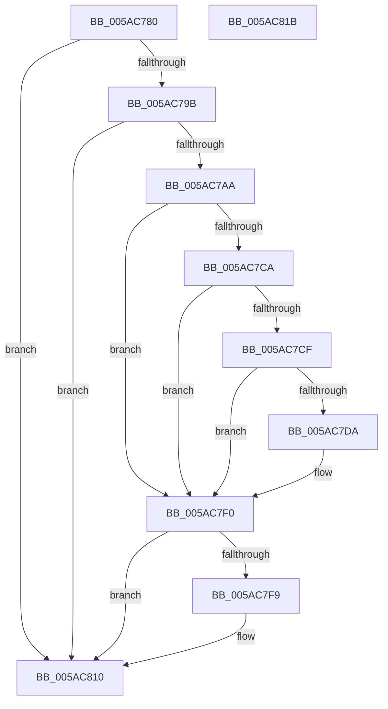

# _asan_load1_volatile

- RVA: `0x005AC780`–`0x005AC81C` (길이 `156` bytes)
- VA: `0x00000001405AC780`
- 실행 섹션: `.text`
- PDB 이름 있음: `예`; PDB Function 태그: `아니요`
- unwind 정보 RVA: `0x0006E5F8`
- 디코드: `43`개 명령, `156/156` bytes 표시
- 미해석 바이트: `0` (있으면 어셈블리에 `.byte`로 보존)

> 이 문서는 커널 이미지의 기계어와 PDB 기호를 분석해 생성했습니다. 4번과 5번은 함수 원형과 자료형을 바이너리 사용 방식에서 추정한 C 해석이며 원본 소스 복구 결과는 아닙니다.

## 1. Dependencies

- 직접 호출 지점: **2**; 고유 호출 대상: **2**
- 직접 호출자로 확인된 함수: **0**
- RIP 상대 이미지 참조: **3**

### Outgoing calls
- `0x005AC7EB` → [KasaniReport](KasaniReport_function_005AB0B0.md) (function, `0x005AB0B0`)
- `0x005AC80B` → [KcsanValidateAddress](KcsanValidateAddress_function_005AF5E0.md) (function, `0x005AF5E0`)

### Direct callers
- 이 함수 시작 RVA로 연결되는 직접 call은 확인되지 않았습니다. 간접 호출은 완전히 역산할 수 없습니다.

### Static image references
- `0x005AC78A` → RVA `0x00FCEC6A` (`ALMOSTRO`; read)
- `0x005AC7AA` → RVA `0x00FC6ED8` (`ALMOSTRO`; read)
- `0x005AC7F0` → RVA `0x00F8A7E8` (`.data`; read)

## 2. Other-region calls and transfers

- 다른 실행 섹션으로 향하는 call: **0**
- 별도 외부 분기/꼬리 이동을 확인하지 못했습니다.

## 3. Assembly (complete function range)

```asm
005AC780  48 89 5C 24 08                  mov qword ptr [rsp + 8], rbx
005AC785  57                              push rdi
005AC786  48 83 EC 30                     sub rsp, 0x30
005AC78A  80 3D D9 24 A2 00 00            cmp byte ptr [rip + 0xa224d9], 0
005AC791  48 8B D9                        mov rbx, rcx
005AC794  48 8B 7C 24 38                  mov rdi, qword ptr [rsp + 0x38]
005AC799  74 75                           je 0x1405ac810
005AC79B  48 B8 00 00 00 00 00 80 FF FF   movabs rax, 0xffff800000000000
005AC7A5  48 3B C8                        cmp rcx, rax
005AC7A8  72 66                           jb 0x1405ac810
005AC7AA  48 8B 05 27 A7 A1 00            mov rax, qword ptr [rip + 0xa1a727]
005AC7B1  48 BA 00 00 00 00 00 80 00 00   movabs rdx, 0x800000000000
005AC7BB  48 03 D1                        add rdx, rcx
005AC7BE  48 C1 EA 03                     shr rdx, 3
005AC7C2  0F B6 0C 02                     movzx ecx, byte ptr [rdx + rax]
005AC7C6  84 C9                           test cl, cl
005AC7C8  74 26                           je 0x1405ac7f0
005AC7CA  80 F9 08                        cmp cl, 8
005AC7CD  7D 21                           jge 0x1405ac7f0
005AC7CF  0F B6 C3                        movzx eax, bl
005AC7D2  24 07                           and al, 7
005AC7D4  FE C0                           inc al
005AC7D6  3A C1                           cmp al, cl
005AC7D8  7E 16                           jle 0x1405ac7f0
005AC7DA  45 33 C0                        xor r8d, r8d
005AC7DD  88 4C 24 20                     mov byte ptr [rsp + 0x20], cl
005AC7E1  4C 8B CF                        mov r9, rdi
005AC7E4  48 8B CB                        mov rcx, rbx
005AC7E7  41 8D 50 01                     lea edx, [r8 + 1]
005AC7EB  E8 C0 E8 FF FF                  call 0x1405ab0b0
005AC7F0  80 3D F1 DF 9D 00 00            cmp byte ptr [rip + 0x9ddff1], 0
005AC7F7  74 17                           je 0x1405ac810
005AC7F9  45 33 C0                        xor r8d, r8d
005AC7FC  48 89 7C 24 20                  mov qword ptr [rsp + 0x20], rdi
005AC801  41 B1 01                        mov r9b, 1
005AC804  48 8B CB                        mov rcx, rbx
005AC807  41 8D 50 01                     lea edx, [r8 + 1]
005AC80B  E8 D0 2D 00 00                  call 0x1405af5e0
005AC810  48 8B 5C 24 40                  mov rbx, qword ptr [rsp + 0x40]
005AC815  48 83 C4 30                     add rsp, 0x30
005AC819  5F                              pop rdi
005AC81A  C3                              ret
005AC81B  CC                              int3
```

## 4. C-style interpretation (structured pseudocode)

```c
__int64 __fastcall _asan_load1_volatile(__int64 a1, __int64 a2, int a3)
{
    __int64 result;
    __int64 v_rsp;
    unsigned __int8 v_stack_m18;
    unsigned __int64 v_stack_p0;
    unsigned __int64 v_stack_p8;

    v_stack_p8 = v_rbx;
    v_rsp = (v_rsp) - (48);
    if ((*(unsigned __int8 *)(v_rip + 10626265)) == 0) goto loc_005AC810;
    if (a1 < result) goto loc_005AC810;
    a2 = (a2) + (a1);
    a2 = (a2) >> (3);
    if ((unsigned __int8)(*(unsigned __int8 *)(a2 + *(unsigned __int64 *)(v_rip + 10594087) * 1)) == 0) goto loc_005AC7F0;
    if (((unsigned __int8)(*(unsigned __int8 *)(a2 + *(unsigned __int64 *)(v_rip + 10594087) * 1))) >= 8) goto loc_005AC7F0;
    result = (unsigned __int8)(((unsigned __int8)(a1)) & (7));
    result = (unsigned __int8)((result) + 1);
    if (((unsigned __int8)(result)) >= = ((unsigned __int8)(*(unsigned __int8 *)(a2 + *(unsigned __int64 *)(v_rip + 10594087) * 1)))) {
        a3 = 0;
        v_stack_m18 = (unsigned __int8)(*(unsigned __int8 *)(a2 + *(unsigned __int64 *)(v_rip + 10594087) * 1));
        a4 = v_stack_p0;
        a1 = a1;
        a2 = a3 + 1;
        result = KasaniReport(a1, a2, a3, a4);
    }
    if ((*(unsigned __int8 *)(v_rip + 10346481)) != 0) {
        a3 = 0;
        v_stack_m18 = v_stack_p0;
        a4 = 1;
        a1 = a1;
        a2 = a3 + 1;
        result = KcsanValidateAddress(a1, a2, a3, a4);
    }
    v_rsp = (v_rsp) + (48);
    return result;
}
```

## 5. (Beta) C Style

```c
int64_t _asan_load1_volatile(int64_t Arg1, int64_t Arg2, int32_t Arg3)
{
    int64_t result;
    int64_t local_rsp;
    uint8_t v_stack_m18;
    uint64_t v_stack_p0;
    uint64_t v_stack_p8;

    v_stack_p8 = local_rbx;
    local_rsp = (local_rsp) - (48);
    if ((*(uint8_t *)(v_rip + 0xA224D9)) == 0) goto loc_005AC810;
    if (Arg1 < result) goto loc_005AC810;
    Arg2 = (Arg2) + (Arg1);
    Arg2 = (Arg2) >> (3);
    if ((uint8_t)(*(uint8_t *)(Arg2 + *(uint64_t *)(v_rip + 0xA1A727) * 1)) == 0) goto loc_005AC7F0;
    if (((uint8_t)(*(uint8_t *)(Arg2 + *(uint64_t *)(v_rip + 0xA1A727) * 1))) >= 8) goto loc_005AC7F0;
    result = (uint8_t)(((uint8_t)(Arg1)) & (7));
    result = (uint8_t)((result) + 1);
    if (((uint8_t)(result)) >= = ((uint8_t)(*(uint8_t *)(Arg2 + *(uint64_t *)(v_rip + 0xA1A727) * 1)))) {
        Arg3 = 0;
        v_stack_m18 = (uint8_t)(*(uint8_t *)(Arg2 + *(uint64_t *)(v_rip + 0xA1A727) * 1));
        a4 = v_stack_p0;
        Arg1 = Arg1;
        Arg2 = Arg3 + 1;
        result = KasaniReport(Arg1, Arg2, Arg3, a4);
    }
    if ((*(uint8_t *)(v_rip + 0x9DDFF1)) != 0) {
        Arg3 = 0;
        v_stack_m18 = v_stack_p0;
        a4 = 1;
        Arg1 = Arg1;
        Arg2 = Arg3 + 1;
        result = KcsanValidateAddress(Arg1, Arg2, Arg3, a4);
    }
    local_rsp = (local_rsp) + (48);
    return result;
}
```

## 6. Execution-region graph

[열기: 2D/3D 그래프와 함수 탐색 컨트롤 패널](../../../control-panel.html?section=text&rva=0x005AC780&view=graph)

- 2D 그래프는 위에서 아래로 흐르고, 3D 그래프는 빈 공간을 드래그해 회전합니다. Shift+드래그는 이동, 휠은 확대·축소, 함수 노드 선택은 대상 보고서 이동입니다.

### Static fallback


