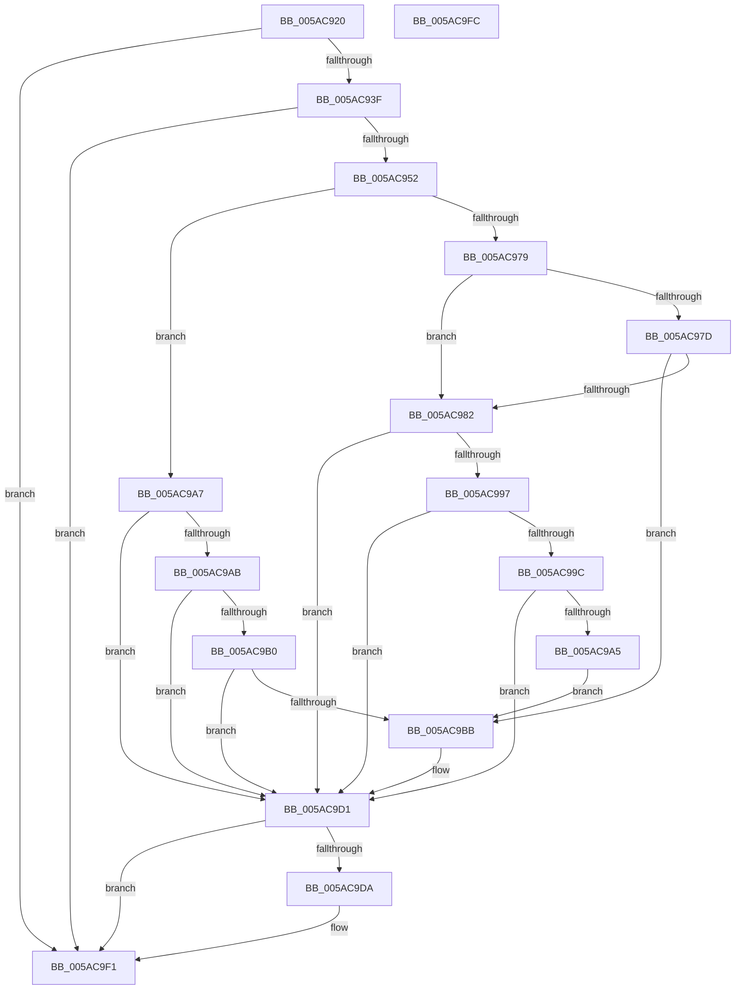

# _asan_load2_volatile

- RVA: `0x005AC920`–`0x005AC9FD` (길이 `221` bytes)
- VA: `0x00000001405AC920`
- 실행 섹션: `.text`
- PDB 이름 있음: `예`; PDB Function 태그: `아니요`
- unwind 정보 RVA: `0x0006E5F8`
- 디코드: `64`개 명령, `221/221` bytes 표시
- 미해석 바이트: `0` (있으면 어셈블리에 `.byte`로 보존)

> 이 문서는 커널 이미지의 기계어와 PDB 기호를 분석해 생성했습니다. 4번과 5번은 함수 원형과 자료형을 바이너리 사용 방식에서 추정한 C 해석이며 원본 소스 복구 결과는 아닙니다.

## 1. Dependencies

- 직접 호출 지점: **2**; 고유 호출 대상: **2**
- 직접 호출자로 확인된 함수: **0**
- RIP 상대 이미지 참조: **3**

### Outgoing calls
- `0x005AC9CC` → [KasaniReport](KasaniReport_function_005AB0B0.md) (function, `0x005AB0B0`)
- `0x005AC9EC` → [KcsanValidateAddress](KcsanValidateAddress_function_005AF5E0.md) (function, `0x005AF5E0`)

### Direct callers
- 이 함수 시작 RVA로 연결되는 직접 call은 확인되지 않았습니다. 간접 호출은 완전히 역산할 수 없습니다.

### Static image references
- `0x005AC92A` → RVA `0x00FCEC6A` (`ALMOSTRO`; read)
- `0x005AC952` → RVA `0x00FC6ED8` (`ALMOSTRO`; read)
- `0x005AC9D1` → RVA `0x00F8A7E8` (`.data`; read)

## 2. Other-region calls and transfers

- 다른 실행 섹션으로 향하는 call: **0**
- 별도 외부 분기/꼬리 이동을 확인하지 못했습니다.

## 3. Assembly (complete function range)

```asm
005AC920  48 89 5C 24 08                  mov qword ptr [rsp + 8], rbx
005AC925  57                              push rdi
005AC926  48 83 EC 30                     sub rsp, 0x30
005AC92A  80 3D 39 23 A2 00 00            cmp byte ptr [rip + 0xa22339], 0
005AC931  48 8B D9                        mov rbx, rcx
005AC934  48 8B 7C 24 38                  mov rdi, qword ptr [rsp + 0x38]
005AC939  0F 84 B2 00 00 00               je 0x1405ac9f1
005AC93F  48 B8 00 00 00 00 00 80 FF FF   movabs rax, 0xffff800000000000
005AC949  48 3B C8                        cmp rcx, rax
005AC94C  0F 82 9F 00 00 00               jb 0x1405ac9f1
005AC952  4C 8B 05 7F A5 A1 00            mov r8, qword ptr [rip + 0xa1a57f]
005AC959  49 B9 00 00 00 00 00 80 00 00   movabs r9, 0x800000000000
005AC963  4A 8D 04 09                     lea rax, [rcx + r9]
005AC967  48 C1 E8 03                     shr rax, 3
005AC96B  42 0F B6 0C 00                  movzx ecx, byte ptr [rax + r8]
005AC970  8B C3                           mov eax, ebx
005AC972  83 E0 07                        and eax, 7
005AC975  3C 06                           cmp al, 6
005AC977  76 2E                           jbe 0x1405ac9a7
005AC979  84 C9                           test cl, cl
005AC97B  74 05                           je 0x1405ac982
005AC97D  80 F9 08                        cmp cl, 8
005AC980  7C 39                           jl 0x1405ac9bb
005AC982  48 8D 53 01                     lea rdx, [rbx + 1]
005AC986  4A 8D 04 0A                     lea rax, [rdx + r9]
005AC98A  48 C1 E8 03                     shr rax, 3
005AC98E  42 0F B6 0C 00                  movzx ecx, byte ptr [rax + r8]
005AC993  84 C9                           test cl, cl
005AC995  74 3A                           je 0x1405ac9d1
005AC997  80 F9 08                        cmp cl, 8
005AC99A  7D 35                           jge 0x1405ac9d1
005AC99C  80 E2 07                        and dl, 7
005AC99F  FE C2                           inc dl
005AC9A1  3A D1                           cmp dl, cl
005AC9A3  7E 2C                           jle 0x1405ac9d1
005AC9A5  EB 14                           jmp 0x1405ac9bb
005AC9A7  84 C9                           test cl, cl
005AC9A9  74 26                           je 0x1405ac9d1
005AC9AB  80 F9 08                        cmp cl, 8
005AC9AE  7D 21                           jge 0x1405ac9d1
005AC9B0  8D 43 01                        lea eax, [rbx + 1]
005AC9B3  24 07                           and al, 7
005AC9B5  FE C0                           inc al
005AC9B7  3A C1                           cmp al, cl
005AC9B9  7E 16                           jle 0x1405ac9d1
005AC9BB  45 33 C0                        xor r8d, r8d
005AC9BE  88 4C 24 20                     mov byte ptr [rsp + 0x20], cl
005AC9C2  4C 8B CF                        mov r9, rdi
005AC9C5  48 8B CB                        mov rcx, rbx
005AC9C8  41 8D 50 02                     lea edx, [r8 + 2]
005AC9CC  E8 DF E6 FF FF                  call 0x1405ab0b0
005AC9D1  80 3D 10 DE 9D 00 00            cmp byte ptr [rip + 0x9dde10], 0
005AC9D8  74 17                           je 0x1405ac9f1
005AC9DA  45 33 C0                        xor r8d, r8d
005AC9DD  48 89 7C 24 20                  mov qword ptr [rsp + 0x20], rdi
005AC9E2  41 B1 01                        mov r9b, 1
005AC9E5  48 8B CB                        mov rcx, rbx
005AC9E8  41 8D 50 02                     lea edx, [r8 + 2]
005AC9EC  E8 EF 2B 00 00                  call 0x1405af5e0
005AC9F1  48 8B 5C 24 40                  mov rbx, qword ptr [rsp + 0x40]
005AC9F6  48 83 C4 30                     add rsp, 0x30
005AC9FA  5F                              pop rdi
005AC9FB  C3                              ret
005AC9FC  CC                              int3
```

## 4. C-style interpretation (structured pseudocode)

```c
__int64 __fastcall _asan_load2_volatile(__int64 a1)
{
    __int64 result;
    __int64 v_rsp;
    unsigned __int8 v_stack_m18;
    unsigned __int64 v_stack_p0;
    unsigned __int64 v_stack_p8;

    v_stack_p8 = v_rbx;
    v_rsp = (v_rsp) - (48);
    if ((*(unsigned __int8 *)(v_rip + 10625849)) == 0) goto loc_005AC9F1;
    if (a1 < result) goto loc_005AC9F1;
    result = (a1 + a4 * 1) >> (3);
    result = (unsigned int)(((unsigned int)((unsigned int)(a1))) & (7));
    if (((unsigned __int8)(result)) <= 6) goto loc_005AC9A7;
    if ((unsigned __int8)(*(unsigned __int8 *)(result + *(unsigned __int64 *)(v_rip + 10593663) * 1)) == 0) goto loc_005AC982;
    if (((unsigned __int8)(*(unsigned __int8 *)(result + *(unsigned __int64 *)(v_rip + 10593663) * 1))) < 8) goto loc_005AC9BB;
loc_005AC982:
    result = (a1 + 1 + a4 * 1) >> (3);
    if ((unsigned __int8)(*(unsigned __int8 *)(result + *(unsigned __int64 *)(v_rip + 10593663) * 1)) == 0) goto loc_005AC9D1;
    if (((unsigned __int8)(*(unsigned __int8 *)(result + *(unsigned __int64 *)(v_rip + 10593663) * 1))) >= 8) goto loc_005AC9D1;
    a2 = (unsigned __int8)((a1 + 1) & (7));
    a2 = (unsigned __int8)((a2) + 1);
    if (((unsigned __int8)(a2)) <= ((unsigned __int8)(*(unsigned __int8 *)(result + *(unsigned __int64 *)(v_rip + 10593663) * 1)))) goto loc_005AC9D1;
    goto loc_005AC9BB;
loc_005AC9A7:
    if ((unsigned __int8)(*(unsigned __int8 *)(result + *(unsigned __int64 *)(v_rip + 10593663) * 1)) == 0) goto loc_005AC9D1;
    if (((unsigned __int8)(*(unsigned __int8 *)(result + *(unsigned __int64 *)(v_rip + 10593663) * 1))) >= 8) goto loc_005AC9D1;
    result = (unsigned __int8)((a1 + 1) & (7));
    result = (unsigned __int8)((result) + 1);
    if (((unsigned __int8)(result)) >= = ((unsigned __int8)(*(unsigned __int8 *)(result + *(unsigned __int64 *)(v_rip + 10593663) * 1)))) {
        a3 = 0;
        v_stack_m18 = (unsigned __int8)(*(unsigned __int8 *)(result + *(unsigned __int64 *)(v_rip + 10593663) * 1));
        a4 = v_stack_p0;
        a1 = a1;
        a2 = a3 + 2;
        result = KasaniReport(a1, a2, a3, a4);
    }
    if ((*(unsigned __int8 *)(v_rip + 10346000)) != 0) {
        a3 = 0;
        v_stack_m18 = v_stack_p0;
        a4 = 1;
        a1 = a1;
        a2 = a3 + 2;
        result = KcsanValidateAddress(a1, a2, a3, a4);
    }
    v_rsp = (v_rsp) + (48);
    return result;
}
```

## 5. (Beta) C Style

```c
int64_t _asan_load2_volatile(void *Arg1)
{
    uint8_t *arg1 = (uint8_t *)Arg1;

    int64_t result;
    int64_t local_rsp;
    uint8_t v_stack_m18;
    uint64_t v_stack_p0;
    uint64_t v_stack_p8;

    v_stack_p8 = local_rbx;
    local_rsp = (local_rsp) - (48);
    if ((*(uint8_t *)(v_rip + 0xA22339)) == 0) goto loc_005AC9F1;
    if (Arg1 < result) goto loc_005AC9F1;
    result = (Arg1 + a4 * 1) >> (3);
    result = (uint32_t)(((uint32_t)((uint32_t)(Arg1))) & (7));
    if (((uint8_t)(result)) <= 6) goto loc_005AC9A7;
    if ((uint8_t)(*(uint8_t *)(result + *(uint64_t *)(v_rip + 0xA1A57F) * 1)) == 0) goto loc_005AC982;
    if (((uint8_t)(*(uint8_t *)(result + *(uint64_t *)(v_rip + 0xA1A57F) * 1))) < 8) goto loc_005AC9BB;
loc_005AC982:
    result = (Arg1 + 1 + a4 * 1) >> (3);
    if ((uint8_t)(*(uint8_t *)(result + *(uint64_t *)(v_rip + 0xA1A57F) * 1)) == 0) goto loc_005AC9D1;
    if (((uint8_t)(*(uint8_t *)(result + *(uint64_t *)(v_rip + 0xA1A57F) * 1))) >= 8) goto loc_005AC9D1;
    a2 = (uint8_t)((Arg1 + 1) & (7));
    a2 = (uint8_t)((a2) + 1);
    if (((uint8_t)(a2)) <= ((uint8_t)(*(uint8_t *)(result + *(uint64_t *)(v_rip + 0xA1A57F) * 1)))) goto loc_005AC9D1;
    goto loc_005AC9BB;
loc_005AC9A7:
    if ((uint8_t)(*(uint8_t *)(result + *(uint64_t *)(v_rip + 0xA1A57F) * 1)) == 0) goto loc_005AC9D1;
    if (((uint8_t)(*(uint8_t *)(result + *(uint64_t *)(v_rip + 0xA1A57F) * 1))) >= 8) goto loc_005AC9D1;
    result = (uint8_t)((Arg1 + 1) & (7));
    result = (uint8_t)((result) + 1);
    if (((uint8_t)(result)) >= = ((uint8_t)(*(uint8_t *)(result + *(uint64_t *)(v_rip + 0xA1A57F) * 1)))) {
        a3 = 0;
        v_stack_m18 = (uint8_t)(*(uint8_t *)(result + *(uint64_t *)(v_rip + 0xA1A57F) * 1));
        a4 = v_stack_p0;
        Arg1 = Arg1;
        a2 = a3 + 2;
        result = KasaniReport(Arg1, a2, a3, a4);
    }
    if ((*(uint8_t *)(v_rip + 0x9DDE10)) != 0) {
        a3 = 0;
        v_stack_m18 = v_stack_p0;
        a4 = 1;
        Arg1 = Arg1;
        a2 = a3 + 2;
        result = KcsanValidateAddress(Arg1, a2, a3, a4);
    }
    local_rsp = (local_rsp) + (48);
    return result;
}
```

### 관측된 메모리 오프셋

구조체 형식이 확인되지 않은 접근은 인자 기준의 오프셋으로만 기록했습니다.

| 기준 인자 | 오프셋 표현 | 폭 (bit) | 접근 |
|---|---:|---:|---|
| `Arg1` | `+ 0x0 + r9*1` | `64` | `R` |
| `Arg1` | `+ 0x1` | `32` | `R` |
| `Arg1` | `+ 0x1` | `64` | `R` |

## 6. Execution-region graph

[열기: 2D/3D 그래프와 함수 탐색 컨트롤 패널](../../../control-panel.html?section=text&rva=0x005AC920&view=graph)

- 2D 그래프는 위에서 아래로 흐르고, 3D 그래프는 빈 공간을 드래그해 회전합니다. Shift+드래그는 이동, 휠은 확대·축소, 함수 노드 선택은 대상 보고서 이동입니다.

### Static fallback


