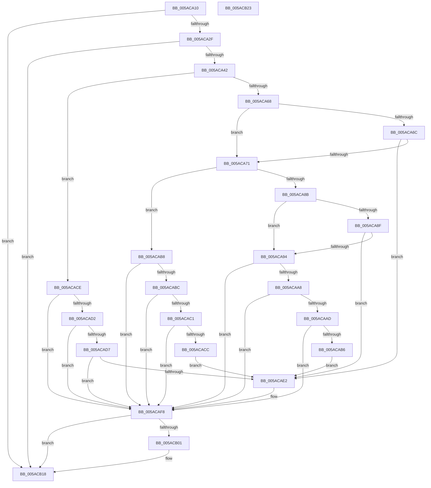

# _asan_load4

- RVA: `0x005ACA10`–`0x005ACB24` (길이 `276` bytes)
- VA: `0x00000001405ACA10`
- 실행 섹션: `.text`
- PDB 이름 있음: `예`; PDB Function 태그: `아니요`
- unwind 정보 RVA: `0x0006E5F8`
- 디코드: `86`개 명령, `276/276` bytes 표시
- 미해석 바이트: `0` (있으면 어셈블리에 `.byte`로 보존)

> 이 문서는 커널 이미지의 기계어와 PDB 기호를 분석해 생성했습니다. 4번과 5번은 함수 원형과 자료형을 바이너리 사용 방식에서 추정한 C 해석이며 원본 소스 복구 결과는 아닙니다.

## 1. Dependencies

- 직접 호출 지점: **2**; 고유 호출 대상: **2**
- 직접 호출자로 확인된 함수: **0**
- RIP 상대 이미지 참조: **3**

### Outgoing calls
- `0x005ACAF3` → [KasaniReport](KasaniReport_function_005AB0B0.md) (function, `0x005AB0B0`)
- `0x005ACB13` → [KcsanValidateAddress](KcsanValidateAddress_function_005AF5E0.md) (function, `0x005AF5E0`)

### Direct callers
- 이 함수 시작 RVA로 연결되는 직접 call은 확인되지 않았습니다. 간접 호출은 완전히 역산할 수 없습니다.

### Static image references
- `0x005ACA1A` → RVA `0x00FCEC6A` (`ALMOSTRO`; read)
- `0x005ACA42` → RVA `0x00FC6ED8` (`ALMOSTRO`; read)
- `0x005ACAF8` → RVA `0x00F8A7E8` (`.data`; read)

## 2. Other-region calls and transfers

- 다른 실행 섹션으로 향하는 call: **0**
- 별도 외부 분기/꼬리 이동을 확인하지 못했습니다.

## 3. Assembly (complete function range)

```asm
005ACA10  48 89 5C 24 08                  mov qword ptr [rsp + 8], rbx
005ACA15  57                              push rdi
005ACA16  48 83 EC 30                     sub rsp, 0x30
005ACA1A  80 3D 49 22 A2 00 00            cmp byte ptr [rip + 0xa22249], 0
005ACA21  48 8B D9                        mov rbx, rcx
005ACA24  48 8B 7C 24 38                  mov rdi, qword ptr [rsp + 0x38]
005ACA29  0F 84 E9 00 00 00               je 0x1405acb18
005ACA2F  48 B8 00 00 00 00 00 80 FF FF   movabs rax, 0xffff800000000000
005ACA39  48 3B C8                        cmp rcx, rax
005ACA3C  0F 82 D6 00 00 00               jb 0x1405acb18
005ACA42  4C 8B 05 8F A4 A1 00            mov r8, qword ptr [rip + 0xa1a48f]
005ACA49  49 B9 00 00 00 00 00 80 00 00   movabs r9, 0x800000000000
005ACA53  4A 8D 04 09                     lea rax, [rcx + r9]
005ACA57  48 C1 E8 03                     shr rax, 3
005ACA5B  42 0F B6 0C 00                  movzx ecx, byte ptr [rax + r8]
005ACA60  8B C3                           mov eax, ebx
005ACA62  24 07                           and al, 7
005ACA64  3C 04                           cmp al, 4
005ACA66  76 66                           jbe 0x1405acace
005ACA68  84 C9                           test cl, cl
005ACA6A  74 05                           je 0x1405aca71
005ACA6C  80 F9 08                        cmp cl, 8
005ACA6F  7C 71                           jl 0x1405acae2
005ACA71  48 8D 53 02                     lea rdx, [rbx + 2]
005ACA75  4A 8D 04 0A                     lea rax, [rdx + r9]
005ACA79  48 C1 E8 03                     shr rax, 3
005ACA7D  42 0F B6 0C 00                  movzx ecx, byte ptr [rax + r8]
005ACA82  8B C2                           mov eax, edx
005ACA84  83 E0 07                        and eax, 7
005ACA87  3C 06                           cmp al, 6
005ACA89  76 2D                           jbe 0x1405acab8
005ACA8B  84 C9                           test cl, cl
005ACA8D  74 05                           je 0x1405aca94
005ACA8F  80 F9 08                        cmp cl, 8
005ACA92  7C 4E                           jl 0x1405acae2
005ACA94  48 FF C2                        inc rdx
005ACA97  4A 8D 04 0A                     lea rax, [rdx + r9]
005ACA9B  48 C1 E8 03                     shr rax, 3
005ACA9F  42 0F B6 0C 00                  movzx ecx, byte ptr [rax + r8]
005ACAA4  84 C9                           test cl, cl
005ACAA6  74 50                           je 0x1405acaf8
005ACAA8  80 F9 08                        cmp cl, 8
005ACAAB  7D 4B                           jge 0x1405acaf8
005ACAAD  80 E2 07                        and dl, 7
005ACAB0  FE C2                           inc dl
005ACAB2  3A D1                           cmp dl, cl
005ACAB4  7E 42                           jle 0x1405acaf8
005ACAB6  EB 2A                           jmp 0x1405acae2
005ACAB8  84 C9                           test cl, cl
005ACABA  74 3C                           je 0x1405acaf8
005ACABC  80 F9 08                        cmp cl, 8
005ACABF  7D 37                           jge 0x1405acaf8
005ACAC1  FE C2                           inc dl
005ACAC3  80 E2 07                        and dl, 7
005ACAC6  FE C2                           inc dl
005ACAC8  3A D1                           cmp dl, cl
005ACACA  7E 2C                           jle 0x1405acaf8
005ACACC  EB 14                           jmp 0x1405acae2
005ACACE  84 C9                           test cl, cl
005ACAD0  74 26                           je 0x1405acaf8
005ACAD2  80 F9 08                        cmp cl, 8
005ACAD5  7D 21                           jge 0x1405acaf8
005ACAD7  8D 43 03                        lea eax, [rbx + 3]
005ACADA  24 07                           and al, 7
005ACADC  FE C0                           inc al
005ACADE  3A C1                           cmp al, cl
005ACAE0  7E 16                           jle 0x1405acaf8
005ACAE2  45 33 C0                        xor r8d, r8d
005ACAE5  88 4C 24 20                     mov byte ptr [rsp + 0x20], cl
005ACAE9  4C 8B CF                        mov r9, rdi
005ACAEC  48 8B CB                        mov rcx, rbx
005ACAEF  41 8D 50 04                     lea edx, [r8 + 4]
005ACAF3  E8 B8 E5 FF FF                  call 0x1405ab0b0
005ACAF8  80 3D E9 DC 9D 00 00            cmp byte ptr [rip + 0x9ddce9], 0
005ACAFF  74 17                           je 0x1405acb18
005ACB01  45 33 C9                        xor r9d, r9d
005ACB04  48 89 7C 24 20                  mov qword ptr [rsp + 0x20], rdi
005ACB09  45 33 C0                        xor r8d, r8d
005ACB0C  48 8B CB                        mov rcx, rbx
005ACB0F  41 8D 51 04                     lea edx, [r9 + 4]
005ACB13  E8 C8 2A 00 00                  call 0x1405af5e0
005ACB18  48 8B 5C 24 40                  mov rbx, qword ptr [rsp + 0x40]
005ACB1D  48 83 C4 30                     add rsp, 0x30
005ACB21  5F                              pop rdi
005ACB22  C3                              ret
005ACB23  CC                              int3
```

## 4. C-style interpretation (structured pseudocode)

```c
__int64 __fastcall _asan_load4(__int64 a1)
{
    __int64 result;
    __int64 v_rsp;
    unsigned __int8 v_stack_m18;
    unsigned __int64 v_stack_p0;
    unsigned __int64 v_stack_p8;

    v_stack_p8 = v_rbx;
    v_rsp = (v_rsp) - (48);
    if ((*(unsigned __int8 *)(v_rip + 10625609)) == 0) goto loc_005ACB18;
    if (a1 < result) goto loc_005ACB18;
    result = (a1 + a4 * 1) >> (3);
    result = (unsigned __int8)(((unsigned int)((unsigned int)(a1))) & (7));
    if (((unsigned __int8)(result)) <= 4) goto loc_005ACACE;
    if ((unsigned __int8)(*(unsigned __int8 *)(result + *(unsigned __int64 *)(v_rip + 10593423) * 1)) == 0) goto loc_005ACA71;
    if (((unsigned __int8)(*(unsigned __int8 *)(result + *(unsigned __int64 *)(v_rip + 10593423) * 1))) < 8) goto loc_005ACAE2;
loc_005ACA71:
    result = (a1 + 2 + a4 * 1) >> (3);
    result = (unsigned int)(((unsigned int)((unsigned int)(a1 + 2))) & (7));
    if (((unsigned __int8)(result)) <= 6) goto loc_005ACAB8;
    if ((unsigned __int8)(*(unsigned __int8 *)(result + *(unsigned __int64 *)(v_rip + 10593423) * 1)) == 0) goto loc_005ACA94;
    if (((unsigned __int8)(*(unsigned __int8 *)(result + *(unsigned __int64 *)(v_rip + 10593423) * 1))) < 8) goto loc_005ACAE2;
loc_005ACA94:
    a2 = (a1 + 2) + 1;
    result = (a2 + a4 * 1) >> (3);
    if ((unsigned __int8)(*(unsigned __int8 *)(result + *(unsigned __int64 *)(v_rip + 10593423) * 1)) == 0) goto loc_005ACAF8;
    if (((unsigned __int8)(*(unsigned __int8 *)(result + *(unsigned __int64 *)(v_rip + 10593423) * 1))) >= 8) goto loc_005ACAF8;
    a2 = (unsigned __int8)((a2) & (7));
    a2 = (unsigned __int8)((a2) + 1);
    if (((unsigned __int8)(a2)) <= ((unsigned __int8)(*(unsigned __int8 *)(result + *(unsigned __int64 *)(v_rip + 10593423) * 1)))) goto loc_005ACAF8;
    goto loc_005ACAE2;
loc_005ACAB8:
    if ((unsigned __int8)(*(unsigned __int8 *)(result + *(unsigned __int64 *)(v_rip + 10593423) * 1)) == 0) goto loc_005ACAF8;
    if (((unsigned __int8)(*(unsigned __int8 *)(result + *(unsigned __int64 *)(v_rip + 10593423) * 1))) >= 8) goto loc_005ACAF8;
    a2 = (unsigned __int8)((a2) + 1);
    a2 = (unsigned __int8)((a2) & (7));
    a2 = (unsigned __int8)((a2) + 1);
    if (((unsigned __int8)(a2)) <= ((unsigned __int8)(*(unsigned __int8 *)(result + *(unsigned __int64 *)(v_rip + 10593423) * 1)))) goto loc_005ACAF8;
    goto loc_005ACAE2;
loc_005ACACE:
    if ((unsigned __int8)(*(unsigned __int8 *)(result + *(unsigned __int64 *)(v_rip + 10593423) * 1)) == 0) goto loc_005ACAF8;
    if (((unsigned __int8)(*(unsigned __int8 *)(result + *(unsigned __int64 *)(v_rip + 10593423) * 1))) >= 8) goto loc_005ACAF8;
    result = (unsigned __int8)((a1 + 3) & (7));
    result = (unsigned __int8)((result) + 1);
    if (((unsigned __int8)(result)) >= = ((unsigned __int8)(*(unsigned __int8 *)(result + *(unsigned __int64 *)(v_rip + 10593423) * 1)))) {
        a3 = 0;
        v_stack_m18 = (unsigned __int8)(*(unsigned __int8 *)(result + *(unsigned __int64 *)(v_rip + 10593423) * 1));
        a4 = v_stack_p0;
        a1 = a1;
        a2 = a3 + 4;
        result = KasaniReport(a1, a2, a3, a4);
    }
    if ((*(unsigned __int8 *)(v_rip + 10345705)) != 0) {
        a4 = 0;
        v_stack_m18 = v_stack_p0;
        a3 = 0;
        a1 = a1;
        a2 = a4 + 4;
        result = KcsanValidateAddress(a1, a2, a3, a4);
    }
    v_rsp = (v_rsp) + (48);
    return result;
}
```

## 5. (Beta) C Style

```c
int64_t _asan_load4(void *Arg1)
{
    uint8_t *arg1 = (uint8_t *)Arg1;

    int64_t result;
    int64_t local_rsp;
    uint8_t v_stack_m18;
    uint64_t v_stack_p0;
    uint64_t v_stack_p8;

    v_stack_p8 = local_rbx;
    local_rsp = (local_rsp) - (48);
    if ((*(uint8_t *)(v_rip + 0xA22249)) == 0) goto loc_005ACB18;
    if (Arg1 < result) goto loc_005ACB18;
    result = (Arg1 + a4 * 1) >> (3);
    result = (uint8_t)(((uint32_t)((uint32_t)(Arg1))) & (7));
    if (((uint8_t)(result)) <= 4) goto loc_005ACACE;
    if ((uint8_t)(*(uint8_t *)(result + *(uint64_t *)(v_rip + 0xA1A48F) * 1)) == 0) goto loc_005ACA71;
    if (((uint8_t)(*(uint8_t *)(result + *(uint64_t *)(v_rip + 0xA1A48F) * 1))) < 8) goto loc_005ACAE2;
loc_005ACA71:
    result = (Arg1 + 2 + a4 * 1) >> (3);
    result = (uint32_t)(((uint32_t)((uint32_t)(Arg1 + 2))) & (7));
    if (((uint8_t)(result)) <= 6) goto loc_005ACAB8;
    if ((uint8_t)(*(uint8_t *)(result + *(uint64_t *)(v_rip + 0xA1A48F) * 1)) == 0) goto loc_005ACA94;
    if (((uint8_t)(*(uint8_t *)(result + *(uint64_t *)(v_rip + 0xA1A48F) * 1))) < 8) goto loc_005ACAE2;
loc_005ACA94:
    a2 = (Arg1 + 2) + 1;
    result = (a2 + a4 * 1) >> (3);
    if ((uint8_t)(*(uint8_t *)(result + *(uint64_t *)(v_rip + 0xA1A48F) * 1)) == 0) goto loc_005ACAF8;
    if (((uint8_t)(*(uint8_t *)(result + *(uint64_t *)(v_rip + 0xA1A48F) * 1))) >= 8) goto loc_005ACAF8;
    a2 = (uint8_t)((a2) & (7));
    a2 = (uint8_t)((a2) + 1);
    if (((uint8_t)(a2)) <= ((uint8_t)(*(uint8_t *)(result + *(uint64_t *)(v_rip + 0xA1A48F) * 1)))) goto loc_005ACAF8;
    goto loc_005ACAE2;
loc_005ACAB8:
    if ((uint8_t)(*(uint8_t *)(result + *(uint64_t *)(v_rip + 0xA1A48F) * 1)) == 0) goto loc_005ACAF8;
    if (((uint8_t)(*(uint8_t *)(result + *(uint64_t *)(v_rip + 0xA1A48F) * 1))) >= 8) goto loc_005ACAF8;
    a2 = (uint8_t)((a2) + 1);
    a2 = (uint8_t)((a2) & (7));
    a2 = (uint8_t)((a2) + 1);
    if (((uint8_t)(a2)) <= ((uint8_t)(*(uint8_t *)(result + *(uint64_t *)(v_rip + 0xA1A48F) * 1)))) goto loc_005ACAF8;
    goto loc_005ACAE2;
loc_005ACACE:
    if ((uint8_t)(*(uint8_t *)(result + *(uint64_t *)(v_rip + 0xA1A48F) * 1)) == 0) goto loc_005ACAF8;
    if (((uint8_t)(*(uint8_t *)(result + *(uint64_t *)(v_rip + 0xA1A48F) * 1))) >= 8) goto loc_005ACAF8;
    result = (uint8_t)((Arg1 + 3) & (7));
    result = (uint8_t)((result) + 1);
    if (((uint8_t)(result)) >= = ((uint8_t)(*(uint8_t *)(result + *(uint64_t *)(v_rip + 0xA1A48F) * 1)))) {
        a3 = 0;
        v_stack_m18 = (uint8_t)(*(uint8_t *)(result + *(uint64_t *)(v_rip + 0xA1A48F) * 1));
        a4 = v_stack_p0;
        Arg1 = Arg1;
        a2 = a3 + 4;
        result = KasaniReport(Arg1, a2, a3, a4);
    }
    if ((*(uint8_t *)(v_rip + 0x9DDCE9)) != 0) {
        a4 = 0;
        v_stack_m18 = v_stack_p0;
        a3 = 0;
        Arg1 = Arg1;
        a2 = a4 + 4;
        result = KcsanValidateAddress(Arg1, a2, a3, a4);
    }
    local_rsp = (local_rsp) + (48);
    return result;
}
```

### 관측된 메모리 오프셋

구조체 형식이 확인되지 않은 접근은 인자 기준의 오프셋으로만 기록했습니다.

| 기준 인자 | 오프셋 표현 | 폭 (bit) | 접근 |
|---|---:|---:|---|
| `Arg1` | `+ 0x0 + r9*1` | `64` | `R` |
| `Arg1` | `+ 0x2` | `64` | `R` |
| `Arg1` | `+ 0x3` | `32` | `R` |

## 6. Execution-region graph

[열기: 2D/3D 그래프와 함수 탐색 컨트롤 패널](../../../control-panel.html?section=text&rva=0x005ACA10&view=graph)

- 2D 그래프는 위에서 아래로 흐르고, 3D 그래프는 빈 공간을 드래그해 회전합니다. Shift+드래그는 이동, 휠은 확대·축소, 함수 노드 선택은 대상 보고서 이동입니다.

### Static fallback


