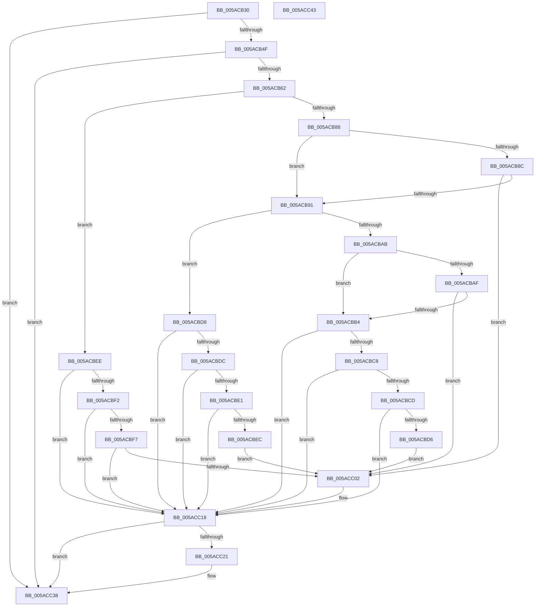

# _asan_load4_volatile

- RVA: `0x005ACB30`–`0x005ACC44` (길이 `276` bytes)
- VA: `0x00000001405ACB30`
- 실행 섹션: `.text`
- PDB 이름 있음: `예`; PDB Function 태그: `아니요`
- unwind 정보 RVA: `0x0006E5F8`
- 디코드: `86`개 명령, `276/276` bytes 표시
- 미해석 바이트: `0` (있으면 어셈블리에 `.byte`로 보존)

> 이 문서는 커널 이미지의 기계어와 PDB 기호를 분석해 생성했습니다. 4번과 5번은 함수 원형과 자료형을 바이너리 사용 방식에서 추정한 C 해석이며 원본 소스 복구 결과는 아닙니다.

## 1. Dependencies

- 직접 호출 지점: **2**; 고유 호출 대상: **2**
- 직접 호출자로 확인된 함수: **0**
- RIP 상대 이미지 참조: **3**

### Outgoing calls
- `0x005ACC13` → [KasaniReport](KasaniReport_function_005AB0B0.md) (function, `0x005AB0B0`)
- `0x005ACC33` → [KcsanValidateAddress](KcsanValidateAddress_function_005AF5E0.md) (function, `0x005AF5E0`)

### Direct callers
- 이 함수 시작 RVA로 연결되는 직접 call은 확인되지 않았습니다. 간접 호출은 완전히 역산할 수 없습니다.

### Static image references
- `0x005ACB3A` → RVA `0x00FCEC6A` (`ALMOSTRO`; read)
- `0x005ACB62` → RVA `0x00FC6ED8` (`ALMOSTRO`; read)
- `0x005ACC18` → RVA `0x00F8A7E8` (`.data`; read)

## 2. Other-region calls and transfers

- 다른 실행 섹션으로 향하는 call: **0**
- 별도 외부 분기/꼬리 이동을 확인하지 못했습니다.

## 3. Assembly (complete function range)

```asm
005ACB30  48 89 5C 24 08                  mov qword ptr [rsp + 8], rbx
005ACB35  57                              push rdi
005ACB36  48 83 EC 30                     sub rsp, 0x30
005ACB3A  80 3D 29 21 A2 00 00            cmp byte ptr [rip + 0xa22129], 0
005ACB41  48 8B D9                        mov rbx, rcx
005ACB44  48 8B 7C 24 38                  mov rdi, qword ptr [rsp + 0x38]
005ACB49  0F 84 E9 00 00 00               je 0x1405acc38
005ACB4F  48 B8 00 00 00 00 00 80 FF FF   movabs rax, 0xffff800000000000
005ACB59  48 3B C8                        cmp rcx, rax
005ACB5C  0F 82 D6 00 00 00               jb 0x1405acc38
005ACB62  4C 8B 05 6F A3 A1 00            mov r8, qword ptr [rip + 0xa1a36f]
005ACB69  49 B9 00 00 00 00 00 80 00 00   movabs r9, 0x800000000000
005ACB73  4A 8D 04 09                     lea rax, [rcx + r9]
005ACB77  48 C1 E8 03                     shr rax, 3
005ACB7B  42 0F B6 0C 00                  movzx ecx, byte ptr [rax + r8]
005ACB80  8B C3                           mov eax, ebx
005ACB82  24 07                           and al, 7
005ACB84  3C 04                           cmp al, 4
005ACB86  76 66                           jbe 0x1405acbee
005ACB88  84 C9                           test cl, cl
005ACB8A  74 05                           je 0x1405acb91
005ACB8C  80 F9 08                        cmp cl, 8
005ACB8F  7C 71                           jl 0x1405acc02
005ACB91  48 8D 53 02                     lea rdx, [rbx + 2]
005ACB95  4A 8D 04 0A                     lea rax, [rdx + r9]
005ACB99  48 C1 E8 03                     shr rax, 3
005ACB9D  42 0F B6 0C 00                  movzx ecx, byte ptr [rax + r8]
005ACBA2  8B C2                           mov eax, edx
005ACBA4  83 E0 07                        and eax, 7
005ACBA7  3C 06                           cmp al, 6
005ACBA9  76 2D                           jbe 0x1405acbd8
005ACBAB  84 C9                           test cl, cl
005ACBAD  74 05                           je 0x1405acbb4
005ACBAF  80 F9 08                        cmp cl, 8
005ACBB2  7C 4E                           jl 0x1405acc02
005ACBB4  48 FF C2                        inc rdx
005ACBB7  4A 8D 04 0A                     lea rax, [rdx + r9]
005ACBBB  48 C1 E8 03                     shr rax, 3
005ACBBF  42 0F B6 0C 00                  movzx ecx, byte ptr [rax + r8]
005ACBC4  84 C9                           test cl, cl
005ACBC6  74 50                           je 0x1405acc18
005ACBC8  80 F9 08                        cmp cl, 8
005ACBCB  7D 4B                           jge 0x1405acc18
005ACBCD  80 E2 07                        and dl, 7
005ACBD0  FE C2                           inc dl
005ACBD2  3A D1                           cmp dl, cl
005ACBD4  7E 42                           jle 0x1405acc18
005ACBD6  EB 2A                           jmp 0x1405acc02
005ACBD8  84 C9                           test cl, cl
005ACBDA  74 3C                           je 0x1405acc18
005ACBDC  80 F9 08                        cmp cl, 8
005ACBDF  7D 37                           jge 0x1405acc18
005ACBE1  FE C2                           inc dl
005ACBE3  80 E2 07                        and dl, 7
005ACBE6  FE C2                           inc dl
005ACBE8  3A D1                           cmp dl, cl
005ACBEA  7E 2C                           jle 0x1405acc18
005ACBEC  EB 14                           jmp 0x1405acc02
005ACBEE  84 C9                           test cl, cl
005ACBF0  74 26                           je 0x1405acc18
005ACBF2  80 F9 08                        cmp cl, 8
005ACBF5  7D 21                           jge 0x1405acc18
005ACBF7  8D 43 03                        lea eax, [rbx + 3]
005ACBFA  24 07                           and al, 7
005ACBFC  FE C0                           inc al
005ACBFE  3A C1                           cmp al, cl
005ACC00  7E 16                           jle 0x1405acc18
005ACC02  45 33 C0                        xor r8d, r8d
005ACC05  88 4C 24 20                     mov byte ptr [rsp + 0x20], cl
005ACC09  4C 8B CF                        mov r9, rdi
005ACC0C  48 8B CB                        mov rcx, rbx
005ACC0F  41 8D 50 04                     lea edx, [r8 + 4]
005ACC13  E8 98 E4 FF FF                  call 0x1405ab0b0
005ACC18  80 3D C9 DB 9D 00 00            cmp byte ptr [rip + 0x9ddbc9], 0
005ACC1F  74 17                           je 0x1405acc38
005ACC21  45 33 C0                        xor r8d, r8d
005ACC24  48 89 7C 24 20                  mov qword ptr [rsp + 0x20], rdi
005ACC29  41 B1 01                        mov r9b, 1
005ACC2C  48 8B CB                        mov rcx, rbx
005ACC2F  41 8D 50 04                     lea edx, [r8 + 4]
005ACC33  E8 A8 29 00 00                  call 0x1405af5e0
005ACC38  48 8B 5C 24 40                  mov rbx, qword ptr [rsp + 0x40]
005ACC3D  48 83 C4 30                     add rsp, 0x30
005ACC41  5F                              pop rdi
005ACC42  C3                              ret
005ACC43  CC                              int3
```

## 4. C-style interpretation (structured pseudocode)

```c
__int64 __fastcall _asan_load4_volatile(__int64 a1)
{
    __int64 result;
    __int64 v_rsp;
    unsigned __int8 v_stack_m18;
    unsigned __int64 v_stack_p0;
    unsigned __int64 v_stack_p8;

    v_stack_p8 = v_rbx;
    v_rsp = (v_rsp) - (48);
    if ((*(unsigned __int8 *)(v_rip + 10625321)) == 0) goto loc_005ACC38;
    if (a1 < result) goto loc_005ACC38;
    result = (a1 + a4 * 1) >> (3);
    result = (unsigned __int8)(((unsigned int)((unsigned int)(a1))) & (7));
    if (((unsigned __int8)(result)) <= 4) goto loc_005ACBEE;
    if ((unsigned __int8)(*(unsigned __int8 *)(result + *(unsigned __int64 *)(v_rip + 10593135) * 1)) == 0) goto loc_005ACB91;
    if (((unsigned __int8)(*(unsigned __int8 *)(result + *(unsigned __int64 *)(v_rip + 10593135) * 1))) < 8) goto loc_005ACC02;
loc_005ACB91:
    result = (a1 + 2 + a4 * 1) >> (3);
    result = (unsigned int)(((unsigned int)((unsigned int)(a1 + 2))) & (7));
    if (((unsigned __int8)(result)) <= 6) goto loc_005ACBD8;
    if ((unsigned __int8)(*(unsigned __int8 *)(result + *(unsigned __int64 *)(v_rip + 10593135) * 1)) == 0) goto loc_005ACBB4;
    if (((unsigned __int8)(*(unsigned __int8 *)(result + *(unsigned __int64 *)(v_rip + 10593135) * 1))) < 8) goto loc_005ACC02;
loc_005ACBB4:
    a2 = (a1 + 2) + 1;
    result = (a2 + a4 * 1) >> (3);
    if ((unsigned __int8)(*(unsigned __int8 *)(result + *(unsigned __int64 *)(v_rip + 10593135) * 1)) == 0) goto loc_005ACC18;
    if (((unsigned __int8)(*(unsigned __int8 *)(result + *(unsigned __int64 *)(v_rip + 10593135) * 1))) >= 8) goto loc_005ACC18;
    a2 = (unsigned __int8)((a2) & (7));
    a2 = (unsigned __int8)((a2) + 1);
    if (((unsigned __int8)(a2)) <= ((unsigned __int8)(*(unsigned __int8 *)(result + *(unsigned __int64 *)(v_rip + 10593135) * 1)))) goto loc_005ACC18;
    goto loc_005ACC02;
loc_005ACBD8:
    if ((unsigned __int8)(*(unsigned __int8 *)(result + *(unsigned __int64 *)(v_rip + 10593135) * 1)) == 0) goto loc_005ACC18;
    if (((unsigned __int8)(*(unsigned __int8 *)(result + *(unsigned __int64 *)(v_rip + 10593135) * 1))) >= 8) goto loc_005ACC18;
    a2 = (unsigned __int8)((a2) + 1);
    a2 = (unsigned __int8)((a2) & (7));
    a2 = (unsigned __int8)((a2) + 1);
    if (((unsigned __int8)(a2)) <= ((unsigned __int8)(*(unsigned __int8 *)(result + *(unsigned __int64 *)(v_rip + 10593135) * 1)))) goto loc_005ACC18;
    goto loc_005ACC02;
loc_005ACBEE:
    if ((unsigned __int8)(*(unsigned __int8 *)(result + *(unsigned __int64 *)(v_rip + 10593135) * 1)) == 0) goto loc_005ACC18;
    if (((unsigned __int8)(*(unsigned __int8 *)(result + *(unsigned __int64 *)(v_rip + 10593135) * 1))) >= 8) goto loc_005ACC18;
    result = (unsigned __int8)((a1 + 3) & (7));
    result = (unsigned __int8)((result) + 1);
    if (((unsigned __int8)(result)) >= = ((unsigned __int8)(*(unsigned __int8 *)(result + *(unsigned __int64 *)(v_rip + 10593135) * 1)))) {
        a3 = 0;
        v_stack_m18 = (unsigned __int8)(*(unsigned __int8 *)(result + *(unsigned __int64 *)(v_rip + 10593135) * 1));
        a4 = v_stack_p0;
        a1 = a1;
        a2 = a3 + 4;
        result = KasaniReport(a1, a2, a3, a4);
    }
    if ((*(unsigned __int8 *)(v_rip + 10345417)) != 0) {
        a3 = 0;
        v_stack_m18 = v_stack_p0;
        a4 = 1;
        a1 = a1;
        a2 = a3 + 4;
        result = KcsanValidateAddress(a1, a2, a3, a4);
    }
    v_rsp = (v_rsp) + (48);
    return result;
}
```

## 5. (Beta) C Style

```c
int64_t _asan_load4_volatile(void *Arg1)
{
    uint8_t *arg1 = (uint8_t *)Arg1;

    int64_t result;
    int64_t local_rsp;
    uint8_t v_stack_m18;
    uint64_t v_stack_p0;
    uint64_t v_stack_p8;

    v_stack_p8 = local_rbx;
    local_rsp = (local_rsp) - (48);
    if ((*(uint8_t *)(v_rip + 0xA22129)) == 0) goto loc_005ACC38;
    if (Arg1 < result) goto loc_005ACC38;
    result = (Arg1 + a4 * 1) >> (3);
    result = (uint8_t)(((uint32_t)((uint32_t)(Arg1))) & (7));
    if (((uint8_t)(result)) <= 4) goto loc_005ACBEE;
    if ((uint8_t)(*(uint8_t *)(result + *(uint64_t *)(v_rip + 0xA1A36F) * 1)) == 0) goto loc_005ACB91;
    if (((uint8_t)(*(uint8_t *)(result + *(uint64_t *)(v_rip + 0xA1A36F) * 1))) < 8) goto loc_005ACC02;
loc_005ACB91:
    result = (Arg1 + 2 + a4 * 1) >> (3);
    result = (uint32_t)(((uint32_t)((uint32_t)(Arg1 + 2))) & (7));
    if (((uint8_t)(result)) <= 6) goto loc_005ACBD8;
    if ((uint8_t)(*(uint8_t *)(result + *(uint64_t *)(v_rip + 0xA1A36F) * 1)) == 0) goto loc_005ACBB4;
    if (((uint8_t)(*(uint8_t *)(result + *(uint64_t *)(v_rip + 0xA1A36F) * 1))) < 8) goto loc_005ACC02;
loc_005ACBB4:
    a2 = (Arg1 + 2) + 1;
    result = (a2 + a4 * 1) >> (3);
    if ((uint8_t)(*(uint8_t *)(result + *(uint64_t *)(v_rip + 0xA1A36F) * 1)) == 0) goto loc_005ACC18;
    if (((uint8_t)(*(uint8_t *)(result + *(uint64_t *)(v_rip + 0xA1A36F) * 1))) >= 8) goto loc_005ACC18;
    a2 = (uint8_t)((a2) & (7));
    a2 = (uint8_t)((a2) + 1);
    if (((uint8_t)(a2)) <= ((uint8_t)(*(uint8_t *)(result + *(uint64_t *)(v_rip + 0xA1A36F) * 1)))) goto loc_005ACC18;
    goto loc_005ACC02;
loc_005ACBD8:
    if ((uint8_t)(*(uint8_t *)(result + *(uint64_t *)(v_rip + 0xA1A36F) * 1)) == 0) goto loc_005ACC18;
    if (((uint8_t)(*(uint8_t *)(result + *(uint64_t *)(v_rip + 0xA1A36F) * 1))) >= 8) goto loc_005ACC18;
    a2 = (uint8_t)((a2) + 1);
    a2 = (uint8_t)((a2) & (7));
    a2 = (uint8_t)((a2) + 1);
    if (((uint8_t)(a2)) <= ((uint8_t)(*(uint8_t *)(result + *(uint64_t *)(v_rip + 0xA1A36F) * 1)))) goto loc_005ACC18;
    goto loc_005ACC02;
loc_005ACBEE:
    if ((uint8_t)(*(uint8_t *)(result + *(uint64_t *)(v_rip + 0xA1A36F) * 1)) == 0) goto loc_005ACC18;
    if (((uint8_t)(*(uint8_t *)(result + *(uint64_t *)(v_rip + 0xA1A36F) * 1))) >= 8) goto loc_005ACC18;
    result = (uint8_t)((Arg1 + 3) & (7));
    result = (uint8_t)((result) + 1);
    if (((uint8_t)(result)) >= = ((uint8_t)(*(uint8_t *)(result + *(uint64_t *)(v_rip + 0xA1A36F) * 1)))) {
        a3 = 0;
        v_stack_m18 = (uint8_t)(*(uint8_t *)(result + *(uint64_t *)(v_rip + 0xA1A36F) * 1));
        a4 = v_stack_p0;
        Arg1 = Arg1;
        a2 = a3 + 4;
        result = KasaniReport(Arg1, a2, a3, a4);
    }
    if ((*(uint8_t *)(v_rip + 0x9DDBC9)) != 0) {
        a3 = 0;
        v_stack_m18 = v_stack_p0;
        a4 = 1;
        Arg1 = Arg1;
        a2 = a3 + 4;
        result = KcsanValidateAddress(Arg1, a2, a3, a4);
    }
    local_rsp = (local_rsp) + (48);
    return result;
}
```

### 관측된 메모리 오프셋

구조체 형식이 확인되지 않은 접근은 인자 기준의 오프셋으로만 기록했습니다.

| 기준 인자 | 오프셋 표현 | 폭 (bit) | 접근 |
|---|---:|---:|---|
| `Arg1` | `+ 0x0 + r9*1` | `64` | `R` |
| `Arg1` | `+ 0x2` | `64` | `R` |
| `Arg1` | `+ 0x3` | `32` | `R` |

## 6. Execution-region graph

[열기: 2D/3D 그래프와 함수 탐색 컨트롤 패널](../../../control-panel.html?section=text&rva=0x005ACB30&view=graph)

- 2D 그래프는 위에서 아래로 흐르고, 3D 그래프는 빈 공간을 드래그해 회전합니다. Shift+드래그는 이동, 휠은 확대·축소, 함수 노드 선택은 대상 보고서 이동입니다.

### Static fallback


