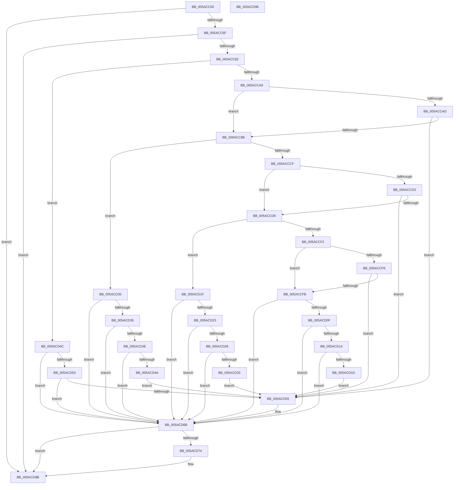

# _asan_load8

- RVA: `0x005ACC50`–`0x005ACD97` (길이 `327` bytes)
- VA: `0x00000001405ACC50`
- 실행 섹션: `.text`
- PDB 이름 있음: `예`; PDB Function 태그: `아니요`
- unwind 정보 RVA: `0x0006E5F8`
- 디코드: `101`개 명령, `327/327` bytes 표시
- 미해석 바이트: `0` (있으면 어셈블리에 `.byte`로 보존)

> 이 문서는 커널 이미지의 기계어와 PDB 기호를 분석해 생성했습니다. 4번과 5번은 함수 원형과 자료형을 바이너리 사용 방식에서 추정한 C 해석이며 원본 소스 복구 결과는 아닙니다.

## 1. Dependencies

- 직접 호출 지점: **2**; 고유 호출 대상: **2**
- 직접 호출자로 확인된 함수: **0**
- RIP 상대 이미지 참조: **3**

### Outgoing calls
- `0x005ACD66` → [KasaniReport](KasaniReport_function_005AB0B0.md) (function, `0x005AB0B0`)
- `0x005ACD86` → [KcsanValidateAddress](KcsanValidateAddress_function_005AF5E0.md) (function, `0x005AF5E0`)

### Direct callers
- 이 함수 시작 RVA로 연결되는 직접 call은 확인되지 않았습니다. 간접 호출은 완전히 역산할 수 없습니다.

### Static image references
- `0x005ACC5A` → RVA `0x00FCEC6A` (`ALMOSTRO`; read)
- `0x005ACC82` → RVA `0x00FC6ED8` (`ALMOSTRO`; read)
- `0x005ACD6B` → RVA `0x00F8A7E8` (`.data`; read)

## 2. Other-region calls and transfers

- 다른 실행 섹션으로 향하는 call: **0**
- 별도 외부 분기/꼬리 이동을 확인하지 못했습니다.

## 3. Assembly (complete function range)

```asm
005ACC50  48 89 5C 24 08                  mov qword ptr [rsp + 8], rbx
005ACC55  57                              push rdi
005ACC56  48 83 EC 30                     sub rsp, 0x30
005ACC5A  80 3D 09 20 A2 00 00            cmp byte ptr [rip + 0xa22009], 0
005ACC61  48 8B D9                        mov rbx, rcx
005ACC64  48 8B 7C 24 38                  mov rdi, qword ptr [rsp + 0x38]
005ACC69  0F 84 1C 01 00 00               je 0x1405acd8b
005ACC6F  48 B8 00 00 00 00 00 80 FF FF   movabs rax, 0xffff800000000000
005ACC79  48 3B C8                        cmp rcx, rax
005ACC7C  0F 82 09 01 00 00               jb 0x1405acd8b
005ACC82  4C 8B 05 4F A2 A1 00            mov r8, qword ptr [rip + 0xa1a24f]
005ACC89  49 B9 00 00 00 00 00 80 00 00   movabs r9, 0x800000000000
005ACC93  4A 8D 04 09                     lea rax, [rcx + r9]
005ACC97  48 C1 E8 03                     shr rax, 3
005ACC9B  42 0F B6 0C 00                  movzx ecx, byte ptr [rax + r8]
005ACCA0  F6 C3 07                        test bl, 7
005ACCA3  0F 86 A3 00 00 00               jbe 0x1405acd4c
005ACCA9  84 C9                           test cl, cl
005ACCAB  74 09                           je 0x1405accb6
005ACCAD  80 F9 08                        cmp cl, 8
005ACCB0  0F 8C 9F 00 00 00               jl 0x1405acd55
005ACCB6  48 8D 53 04                     lea rdx, [rbx + 4]
005ACCBA  4A 8D 04 0A                     lea rax, [rdx + r9]
005ACCBE  48 C1 E8 03                     shr rax, 3
005ACCC2  42 0F B6 0C 00                  movzx ecx, byte ptr [rax + r8]
005ACCC7  8B C2                           mov eax, edx
005ACCC9  24 07                           and al, 7
005ACCCB  3C 04                           cmp al, 4
005ACCCD  76 66                           jbe 0x1405acd35
005ACCCF  84 C9                           test cl, cl
005ACCD1  74 05                           je 0x1405accd8
005ACCD3  80 F9 08                        cmp cl, 8
005ACCD6  7C 7D                           jl 0x1405acd55
005ACCD8  48 83 C2 02                     add rdx, 2
005ACCDC  4A 8D 04 0A                     lea rax, [rdx + r9]
005ACCE0  48 C1 E8 03                     shr rax, 3
005ACCE4  42 0F B6 0C 00                  movzx ecx, byte ptr [rax + r8]
005ACCE9  8B C2                           mov eax, edx
005ACCEB  83 E0 07                        and eax, 7
005ACCEE  3C 06                           cmp al, 6
005ACCF0  76 2D                           jbe 0x1405acd1f
005ACCF2  84 C9                           test cl, cl
005ACCF4  74 05                           je 0x1405accfb
005ACCF6  80 F9 08                        cmp cl, 8
005ACCF9  7C 5A                           jl 0x1405acd55
005ACCFB  48 FF C2                        inc rdx
005ACCFE  4A 8D 04 0A                     lea rax, [rdx + r9]
005ACD02  48 C1 E8 03                     shr rax, 3
005ACD06  42 0F B6 0C 00                  movzx ecx, byte ptr [rax + r8]
005ACD0B  84 C9                           test cl, cl
005ACD0D  74 5C                           je 0x1405acd6b
005ACD0F  80 F9 08                        cmp cl, 8
005ACD12  7D 57                           jge 0x1405acd6b
005ACD14  80 E2 07                        and dl, 7
005ACD17  FE C2                           inc dl
005ACD19  3A D1                           cmp dl, cl
005ACD1B  7E 4E                           jle 0x1405acd6b
005ACD1D  EB 36                           jmp 0x1405acd55
005ACD1F  84 C9                           test cl, cl
005ACD21  74 48                           je 0x1405acd6b
005ACD23  80 F9 08                        cmp cl, 8
005ACD26  7D 43                           jge 0x1405acd6b
005ACD28  FE C2                           inc dl
005ACD2A  80 E2 07                        and dl, 7
005ACD2D  FE C2                           inc dl
005ACD2F  3A D1                           cmp dl, cl
005ACD31  7E 38                           jle 0x1405acd6b
005ACD33  EB 20                           jmp 0x1405acd55
005ACD35  84 C9                           test cl, cl
005ACD37  74 32                           je 0x1405acd6b
005ACD39  80 F9 08                        cmp cl, 8
005ACD3C  7D 2D                           jge 0x1405acd6b
005ACD3E  80 C2 03                        add dl, 3
005ACD41  80 E2 07                        and dl, 7
005ACD44  FE C2                           inc dl
005ACD46  3A D1                           cmp dl, cl
005ACD48  7E 21                           jle 0x1405acd6b
005ACD4A  EB 09                           jmp 0x1405acd55
005ACD4C  84 C9                           test cl, cl
005ACD4E  74 1B                           je 0x1405acd6b
005ACD50  80 F9 08                        cmp cl, 8
005ACD53  7D 16                           jge 0x1405acd6b
005ACD55  45 33 C0                        xor r8d, r8d
005ACD58  88 4C 24 20                     mov byte ptr [rsp + 0x20], cl
005ACD5C  4C 8B CF                        mov r9, rdi
005ACD5F  48 8B CB                        mov rcx, rbx
005ACD62  41 8D 50 08                     lea edx, [r8 + 8]
005ACD66  E8 45 E3 FF FF                  call 0x1405ab0b0
005ACD6B  80 3D 76 DA 9D 00 00            cmp byte ptr [rip + 0x9dda76], 0
005ACD72  74 17                           je 0x1405acd8b
005ACD74  45 33 C9                        xor r9d, r9d
005ACD77  48 89 7C 24 20                  mov qword ptr [rsp + 0x20], rdi
005ACD7C  45 33 C0                        xor r8d, r8d
005ACD7F  48 8B CB                        mov rcx, rbx
005ACD82  41 8D 51 08                     lea edx, [r9 + 8]
005ACD86  E8 55 28 00 00                  call 0x1405af5e0
005ACD8B  48 8B 5C 24 40                  mov rbx, qword ptr [rsp + 0x40]
005ACD90  48 83 C4 30                     add rsp, 0x30
005ACD94  5F                              pop rdi
005ACD95  C3                              ret
005ACD96  CC                              int3
```

## 4. C-style interpretation (structured pseudocode)

```c
__int64 __fastcall _asan_load8(__int64 a1)
{
    __int64 result;
    __int64 v_rsp;
    unsigned __int8 v_stack_m18;
    unsigned __int64 v_stack_p0;
    unsigned __int64 v_stack_p8;

    v_stack_p8 = v_rbx;
    v_rsp = (v_rsp) - (48);
    if ((*(unsigned __int8 *)(v_rip + 10625033)) == 0) goto loc_005ACD8B;
    if (a1 < result) goto loc_005ACD8B;
    result = (a1 + a4 * 1) >> (3);
    if (condition_is_below_or_equal) goto loc_005ACD4C;
    if ((unsigned __int8)(*(unsigned __int8 *)(result + *(unsigned __int64 *)(v_rip + 10592847) * 1)) == 0) goto loc_005ACCB6;
    if (((unsigned __int8)(*(unsigned __int8 *)(result + *(unsigned __int64 *)(v_rip + 10592847) * 1))) < 8) goto loc_005ACD55;
loc_005ACCB6:
    result = (a1 + 4 + a4 * 1) >> (3);
    result = (unsigned __int8)(((unsigned int)((unsigned int)(a1 + 4))) & (7));
    if (((unsigned __int8)(result)) <= 4) goto loc_005ACD35;
    if ((unsigned __int8)(*(unsigned __int8 *)(result + *(unsigned __int64 *)(v_rip + 10592847) * 1)) == 0) goto loc_005ACCD8;
    if (((unsigned __int8)(*(unsigned __int8 *)(result + *(unsigned __int64 *)(v_rip + 10592847) * 1))) < 8) goto loc_005ACD55;
loc_005ACCD8:
    a2 = (a1 + 4) + (2);
    result = (a2 + a4 * 1) >> (3);
    result = (unsigned int)(((unsigned int)((unsigned int)(a2))) & (7));
    if (((unsigned __int8)(result)) <= 6) goto loc_005ACD1F;
    if ((unsigned __int8)(*(unsigned __int8 *)(result + *(unsigned __int64 *)(v_rip + 10592847) * 1)) == 0) goto loc_005ACCFB;
    if (((unsigned __int8)(*(unsigned __int8 *)(result + *(unsigned __int64 *)(v_rip + 10592847) * 1))) < 8) goto loc_005ACD55;
loc_005ACCFB:
    a2 = (a2) + 1;
    result = (a2 + a4 * 1) >> (3);
    if ((unsigned __int8)(*(unsigned __int8 *)(result + *(unsigned __int64 *)(v_rip + 10592847) * 1)) == 0) goto loc_005ACD6B;
    if (((unsigned __int8)(*(unsigned __int8 *)(result + *(unsigned __int64 *)(v_rip + 10592847) * 1))) >= 8) goto loc_005ACD6B;
    a2 = (unsigned __int8)((a2) & (7));
    a2 = (unsigned __int8)((a2) + 1);
    if (((unsigned __int8)(a2)) <= ((unsigned __int8)(*(unsigned __int8 *)(result + *(unsigned __int64 *)(v_rip + 10592847) * 1)))) goto loc_005ACD6B;
    goto loc_005ACD55;
loc_005ACD1F:
    if ((unsigned __int8)(*(unsigned __int8 *)(result + *(unsigned __int64 *)(v_rip + 10592847) * 1)) == 0) goto loc_005ACD6B;
    if (((unsigned __int8)(*(unsigned __int8 *)(result + *(unsigned __int64 *)(v_rip + 10592847) * 1))) >= 8) goto loc_005ACD6B;
    a2 = (unsigned __int8)((a2) + 1);
    a2 = (unsigned __int8)((a2) & (7));
    a2 = (unsigned __int8)((a2) + 1);
    if (((unsigned __int8)(a2)) <= ((unsigned __int8)(*(unsigned __int8 *)(result + *(unsigned __int64 *)(v_rip + 10592847) * 1)))) goto loc_005ACD6B;
    goto loc_005ACD55;
loc_005ACD35:
    if ((unsigned __int8)(*(unsigned __int8 *)(result + *(unsigned __int64 *)(v_rip + 10592847) * 1)) == 0) goto loc_005ACD6B;
    if (((unsigned __int8)(*(unsigned __int8 *)(result + *(unsigned __int64 *)(v_rip + 10592847) * 1))) >= 8) goto loc_005ACD6B;
    a2 = (unsigned __int8)((a2) + (3));
    a2 = (unsigned __int8)((a2) & (7));
    a2 = (unsigned __int8)((a2) + 1);
    if (((unsigned __int8)(a2)) <= ((unsigned __int8)(*(unsigned __int8 *)(result + *(unsigned __int64 *)(v_rip + 10592847) * 1)))) goto loc_005ACD6B;
    goto loc_005ACD55;
loc_005ACD4C:
    if ((unsigned __int8)(*(unsigned __int8 *)(result + *(unsigned __int64 *)(v_rip + 10592847) * 1)) == 0) goto loc_005ACD6B;
    if (((unsigned __int8)(*(unsigned __int8 *)(result + *(unsigned __int64 *)(v_rip + 10592847) * 1))) < 8) {
        a3 = 0;
        v_stack_m18 = (unsigned __int8)(*(unsigned __int8 *)(result + *(unsigned __int64 *)(v_rip + 10592847) * 1));
        a4 = v_stack_p0;
        a1 = a1;
        a2 = a3 + 8;
        result = KasaniReport(a1, a2, a3, a4);
    }
    if ((*(unsigned __int8 *)(v_rip + 10345078)) != 0) {
        a4 = 0;
        v_stack_m18 = v_stack_p0;
        a3 = 0;
        a1 = a1;
        a2 = a4 + 8;
        result = KcsanValidateAddress(a1, a2, a3, a4);
    }
    v_rsp = (v_rsp) + (48);
    return result;
}
```

## 5. (Beta) C Style

```c
int64_t _asan_load8(int64_t Arg1)
{
    int64_t result;
    int64_t local_rsp;
    uint8_t v_stack_m18;
    uint64_t v_stack_p0;
    uint64_t v_stack_p8;

    v_stack_p8 = local_rbx;
    local_rsp = (local_rsp) - (48);
    if ((*(uint8_t *)(v_rip + 0xA22009)) == 0) goto loc_005ACD8B;
    if (Arg1 < result) goto loc_005ACD8B;
    result = (Arg1 + a4 * 1) >> (3);
    if (condition_is_below_or_equal) goto loc_005ACD4C;
    if ((uint8_t)(*(uint8_t *)(result + *(uint64_t *)(v_rip + 0xA1A24F) * 1)) == 0) goto loc_005ACCB6;
    if (((uint8_t)(*(uint8_t *)(result + *(uint64_t *)(v_rip + 0xA1A24F) * 1))) < 8) goto loc_005ACD55;
loc_005ACCB6:
    result = (Arg1 + 4 + a4 * 1) >> (3);
    result = (uint8_t)(((uint32_t)((uint32_t)(Arg1 + 4))) & (7));
    if (((uint8_t)(result)) <= 4) goto loc_005ACD35;
    if ((uint8_t)(*(uint8_t *)(result + *(uint64_t *)(v_rip + 0xA1A24F) * 1)) == 0) goto loc_005ACCD8;
    if (((uint8_t)(*(uint8_t *)(result + *(uint64_t *)(v_rip + 0xA1A24F) * 1))) < 8) goto loc_005ACD55;
loc_005ACCD8:
    a2 = (Arg1 + 4) + (2);
    result = (a2 + a4 * 1) >> (3);
    result = (uint32_t)(((uint32_t)((uint32_t)(a2))) & (7));
    if (((uint8_t)(result)) <= 6) goto loc_005ACD1F;
    if ((uint8_t)(*(uint8_t *)(result + *(uint64_t *)(v_rip + 0xA1A24F) * 1)) == 0) goto loc_005ACCFB;
    if (((uint8_t)(*(uint8_t *)(result + *(uint64_t *)(v_rip + 0xA1A24F) * 1))) < 8) goto loc_005ACD55;
loc_005ACCFB:
    a2 = (a2) + 1;
    result = (a2 + a4 * 1) >> (3);
    if ((uint8_t)(*(uint8_t *)(result + *(uint64_t *)(v_rip + 0xA1A24F) * 1)) == 0) goto loc_005ACD6B;
    if (((uint8_t)(*(uint8_t *)(result + *(uint64_t *)(v_rip + 0xA1A24F) * 1))) >= 8) goto loc_005ACD6B;
    a2 = (uint8_t)((a2) & (7));
    a2 = (uint8_t)((a2) + 1);
    if (((uint8_t)(a2)) <= ((uint8_t)(*(uint8_t *)(result + *(uint64_t *)(v_rip + 0xA1A24F) * 1)))) goto loc_005ACD6B;
    goto loc_005ACD55;
loc_005ACD1F:
    if ((uint8_t)(*(uint8_t *)(result + *(uint64_t *)(v_rip + 0xA1A24F) * 1)) == 0) goto loc_005ACD6B;
    if (((uint8_t)(*(uint8_t *)(result + *(uint64_t *)(v_rip + 0xA1A24F) * 1))) >= 8) goto loc_005ACD6B;
    a2 = (uint8_t)((a2) + 1);
    a2 = (uint8_t)((a2) & (7));
    a2 = (uint8_t)((a2) + 1);
    if (((uint8_t)(a2)) <= ((uint8_t)(*(uint8_t *)(result + *(uint64_t *)(v_rip + 0xA1A24F) * 1)))) goto loc_005ACD6B;
    goto loc_005ACD55;
loc_005ACD35:
    if ((uint8_t)(*(uint8_t *)(result + *(uint64_t *)(v_rip + 0xA1A24F) * 1)) == 0) goto loc_005ACD6B;
    if (((uint8_t)(*(uint8_t *)(result + *(uint64_t *)(v_rip + 0xA1A24F) * 1))) >= 8) goto loc_005ACD6B;
    a2 = (uint8_t)((a2) + (3));
    a2 = (uint8_t)((a2) & (7));
    a2 = (uint8_t)((a2) + 1);
    if (((uint8_t)(a2)) <= ((uint8_t)(*(uint8_t *)(result + *(uint64_t *)(v_rip + 0xA1A24F) * 1)))) goto loc_005ACD6B;
    goto loc_005ACD55;
loc_005ACD4C:
    if ((uint8_t)(*(uint8_t *)(result + *(uint64_t *)(v_rip + 0xA1A24F) * 1)) == 0) goto loc_005ACD6B;
    if (((uint8_t)(*(uint8_t *)(result + *(uint64_t *)(v_rip + 0xA1A24F) * 1))) < 8) {
        a3 = 0;
        v_stack_m18 = (uint8_t)(*(uint8_t *)(result + *(uint64_t *)(v_rip + 0xA1A24F) * 1));
        a4 = v_stack_p0;
        Arg1 = Arg1;
        a2 = a3 + 8;
        result = KasaniReport(Arg1, a2, a3, a4);
    }
    if ((*(uint8_t *)(v_rip + 0x9DDA76)) != 0) {
        a4 = 0;
        v_stack_m18 = v_stack_p0;
        a3 = 0;
        Arg1 = Arg1;
        a2 = a4 + 8;
        result = KcsanValidateAddress(Arg1, a2, a3, a4);
    }
    local_rsp = (local_rsp) + (48);
    return result;
}
```

## 6. Execution-region graph

[열기: 2D/3D 그래프와 함수 탐색 컨트롤 패널](../../../control-panel.html?section=text&rva=0x005ACC50&view=graph)

- 2D 그래프는 위에서 아래로 흐르고, 3D 그래프는 빈 공간을 드래그해 회전합니다. Shift+드래그는 이동, 휠은 확대·축소, 함수 노드 선택은 대상 보고서 이동입니다.

### Static fallback


