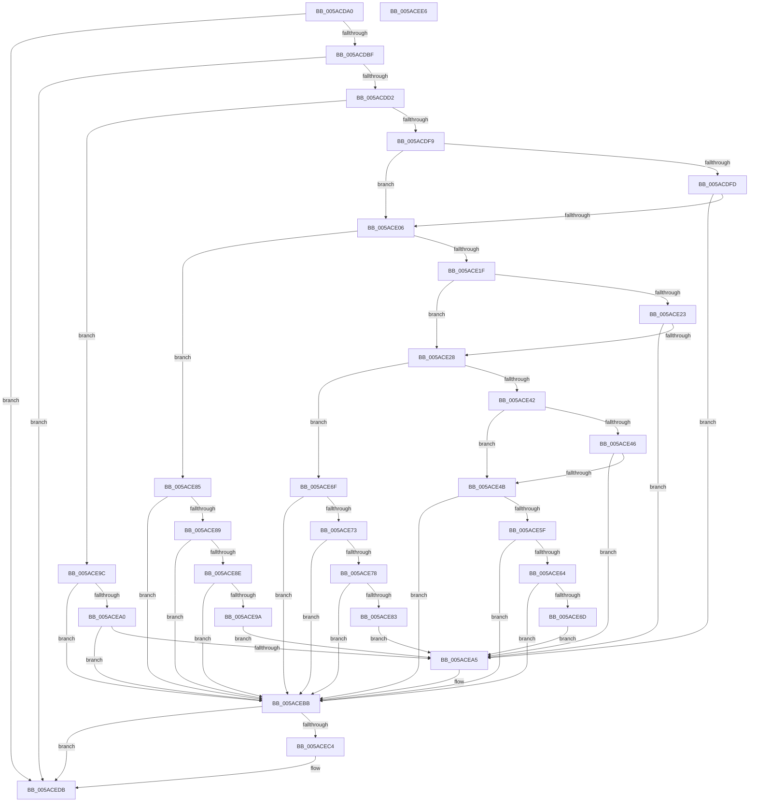

# _asan_load8_volatile

- RVA: `0x005ACDA0`–`0x005ACEE7` (길이 `327` bytes)
- VA: `0x00000001405ACDA0`
- 실행 섹션: `.text`
- PDB 이름 있음: `예`; PDB Function 태그: `아니요`
- unwind 정보 RVA: `0x0006E5F8`
- 디코드: `101`개 명령, `327/327` bytes 표시
- 미해석 바이트: `0` (있으면 어셈블리에 `.byte`로 보존)

> 이 문서는 커널 이미지의 기계어와 PDB 기호를 분석해 생성했습니다. 4번과 5번은 함수 원형과 자료형을 바이너리 사용 방식에서 추정한 C 해석이며 원본 소스 복구 결과는 아닙니다.

## 1. Dependencies

- 직접 호출 지점: **2**; 고유 호출 대상: **2**
- 직접 호출자로 확인된 함수: **0**
- RIP 상대 이미지 참조: **3**

### Outgoing calls
- `0x005ACEB6` → [KasaniReport](KasaniReport_function_005AB0B0.md) (function, `0x005AB0B0`)
- `0x005ACED6` → [KcsanValidateAddress](KcsanValidateAddress_function_005AF5E0.md) (function, `0x005AF5E0`)

### Direct callers
- 이 함수 시작 RVA로 연결되는 직접 call은 확인되지 않았습니다. 간접 호출은 완전히 역산할 수 없습니다.

### Static image references
- `0x005ACDAA` → RVA `0x00FCEC6A` (`ALMOSTRO`; read)
- `0x005ACDD2` → RVA `0x00FC6ED8` (`ALMOSTRO`; read)
- `0x005ACEBB` → RVA `0x00F8A7E8` (`.data`; read)

## 2. Other-region calls and transfers

- 다른 실행 섹션으로 향하는 call: **0**
- 별도 외부 분기/꼬리 이동을 확인하지 못했습니다.

## 3. Assembly (complete function range)

```asm
005ACDA0  48 89 5C 24 08                  mov qword ptr [rsp + 8], rbx
005ACDA5  57                              push rdi
005ACDA6  48 83 EC 30                     sub rsp, 0x30
005ACDAA  80 3D B9 1E A2 00 00            cmp byte ptr [rip + 0xa21eb9], 0
005ACDB1  48 8B D9                        mov rbx, rcx
005ACDB4  48 8B 7C 24 38                  mov rdi, qword ptr [rsp + 0x38]
005ACDB9  0F 84 1C 01 00 00               je 0x1405acedb
005ACDBF  48 B8 00 00 00 00 00 80 FF FF   movabs rax, 0xffff800000000000
005ACDC9  48 3B C8                        cmp rcx, rax
005ACDCC  0F 82 09 01 00 00               jb 0x1405acedb
005ACDD2  4C 8B 05 FF A0 A1 00            mov r8, qword ptr [rip + 0xa1a0ff]
005ACDD9  49 B9 00 00 00 00 00 80 00 00   movabs r9, 0x800000000000
005ACDE3  4A 8D 04 09                     lea rax, [rcx + r9]
005ACDE7  48 C1 E8 03                     shr rax, 3
005ACDEB  42 0F B6 0C 00                  movzx ecx, byte ptr [rax + r8]
005ACDF0  F6 C3 07                        test bl, 7
005ACDF3  0F 86 A3 00 00 00               jbe 0x1405ace9c
005ACDF9  84 C9                           test cl, cl
005ACDFB  74 09                           je 0x1405ace06
005ACDFD  80 F9 08                        cmp cl, 8
005ACE00  0F 8C 9F 00 00 00               jl 0x1405acea5
005ACE06  48 8D 53 04                     lea rdx, [rbx + 4]
005ACE0A  4A 8D 04 0A                     lea rax, [rdx + r9]
005ACE0E  48 C1 E8 03                     shr rax, 3
005ACE12  42 0F B6 0C 00                  movzx ecx, byte ptr [rax + r8]
005ACE17  8B C2                           mov eax, edx
005ACE19  24 07                           and al, 7
005ACE1B  3C 04                           cmp al, 4
005ACE1D  76 66                           jbe 0x1405ace85
005ACE1F  84 C9                           test cl, cl
005ACE21  74 05                           je 0x1405ace28
005ACE23  80 F9 08                        cmp cl, 8
005ACE26  7C 7D                           jl 0x1405acea5
005ACE28  48 83 C2 02                     add rdx, 2
005ACE2C  4A 8D 04 0A                     lea rax, [rdx + r9]
005ACE30  48 C1 E8 03                     shr rax, 3
005ACE34  42 0F B6 0C 00                  movzx ecx, byte ptr [rax + r8]
005ACE39  8B C2                           mov eax, edx
005ACE3B  83 E0 07                        and eax, 7
005ACE3E  3C 06                           cmp al, 6
005ACE40  76 2D                           jbe 0x1405ace6f
005ACE42  84 C9                           test cl, cl
005ACE44  74 05                           je 0x1405ace4b
005ACE46  80 F9 08                        cmp cl, 8
005ACE49  7C 5A                           jl 0x1405acea5
005ACE4B  48 FF C2                        inc rdx
005ACE4E  4A 8D 04 0A                     lea rax, [rdx + r9]
005ACE52  48 C1 E8 03                     shr rax, 3
005ACE56  42 0F B6 0C 00                  movzx ecx, byte ptr [rax + r8]
005ACE5B  84 C9                           test cl, cl
005ACE5D  74 5C                           je 0x1405acebb
005ACE5F  80 F9 08                        cmp cl, 8
005ACE62  7D 57                           jge 0x1405acebb
005ACE64  80 E2 07                        and dl, 7
005ACE67  FE C2                           inc dl
005ACE69  3A D1                           cmp dl, cl
005ACE6B  7E 4E                           jle 0x1405acebb
005ACE6D  EB 36                           jmp 0x1405acea5
005ACE6F  84 C9                           test cl, cl
005ACE71  74 48                           je 0x1405acebb
005ACE73  80 F9 08                        cmp cl, 8
005ACE76  7D 43                           jge 0x1405acebb
005ACE78  FE C2                           inc dl
005ACE7A  80 E2 07                        and dl, 7
005ACE7D  FE C2                           inc dl
005ACE7F  3A D1                           cmp dl, cl
005ACE81  7E 38                           jle 0x1405acebb
005ACE83  EB 20                           jmp 0x1405acea5
005ACE85  84 C9                           test cl, cl
005ACE87  74 32                           je 0x1405acebb
005ACE89  80 F9 08                        cmp cl, 8
005ACE8C  7D 2D                           jge 0x1405acebb
005ACE8E  80 C2 03                        add dl, 3
005ACE91  80 E2 07                        and dl, 7
005ACE94  FE C2                           inc dl
005ACE96  3A D1                           cmp dl, cl
005ACE98  7E 21                           jle 0x1405acebb
005ACE9A  EB 09                           jmp 0x1405acea5
005ACE9C  84 C9                           test cl, cl
005ACE9E  74 1B                           je 0x1405acebb
005ACEA0  80 F9 08                        cmp cl, 8
005ACEA3  7D 16                           jge 0x1405acebb
005ACEA5  45 33 C0                        xor r8d, r8d
005ACEA8  88 4C 24 20                     mov byte ptr [rsp + 0x20], cl
005ACEAC  4C 8B CF                        mov r9, rdi
005ACEAF  48 8B CB                        mov rcx, rbx
005ACEB2  41 8D 50 08                     lea edx, [r8 + 8]
005ACEB6  E8 F5 E1 FF FF                  call 0x1405ab0b0
005ACEBB  80 3D 26 D9 9D 00 00            cmp byte ptr [rip + 0x9dd926], 0
005ACEC2  74 17                           je 0x1405acedb
005ACEC4  45 33 C0                        xor r8d, r8d
005ACEC7  48 89 7C 24 20                  mov qword ptr [rsp + 0x20], rdi
005ACECC  41 B1 01                        mov r9b, 1
005ACECF  48 8B CB                        mov rcx, rbx
005ACED2  41 8D 50 08                     lea edx, [r8 + 8]
005ACED6  E8 05 27 00 00                  call 0x1405af5e0
005ACEDB  48 8B 5C 24 40                  mov rbx, qword ptr [rsp + 0x40]
005ACEE0  48 83 C4 30                     add rsp, 0x30
005ACEE4  5F                              pop rdi
005ACEE5  C3                              ret
005ACEE6  CC                              int3
```

## 4. C-style interpretation (structured pseudocode)

```c
__int64 __fastcall _asan_load8_volatile(__int64 a1)
{
    __int64 result;
    __int64 v_rsp;
    unsigned __int8 v_stack_m18;
    unsigned __int64 v_stack_p0;
    unsigned __int64 v_stack_p8;

    v_stack_p8 = v_rbx;
    v_rsp = (v_rsp) - (48);
    if ((*(unsigned __int8 *)(v_rip + 10624697)) == 0) goto loc_005ACEDB;
    if (a1 < result) goto loc_005ACEDB;
    result = (a1 + a4 * 1) >> (3);
    if (condition_is_below_or_equal) goto loc_005ACE9C;
    if ((unsigned __int8)(*(unsigned __int8 *)(result + *(unsigned __int64 *)(v_rip + 10592511) * 1)) == 0) goto loc_005ACE06;
    if (((unsigned __int8)(*(unsigned __int8 *)(result + *(unsigned __int64 *)(v_rip + 10592511) * 1))) < 8) goto loc_005ACEA5;
loc_005ACE06:
    result = (a1 + 4 + a4 * 1) >> (3);
    result = (unsigned __int8)(((unsigned int)((unsigned int)(a1 + 4))) & (7));
    if (((unsigned __int8)(result)) <= 4) goto loc_005ACE85;
    if ((unsigned __int8)(*(unsigned __int8 *)(result + *(unsigned __int64 *)(v_rip + 10592511) * 1)) == 0) goto loc_005ACE28;
    if (((unsigned __int8)(*(unsigned __int8 *)(result + *(unsigned __int64 *)(v_rip + 10592511) * 1))) < 8) goto loc_005ACEA5;
loc_005ACE28:
    a2 = (a1 + 4) + (2);
    result = (a2 + a4 * 1) >> (3);
    result = (unsigned int)(((unsigned int)((unsigned int)(a2))) & (7));
    if (((unsigned __int8)(result)) <= 6) goto loc_005ACE6F;
    if ((unsigned __int8)(*(unsigned __int8 *)(result + *(unsigned __int64 *)(v_rip + 10592511) * 1)) == 0) goto loc_005ACE4B;
    if (((unsigned __int8)(*(unsigned __int8 *)(result + *(unsigned __int64 *)(v_rip + 10592511) * 1))) < 8) goto loc_005ACEA5;
loc_005ACE4B:
    a2 = (a2) + 1;
    result = (a2 + a4 * 1) >> (3);
    if ((unsigned __int8)(*(unsigned __int8 *)(result + *(unsigned __int64 *)(v_rip + 10592511) * 1)) == 0) goto loc_005ACEBB;
    if (((unsigned __int8)(*(unsigned __int8 *)(result + *(unsigned __int64 *)(v_rip + 10592511) * 1))) >= 8) goto loc_005ACEBB;
    a2 = (unsigned __int8)((a2) & (7));
    a2 = (unsigned __int8)((a2) + 1);
    if (((unsigned __int8)(a2)) <= ((unsigned __int8)(*(unsigned __int8 *)(result + *(unsigned __int64 *)(v_rip + 10592511) * 1)))) goto loc_005ACEBB;
    goto loc_005ACEA5;
loc_005ACE6F:
    if ((unsigned __int8)(*(unsigned __int8 *)(result + *(unsigned __int64 *)(v_rip + 10592511) * 1)) == 0) goto loc_005ACEBB;
    if (((unsigned __int8)(*(unsigned __int8 *)(result + *(unsigned __int64 *)(v_rip + 10592511) * 1))) >= 8) goto loc_005ACEBB;
    a2 = (unsigned __int8)((a2) + 1);
    a2 = (unsigned __int8)((a2) & (7));
    a2 = (unsigned __int8)((a2) + 1);
    if (((unsigned __int8)(a2)) <= ((unsigned __int8)(*(unsigned __int8 *)(result + *(unsigned __int64 *)(v_rip + 10592511) * 1)))) goto loc_005ACEBB;
    goto loc_005ACEA5;
loc_005ACE85:
    if ((unsigned __int8)(*(unsigned __int8 *)(result + *(unsigned __int64 *)(v_rip + 10592511) * 1)) == 0) goto loc_005ACEBB;
    if (((unsigned __int8)(*(unsigned __int8 *)(result + *(unsigned __int64 *)(v_rip + 10592511) * 1))) >= 8) goto loc_005ACEBB;
    a2 = (unsigned __int8)((a2) + (3));
    a2 = (unsigned __int8)((a2) & (7));
    a2 = (unsigned __int8)((a2) + 1);
    if (((unsigned __int8)(a2)) <= ((unsigned __int8)(*(unsigned __int8 *)(result + *(unsigned __int64 *)(v_rip + 10592511) * 1)))) goto loc_005ACEBB;
    goto loc_005ACEA5;
loc_005ACE9C:
    if ((unsigned __int8)(*(unsigned __int8 *)(result + *(unsigned __int64 *)(v_rip + 10592511) * 1)) == 0) goto loc_005ACEBB;
    if (((unsigned __int8)(*(unsigned __int8 *)(result + *(unsigned __int64 *)(v_rip + 10592511) * 1))) < 8) {
        a3 = 0;
        v_stack_m18 = (unsigned __int8)(*(unsigned __int8 *)(result + *(unsigned __int64 *)(v_rip + 10592511) * 1));
        a4 = v_stack_p0;
        a1 = a1;
        a2 = a3 + 8;
        result = KasaniReport(a1, a2, a3, a4);
    }
    if ((*(unsigned __int8 *)(v_rip + 10344742)) != 0) {
        a3 = 0;
        v_stack_m18 = v_stack_p0;
        a4 = 1;
        a1 = a1;
        a2 = a3 + 8;
        result = KcsanValidateAddress(a1, a2, a3, a4);
    }
    v_rsp = (v_rsp) + (48);
    return result;
}
```

## 5. (Beta) C Style

```c
int64_t _asan_load8_volatile(int64_t Arg1)
{
    int64_t result;
    int64_t local_rsp;
    uint8_t v_stack_m18;
    uint64_t v_stack_p0;
    uint64_t v_stack_p8;

    v_stack_p8 = local_rbx;
    local_rsp = (local_rsp) - (48);
    if ((*(uint8_t *)(v_rip + 0xA21EB9)) == 0) goto loc_005ACEDB;
    if (Arg1 < result) goto loc_005ACEDB;
    result = (Arg1 + a4 * 1) >> (3);
    if (condition_is_below_or_equal) goto loc_005ACE9C;
    if ((uint8_t)(*(uint8_t *)(result + *(uint64_t *)(v_rip + 0xA1A0FF) * 1)) == 0) goto loc_005ACE06;
    if (((uint8_t)(*(uint8_t *)(result + *(uint64_t *)(v_rip + 0xA1A0FF) * 1))) < 8) goto loc_005ACEA5;
loc_005ACE06:
    result = (Arg1 + 4 + a4 * 1) >> (3);
    result = (uint8_t)(((uint32_t)((uint32_t)(Arg1 + 4))) & (7));
    if (((uint8_t)(result)) <= 4) goto loc_005ACE85;
    if ((uint8_t)(*(uint8_t *)(result + *(uint64_t *)(v_rip + 0xA1A0FF) * 1)) == 0) goto loc_005ACE28;
    if (((uint8_t)(*(uint8_t *)(result + *(uint64_t *)(v_rip + 0xA1A0FF) * 1))) < 8) goto loc_005ACEA5;
loc_005ACE28:
    a2 = (Arg1 + 4) + (2);
    result = (a2 + a4 * 1) >> (3);
    result = (uint32_t)(((uint32_t)((uint32_t)(a2))) & (7));
    if (((uint8_t)(result)) <= 6) goto loc_005ACE6F;
    if ((uint8_t)(*(uint8_t *)(result + *(uint64_t *)(v_rip + 0xA1A0FF) * 1)) == 0) goto loc_005ACE4B;
    if (((uint8_t)(*(uint8_t *)(result + *(uint64_t *)(v_rip + 0xA1A0FF) * 1))) < 8) goto loc_005ACEA5;
loc_005ACE4B:
    a2 = (a2) + 1;
    result = (a2 + a4 * 1) >> (3);
    if ((uint8_t)(*(uint8_t *)(result + *(uint64_t *)(v_rip + 0xA1A0FF) * 1)) == 0) goto loc_005ACEBB;
    if (((uint8_t)(*(uint8_t *)(result + *(uint64_t *)(v_rip + 0xA1A0FF) * 1))) >= 8) goto loc_005ACEBB;
    a2 = (uint8_t)((a2) & (7));
    a2 = (uint8_t)((a2) + 1);
    if (((uint8_t)(a2)) <= ((uint8_t)(*(uint8_t *)(result + *(uint64_t *)(v_rip + 0xA1A0FF) * 1)))) goto loc_005ACEBB;
    goto loc_005ACEA5;
loc_005ACE6F:
    if ((uint8_t)(*(uint8_t *)(result + *(uint64_t *)(v_rip + 0xA1A0FF) * 1)) == 0) goto loc_005ACEBB;
    if (((uint8_t)(*(uint8_t *)(result + *(uint64_t *)(v_rip + 0xA1A0FF) * 1))) >= 8) goto loc_005ACEBB;
    a2 = (uint8_t)((a2) + 1);
    a2 = (uint8_t)((a2) & (7));
    a2 = (uint8_t)((a2) + 1);
    if (((uint8_t)(a2)) <= ((uint8_t)(*(uint8_t *)(result + *(uint64_t *)(v_rip + 0xA1A0FF) * 1)))) goto loc_005ACEBB;
    goto loc_005ACEA5;
loc_005ACE85:
    if ((uint8_t)(*(uint8_t *)(result + *(uint64_t *)(v_rip + 0xA1A0FF) * 1)) == 0) goto loc_005ACEBB;
    if (((uint8_t)(*(uint8_t *)(result + *(uint64_t *)(v_rip + 0xA1A0FF) * 1))) >= 8) goto loc_005ACEBB;
    a2 = (uint8_t)((a2) + (3));
    a2 = (uint8_t)((a2) & (7));
    a2 = (uint8_t)((a2) + 1);
    if (((uint8_t)(a2)) <= ((uint8_t)(*(uint8_t *)(result + *(uint64_t *)(v_rip + 0xA1A0FF) * 1)))) goto loc_005ACEBB;
    goto loc_005ACEA5;
loc_005ACE9C:
    if ((uint8_t)(*(uint8_t *)(result + *(uint64_t *)(v_rip + 0xA1A0FF) * 1)) == 0) goto loc_005ACEBB;
    if (((uint8_t)(*(uint8_t *)(result + *(uint64_t *)(v_rip + 0xA1A0FF) * 1))) < 8) {
        a3 = 0;
        v_stack_m18 = (uint8_t)(*(uint8_t *)(result + *(uint64_t *)(v_rip + 0xA1A0FF) * 1));
        a4 = v_stack_p0;
        Arg1 = Arg1;
        a2 = a3 + 8;
        result = KasaniReport(Arg1, a2, a3, a4);
    }
    if ((*(uint8_t *)(v_rip + 0x9DD926)) != 0) {
        a3 = 0;
        v_stack_m18 = v_stack_p0;
        a4 = 1;
        Arg1 = Arg1;
        a2 = a3 + 8;
        result = KcsanValidateAddress(Arg1, a2, a3, a4);
    }
    local_rsp = (local_rsp) + (48);
    return result;
}
```

## 6. Execution-region graph

[열기: 2D/3D 그래프와 함수 탐색 컨트롤 패널](../../../control-panel.html?section=text&rva=0x005ACDA0&view=graph)

- 2D 그래프는 위에서 아래로 흐르고, 3D 그래프는 빈 공간을 드래그해 회전합니다. Shift+드래그는 이동, 휠은 확대·축소, 함수 노드 선택은 대상 보고서 이동입니다.

### Static fallback


