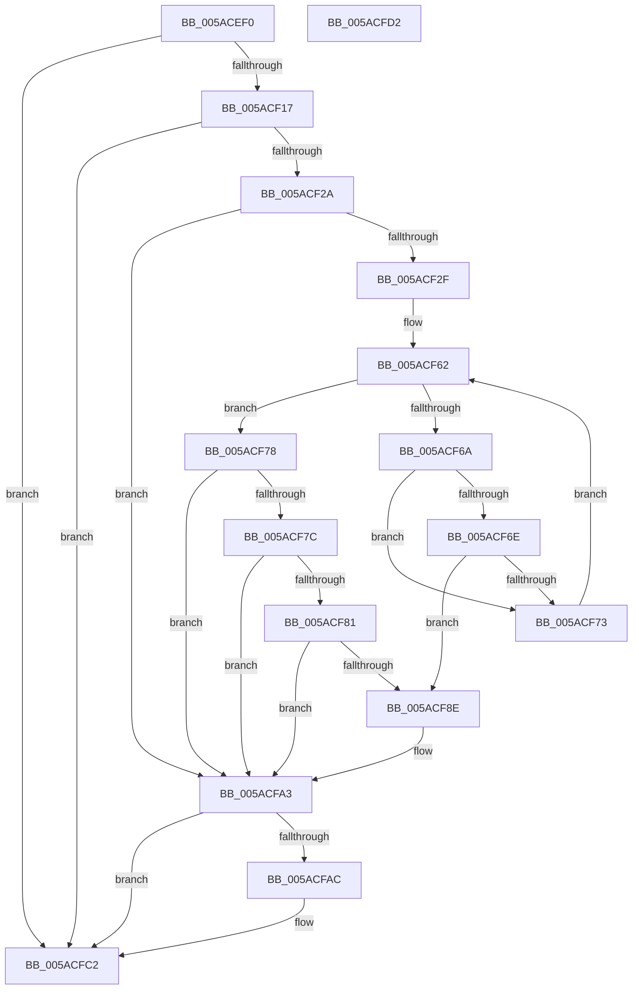

# _asan_loadN

- RVA: `0x005ACEF0`–`0x005ACFD3` (길이 `227` bytes)
- VA: `0x00000001405ACEF0`
- 실행 섹션: `.text`
- PDB 이름 있음: `예`; PDB Function 태그: `아니요`
- unwind 정보 RVA: `0x000794E0`
- 디코드: `62`개 명령, `227/227` bytes 표시
- 미해석 바이트: `0` (있으면 어셈블리에 `.byte`로 보존)

> 이 문서는 커널 이미지의 기계어와 PDB 기호를 분석해 생성했습니다. 4번과 5번은 함수 원형과 자료형을 바이너리 사용 방식에서 추정한 C 해석이며 원본 소스 복구 결과는 아닙니다.

## 1. Dependencies

- 직접 호출 지점: **2**; 고유 호출 대상: **2**
- 직접 호출자로 확인된 함수: **0**
- RIP 상대 이미지 참조: **3**

### Outgoing calls
- `0x005ACF9E` → [KasaniReport](KasaniReport_function_005AB0B0.md) (function, `0x005AB0B0`)
- `0x005ACFBD` → [KcsanValidateAddress](KcsanValidateAddress_function_005AF5E0.md) (function, `0x005AF5E0`)

### Direct callers
- 이 함수 시작 RVA로 연결되는 직접 call은 확인되지 않았습니다. 간접 호출은 완전히 역산할 수 없습니다.

### Static image references
- `0x005ACEFF` → RVA `0x00FCEC6A` (`ALMOSTRO`; read)
- `0x005ACF50` → RVA `0x00FC6ED8` (`ALMOSTRO`; read)
- `0x005ACFA3` → RVA `0x00F8A7E8` (`.data`; read)

## 2. Other-region calls and transfers

- 다른 실행 섹션으로 향하는 call: **0**
- 별도 외부 분기/꼬리 이동을 확인하지 못했습니다.

## 3. Assembly (complete function range)

```asm
005ACEF0  48 89 5C 24 08                  mov qword ptr [rsp + 8], rbx
005ACEF5  48 89 74 24 10                  mov qword ptr [rsp + 0x10], rsi
005ACEFA  57                              push rdi
005ACEFB  48 83 EC 30                     sub rsp, 0x30
005ACEFF  80 3D 64 1D A2 00 00            cmp byte ptr [rip + 0xa21d64], 0
005ACF06  48 8B FA                        mov rdi, rdx
005ACF09  48 8B 74 24 38                  mov rsi, qword ptr [rsp + 0x38]
005ACF0E  48 8B D9                        mov rbx, rcx
005ACF11  0F 84 AB 00 00 00               je 0x1405acfc2
005ACF17  48 B8 00 00 00 00 00 80 FF FF   movabs rax, 0xffff800000000000
005ACF21  48 3B C8                        cmp rcx, rax
005ACF24  0F 82 98 00 00 00               jb 0x1405acfc2
005ACF2A  48 85 D2                        test rdx, rdx
005ACF2D  74 74                           je 0x1405acfa3
005ACF2F  48 BA 00 00 00 00 00 80 00 00   movabs rdx, 0x800000000000
005ACF39  49 B8 FF FF FF FF FF 7F 00 00   movabs r8, 0x7fffffffffff
005ACF43  48 03 D1                        add rdx, rcx
005ACF46  4C 03 C1                        add r8, rcx
005ACF49  48 C1 EA 03                     shr rdx, 3
005ACF4D  4C 03 C7                        add r8, rdi
005ACF50  48 03 15 81 9F A1 00            add rdx, qword ptr [rip + 0xa19f81]
005ACF57  49 C1 E8 03                     shr r8, 3
005ACF5B  4C 03 05 76 9F A1 00            add r8, qword ptr [rip + 0xa19f76]
005ACF62  0F B6 0A                        movzx ecx, byte ptr [rdx]
005ACF65  49 3B D0                        cmp rdx, r8
005ACF68  73 0E                           jae 0x1405acf78
005ACF6A  84 C9                           test cl, cl
005ACF6C  74 05                           je 0x1405acf73
005ACF6E  80 F9 08                        cmp cl, 8
005ACF71  7C 1B                           jl 0x1405acf8e
005ACF73  48 FF C2                        inc rdx
005ACF76  EB EA                           jmp 0x1405acf62
005ACF78  84 C9                           test cl, cl
005ACF7A  74 27                           je 0x1405acfa3
005ACF7C  80 F9 08                        cmp cl, 8
005ACF7F  7D 22                           jge 0x1405acfa3
005ACF81  8D 47 FF                        lea eax, [rdi - 1]
005ACF84  02 C3                           add al, bl
005ACF86  24 07                           and al, 7
005ACF88  FE C0                           inc al
005ACF8A  3A C1                           cmp al, cl
005ACF8C  7E 15                           jle 0x1405acfa3
005ACF8E  88 4C 24 20                     mov byte ptr [rsp + 0x20], cl
005ACF92  4C 8B CE                        mov r9, rsi
005ACF95  48 8B CB                        mov rcx, rbx
005ACF98  45 33 C0                        xor r8d, r8d
005ACF9B  48 8B D7                        mov rdx, rdi
005ACF9E  E8 0D E1 FF FF                  call 0x1405ab0b0
005ACFA3  80 3D 3E D8 9D 00 00            cmp byte ptr [rip + 0x9dd83e], 0
005ACFAA  74 16                           je 0x1405acfc2
005ACFAC  45 33 C9                        xor r9d, r9d
005ACFAF  48 89 74 24 20                  mov qword ptr [rsp + 0x20], rsi
005ACFB4  45 33 C0                        xor r8d, r8d
005ACFB7  48 8B D7                        mov rdx, rdi
005ACFBA  48 8B CB                        mov rcx, rbx
005ACFBD  E8 1E 26 00 00                  call 0x1405af5e0
005ACFC2  48 8B 5C 24 40                  mov rbx, qword ptr [rsp + 0x40]
005ACFC7  48 8B 74 24 48                  mov rsi, qword ptr [rsp + 0x48]
005ACFCC  48 83 C4 30                     add rsp, 0x30
005ACFD0  5F                              pop rdi
005ACFD1  C3                              ret
005ACFD2  CC                              int3
```

## 4. C-style interpretation (structured pseudocode)

```c
__int64 __fastcall _asan_loadN(__int64 a1, __int64 a2)
{
    __int64 result;
    __int64 v_rsp;
    unsigned __int8 v_stack_m18;
    unsigned __int64 v_stack_p0;
    unsigned __int64 v_stack_p10;
    unsigned __int64 v_stack_p8;

    v_stack_p8 = v_rbx;
    v_stack_p10 = v_rsi;
    v_rsp = (v_rsp) - (48);
    if ((*(unsigned __int8 *)(v_rip + 10624356)) == 0) goto loc_005ACFC2;
    if (a1 < result) goto loc_005ACFC2;
    if (a2 == 0) goto loc_005ACFA3;
    a2 = (a2) + (a1);
    a3 = (a3) + (a1);
    a2 = (a2) >> (3);
    a3 = (a3) + (a2);
    a2 = (a2) + (*(unsigned __int64 *)(v_rip + 10592129));
    a3 = (a3) >> (3);
    a3 = (a3) + (*(unsigned __int64 *)(v_rip + 10592118));
loc_005ACF62:
    if (a2 >= a3) goto loc_005ACF78;
    if ((unsigned __int8)(*(unsigned __int8 *)(a2)) == 0) goto loc_005ACF73;
    if (((unsigned __int8)(*(unsigned __int8 *)(a2))) < 8) goto loc_005ACF8E;
loc_005ACF73:
    a2 = (a2) + 1;
    goto loc_005ACF62;
loc_005ACF78:
    if ((unsigned __int8)(*(unsigned __int8 *)(a2)) == 0) goto loc_005ACFA3;
    if (((unsigned __int8)(*(unsigned __int8 *)(a2))) >= 8) goto loc_005ACFA3;
    result = (unsigned __int8)((a2 - 1) + ((unsigned __int8)(a1)));
    result = (unsigned __int8)((result) & (7));
    result = (unsigned __int8)((result) + 1);
    if (((unsigned __int8)(result)) >= = ((unsigned __int8)(*(unsigned __int8 *)(a2)))) {
        v_stack_m18 = (unsigned __int8)(*(unsigned __int8 *)(a2));
        a4 = v_stack_p0;
        a1 = a1;
        a3 = 0;
        a2 = a2;
        result = KasaniReport(a1, a2, a3, a4);
    }
    if ((*(unsigned __int8 *)(v_rip + 10344510)) != 0) {
        a4 = 0;
        v_stack_m18 = v_stack_p0;
        a3 = 0;
        a2 = a2;
        a1 = a1;
        result = KcsanValidateAddress(a1, a2, a3, a4);
    }
    v_rsp = (v_rsp) + (48);
    return result;
}
```

## 5. (Beta) C Style

```c
int64_t _asan_loadN(int64_t Arg1, void *Arg2)
{
    uint8_t *arg2 = (uint8_t *)Arg2;

    int64_t result;
    int64_t local_rsp;
    uint8_t v_stack_m18;
    uint64_t v_stack_p0;
    uint64_t v_stack_p10;
    uint64_t v_stack_p8;

    v_stack_p8 = local_rbx;
    v_stack_p10 = local_rsi;
    local_rsp = (local_rsp) - (48);
    if ((*(uint8_t *)(v_rip + 0xA21D64)) == 0) goto loc_005ACFC2;
    if (Arg1 < result) goto loc_005ACFC2;
    if (Arg2 == NULL) goto loc_005ACFA3;
    Arg2 = (Arg2) + (Arg1);
    a3 = (a3) + (Arg1);
    Arg2 = (Arg2) >> (3);
    a3 = (a3) + (Arg2);
    Arg2 = (Arg2) + (*(uint64_t *)(v_rip + 0xA19F81));
    a3 = (a3) >> (3);
    a3 = (a3) + (*(uint64_t *)(v_rip + 0xA19F76));
loc_005ACF62:
    if (Arg2 >= a3) goto loc_005ACF78;
    if ((uint8_t)(*(uint8_t *)(arg2)) == 0) goto loc_005ACF73;
    if (((uint8_t)(*(uint8_t *)(arg2))) < 8) goto loc_005ACF8E;
loc_005ACF73:
    Arg2 = (Arg2) + 1;
    goto loc_005ACF62;
loc_005ACF78:
    if ((uint8_t)(*(uint8_t *)(arg2)) == 0) goto loc_005ACFA3;
    if (((uint8_t)(*(uint8_t *)(arg2))) >= 8) goto loc_005ACFA3;
    result = (uint8_t)((Arg2 - 1) + ((uint8_t)(Arg1)));
    result = (uint8_t)((result) & (7));
    result = (uint8_t)((result) + 1);
    if (((uint8_t)(result)) >= = ((uint8_t)(*(uint8_t *)(arg2)))) {
        v_stack_m18 = (uint8_t)(*(uint8_t *)(arg2));
        a4 = v_stack_p0;
        Arg1 = Arg1;
        a3 = 0;
        Arg2 = Arg2;
        result = KasaniReport(Arg1, Arg2, a3, a4);
    }
    if ((*(uint8_t *)(v_rip + 0x9DD83E)) != 0) {
        a4 = 0;
        v_stack_m18 = v_stack_p0;
        a3 = 0;
        Arg2 = Arg2;
        Arg1 = Arg1;
        result = KcsanValidateAddress(Arg1, Arg2, a3, a4);
    }
    local_rsp = (local_rsp) + (48);
    return result;
}
```

### 관측된 메모리 오프셋

구조체 형식이 확인되지 않은 접근은 인자 기준의 오프셋으로만 기록했습니다.

| 기준 인자 | 오프셋 표현 | 폭 (bit) | 접근 |
|---|---:|---:|---|
| `Arg2` | `- 0x1` | `32` | `R` |

## 6. Execution-region graph

[열기: 2D/3D 그래프와 함수 탐색 컨트롤 패널](../../../control-panel.html?section=text&rva=0x005ACEF0&view=graph)

- 2D 그래프는 위에서 아래로 흐르고, 3D 그래프는 빈 공간을 드래그해 회전합니다. Shift+드래그는 이동, 휠은 확대·축소, 함수 노드 선택은 대상 보고서 이동입니다.

### Static fallback


