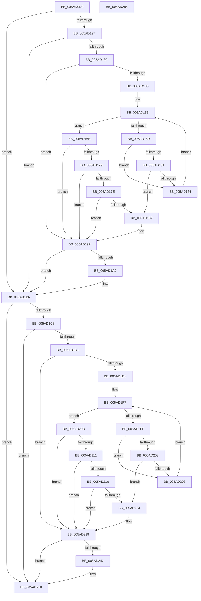

# _asan_memcpy

- RVA: `0x005AD0D0`–`0x005AD286` (길이 `438` bytes)
- VA: `0x00000001405AD0D0`
- 실행 섹션: `.text`
- PDB 이름 있음: `예`; PDB Function 태그: `아니요`
- unwind 정보 RVA: `0x000C953C`
- 디코드: `122`개 명령, `438/438` bytes 표시
- 미해석 바이트: `0` (있으면 어셈블리에 `.byte`로 보존)

> 이 문서는 커널 이미지의 기계어와 PDB 기호를 분석해 생성했습니다. 4번과 5번은 함수 원형과 자료형을 바이너리 사용 방식에서 추정한 C 해석이며 원본 소스 복구 결과는 아닙니다.

## 1. Dependencies

- 직접 호출 지점: **5**; 고유 호출 대상: **3**
- 직접 호출자로 확인된 함수: **0**
- RIP 상대 이미지 참조: **3**

### Outgoing calls
- `0x005AD192` → [KasaniReport](KasaniReport_function_005AB0B0.md) (function, `0x005AB0B0`)
- `0x005AD1B1` → [KcsanValidateAddress](KcsanValidateAddress_function_005AF5E0.md) (function, `0x005AF5E0`)
- `0x005AD234` → [KasaniReport](KasaniReport_function_005AB0B0.md) (function, `0x005AB0B0`)
- `0x005AD253` → [KcsanValidateAddress](KcsanValidateAddress_function_005AF5E0.md) (function, `0x005AF5E0`)
- `0x005AD261` → [memcpy](../6C/memcpy_function_006C6840.md) (function, `0x006C6840`)

### Direct callers
- 이 함수 시작 RVA로 연결되는 직접 call은 확인되지 않았습니다. 간접 호출은 완전히 역산할 수 없습니다.

### Static image references
- `0x005AD0EE` → RVA `0x00FCEC6A` (`ALMOSTRO`; read)
- `0x005AD143` → RVA `0x00FC6ED8` (`ALMOSTRO`; read)
- `0x005AD197` → RVA `0x00F8A7E8` (`.data`; read)

## 2. Other-region calls and transfers

- 다른 실행 섹션으로 향하는 call: **0**
- 별도 외부 분기/꼬리 이동을 확인하지 못했습니다.

## 3. Assembly (complete function range)

```asm
005AD0D0  48 89 5C 24 08                  mov qword ptr [rsp + 8], rbx
005AD0D5  48 89 6C 24 10                  mov qword ptr [rsp + 0x10], rbp
005AD0DA  48 89 74 24 18                  mov qword ptr [rsp + 0x18], rsi
005AD0DF  48 89 7C 24 20                  mov qword ptr [rsp + 0x20], rdi
005AD0E4  41 54                           push r12
005AD0E6  41 56                           push r14
005AD0E8  41 57                           push r15
005AD0EA  48 83 EC 30                     sub rsp, 0x30
005AD0EE  80 3D 75 1B A2 00 00            cmp byte ptr [rip + 0xa21b75], 0
005AD0F5  49 8B D8                        mov rbx, r8
005AD0F8  48 8B 6C 24 48                  mov rbp, qword ptr [rsp + 0x48]
005AD0FD  48 8B F2                        mov rsi, rdx
005AD100  48 8B F9                        mov rdi, rcx
005AD103  49 BE 00 00 00 00 00 80 FF FF   movabs r14, 0xffff800000000000
005AD10D  49 BF 00 00 00 00 00 80 00 00   movabs r15, 0x800000000000
005AD117  49 BC FF FF FF FF FF 7F 00 00   movabs r12, 0x7fffffffffff
005AD121  0F 84 8F 00 00 00               je 0x1405ad1b6
005AD127  49 3B D6                        cmp rdx, r14
005AD12A  0F 82 86 00 00 00               jb 0x1405ad1b6
005AD130  48 85 DB                        test rbx, rbx
005AD133  74 62                           je 0x1405ad197
005AD135  49 03 D7                        add rdx, r15
005AD138  4E 8D 04 26                     lea r8, [rsi + r12]
005AD13C  48 C1 EA 03                     shr rdx, 3
005AD140  4C 03 C3                        add r8, rbx
005AD143  48 03 15 8E 9D A1 00            add rdx, qword ptr [rip + 0xa19d8e]
005AD14A  49 C1 E8 03                     shr r8, 3
005AD14E  4C 03 05 83 9D A1 00            add r8, qword ptr [rip + 0xa19d83]
005AD155  0F B6 0A                        movzx ecx, byte ptr [rdx]
005AD158  49 3B D0                        cmp rdx, r8
005AD15B  73 0E                           jae 0x1405ad16b
005AD15D  84 C9                           test cl, cl
005AD15F  74 05                           je 0x1405ad166
005AD161  80 F9 08                        cmp cl, 8
005AD164  7C 1C                           jl 0x1405ad182
005AD166  48 FF C2                        inc rdx
005AD169  EB EA                           jmp 0x1405ad155
005AD16B  8D 43 FF                        lea eax, [rbx - 1]
005AD16E  40 02 C6                        add al, sil
005AD171  24 07                           and al, 7
005AD173  FE C0                           inc al
005AD175  84 C9                           test cl, cl
005AD177  74 1E                           je 0x1405ad197
005AD179  80 F9 08                        cmp cl, 8
005AD17C  7D 19                           jge 0x1405ad197
005AD17E  3A C1                           cmp al, cl
005AD180  7E 15                           jle 0x1405ad197
005AD182  88 4C 24 20                     mov byte ptr [rsp + 0x20], cl
005AD186  4C 8B CD                        mov r9, rbp
005AD189  48 8B CE                        mov rcx, rsi
005AD18C  45 33 C0                        xor r8d, r8d
005AD18F  48 8B D3                        mov rdx, rbx
005AD192  E8 19 DF FF FF                  call 0x1405ab0b0
005AD197  80 3D 4A D6 9D 00 00            cmp byte ptr [rip + 0x9dd64a], 0
005AD19E  74 16                           je 0x1405ad1b6
005AD1A0  45 33 C9                        xor r9d, r9d
005AD1A3  48 89 6C 24 20                  mov qword ptr [rsp + 0x20], rbp
005AD1A8  45 33 C0                        xor r8d, r8d
005AD1AB  48 8B D3                        mov rdx, rbx
005AD1AE  48 8B CE                        mov rcx, rsi
005AD1B1  E8 2A 24 00 00                  call 0x1405af5e0
005AD1B6  80 3D AD 1A A2 00 00            cmp byte ptr [rip + 0xa21aad], 0
005AD1BD  48 8B 6C 24 48                  mov rbp, qword ptr [rsp + 0x48]
005AD1C2  0F 84 90 00 00 00               je 0x1405ad258
005AD1C8  49 3B FE                        cmp rdi, r14
005AD1CB  0F 82 87 00 00 00               jb 0x1405ad258
005AD1D1  48 85 DB                        test rbx, rbx
005AD1D4  74 63                           je 0x1405ad239
005AD1D6  4A 8D 14 3F                     lea rdx, [rdi + r15]
005AD1DA  48 C1 EA 03                     shr rdx, 3
005AD1DE  4E 8D 04 27                     lea r8, [rdi + r12]
005AD1E2  48 03 15 EF 9C A1 00            add rdx, qword ptr [rip + 0xa19cef]
005AD1E9  4C 03 C3                        add r8, rbx
005AD1EC  49 C1 E8 03                     shr r8, 3
005AD1F0  4C 03 05 E1 9C A1 00            add r8, qword ptr [rip + 0xa19ce1]
005AD1F7  0F B6 0A                        movzx ecx, byte ptr [rdx]
005AD1FA  49 3B D0                        cmp rdx, r8
005AD1FD  73 0E                           jae 0x1405ad20d
005AD1FF  84 C9                           test cl, cl
005AD201  74 05                           je 0x1405ad208
005AD203  80 F9 08                        cmp cl, 8
005AD206  7C 1C                           jl 0x1405ad224
005AD208  48 FF C2                        inc rdx
005AD20B  EB EA                           jmp 0x1405ad1f7
005AD20D  84 C9                           test cl, cl
005AD20F  74 28                           je 0x1405ad239
005AD211  80 F9 08                        cmp cl, 8
005AD214  7D 23                           jge 0x1405ad239
005AD216  8D 43 FF                        lea eax, [rbx - 1]
005AD219  40 02 C7                        add al, dil
005AD21C  24 07                           and al, 7
005AD21E  FE C0                           inc al
005AD220  3A C1                           cmp al, cl
005AD222  7E 15                           jle 0x1405ad239
005AD224  88 4C 24 20                     mov byte ptr [rsp + 0x20], cl
005AD228  4C 8B CD                        mov r9, rbp
005AD22B  48 8B CF                        mov rcx, rdi
005AD22E  41 B0 01                        mov r8b, 1
005AD231  48 8B D3                        mov rdx, rbx
005AD234  E8 77 DE FF FF                  call 0x1405ab0b0
005AD239  80 3D A8 D5 9D 00 00            cmp byte ptr [rip + 0x9dd5a8], 0
005AD240  74 16                           je 0x1405ad258
005AD242  45 33 C9                        xor r9d, r9d
005AD245  48 89 6C 24 20                  mov qword ptr [rsp + 0x20], rbp
005AD24A  41 B0 01                        mov r8b, 1
005AD24D  48 8B D3                        mov rdx, rbx
005AD250  48 8B CF                        mov rcx, rdi
005AD253  E8 88 23 00 00                  call 0x1405af5e0
005AD258  4C 8B C3                        mov r8, rbx
005AD25B  48 8B D6                        mov rdx, rsi
005AD25E  48 8B CF                        mov rcx, rdi
005AD261  E8 DA 95 11 00                  call 0x1406c6840
005AD266  48 8B 5C 24 50                  mov rbx, qword ptr [rsp + 0x50]
005AD26B  48 8B 6C 24 58                  mov rbp, qword ptr [rsp + 0x58]
005AD270  48 8B 74 24 60                  mov rsi, qword ptr [rsp + 0x60]
005AD275  48 8B 7C 24 68                  mov rdi, qword ptr [rsp + 0x68]
005AD27A  48 83 C4 30                     add rsp, 0x30
005AD27E  41 5F                           pop r15
005AD280  41 5E                           pop r14
005AD282  41 5C                           pop r12
005AD284  C3                              ret
005AD285  CC                              int3
```

## 4. C-style interpretation (structured pseudocode)

```c
__int64 __fastcall _asan_memcpy(__int64 a1, __int64 a2, __int64 a3)
{
    __int64 result;
    __int64 v_rsp;
    unsigned __int8 v_stack_m28;
    unsigned __int64 v_stack_p0;
    unsigned __int64 v_stack_p10;
    unsigned __int64 v_stack_p18;
    unsigned __int64 v_stack_p20;
    unsigned __int64 v_stack_p8;

    v_stack_p8 = v_rbx;
    v_stack_p10 = v_rbp;
    v_stack_p18 = v_rsi;
    v_stack_p20 = v_rdi;
    v_rsp = (v_rsp) - (48);
    if ((*(unsigned __int8 *)(v_rip + 10623861)) == 0) goto loc_005AD1B6;
    if (a2 < v_r14) goto loc_005AD1B6;
    if (a3 == 0) goto loc_005AD197;
    a2 = (a2) + (v_r15);
    a2 = (a2) >> (3);
    a3 = (a2 + v_r12 * 1) + (a3);
    a2 = (a2) + (*(unsigned __int64 *)(v_rip + 10591630));
    a3 = (a3) >> (3);
    a3 = (a3) + (*(unsigned __int64 *)(v_rip + 10591619));
loc_005AD155:
    if (a2 >= a3) goto loc_005AD16B;
    if ((unsigned __int8)(*(unsigned __int8 *)(a2)) == 0) goto loc_005AD166;
    if (((unsigned __int8)(*(unsigned __int8 *)(a2))) < 8) goto loc_005AD182;
loc_005AD166:
    a2 = (a2) + 1;
    goto loc_005AD155;
loc_005AD16B:
    result = (unsigned __int8)((a3 - 1) + ((unsigned __int8)(a2)));
    result = (unsigned __int8)((result) & (7));
    result = (unsigned __int8)((result) + 1);
    if ((unsigned __int8)(*(unsigned __int8 *)(a2)) == 0) goto loc_005AD197;
    if (((unsigned __int8)(*(unsigned __int8 *)(a2))) >= 8) goto loc_005AD197;
    if (((unsigned __int8)(result)) >= = ((unsigned __int8)(*(unsigned __int8 *)(a2)))) {
        v_stack_m28 = (unsigned __int8)(*(unsigned __int8 *)(a2));
        a4 = v_stack_p0;
        a1 = a2;
        a3 = 0;
        a2 = 0;
        result = KasaniReport(a1, a2, a3, a4);
    }
    if ((*(unsigned __int8 *)(v_rip + 10344010)) != 0) {
        a4 = 0;
        v_stack_m28 = v_stack_p0;
        a3 = 0;
        a2 = 0;
        a1 = a2;
        result = KcsanValidateAddress(a1, a2, a3, a4);
    }
    if ((*(unsigned __int8 *)(v_rip + 10623661)) == 0) goto loc_005AD258;
    if (a1 < v_r14) goto loc_005AD258;
    if (0 == 0) goto loc_005AD239;
    a2 = (a1 + v_r15 * 1) >> (3);
    a2 = (a2) + (*(unsigned __int64 *)(v_rip + 10591471));
    a3 = (a1 + v_r12 * 1) + (0);
    a3 = (a3) >> (3);
    a3 = (a3) + (*(unsigned __int64 *)(v_rip + 10591457));
loc_005AD1F7:
    if (a2 >= a3) goto loc_005AD20D;
    if ((unsigned __int8)(*(unsigned __int8 *)(a2)) == 0) goto loc_005AD208;
    if (((unsigned __int8)(*(unsigned __int8 *)(a2))) < 8) goto loc_005AD224;
loc_005AD208:
    a2 = (a2) + 1;
    goto loc_005AD1F7;
loc_005AD20D:
    if ((unsigned __int8)(*(unsigned __int8 *)(a2)) == 0) goto loc_005AD239;
    if (((unsigned __int8)(*(unsigned __int8 *)(a2))) >= 8) goto loc_005AD239;
    result = (unsigned __int8)((a3 - 1) + ((unsigned __int8)(a1)));
    result = (unsigned __int8)((result) & (7));
    result = (unsigned __int8)((result) + 1);
    if (((unsigned __int8)(result)) >= = ((unsigned __int8)(*(unsigned __int8 *)(a2)))) {
        v_stack_m28 = (unsigned __int8)(*(unsigned __int8 *)(a2));
        a4 = v_stack_p0;
        a1 = a1;
        a3 = 1;
        a2 = a3;
        result = KasaniReport(a1, a2, a3, a4);
    }
    if ((*(unsigned __int8 *)(v_rip + 10343848)) != 0) {
        a4 = 0;
        v_stack_m28 = v_stack_p0;
        a3 = 1;
        a2 = a3;
        a1 = a1;
        result = KcsanValidateAddress(a1, a2, a3, a4);
    }
    result = memcpy(a1, a2, a3, a4);
    v_rsp = (v_rsp) + (48);
    return result;
}
```

## 5. (Beta) C Style

```c
int64_t _asan_memcpy(int64_t Arg1, void *Arg2, int64_t Arg3)
{
    uint8_t *arg2 = (uint8_t *)Arg2;

    int64_t result;
    int64_t local_rsp;
    uint8_t v_stack_m28;
    uint64_t v_stack_p0;
    uint64_t v_stack_p10;
    uint64_t v_stack_p18;
    uint64_t v_stack_p20;
    uint64_t v_stack_p8;

    v_stack_p8 = local_rbx;
    v_stack_p10 = local_rbp;
    v_stack_p18 = local_rsi;
    v_stack_p20 = local_rdi;
    local_rsp = (local_rsp) - (48);
    if ((*(uint8_t *)(v_rip + 0xA21B75)) == 0) goto loc_005AD1B6;
    if (Arg2 < local_r14) goto loc_005AD1B6;
    if (Arg3 == 0) goto loc_005AD197;
    Arg2 = (Arg2) + (local_r15);
    Arg2 = (Arg2) >> (3);
    Arg3 = (Arg2 + local_r12 * 1) + (Arg3);
    Arg2 = (Arg2) + (*(uint64_t *)(v_rip + 0xA19D8E));
    Arg3 = (Arg3) >> (3);
    Arg3 = (Arg3) + (*(uint64_t *)(v_rip + 0xA19D83));
loc_005AD155:
    if (Arg2 >= Arg3) goto loc_005AD16B;
    if ((uint8_t)(*(uint8_t *)(arg2)) == 0) goto loc_005AD166;
    if (((uint8_t)(*(uint8_t *)(arg2))) < 8) goto loc_005AD182;
loc_005AD166:
    Arg2 = (Arg2) + 1;
    goto loc_005AD155;
loc_005AD16B:
    result = (uint8_t)((Arg3 - 1) + ((uint8_t)(Arg2)));
    result = (uint8_t)((result) & (7));
    result = (uint8_t)((result) + 1);
    if ((uint8_t)(*(uint8_t *)(arg2)) == 0) goto loc_005AD197;
    if (((uint8_t)(*(uint8_t *)(arg2))) >= 8) goto loc_005AD197;
    if (((uint8_t)(result)) >= = ((uint8_t)(*(uint8_t *)(arg2)))) {
        v_stack_m28 = (uint8_t)(*(uint8_t *)(arg2));
        a4 = v_stack_p0;
        Arg1 = Arg2;
        Arg3 = 0;
        Arg2 = 0;
        result = KasaniReport(Arg1, Arg2, Arg3, a4);
    }
    if ((*(uint8_t *)(v_rip + 0x9DD64A)) != 0) {
        a4 = 0;
        v_stack_m28 = v_stack_p0;
        Arg3 = 0;
        Arg2 = 0;
        Arg1 = Arg2;
        result = KcsanValidateAddress(Arg1, Arg2, Arg3, a4);
    }
    if ((*(uint8_t *)(v_rip + 0xA21AAD)) == 0) goto loc_005AD258;
    if (Arg1 < local_r14) goto loc_005AD258;
    if (0 == 0) goto loc_005AD239;
    Arg2 = (Arg1 + local_r15 * 1) >> (3);
    Arg2 = (Arg2) + (*(uint64_t *)(v_rip + 0xA19CEF));
    Arg3 = (Arg1 + local_r12 * 1) + (0);
    Arg3 = (Arg3) >> (3);
    Arg3 = (Arg3) + (*(uint64_t *)(v_rip + 0xA19CE1));
loc_005AD1F7:
    if (Arg2 >= Arg3) goto loc_005AD20D;
    if ((uint8_t)(*(uint8_t *)(arg2)) == 0) goto loc_005AD208;
    if (((uint8_t)(*(uint8_t *)(arg2))) < 8) goto loc_005AD224;
loc_005AD208:
    Arg2 = (Arg2) + 1;
    goto loc_005AD1F7;
loc_005AD20D:
    if ((uint8_t)(*(uint8_t *)(arg2)) == 0) goto loc_005AD239;
    if (((uint8_t)(*(uint8_t *)(arg2))) >= 8) goto loc_005AD239;
    result = (uint8_t)((Arg3 - 1) + ((uint8_t)(Arg1)));
    result = (uint8_t)((result) & (7));
    result = (uint8_t)((result) + 1);
    if (((uint8_t)(result)) >= = ((uint8_t)(*(uint8_t *)(arg2)))) {
        v_stack_m28 = (uint8_t)(*(uint8_t *)(arg2));
        a4 = v_stack_p0;
        Arg1 = Arg1;
        Arg3 = 1;
        Arg2 = Arg3;
        result = KasaniReport(Arg1, Arg2, Arg3, a4);
    }
    if ((*(uint8_t *)(v_rip + 0x9DD5A8)) != 0) {
        a4 = 0;
        v_stack_m28 = v_stack_p0;
        Arg3 = 1;
        Arg2 = Arg3;
        Arg1 = Arg1;
        result = KcsanValidateAddress(Arg1, Arg2, Arg3, a4);
    }
    result = memcpy(Arg1, Arg2, Arg3, a4);
    local_rsp = (local_rsp) + (48);
    return result;
}
```

### 관측된 메모리 오프셋

구조체 형식이 확인되지 않은 접근은 인자 기준의 오프셋으로만 기록했습니다.

| 기준 인자 | 오프셋 표현 | 폭 (bit) | 접근 |
|---|---:|---:|---|
| `Arg2` | `+ 0x0 + r12*1` | `64` | `R` |

## 6. Execution-region graph

[열기: 2D/3D 그래프와 함수 탐색 컨트롤 패널](../../../control-panel.html?section=text&rva=0x005AD0D0&view=graph)

- 2D 그래프는 위에서 아래로 흐르고, 3D 그래프는 빈 공간을 드래그해 회전합니다. Shift+드래그는 이동, 휠은 확대·축소, 함수 노드 선택은 대상 보고서 이동입니다.

### Static fallback


