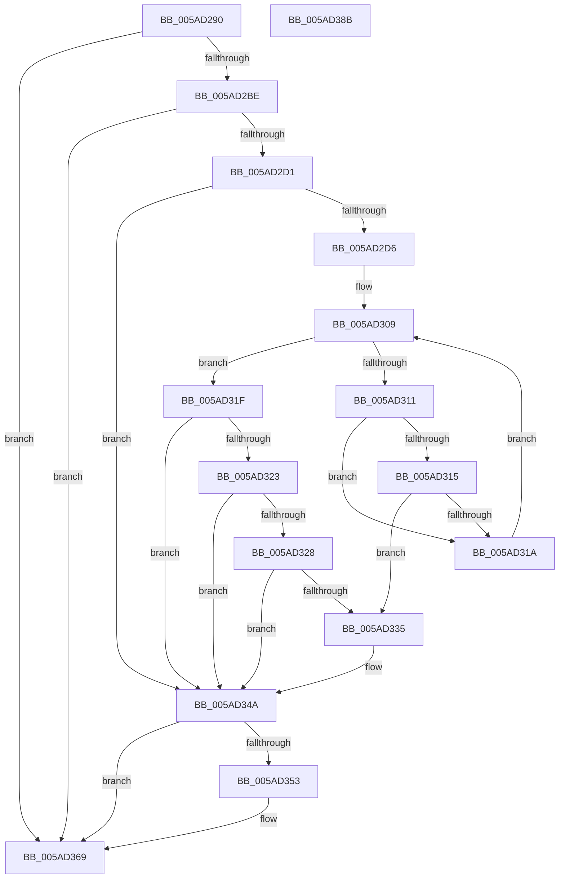

# _asan_memset

- RVA: `0x005AD290`–`0x005AD38C` (길이 `252` bytes)
- VA: `0x00000001405AD290`
- 실행 섹션: `.text`
- PDB 이름 있음: `예`; PDB Function 태그: `아니요`
- unwind 정보 RVA: `0x00066400`
- 디코드: `69`개 명령, `252/252` bytes 표시
- 미해석 바이트: `0` (있으면 어셈블리에 `.byte`로 보존)

> 이 문서는 커널 이미지의 기계어와 PDB 기호를 분석해 생성했습니다. 4번과 5번은 함수 원형과 자료형을 바이너리 사용 방식에서 추정한 C 해석이며 원본 소스 복구 결과는 아닙니다.

## 1. Dependencies

- 직접 호출 지점: **3**; 고유 호출 대상: **3**
- 직접 호출자로 확인된 함수: **0**
- RIP 상대 이미지 참조: **3**

### Outgoing calls
- `0x005AD345` → [KasaniReport](KasaniReport_function_005AB0B0.md) (function, `0x005AB0B0`)
- `0x005AD364` → [KcsanValidateAddress](KcsanValidateAddress_function_005AF5E0.md) (function, `0x005AF5E0`)
- `0x005AD371` → [memset](../6C/memset_function_006C6C40.md) (function, `0x006C6C40`)

### Direct callers
- 이 함수 시작 RVA로 연결되는 직접 call은 확인되지 않았습니다. 간접 호출은 완전히 역산할 수 없습니다.

### Static image references
- `0x005AD2A4` → RVA `0x00FCEC6A` (`ALMOSTRO`; read)
- `0x005AD2F7` → RVA `0x00FC6ED8` (`ALMOSTRO`; read)
- `0x005AD34A` → RVA `0x00F8A7E8` (`.data`; read)

## 2. Other-region calls and transfers

- 다른 실행 섹션으로 향하는 call: **0**
- 별도 외부 분기/꼬리 이동을 확인하지 못했습니다.

## 3. Assembly (complete function range)

```asm
005AD290  48 89 5C 24 08                  mov qword ptr [rsp + 8], rbx
005AD295  48 89 6C 24 10                  mov qword ptr [rsp + 0x10], rbp
005AD29A  48 89 74 24 18                  mov qword ptr [rsp + 0x18], rsi
005AD29F  57                              push rdi
005AD2A0  48 83 EC 30                     sub rsp, 0x30
005AD2A4  80 3D BF 19 A2 00 00            cmp byte ptr [rip + 0xa219bf], 0
005AD2AB  49 8B F8                        mov rdi, r8
005AD2AE  48 8B 74 24 38                  mov rsi, qword ptr [rsp + 0x38]
005AD2B3  8B EA                           mov ebp, edx
005AD2B5  48 8B D9                        mov rbx, rcx
005AD2B8  0F 84 AB 00 00 00               je 0x1405ad369
005AD2BE  48 B8 00 00 00 00 00 80 FF FF   movabs rax, 0xffff800000000000
005AD2C8  48 3B C8                        cmp rcx, rax
005AD2CB  0F 82 98 00 00 00               jb 0x1405ad369
005AD2D1  4D 85 C0                        test r8, r8
005AD2D4  74 74                           je 0x1405ad34a
005AD2D6  48 BA 00 00 00 00 00 80 00 00   movabs rdx, 0x800000000000
005AD2E0  49 B8 FF FF FF FF FF 7F 00 00   movabs r8, 0x7fffffffffff
005AD2EA  48 03 D1                        add rdx, rcx
005AD2ED  4C 03 C1                        add r8, rcx
005AD2F0  48 C1 EA 03                     shr rdx, 3
005AD2F4  4C 03 C7                        add r8, rdi
005AD2F7  48 03 15 DA 9B A1 00            add rdx, qword ptr [rip + 0xa19bda]
005AD2FE  49 C1 E8 03                     shr r8, 3
005AD302  4C 03 05 CF 9B A1 00            add r8, qword ptr [rip + 0xa19bcf]
005AD309  0F B6 0A                        movzx ecx, byte ptr [rdx]
005AD30C  49 3B D0                        cmp rdx, r8
005AD30F  73 0E                           jae 0x1405ad31f
005AD311  84 C9                           test cl, cl
005AD313  74 05                           je 0x1405ad31a
005AD315  80 F9 08                        cmp cl, 8
005AD318  7C 1B                           jl 0x1405ad335
005AD31A  48 FF C2                        inc rdx
005AD31D  EB EA                           jmp 0x1405ad309
005AD31F  84 C9                           test cl, cl
005AD321  74 27                           je 0x1405ad34a
005AD323  80 F9 08                        cmp cl, 8
005AD326  7D 22                           jge 0x1405ad34a
005AD328  8D 47 FF                        lea eax, [rdi - 1]
005AD32B  02 C3                           add al, bl
005AD32D  24 07                           and al, 7
005AD32F  FE C0                           inc al
005AD331  3A C1                           cmp al, cl
005AD333  7E 15                           jle 0x1405ad34a
005AD335  88 4C 24 20                     mov byte ptr [rsp + 0x20], cl
005AD339  4C 8B CE                        mov r9, rsi
005AD33C  48 8B CB                        mov rcx, rbx
005AD33F  41 B0 01                        mov r8b, 1
005AD342  48 8B D7                        mov rdx, rdi
005AD345  E8 66 DD FF FF                  call 0x1405ab0b0
005AD34A  80 3D 97 D4 9D 00 00            cmp byte ptr [rip + 0x9dd497], 0
005AD351  74 16                           je 0x1405ad369
005AD353  45 33 C9                        xor r9d, r9d
005AD356  48 89 74 24 20                  mov qword ptr [rsp + 0x20], rsi
005AD35B  41 B0 01                        mov r8b, 1
005AD35E  48 8B D7                        mov rdx, rdi
005AD361  48 8B CB                        mov rcx, rbx
005AD364  E8 77 22 00 00                  call 0x1405af5e0
005AD369  4C 8B C7                        mov r8, rdi
005AD36C  8B D5                           mov edx, ebp
005AD36E  48 8B CB                        mov rcx, rbx
005AD371  E8 CA 98 11 00                  call 0x1406c6c40
005AD376  48 8B 5C 24 40                  mov rbx, qword ptr [rsp + 0x40]
005AD37B  48 8B 6C 24 48                  mov rbp, qword ptr [rsp + 0x48]
005AD380  48 8B 74 24 50                  mov rsi, qword ptr [rsp + 0x50]
005AD385  48 83 C4 30                     add rsp, 0x30
005AD389  5F                              pop rdi
005AD38A  C3                              ret
005AD38B  CC                              int3
```

## 4. C-style interpretation (structured pseudocode)

```c
__int64 __fastcall _asan_memset(__int64 a1, int a2, __int64 a3)
{
    __int64 result;
    __int64 v_rsp;
    unsigned __int8 v_stack_m18;
    unsigned __int64 v_stack_p0;
    unsigned __int64 v_stack_p10;
    unsigned __int64 v_stack_p18;
    unsigned __int64 v_stack_p8;

    v_stack_p8 = v_rbx;
    v_stack_p10 = v_rbp;
    v_stack_p18 = v_rsi;
    v_rsp = (v_rsp) - (48);
    if ((*(unsigned __int8 *)(v_rip + 10623423)) == 0) goto loc_005AD369;
    if (a1 < result) goto loc_005AD369;
    if (a3 == 0) goto loc_005AD34A;
    a2 = (a2) + (a1);
    a3 = (a3) + (a1);
    a2 = (a2) >> (3);
    a3 = (a3) + (a3);
    a2 = (a2) + (*(unsigned __int64 *)(v_rip + 10591194));
    a3 = (a3) >> (3);
    a3 = (a3) + (*(unsigned __int64 *)(v_rip + 10591183));
loc_005AD309:
    if (a2 >= a3) goto loc_005AD31F;
    if ((unsigned __int8)(*(unsigned __int8 *)(a2)) == 0) goto loc_005AD31A;
    if (((unsigned __int8)(*(unsigned __int8 *)(a2))) < 8) goto loc_005AD335;
loc_005AD31A:
    a2 = (a2) + 1;
    goto loc_005AD309;
loc_005AD31F:
    if ((unsigned __int8)(*(unsigned __int8 *)(a2)) == 0) goto loc_005AD34A;
    if (((unsigned __int8)(*(unsigned __int8 *)(a2))) >= 8) goto loc_005AD34A;
    result = (unsigned __int8)((a3 - 1) + ((unsigned __int8)(a1)));
    result = (unsigned __int8)((result) & (7));
    result = (unsigned __int8)((result) + 1);
    if (((unsigned __int8)(result)) >= = ((unsigned __int8)(*(unsigned __int8 *)(a2)))) {
        v_stack_m18 = (unsigned __int8)(*(unsigned __int8 *)(a2));
        a4 = v_stack_p0;
        a1 = a1;
        a3 = 1;
        a2 = a3;
        result = KasaniReport(a1, a2, a3, a4);
    }
    if ((*(unsigned __int8 *)(v_rip + 10343575)) != 0) {
        a4 = 0;
        v_stack_m18 = v_stack_p0;
        a3 = 1;
        a2 = a3;
        a1 = a1;
        result = KcsanValidateAddress(a1, a2, a3, a4);
    }
    result = memset(a1, (unsigned int)((unsigned int)((unsigned int)(a2))), a3, a4);
    v_rsp = (v_rsp) + (48);
    return result;
}
```

## 5. (Beta) C Style

```c
int64_t _asan_memset(int64_t Arg1, int32_t Arg2, void *Arg3)
{
    uint8_t *arg3 = (uint8_t *)Arg3;

    int64_t result;
    int64_t local_rsp;
    uint8_t v_stack_m18;
    uint64_t v_stack_p0;
    uint64_t v_stack_p10;
    uint64_t v_stack_p18;
    uint64_t v_stack_p8;

    v_stack_p8 = local_rbx;
    v_stack_p10 = local_rbp;
    v_stack_p18 = local_rsi;
    local_rsp = (local_rsp) - (48);
    if ((*(uint8_t *)(v_rip + 0xA219BF)) == 0) goto loc_005AD369;
    if (Arg1 < result) goto loc_005AD369;
    if (Arg3 == NULL) goto loc_005AD34A;
    Arg2 = (Arg2) + (Arg1);
    Arg3 = (Arg3) + (Arg1);
    Arg2 = (Arg2) >> (3);
    Arg3 = (Arg3) + (Arg3);
    Arg2 = (Arg2) + (*(uint64_t *)(v_rip + 0xA19BDA));
    Arg3 = (Arg3) >> (3);
    Arg3 = (Arg3) + (*(uint64_t *)(v_rip + 0xA19BCF));
loc_005AD309:
    if (Arg2 >= Arg3) goto loc_005AD31F;
    if ((uint8_t)(*(uint8_t *)(Arg2)) == 0) goto loc_005AD31A;
    if (((uint8_t)(*(uint8_t *)(Arg2))) < 8) goto loc_005AD335;
loc_005AD31A:
    Arg2 = (Arg2) + 1;
    goto loc_005AD309;
loc_005AD31F:
    if ((uint8_t)(*(uint8_t *)(Arg2)) == 0) goto loc_005AD34A;
    if (((uint8_t)(*(uint8_t *)(Arg2))) >= 8) goto loc_005AD34A;
    result = (uint8_t)((Arg3 - 1) + ((uint8_t)(Arg1)));
    result = (uint8_t)((result) & (7));
    result = (uint8_t)((result) + 1);
    if (((uint8_t)(result)) >= = ((uint8_t)(*(uint8_t *)(Arg2)))) {
        v_stack_m18 = (uint8_t)(*(uint8_t *)(Arg2));
        a4 = v_stack_p0;
        Arg1 = Arg1;
        Arg3 = 1;
        Arg2 = Arg3;
        result = KasaniReport(Arg1, Arg2, Arg3, a4);
    }
    if ((*(uint8_t *)(v_rip + 0x9DD497)) != 0) {
        a4 = 0;
        v_stack_m18 = v_stack_p0;
        Arg3 = 1;
        Arg2 = Arg3;
        Arg1 = Arg1;
        result = KcsanValidateAddress(Arg1, Arg2, Arg3, a4);
    }
    result = memset(Arg1, (uint32_t)((uint32_t)((uint32_t)(Arg2))), Arg3, a4);
    local_rsp = (local_rsp) + (48);
    return result;
}
```

### 관측된 메모리 오프셋

구조체 형식이 확인되지 않은 접근은 인자 기준의 오프셋으로만 기록했습니다.

| 기준 인자 | 오프셋 표현 | 폭 (bit) | 접근 |
|---|---:|---:|---|
| `Arg3` | `- 0x1` | `32` | `R` |

## 6. Execution-region graph

[열기: 2D/3D 그래프와 함수 탐색 컨트롤 패널](../../../control-panel.html?section=text&rva=0x005AD290&view=graph)

- 2D 그래프는 위에서 아래로 흐르고, 3D 그래프는 빈 공간을 드래그해 회전합니다. Shift+드래그는 이동, 휠은 확대·축소, 함수 노드 선택은 대상 보고서 이동입니다.

### Static fallback


