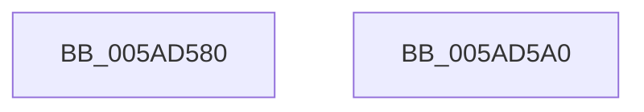

# _asan_report_store8

- RVA: `0x005AD580`–`0x005AD5A1` (길이 `33` bytes)
- VA: `0x00000001405AD580`
- 실행 섹션: `.text`
- PDB 이름 있음: `예`; PDB Function 태그: `아니요`
- unwind 정보 RVA: `0x0005D2F4`
- 디코드: `9`개 명령, `33/33` bytes 표시
- 미해석 바이트: `0` (있으면 어셈블리에 `.byte`로 보존)

> 이 문서는 커널 이미지의 기계어와 PDB 기호를 분석해 생성했습니다. 4번과 5번은 함수 원형과 자료형을 바이너리 사용 방식에서 추정한 C 해석이며 원본 소스 복구 결과는 아닙니다.

## 1. Dependencies

- 직접 호출 지점: **1**; 고유 호출 대상: **1**
- 직접 호출자로 확인된 함수: **0**
- RIP 상대 이미지 참조: **0**

### Outgoing calls
- `0x005AD596` → [KasaniReport](KasaniReport_function_005AB0B0.md) (function, `0x005AB0B0`)

### Direct callers
- 이 함수 시작 RVA로 연결되는 직접 call은 확인되지 않았습니다. 간접 호출은 완전히 역산할 수 없습니다.

### Static image references
- 디코드된 RIP-relative 메모리 참조가 없습니다.

## 2. Other-region calls and transfers

- 다른 실행 섹션으로 향하는 call: **0**
- 별도 외부 분기/꼬리 이동을 확인하지 못했습니다.

## 3. Assembly (complete function range)

```asm
005AD580  48 83 EC 38                     sub rsp, 0x38
005AD584  4C 8B 4C 24 38                  mov r9, qword ptr [rsp + 0x38]
005AD589  41 B0 01                        mov r8b, 1
005AD58C  BA 08 00 00 00                  mov edx, 8
005AD591  C6 44 24 20 80                  mov byte ptr [rsp + 0x20], 0x80
005AD596  E8 15 DB FF FF                  call 0x1405ab0b0
005AD59B  48 83 C4 38                     add rsp, 0x38
005AD59F  C3                              ret
005AD5A0  CC                              int3
```

## 4. C-style interpretation (structured pseudocode)

```c
__int64 __fastcall _asan_report_store8(void)
{
    __int64 result;
    __int64 v_rsp;
    unsigned __int8 v_stack_m18;
    unsigned __int64 v_stack_p0;

    v_rsp = (v_rsp) - (56);
    v_stack_m18 = 128;
    result = KasaniReport(a1, 8, 1, v_stack_p0);
    v_rsp = (v_rsp) + (56);
    return result;
}
```

## 5. (Beta) C Style

```c
void _asan_report_store8(void)
{
    int64_t result;
    int64_t local_rsp;
    uint8_t v_stack_m18;
    uint64_t v_stack_p0;

    local_rsp = (local_rsp) - (56);
    v_stack_m18 = 128;
    result = KasaniReport(a1, 8, 1, v_stack_p0);
    local_rsp = (local_rsp) + (56);
    return result;
}
```

## 6. Execution-region graph

[열기: 2D/3D 그래프와 함수 탐색 컨트롤 패널](../../../control-panel.html?section=text&rva=0x005AD580&view=graph)

- 2D 그래프는 위에서 아래로 흐르고, 3D 그래프는 빈 공간을 드래그해 회전합니다. Shift+드래그는 이동, 휠은 확대·축소, 함수 노드 선택은 대상 보고서 이동입니다.

### Static fallback


