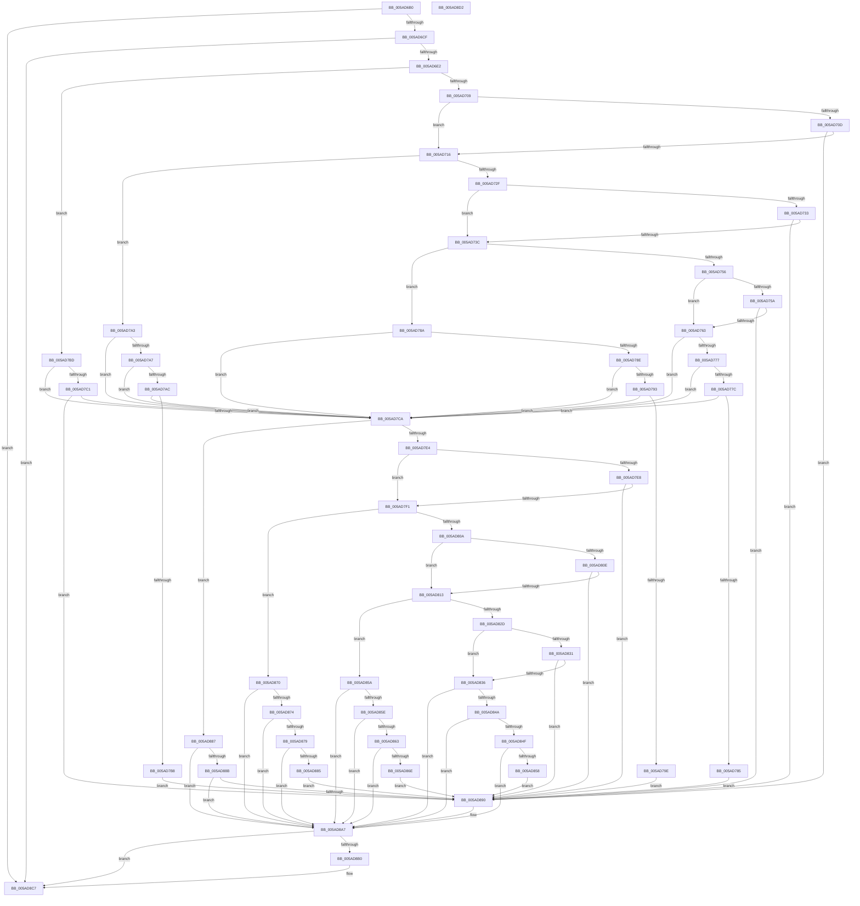

# _asan_store16

- RVA: `0x005AD6B0`–`0x005AD8D3` (길이 `547` bytes)
- VA: `0x00000001405AD6B0`
- 실행 섹션: `.text`
- PDB 이름 있음: `예`; PDB Function 태그: `아니요`
- unwind 정보 RVA: `0x0006E5F8`
- 디코드: `172`개 명령, `547/547` bytes 표시
- 미해석 바이트: `0` (있으면 어셈블리에 `.byte`로 보존)

> 이 문서는 커널 이미지의 기계어와 PDB 기호를 분석해 생성했습니다. 4번과 5번은 함수 원형과 자료형을 바이너리 사용 방식에서 추정한 C 해석이며 원본 소스 복구 결과는 아닙니다.

## 1. Dependencies

- 직접 호출 지점: **2**; 고유 호출 대상: **2**
- 직접 호출자로 확인된 함수: **0**
- RIP 상대 이미지 참조: **3**

### Outgoing calls
- `0x005AD8A2` → [KasaniReport](KasaniReport_function_005AB0B0.md) (function, `0x005AB0B0`)
- `0x005AD8C2` → [KcsanValidateAddress](KcsanValidateAddress_function_005AF5E0.md) (function, `0x005AF5E0`)

### Direct callers
- 이 함수 시작 RVA로 연결되는 직접 call은 확인되지 않았습니다. 간접 호출은 완전히 역산할 수 없습니다.

### Static image references
- `0x005AD6BA` → RVA `0x00FCEC6A` (`ALMOSTRO`; read)
- `0x005AD6E2` → RVA `0x00FC6ED8` (`ALMOSTRO`; read)
- `0x005AD8A7` → RVA `0x00F8A7E8` (`.data`; read)

## 2. Other-region calls and transfers

- 다른 실행 섹션으로 향하는 call: **0**
- 별도 외부 분기/꼬리 이동을 확인하지 못했습니다.

## 3. Assembly (complete function range)

```asm
005AD6B0  48 89 5C 24 08                  mov qword ptr [rsp + 8], rbx
005AD6B5  57                              push rdi
005AD6B6  48 83 EC 30                     sub rsp, 0x30
005AD6BA  80 3D A9 15 A2 00 00            cmp byte ptr [rip + 0xa215a9], 0
005AD6C1  48 8B D9                        mov rbx, rcx
005AD6C4  48 8B 7C 24 38                  mov rdi, qword ptr [rsp + 0x38]
005AD6C9  0F 84 F8 01 00 00               je 0x1405ad8c7
005AD6CF  48 B8 00 00 00 00 00 80 FF FF   movabs rax, 0xffff800000000000
005AD6D9  48 3B C8                        cmp rcx, rax
005AD6DC  0F 82 E5 01 00 00               jb 0x1405ad8c7
005AD6E2  4C 8B 05 EF 97 A1 00            mov r8, qword ptr [rip + 0xa197ef]
005AD6E9  49 B9 00 00 00 00 00 80 00 00   movabs r9, 0x800000000000
005AD6F3  4A 8D 04 09                     lea rax, [rcx + r9]
005AD6F7  48 C1 E8 03                     shr rax, 3
005AD6FB  42 0F B6 0C 00                  movzx ecx, byte ptr [rax + r8]
005AD700  F6 C3 07                        test bl, 7
005AD703  0F 86 B4 00 00 00               jbe 0x1405ad7bd
005AD709  84 C9                           test cl, cl
005AD70B  74 09                           je 0x1405ad716
005AD70D  80 F9 08                        cmp cl, 8
005AD710  0F 8C 7A 01 00 00               jl 0x1405ad890
005AD716  48 8D 53 04                     lea rdx, [rbx + 4]
005AD71A  4A 8D 04 0A                     lea rax, [rdx + r9]
005AD71E  48 C1 E8 03                     shr rax, 3
005AD722  42 0F B6 0C 00                  movzx ecx, byte ptr [rax + r8]
005AD727  8B C2                           mov eax, edx
005AD729  24 07                           and al, 7
005AD72B  3C 04                           cmp al, 4
005AD72D  76 74                           jbe 0x1405ad7a3
005AD72F  84 C9                           test cl, cl
005AD731  74 09                           je 0x1405ad73c
005AD733  80 F9 08                        cmp cl, 8
005AD736  0F 8C 54 01 00 00               jl 0x1405ad890
005AD73C  48 83 C2 02                     add rdx, 2
005AD740  4A 8D 04 0A                     lea rax, [rdx + r9]
005AD744  48 C1 E8 03                     shr rax, 3
005AD748  42 0F B6 0C 00                  movzx ecx, byte ptr [rax + r8]
005AD74D  8B C2                           mov eax, edx
005AD74F  83 E0 07                        and eax, 7
005AD752  3C 06                           cmp al, 6
005AD754  76 34                           jbe 0x1405ad78a
005AD756  84 C9                           test cl, cl
005AD758  74 09                           je 0x1405ad763
005AD75A  80 F9 08                        cmp cl, 8
005AD75D  0F 8C 2D 01 00 00               jl 0x1405ad890
005AD763  48 FF C2                        inc rdx
005AD766  4A 8D 04 0A                     lea rax, [rdx + r9]
005AD76A  48 C1 E8 03                     shr rax, 3
005AD76E  42 0F B6 0C 00                  movzx ecx, byte ptr [rax + r8]
005AD773  84 C9                           test cl, cl
005AD775  74 53                           je 0x1405ad7ca
005AD777  80 F9 08                        cmp cl, 8
005AD77A  7D 4E                           jge 0x1405ad7ca
005AD77C  80 E2 07                        and dl, 7
005AD77F  FE C2                           inc dl
005AD781  3A D1                           cmp dl, cl
005AD783  7E 45                           jle 0x1405ad7ca
005AD785  E9 06 01 00 00                  jmp 0x1405ad890
005AD78A  84 C9                           test cl, cl
005AD78C  74 3C                           je 0x1405ad7ca
005AD78E  80 F9 08                        cmp cl, 8
005AD791  7D 37                           jge 0x1405ad7ca
005AD793  FE C2                           inc dl
005AD795  80 E2 07                        and dl, 7
005AD798  FE C2                           inc dl
005AD79A  3A D1                           cmp dl, cl
005AD79C  7E 2C                           jle 0x1405ad7ca
005AD79E  E9 ED 00 00 00                  jmp 0x1405ad890
005AD7A3  84 C9                           test cl, cl
005AD7A5  74 23                           je 0x1405ad7ca
005AD7A7  80 F9 08                        cmp cl, 8
005AD7AA  7D 1E                           jge 0x1405ad7ca
005AD7AC  80 C2 03                        add dl, 3
005AD7AF  80 E2 07                        and dl, 7
005AD7B2  FE C2                           inc dl
005AD7B4  3A D1                           cmp dl, cl
005AD7B6  7E 12                           jle 0x1405ad7ca
005AD7B8  E9 D3 00 00 00                  jmp 0x1405ad890
005AD7BD  84 C9                           test cl, cl
005AD7BF  74 09                           je 0x1405ad7ca
005AD7C1  80 F9 08                        cmp cl, 8
005AD7C4  0F 8C C6 00 00 00               jl 0x1405ad890
005AD7CA  48 8D 53 08                     lea rdx, [rbx + 8]
005AD7CE  4A 8D 04 0A                     lea rax, [rdx + r9]
005AD7D2  48 C1 E8 03                     shr rax, 3
005AD7D6  42 0F B6 0C 00                  movzx ecx, byte ptr [rax + r8]
005AD7DB  F6 C2 07                        test dl, 7
005AD7DE  0F 86 A3 00 00 00               jbe 0x1405ad887
005AD7E4  84 C9                           test cl, cl
005AD7E6  74 09                           je 0x1405ad7f1
005AD7E8  80 F9 08                        cmp cl, 8
005AD7EB  0F 8C 9F 00 00 00               jl 0x1405ad890
005AD7F1  48 83 C2 04                     add rdx, 4
005AD7F5  4A 8D 04 0A                     lea rax, [rdx + r9]
005AD7F9  48 C1 E8 03                     shr rax, 3
005AD7FD  42 0F B6 0C 00                  movzx ecx, byte ptr [rax + r8]
005AD802  8B C2                           mov eax, edx
005AD804  24 07                           and al, 7
005AD806  3C 04                           cmp al, 4
005AD808  76 66                           jbe 0x1405ad870
005AD80A  84 C9                           test cl, cl
005AD80C  74 05                           je 0x1405ad813
005AD80E  80 F9 08                        cmp cl, 8
005AD811  7C 7D                           jl 0x1405ad890
005AD813  48 83 C2 02                     add rdx, 2
005AD817  4A 8D 04 0A                     lea rax, [rdx + r9]
005AD81B  48 C1 E8 03                     shr rax, 3
005AD81F  42 0F B6 0C 00                  movzx ecx, byte ptr [rax + r8]
005AD824  8B C2                           mov eax, edx
005AD826  83 E0 07                        and eax, 7
005AD829  3C 06                           cmp al, 6
005AD82B  76 2D                           jbe 0x1405ad85a
005AD82D  84 C9                           test cl, cl
005AD82F  74 05                           je 0x1405ad836
005AD831  80 F9 08                        cmp cl, 8
005AD834  7C 5A                           jl 0x1405ad890
005AD836  48 FF C2                        inc rdx
005AD839  4A 8D 04 0A                     lea rax, [rdx + r9]
005AD83D  48 C1 E8 03                     shr rax, 3
005AD841  42 0F B6 0C 00                  movzx ecx, byte ptr [rax + r8]
005AD846  84 C9                           test cl, cl
005AD848  74 5D                           je 0x1405ad8a7
005AD84A  80 F9 08                        cmp cl, 8
005AD84D  7D 58                           jge 0x1405ad8a7
005AD84F  80 E2 07                        and dl, 7
005AD852  FE C2                           inc dl
005AD854  3A D1                           cmp dl, cl
005AD856  7E 4F                           jle 0x1405ad8a7
005AD858  EB 36                           jmp 0x1405ad890
005AD85A  84 C9                           test cl, cl
005AD85C  74 49                           je 0x1405ad8a7
005AD85E  80 F9 08                        cmp cl, 8
005AD861  7D 44                           jge 0x1405ad8a7
005AD863  FE C2                           inc dl
005AD865  80 E2 07                        and dl, 7
005AD868  FE C2                           inc dl
005AD86A  3A D1                           cmp dl, cl
005AD86C  7E 39                           jle 0x1405ad8a7
005AD86E  EB 20                           jmp 0x1405ad890
005AD870  84 C9                           test cl, cl
005AD872  74 33                           je 0x1405ad8a7
005AD874  80 F9 08                        cmp cl, 8
005AD877  7D 2E                           jge 0x1405ad8a7
005AD879  80 C2 03                        add dl, 3
005AD87C  80 E2 07                        and dl, 7
005AD87F  FE C2                           inc dl
005AD881  3A D1                           cmp dl, cl
005AD883  7E 22                           jle 0x1405ad8a7
005AD885  EB 09                           jmp 0x1405ad890
005AD887  84 C9                           test cl, cl
005AD889  74 1C                           je 0x1405ad8a7
005AD88B  80 F9 08                        cmp cl, 8
005AD88E  7D 17                           jge 0x1405ad8a7
005AD890  88 4C 24 20                     mov byte ptr [rsp + 0x20], cl
005AD894  4C 8B CF                        mov r9, rdi
005AD897  48 8B CB                        mov rcx, rbx
005AD89A  41 B0 01                        mov r8b, 1
005AD89D  BA 10 00 00 00                  mov edx, 0x10
005AD8A2  E8 09 D8 FF FF                  call 0x1405ab0b0
005AD8A7  80 3D 3A CF 9D 00 00            cmp byte ptr [rip + 0x9dcf3a], 0
005AD8AE  74 17                           je 0x1405ad8c7
005AD8B0  45 33 C9                        xor r9d, r9d
005AD8B3  48 89 7C 24 20                  mov qword ptr [rsp + 0x20], rdi
005AD8B8  41 B0 01                        mov r8b, 1
005AD8BB  48 8B CB                        mov rcx, rbx
005AD8BE  41 8D 51 10                     lea edx, [r9 + 0x10]
005AD8C2  E8 19 1D 00 00                  call 0x1405af5e0
005AD8C7  48 8B 5C 24 40                  mov rbx, qword ptr [rsp + 0x40]
005AD8CC  48 83 C4 30                     add rsp, 0x30
005AD8D0  5F                              pop rdi
005AD8D1  C3                              ret
005AD8D2  CC                              int3
```

## 4. C-style interpretation (structured pseudocode)

```c
__int64 __fastcall _asan_store16(__int64 a1)
{
    __int64 result;
    __int64 v_rsp;
    unsigned __int8 v_stack_m18;
    unsigned __int64 v_stack_p0;
    unsigned __int64 v_stack_p8;

    v_stack_p8 = v_rbx;
    v_rsp = (v_rsp) - (48);
    if ((*(unsigned __int8 *)(v_rip + 10622377)) == 0) goto loc_005AD8C7;
    if (a1 < result) goto loc_005AD8C7;
    result = (a1 + a4 * 1) >> (3);
    if (condition_is_below_or_equal) goto loc_005AD7BD;
    if ((unsigned __int8)(*(unsigned __int8 *)(result + *(unsigned __int64 *)(v_rip + 10590191) * 1)) == 0) goto loc_005AD716;
    if (((unsigned __int8)(*(unsigned __int8 *)(result + *(unsigned __int64 *)(v_rip + 10590191) * 1))) < 8) goto loc_005AD890;
loc_005AD716:
    result = (a1 + 4 + a4 * 1) >> (3);
    result = (unsigned __int8)(((unsigned int)((unsigned int)(a1 + 4))) & (7));
    if (((unsigned __int8)(result)) <= 4) goto loc_005AD7A3;
    if ((unsigned __int8)(*(unsigned __int8 *)(result + *(unsigned __int64 *)(v_rip + 10590191) * 1)) == 0) goto loc_005AD73C;
    if (((unsigned __int8)(*(unsigned __int8 *)(result + *(unsigned __int64 *)(v_rip + 10590191) * 1))) < 8) goto loc_005AD890;
loc_005AD73C:
    a2 = (a1 + 4) + (2);
    result = (a2 + a4 * 1) >> (3);
    result = (unsigned int)(((unsigned int)((unsigned int)(a2))) & (7));
    if (((unsigned __int8)(result)) <= 6) goto loc_005AD78A;
    if ((unsigned __int8)(*(unsigned __int8 *)(result + *(unsigned __int64 *)(v_rip + 10590191) * 1)) == 0) goto loc_005AD763;
    if (((unsigned __int8)(*(unsigned __int8 *)(result + *(unsigned __int64 *)(v_rip + 10590191) * 1))) < 8) goto loc_005AD890;
loc_005AD763:
    a2 = (a2) + 1;
    result = (a2 + a4 * 1) >> (3);
    if ((unsigned __int8)(*(unsigned __int8 *)(result + *(unsigned __int64 *)(v_rip + 10590191) * 1)) == 0) goto loc_005AD7CA;
    if (((unsigned __int8)(*(unsigned __int8 *)(result + *(unsigned __int64 *)(v_rip + 10590191) * 1))) >= 8) goto loc_005AD7CA;
    a2 = (unsigned __int8)((a2) & (7));
    a2 = (unsigned __int8)((a2) + 1);
    if (((unsigned __int8)(a2)) <= ((unsigned __int8)(*(unsigned __int8 *)(result + *(unsigned __int64 *)(v_rip + 10590191) * 1)))) goto loc_005AD7CA;
    goto loc_005AD890;
loc_005AD78A:
    if ((unsigned __int8)(*(unsigned __int8 *)(result + *(unsigned __int64 *)(v_rip + 10590191) * 1)) == 0) goto loc_005AD7CA;
    if (((unsigned __int8)(*(unsigned __int8 *)(result + *(unsigned __int64 *)(v_rip + 10590191) * 1))) >= 8) goto loc_005AD7CA;
    a2 = (unsigned __int8)((a2) + 1);
    a2 = (unsigned __int8)((a2) & (7));
    a2 = (unsigned __int8)((a2) + 1);
    if (((unsigned __int8)(a2)) <= ((unsigned __int8)(*(unsigned __int8 *)(result + *(unsigned __int64 *)(v_rip + 10590191) * 1)))) goto loc_005AD7CA;
    goto loc_005AD890;
loc_005AD7A3:
    if ((unsigned __int8)(*(unsigned __int8 *)(result + *(unsigned __int64 *)(v_rip + 10590191) * 1)) == 0) goto loc_005AD7CA;
    if (((unsigned __int8)(*(unsigned __int8 *)(result + *(unsigned __int64 *)(v_rip + 10590191) * 1))) >= 8) goto loc_005AD7CA;
    a2 = (unsigned __int8)((a2) + (3));
    a2 = (unsigned __int8)((a2) & (7));
    a2 = (unsigned __int8)((a2) + 1);
    if (((unsigned __int8)(a2)) <= ((unsigned __int8)(*(unsigned __int8 *)(result + *(unsigned __int64 *)(v_rip + 10590191) * 1)))) goto loc_005AD7CA;
    goto loc_005AD890;
loc_005AD7BD:
    if ((unsigned __int8)(*(unsigned __int8 *)(result + *(unsigned __int64 *)(v_rip + 10590191) * 1)) == 0) goto loc_005AD7CA;
    if (((unsigned __int8)(*(unsigned __int8 *)(result + *(unsigned __int64 *)(v_rip + 10590191) * 1))) < 8) goto loc_005AD890;
loc_005AD7CA:
    result = (a1 + 8 + a4 * 1) >> (3);
    if (condition_is_below_or_equal) goto loc_005AD887;
    if ((unsigned __int8)(*(unsigned __int8 *)(result + *(unsigned __int64 *)(v_rip + 10590191) * 1)) == 0) goto loc_005AD7F1;
    if (((unsigned __int8)(*(unsigned __int8 *)(result + *(unsigned __int64 *)(v_rip + 10590191) * 1))) < 8) goto loc_005AD890;
loc_005AD7F1:
    a2 = (a1 + 8) + (4);
    result = (a2 + a4 * 1) >> (3);
    result = (unsigned __int8)(((unsigned int)((unsigned int)(a2))) & (7));
    if (((unsigned __int8)(result)) <= 4) goto loc_005AD870;
    if ((unsigned __int8)(*(unsigned __int8 *)(result + *(unsigned __int64 *)(v_rip + 10590191) * 1)) == 0) goto loc_005AD813;
    if (((unsigned __int8)(*(unsigned __int8 *)(result + *(unsigned __int64 *)(v_rip + 10590191) * 1))) < 8) goto loc_005AD890;
loc_005AD813:
    a2 = (a2) + (2);
    result = (a2 + a4 * 1) >> (3);
    result = (unsigned int)(((unsigned int)((unsigned int)(a2))) & (7));
    if (((unsigned __int8)(result)) <= 6) goto loc_005AD85A;
    if ((unsigned __int8)(*(unsigned __int8 *)(result + *(unsigned __int64 *)(v_rip + 10590191) * 1)) == 0) goto loc_005AD836;
    if (((unsigned __int8)(*(unsigned __int8 *)(result + *(unsigned __int64 *)(v_rip + 10590191) * 1))) < 8) goto loc_005AD890;
loc_005AD836:
    a2 = (a2) + 1;
    result = (a2 + a4 * 1) >> (3);
    if ((unsigned __int8)(*(unsigned __int8 *)(result + *(unsigned __int64 *)(v_rip + 10590191) * 1)) == 0) goto loc_005AD8A7;
    if (((unsigned __int8)(*(unsigned __int8 *)(result + *(unsigned __int64 *)(v_rip + 10590191) * 1))) >= 8) goto loc_005AD8A7;
    a2 = (unsigned __int8)((a2) & (7));
    a2 = (unsigned __int8)((a2) + 1);
    if (((unsigned __int8)(a2)) <= ((unsigned __int8)(*(unsigned __int8 *)(result + *(unsigned __int64 *)(v_rip + 10590191) * 1)))) goto loc_005AD8A7;
    goto loc_005AD890;
loc_005AD85A:
    if ((unsigned __int8)(*(unsigned __int8 *)(result + *(unsigned __int64 *)(v_rip + 10590191) * 1)) == 0) goto loc_005AD8A7;
    if (((unsigned __int8)(*(unsigned __int8 *)(result + *(unsigned __int64 *)(v_rip + 10590191) * 1))) >= 8) goto loc_005AD8A7;
    a2 = (unsigned __int8)((a2) + 1);
    a2 = (unsigned __int8)((a2) & (7));
    a2 = (unsigned __int8)((a2) + 1);
    if (((unsigned __int8)(a2)) <= ((unsigned __int8)(*(unsigned __int8 *)(result + *(unsigned __int64 *)(v_rip + 10590191) * 1)))) goto loc_005AD8A7;
    goto loc_005AD890;
loc_005AD870:
    if ((unsigned __int8)(*(unsigned __int8 *)(result + *(unsigned __int64 *)(v_rip + 10590191) * 1)) == 0) goto loc_005AD8A7;
    if (((unsigned __int8)(*(unsigned __int8 *)(result + *(unsigned __int64 *)(v_rip + 10590191) * 1))) >= 8) goto loc_005AD8A7;
    a2 = (unsigned __int8)((a2) + (3));
    a2 = (unsigned __int8)((a2) & (7));
    a2 = (unsigned __int8)((a2) + 1);
    if (((unsigned __int8)(a2)) <= ((unsigned __int8)(*(unsigned __int8 *)(result + *(unsigned __int64 *)(v_rip + 10590191) * 1)))) goto loc_005AD8A7;
    goto loc_005AD890;
loc_005AD887:
    if ((unsigned __int8)(*(unsigned __int8 *)(result + *(unsigned __int64 *)(v_rip + 10590191) * 1)) == 0) goto loc_005AD8A7;
    if (((unsigned __int8)(*(unsigned __int8 *)(result + *(unsigned __int64 *)(v_rip + 10590191) * 1))) < 8) {
        v_stack_m18 = (unsigned __int8)(*(unsigned __int8 *)(result + *(unsigned __int64 *)(v_rip + 10590191) * 1));
        a4 = v_stack_p0;
        a1 = a1;
        a3 = 1;
        a2 = 16;
        result = KasaniReport(a1, a2, a3, a4);
    }
    if ((*(unsigned __int8 *)(v_rip + 10342202)) != 0) {
        a4 = 0;
        v_stack_m18 = v_stack_p0;
        a3 = 1;
        a1 = a1;
        a2 = a4 + 16;
        result = KcsanValidateAddress(a1, a2, a3, a4);
    }
    v_rsp = (v_rsp) + (48);
    return result;
}
```

## 5. (Beta) C Style

```c
int64_t _asan_store16(int64_t Arg1)
{
    int64_t result;
    int64_t local_rsp;
    uint8_t v_stack_m18;
    uint64_t v_stack_p0;
    uint64_t v_stack_p8;

    v_stack_p8 = local_rbx;
    local_rsp = (local_rsp) - (48);
    if ((*(uint8_t *)(v_rip + 0xA215A9)) == 0) goto loc_005AD8C7;
    if (Arg1 < result) goto loc_005AD8C7;
    result = (Arg1 + a4 * 1) >> (3);
    if (condition_is_below_or_equal) goto loc_005AD7BD;
    if ((uint8_t)(*(uint8_t *)(result + *(uint64_t *)(v_rip + 0xA197EF) * 1)) == 0) goto loc_005AD716;
    if (((uint8_t)(*(uint8_t *)(result + *(uint64_t *)(v_rip + 0xA197EF) * 1))) < 8) goto loc_005AD890;
loc_005AD716:
    result = (Arg1 + 4 + a4 * 1) >> (3);
    result = (uint8_t)(((uint32_t)((uint32_t)(Arg1 + 4))) & (7));
    if (((uint8_t)(result)) <= 4) goto loc_005AD7A3;
    if ((uint8_t)(*(uint8_t *)(result + *(uint64_t *)(v_rip + 0xA197EF) * 1)) == 0) goto loc_005AD73C;
    if (((uint8_t)(*(uint8_t *)(result + *(uint64_t *)(v_rip + 0xA197EF) * 1))) < 8) goto loc_005AD890;
loc_005AD73C:
    a2 = (Arg1 + 4) + (2);
    result = (a2 + a4 * 1) >> (3);
    result = (uint32_t)(((uint32_t)((uint32_t)(a2))) & (7));
    if (((uint8_t)(result)) <= 6) goto loc_005AD78A;
    if ((uint8_t)(*(uint8_t *)(result + *(uint64_t *)(v_rip + 0xA197EF) * 1)) == 0) goto loc_005AD763;
    if (((uint8_t)(*(uint8_t *)(result + *(uint64_t *)(v_rip + 0xA197EF) * 1))) < 8) goto loc_005AD890;
loc_005AD763:
    a2 = (a2) + 1;
    result = (a2 + a4 * 1) >> (3);
    if ((uint8_t)(*(uint8_t *)(result + *(uint64_t *)(v_rip + 0xA197EF) * 1)) == 0) goto loc_005AD7CA;
    if (((uint8_t)(*(uint8_t *)(result + *(uint64_t *)(v_rip + 0xA197EF) * 1))) >= 8) goto loc_005AD7CA;
    a2 = (uint8_t)((a2) & (7));
    a2 = (uint8_t)((a2) + 1);
    if (((uint8_t)(a2)) <= ((uint8_t)(*(uint8_t *)(result + *(uint64_t *)(v_rip + 0xA197EF) * 1)))) goto loc_005AD7CA;
    goto loc_005AD890;
loc_005AD78A:
    if ((uint8_t)(*(uint8_t *)(result + *(uint64_t *)(v_rip + 0xA197EF) * 1)) == 0) goto loc_005AD7CA;
    if (((uint8_t)(*(uint8_t *)(result + *(uint64_t *)(v_rip + 0xA197EF) * 1))) >= 8) goto loc_005AD7CA;
    a2 = (uint8_t)((a2) + 1);
    a2 = (uint8_t)((a2) & (7));
    a2 = (uint8_t)((a2) + 1);
    if (((uint8_t)(a2)) <= ((uint8_t)(*(uint8_t *)(result + *(uint64_t *)(v_rip + 0xA197EF) * 1)))) goto loc_005AD7CA;
    goto loc_005AD890;
loc_005AD7A3:
    if ((uint8_t)(*(uint8_t *)(result + *(uint64_t *)(v_rip + 0xA197EF) * 1)) == 0) goto loc_005AD7CA;
    if (((uint8_t)(*(uint8_t *)(result + *(uint64_t *)(v_rip + 0xA197EF) * 1))) >= 8) goto loc_005AD7CA;
    a2 = (uint8_t)((a2) + (3));
    a2 = (uint8_t)((a2) & (7));
    a2 = (uint8_t)((a2) + 1);
    if (((uint8_t)(a2)) <= ((uint8_t)(*(uint8_t *)(result + *(uint64_t *)(v_rip + 0xA197EF) * 1)))) goto loc_005AD7CA;
    goto loc_005AD890;
loc_005AD7BD:
    if ((uint8_t)(*(uint8_t *)(result + *(uint64_t *)(v_rip + 0xA197EF) * 1)) == 0) goto loc_005AD7CA;
    if (((uint8_t)(*(uint8_t *)(result + *(uint64_t *)(v_rip + 0xA197EF) * 1))) < 8) goto loc_005AD890;
loc_005AD7CA:
    result = (Arg1 + 8 + a4 * 1) >> (3);
    if (condition_is_below_or_equal) goto loc_005AD887;
    if ((uint8_t)(*(uint8_t *)(result + *(uint64_t *)(v_rip + 0xA197EF) * 1)) == 0) goto loc_005AD7F1;
    if (((uint8_t)(*(uint8_t *)(result + *(uint64_t *)(v_rip + 0xA197EF) * 1))) < 8) goto loc_005AD890;
loc_005AD7F1:
    a2 = (Arg1 + 8) + (4);
    result = (a2 + a4 * 1) >> (3);
    result = (uint8_t)(((uint32_t)((uint32_t)(a2))) & (7));
    if (((uint8_t)(result)) <= 4) goto loc_005AD870;
    if ((uint8_t)(*(uint8_t *)(result + *(uint64_t *)(v_rip + 0xA197EF) * 1)) == 0) goto loc_005AD813;
    if (((uint8_t)(*(uint8_t *)(result + *(uint64_t *)(v_rip + 0xA197EF) * 1))) < 8) goto loc_005AD890;
loc_005AD813:
    a2 = (a2) + (2);
    result = (a2 + a4 * 1) >> (3);
    result = (uint32_t)(((uint32_t)((uint32_t)(a2))) & (7));
    if (((uint8_t)(result)) <= 6) goto loc_005AD85A;
    if ((uint8_t)(*(uint8_t *)(result + *(uint64_t *)(v_rip + 0xA197EF) * 1)) == 0) goto loc_005AD836;
    if (((uint8_t)(*(uint8_t *)(result + *(uint64_t *)(v_rip + 0xA197EF) * 1))) < 8) goto loc_005AD890;
loc_005AD836:
    a2 = (a2) + 1;
    result = (a2 + a4 * 1) >> (3);
    if ((uint8_t)(*(uint8_t *)(result + *(uint64_t *)(v_rip + 0xA197EF) * 1)) == 0) goto loc_005AD8A7;
    if (((uint8_t)(*(uint8_t *)(result + *(uint64_t *)(v_rip + 0xA197EF) * 1))) >= 8) goto loc_005AD8A7;
    a2 = (uint8_t)((a2) & (7));
    a2 = (uint8_t)((a2) + 1);
    if (((uint8_t)(a2)) <= ((uint8_t)(*(uint8_t *)(result + *(uint64_t *)(v_rip + 0xA197EF) * 1)))) goto loc_005AD8A7;
    goto loc_005AD890;
loc_005AD85A:
    if ((uint8_t)(*(uint8_t *)(result + *(uint64_t *)(v_rip + 0xA197EF) * 1)) == 0) goto loc_005AD8A7;
    if (((uint8_t)(*(uint8_t *)(result + *(uint64_t *)(v_rip + 0xA197EF) * 1))) >= 8) goto loc_005AD8A7;
    a2 = (uint8_t)((a2) + 1);
    a2 = (uint8_t)((a2) & (7));
    a2 = (uint8_t)((a2) + 1);
    if (((uint8_t)(a2)) <= ((uint8_t)(*(uint8_t *)(result + *(uint64_t *)(v_rip + 0xA197EF) * 1)))) goto loc_005AD8A7;
    goto loc_005AD890;
loc_005AD870:
    if ((uint8_t)(*(uint8_t *)(result + *(uint64_t *)(v_rip + 0xA197EF) * 1)) == 0) goto loc_005AD8A7;
    if (((uint8_t)(*(uint8_t *)(result + *(uint64_t *)(v_rip + 0xA197EF) * 1))) >= 8) goto loc_005AD8A7;
    a2 = (uint8_t)((a2) + (3));
    a2 = (uint8_t)((a2) & (7));
    a2 = (uint8_t)((a2) + 1);
    if (((uint8_t)(a2)) <= ((uint8_t)(*(uint8_t *)(result + *(uint64_t *)(v_rip + 0xA197EF) * 1)))) goto loc_005AD8A7;
    goto loc_005AD890;
loc_005AD887:
    if ((uint8_t)(*(uint8_t *)(result + *(uint64_t *)(v_rip + 0xA197EF) * 1)) == 0) goto loc_005AD8A7;
    if (((uint8_t)(*(uint8_t *)(result + *(uint64_t *)(v_rip + 0xA197EF) * 1))) < 8) {
        v_stack_m18 = (uint8_t)(*(uint8_t *)(result + *(uint64_t *)(v_rip + 0xA197EF) * 1));
        a4 = v_stack_p0;
        Arg1 = Arg1;
        a3 = 1;
        a2 = 16;
        result = KasaniReport(Arg1, a2, a3, a4);
    }
    if ((*(uint8_t *)(v_rip + 0x9DCF3A)) != 0) {
        a4 = 0;
        v_stack_m18 = v_stack_p0;
        a3 = 1;
        Arg1 = Arg1;
        a2 = a4 + 16;
        result = KcsanValidateAddress(Arg1, a2, a3, a4);
    }
    local_rsp = (local_rsp) + (48);
    return result;
}
```

## 6. Execution-region graph

[열기: 2D/3D 그래프와 함수 탐색 컨트롤 패널](../../../control-panel.html?section=text&rva=0x005AD6B0&view=graph)

- 2D 그래프는 위에서 아래로 흐르고, 3D 그래프는 빈 공간을 드래그해 회전합니다. Shift+드래그는 이동, 휠은 확대·축소, 함수 노드 선택은 대상 보고서 이동입니다.

### Static fallback


