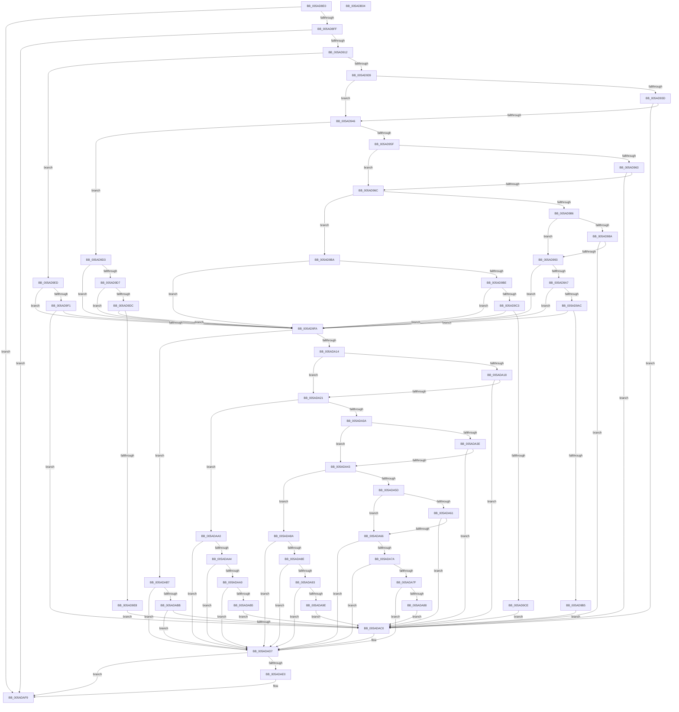

# _asan_store16_volatile

- RVA: `0x005AD8E0`–`0x005ADB05` (길이 `549` bytes)
- VA: `0x00000001405AD8E0`
- 실행 섹션: `.text`
- PDB 이름 있음: `예`; PDB Function 태그: `아니요`
- unwind 정보 RVA: `0x0006E5F8`
- 디코드: `172`개 명령, `549/549` bytes 표시
- 미해석 바이트: `0` (있으면 어셈블리에 `.byte`로 보존)

> 이 문서는 커널 이미지의 기계어와 PDB 기호를 분석해 생성했습니다. 4번과 5번은 함수 원형과 자료형을 바이너리 사용 방식에서 추정한 C 해석이며 원본 소스 복구 결과는 아닙니다.

## 1. Dependencies

- 직접 호출 지점: **2**; 고유 호출 대상: **2**
- 직접 호출자로 확인된 함수: **0**
- RIP 상대 이미지 참조: **3**

### Outgoing calls
- `0x005ADAD2` → [KasaniReport](KasaniReport_function_005AB0B0.md) (function, `0x005AB0B0`)
- `0x005ADAF4` → [KcsanValidateAddress](KcsanValidateAddress_function_005AF5E0.md) (function, `0x005AF5E0`)

### Direct callers
- 이 함수 시작 RVA로 연결되는 직접 call은 확인되지 않았습니다. 간접 호출은 완전히 역산할 수 없습니다.

### Static image references
- `0x005AD8EA` → RVA `0x00FCEC6A` (`ALMOSTRO`; read)
- `0x005AD912` → RVA `0x00FC6ED8` (`ALMOSTRO`; read)
- `0x005ADAD7` → RVA `0x00F8A7E8` (`.data`; read)

## 2. Other-region calls and transfers

- 다른 실행 섹션으로 향하는 call: **0**
- 별도 외부 분기/꼬리 이동을 확인하지 못했습니다.

## 3. Assembly (complete function range)

```asm
005AD8E0  48 89 5C 24 08                  mov qword ptr [rsp + 8], rbx
005AD8E5  57                              push rdi
005AD8E6  48 83 EC 30                     sub rsp, 0x30
005AD8EA  80 3D 79 13 A2 00 00            cmp byte ptr [rip + 0xa21379], 0
005AD8F1  48 8B D9                        mov rbx, rcx
005AD8F4  48 8B 7C 24 38                  mov rdi, qword ptr [rsp + 0x38]
005AD8F9  0F 84 FA 01 00 00               je 0x1405adaf9
005AD8FF  48 B8 00 00 00 00 00 80 FF FF   movabs rax, 0xffff800000000000
005AD909  48 3B C8                        cmp rcx, rax
005AD90C  0F 82 E7 01 00 00               jb 0x1405adaf9
005AD912  4C 8B 05 BF 95 A1 00            mov r8, qword ptr [rip + 0xa195bf]
005AD919  49 B9 00 00 00 00 00 80 00 00   movabs r9, 0x800000000000
005AD923  4A 8D 04 09                     lea rax, [rcx + r9]
005AD927  48 C1 E8 03                     shr rax, 3
005AD92B  42 0F B6 0C 00                  movzx ecx, byte ptr [rax + r8]
005AD930  F6 C3 07                        test bl, 7
005AD933  0F 86 B4 00 00 00               jbe 0x1405ad9ed
005AD939  84 C9                           test cl, cl
005AD93B  74 09                           je 0x1405ad946
005AD93D  80 F9 08                        cmp cl, 8
005AD940  0F 8C 7A 01 00 00               jl 0x1405adac0
005AD946  48 8D 53 04                     lea rdx, [rbx + 4]
005AD94A  4A 8D 04 0A                     lea rax, [rdx + r9]
005AD94E  48 C1 E8 03                     shr rax, 3
005AD952  42 0F B6 0C 00                  movzx ecx, byte ptr [rax + r8]
005AD957  8B C2                           mov eax, edx
005AD959  24 07                           and al, 7
005AD95B  3C 04                           cmp al, 4
005AD95D  76 74                           jbe 0x1405ad9d3
005AD95F  84 C9                           test cl, cl
005AD961  74 09                           je 0x1405ad96c
005AD963  80 F9 08                        cmp cl, 8
005AD966  0F 8C 54 01 00 00               jl 0x1405adac0
005AD96C  48 83 C2 02                     add rdx, 2
005AD970  4A 8D 04 0A                     lea rax, [rdx + r9]
005AD974  48 C1 E8 03                     shr rax, 3
005AD978  42 0F B6 0C 00                  movzx ecx, byte ptr [rax + r8]
005AD97D  8B C2                           mov eax, edx
005AD97F  83 E0 07                        and eax, 7
005AD982  3C 06                           cmp al, 6
005AD984  76 34                           jbe 0x1405ad9ba
005AD986  84 C9                           test cl, cl
005AD988  74 09                           je 0x1405ad993
005AD98A  80 F9 08                        cmp cl, 8
005AD98D  0F 8C 2D 01 00 00               jl 0x1405adac0
005AD993  48 FF C2                        inc rdx
005AD996  4A 8D 04 0A                     lea rax, [rdx + r9]
005AD99A  48 C1 E8 03                     shr rax, 3
005AD99E  42 0F B6 0C 00                  movzx ecx, byte ptr [rax + r8]
005AD9A3  84 C9                           test cl, cl
005AD9A5  74 53                           je 0x1405ad9fa
005AD9A7  80 F9 08                        cmp cl, 8
005AD9AA  7D 4E                           jge 0x1405ad9fa
005AD9AC  80 E2 07                        and dl, 7
005AD9AF  FE C2                           inc dl
005AD9B1  3A D1                           cmp dl, cl
005AD9B3  7E 45                           jle 0x1405ad9fa
005AD9B5  E9 06 01 00 00                  jmp 0x1405adac0
005AD9BA  84 C9                           test cl, cl
005AD9BC  74 3C                           je 0x1405ad9fa
005AD9BE  80 F9 08                        cmp cl, 8
005AD9C1  7D 37                           jge 0x1405ad9fa
005AD9C3  FE C2                           inc dl
005AD9C5  80 E2 07                        and dl, 7
005AD9C8  FE C2                           inc dl
005AD9CA  3A D1                           cmp dl, cl
005AD9CC  7E 2C                           jle 0x1405ad9fa
005AD9CE  E9 ED 00 00 00                  jmp 0x1405adac0
005AD9D3  84 C9                           test cl, cl
005AD9D5  74 23                           je 0x1405ad9fa
005AD9D7  80 F9 08                        cmp cl, 8
005AD9DA  7D 1E                           jge 0x1405ad9fa
005AD9DC  80 C2 03                        add dl, 3
005AD9DF  80 E2 07                        and dl, 7
005AD9E2  FE C2                           inc dl
005AD9E4  3A D1                           cmp dl, cl
005AD9E6  7E 12                           jle 0x1405ad9fa
005AD9E8  E9 D3 00 00 00                  jmp 0x1405adac0
005AD9ED  84 C9                           test cl, cl
005AD9EF  74 09                           je 0x1405ad9fa
005AD9F1  80 F9 08                        cmp cl, 8
005AD9F4  0F 8C C6 00 00 00               jl 0x1405adac0
005AD9FA  48 8D 53 08                     lea rdx, [rbx + 8]
005AD9FE  4A 8D 04 0A                     lea rax, [rdx + r9]
005ADA02  48 C1 E8 03                     shr rax, 3
005ADA06  42 0F B6 0C 00                  movzx ecx, byte ptr [rax + r8]
005ADA0B  F6 C2 07                        test dl, 7
005ADA0E  0F 86 A3 00 00 00               jbe 0x1405adab7
005ADA14  84 C9                           test cl, cl
005ADA16  74 09                           je 0x1405ada21
005ADA18  80 F9 08                        cmp cl, 8
005ADA1B  0F 8C 9F 00 00 00               jl 0x1405adac0
005ADA21  48 83 C2 04                     add rdx, 4
005ADA25  4A 8D 04 0A                     lea rax, [rdx + r9]
005ADA29  48 C1 E8 03                     shr rax, 3
005ADA2D  42 0F B6 0C 00                  movzx ecx, byte ptr [rax + r8]
005ADA32  8B C2                           mov eax, edx
005ADA34  24 07                           and al, 7
005ADA36  3C 04                           cmp al, 4
005ADA38  76 66                           jbe 0x1405adaa0
005ADA3A  84 C9                           test cl, cl
005ADA3C  74 05                           je 0x1405ada43
005ADA3E  80 F9 08                        cmp cl, 8
005ADA41  7C 7D                           jl 0x1405adac0
005ADA43  48 83 C2 02                     add rdx, 2
005ADA47  4A 8D 04 0A                     lea rax, [rdx + r9]
005ADA4B  48 C1 E8 03                     shr rax, 3
005ADA4F  42 0F B6 0C 00                  movzx ecx, byte ptr [rax + r8]
005ADA54  8B C2                           mov eax, edx
005ADA56  83 E0 07                        and eax, 7
005ADA59  3C 06                           cmp al, 6
005ADA5B  76 2D                           jbe 0x1405ada8a
005ADA5D  84 C9                           test cl, cl
005ADA5F  74 05                           je 0x1405ada66
005ADA61  80 F9 08                        cmp cl, 8
005ADA64  7C 5A                           jl 0x1405adac0
005ADA66  48 FF C2                        inc rdx
005ADA69  4A 8D 04 0A                     lea rax, [rdx + r9]
005ADA6D  48 C1 E8 03                     shr rax, 3
005ADA71  42 0F B6 0C 00                  movzx ecx, byte ptr [rax + r8]
005ADA76  84 C9                           test cl, cl
005ADA78  74 5D                           je 0x1405adad7
005ADA7A  80 F9 08                        cmp cl, 8
005ADA7D  7D 58                           jge 0x1405adad7
005ADA7F  80 E2 07                        and dl, 7
005ADA82  FE C2                           inc dl
005ADA84  3A D1                           cmp dl, cl
005ADA86  7E 4F                           jle 0x1405adad7
005ADA88  EB 36                           jmp 0x1405adac0
005ADA8A  84 C9                           test cl, cl
005ADA8C  74 49                           je 0x1405adad7
005ADA8E  80 F9 08                        cmp cl, 8
005ADA91  7D 44                           jge 0x1405adad7
005ADA93  FE C2                           inc dl
005ADA95  80 E2 07                        and dl, 7
005ADA98  FE C2                           inc dl
005ADA9A  3A D1                           cmp dl, cl
005ADA9C  7E 39                           jle 0x1405adad7
005ADA9E  EB 20                           jmp 0x1405adac0
005ADAA0  84 C9                           test cl, cl
005ADAA2  74 33                           je 0x1405adad7
005ADAA4  80 F9 08                        cmp cl, 8
005ADAA7  7D 2E                           jge 0x1405adad7
005ADAA9  80 C2 03                        add dl, 3
005ADAAC  80 E2 07                        and dl, 7
005ADAAF  FE C2                           inc dl
005ADAB1  3A D1                           cmp dl, cl
005ADAB3  7E 22                           jle 0x1405adad7
005ADAB5  EB 09                           jmp 0x1405adac0
005ADAB7  84 C9                           test cl, cl
005ADAB9  74 1C                           je 0x1405adad7
005ADABB  80 F9 08                        cmp cl, 8
005ADABE  7D 17                           jge 0x1405adad7
005ADAC0  88 4C 24 20                     mov byte ptr [rsp + 0x20], cl
005ADAC4  4C 8B CF                        mov r9, rdi
005ADAC7  48 8B CB                        mov rcx, rbx
005ADACA  41 B0 01                        mov r8b, 1
005ADACD  BA 10 00 00 00                  mov edx, 0x10
005ADAD2  E8 D9 D5 FF FF                  call 0x1405ab0b0
005ADAD7  80 3D 0A CD 9D 00 00            cmp byte ptr [rip + 0x9dcd0a], 0
005ADADE  74 19                           je 0x1405adaf9
005ADAE0  41 B1 01                        mov r9b, 1
005ADAE3  48 89 7C 24 20                  mov qword ptr [rsp + 0x20], rdi
005ADAE8  45 0F B6 C1                     movzx r8d, r9b
005ADAEC  BA 10 00 00 00                  mov edx, 0x10
005ADAF1  48 8B CB                        mov rcx, rbx
005ADAF4  E8 E7 1A 00 00                  call 0x1405af5e0
005ADAF9  48 8B 5C 24 40                  mov rbx, qword ptr [rsp + 0x40]
005ADAFE  48 83 C4 30                     add rsp, 0x30
005ADB02  5F                              pop rdi
005ADB03  C3                              ret
005ADB04  CC                              int3
```

## 4. C-style interpretation (structured pseudocode)

```c
__int64 __fastcall _asan_store16_volatile(__int64 a1)
{
    __int64 result;
    __int64 v_rsp;
    unsigned __int8 v_stack_m18;
    unsigned __int64 v_stack_p0;
    unsigned __int64 v_stack_p8;

    v_stack_p8 = v_rbx;
    v_rsp = (v_rsp) - (48);
    if ((*(unsigned __int8 *)(v_rip + 10621817)) == 0) goto loc_005ADAF9;
    if (a1 < result) goto loc_005ADAF9;
    result = (a1 + a4 * 1) >> (3);
    if (condition_is_below_or_equal) goto loc_005AD9ED;
    if ((unsigned __int8)(*(unsigned __int8 *)(result + *(unsigned __int64 *)(v_rip + 10589631) * 1)) == 0) goto loc_005AD946;
    if (((unsigned __int8)(*(unsigned __int8 *)(result + *(unsigned __int64 *)(v_rip + 10589631) * 1))) < 8) goto loc_005ADAC0;
loc_005AD946:
    result = (a1 + 4 + a4 * 1) >> (3);
    result = (unsigned __int8)(((unsigned int)((unsigned int)(a1 + 4))) & (7));
    if (((unsigned __int8)(result)) <= 4) goto loc_005AD9D3;
    if ((unsigned __int8)(*(unsigned __int8 *)(result + *(unsigned __int64 *)(v_rip + 10589631) * 1)) == 0) goto loc_005AD96C;
    if (((unsigned __int8)(*(unsigned __int8 *)(result + *(unsigned __int64 *)(v_rip + 10589631) * 1))) < 8) goto loc_005ADAC0;
loc_005AD96C:
    a2 = (a1 + 4) + (2);
    result = (a2 + a4 * 1) >> (3);
    result = (unsigned int)(((unsigned int)((unsigned int)(a2))) & (7));
    if (((unsigned __int8)(result)) <= 6) goto loc_005AD9BA;
    if ((unsigned __int8)(*(unsigned __int8 *)(result + *(unsigned __int64 *)(v_rip + 10589631) * 1)) == 0) goto loc_005AD993;
    if (((unsigned __int8)(*(unsigned __int8 *)(result + *(unsigned __int64 *)(v_rip + 10589631) * 1))) < 8) goto loc_005ADAC0;
loc_005AD993:
    a2 = (a2) + 1;
    result = (a2 + a4 * 1) >> (3);
    if ((unsigned __int8)(*(unsigned __int8 *)(result + *(unsigned __int64 *)(v_rip + 10589631) * 1)) == 0) goto loc_005AD9FA;
    if (((unsigned __int8)(*(unsigned __int8 *)(result + *(unsigned __int64 *)(v_rip + 10589631) * 1))) >= 8) goto loc_005AD9FA;
    a2 = (unsigned __int8)((a2) & (7));
    a2 = (unsigned __int8)((a2) + 1);
    if (((unsigned __int8)(a2)) <= ((unsigned __int8)(*(unsigned __int8 *)(result + *(unsigned __int64 *)(v_rip + 10589631) * 1)))) goto loc_005AD9FA;
    goto loc_005ADAC0;
loc_005AD9BA:
    if ((unsigned __int8)(*(unsigned __int8 *)(result + *(unsigned __int64 *)(v_rip + 10589631) * 1)) == 0) goto loc_005AD9FA;
    if (((unsigned __int8)(*(unsigned __int8 *)(result + *(unsigned __int64 *)(v_rip + 10589631) * 1))) >= 8) goto loc_005AD9FA;
    a2 = (unsigned __int8)((a2) + 1);
    a2 = (unsigned __int8)((a2) & (7));
    a2 = (unsigned __int8)((a2) + 1);
    if (((unsigned __int8)(a2)) <= ((unsigned __int8)(*(unsigned __int8 *)(result + *(unsigned __int64 *)(v_rip + 10589631) * 1)))) goto loc_005AD9FA;
    goto loc_005ADAC0;
loc_005AD9D3:
    if ((unsigned __int8)(*(unsigned __int8 *)(result + *(unsigned __int64 *)(v_rip + 10589631) * 1)) == 0) goto loc_005AD9FA;
    if (((unsigned __int8)(*(unsigned __int8 *)(result + *(unsigned __int64 *)(v_rip + 10589631) * 1))) >= 8) goto loc_005AD9FA;
    a2 = (unsigned __int8)((a2) + (3));
    a2 = (unsigned __int8)((a2) & (7));
    a2 = (unsigned __int8)((a2) + 1);
    if (((unsigned __int8)(a2)) <= ((unsigned __int8)(*(unsigned __int8 *)(result + *(unsigned __int64 *)(v_rip + 10589631) * 1)))) goto loc_005AD9FA;
    goto loc_005ADAC0;
loc_005AD9ED:
    if ((unsigned __int8)(*(unsigned __int8 *)(result + *(unsigned __int64 *)(v_rip + 10589631) * 1)) == 0) goto loc_005AD9FA;
    if (((unsigned __int8)(*(unsigned __int8 *)(result + *(unsigned __int64 *)(v_rip + 10589631) * 1))) < 8) goto loc_005ADAC0;
loc_005AD9FA:
    result = (a1 + 8 + a4 * 1) >> (3);
    if (condition_is_below_or_equal) goto loc_005ADAB7;
    if ((unsigned __int8)(*(unsigned __int8 *)(result + *(unsigned __int64 *)(v_rip + 10589631) * 1)) == 0) goto loc_005ADA21;
    if (((unsigned __int8)(*(unsigned __int8 *)(result + *(unsigned __int64 *)(v_rip + 10589631) * 1))) < 8) goto loc_005ADAC0;
loc_005ADA21:
    a2 = (a1 + 8) + (4);
    result = (a2 + a4 * 1) >> (3);
    result = (unsigned __int8)(((unsigned int)((unsigned int)(a2))) & (7));
    if (((unsigned __int8)(result)) <= 4) goto loc_005ADAA0;
    if ((unsigned __int8)(*(unsigned __int8 *)(result + *(unsigned __int64 *)(v_rip + 10589631) * 1)) == 0) goto loc_005ADA43;
    if (((unsigned __int8)(*(unsigned __int8 *)(result + *(unsigned __int64 *)(v_rip + 10589631) * 1))) < 8) goto loc_005ADAC0;
loc_005ADA43:
    a2 = (a2) + (2);
    result = (a2 + a4 * 1) >> (3);
    result = (unsigned int)(((unsigned int)((unsigned int)(a2))) & (7));
    if (((unsigned __int8)(result)) <= 6) goto loc_005ADA8A;
    if ((unsigned __int8)(*(unsigned __int8 *)(result + *(unsigned __int64 *)(v_rip + 10589631) * 1)) == 0) goto loc_005ADA66;
    if (((unsigned __int8)(*(unsigned __int8 *)(result + *(unsigned __int64 *)(v_rip + 10589631) * 1))) < 8) goto loc_005ADAC0;
loc_005ADA66:
    a2 = (a2) + 1;
    result = (a2 + a4 * 1) >> (3);
    if ((unsigned __int8)(*(unsigned __int8 *)(result + *(unsigned __int64 *)(v_rip + 10589631) * 1)) == 0) goto loc_005ADAD7;
    if (((unsigned __int8)(*(unsigned __int8 *)(result + *(unsigned __int64 *)(v_rip + 10589631) * 1))) >= 8) goto loc_005ADAD7;
    a2 = (unsigned __int8)((a2) & (7));
    a2 = (unsigned __int8)((a2) + 1);
    if (((unsigned __int8)(a2)) <= ((unsigned __int8)(*(unsigned __int8 *)(result + *(unsigned __int64 *)(v_rip + 10589631) * 1)))) goto loc_005ADAD7;
    goto loc_005ADAC0;
loc_005ADA8A:
    if ((unsigned __int8)(*(unsigned __int8 *)(result + *(unsigned __int64 *)(v_rip + 10589631) * 1)) == 0) goto loc_005ADAD7;
    if (((unsigned __int8)(*(unsigned __int8 *)(result + *(unsigned __int64 *)(v_rip + 10589631) * 1))) >= 8) goto loc_005ADAD7;
    a2 = (unsigned __int8)((a2) + 1);
    a2 = (unsigned __int8)((a2) & (7));
    a2 = (unsigned __int8)((a2) + 1);
    if (((unsigned __int8)(a2)) <= ((unsigned __int8)(*(unsigned __int8 *)(result + *(unsigned __int64 *)(v_rip + 10589631) * 1)))) goto loc_005ADAD7;
    goto loc_005ADAC0;
loc_005ADAA0:
    if ((unsigned __int8)(*(unsigned __int8 *)(result + *(unsigned __int64 *)(v_rip + 10589631) * 1)) == 0) goto loc_005ADAD7;
    if (((unsigned __int8)(*(unsigned __int8 *)(result + *(unsigned __int64 *)(v_rip + 10589631) * 1))) >= 8) goto loc_005ADAD7;
    a2 = (unsigned __int8)((a2) + (3));
    a2 = (unsigned __int8)((a2) & (7));
    a2 = (unsigned __int8)((a2) + 1);
    if (((unsigned __int8)(a2)) <= ((unsigned __int8)(*(unsigned __int8 *)(result + *(unsigned __int64 *)(v_rip + 10589631) * 1)))) goto loc_005ADAD7;
    goto loc_005ADAC0;
loc_005ADAB7:
    if ((unsigned __int8)(*(unsigned __int8 *)(result + *(unsigned __int64 *)(v_rip + 10589631) * 1)) == 0) goto loc_005ADAD7;
    if (((unsigned __int8)(*(unsigned __int8 *)(result + *(unsigned __int64 *)(v_rip + 10589631) * 1))) < 8) {
        v_stack_m18 = (unsigned __int8)(*(unsigned __int8 *)(result + *(unsigned __int64 *)(v_rip + 10589631) * 1));
        a4 = v_stack_p0;
        a1 = a1;
        a3 = 1;
        a2 = 16;
        result = KasaniReport(a1, a2, a3, a4);
    }
    if ((*(unsigned __int8 *)(v_rip + 10341642)) != 0) {
        a4 = 1;
        v_stack_m18 = v_stack_p0;
        a3 = (unsigned __int8)(a4);
        a2 = 16;
        a1 = a1;
        result = KcsanValidateAddress(a1, a2, a3, a4);
    }
    v_rsp = (v_rsp) + (48);
    return result;
}
```

## 5. (Beta) C Style

```c
int64_t _asan_store16_volatile(int64_t Arg1)
{
    int64_t result;
    int64_t local_rsp;
    uint8_t v_stack_m18;
    uint64_t v_stack_p0;
    uint64_t v_stack_p8;

    v_stack_p8 = local_rbx;
    local_rsp = (local_rsp) - (48);
    if ((*(uint8_t *)(v_rip + 0xA21379)) == 0) goto loc_005ADAF9;
    if (Arg1 < result) goto loc_005ADAF9;
    result = (Arg1 + a4 * 1) >> (3);
    if (condition_is_below_or_equal) goto loc_005AD9ED;
    if ((uint8_t)(*(uint8_t *)(result + *(uint64_t *)(v_rip + 0xA195BF) * 1)) == 0) goto loc_005AD946;
    if (((uint8_t)(*(uint8_t *)(result + *(uint64_t *)(v_rip + 0xA195BF) * 1))) < 8) goto loc_005ADAC0;
loc_005AD946:
    result = (Arg1 + 4 + a4 * 1) >> (3);
    result = (uint8_t)(((uint32_t)((uint32_t)(Arg1 + 4))) & (7));
    if (((uint8_t)(result)) <= 4) goto loc_005AD9D3;
    if ((uint8_t)(*(uint8_t *)(result + *(uint64_t *)(v_rip + 0xA195BF) * 1)) == 0) goto loc_005AD96C;
    if (((uint8_t)(*(uint8_t *)(result + *(uint64_t *)(v_rip + 0xA195BF) * 1))) < 8) goto loc_005ADAC0;
loc_005AD96C:
    a2 = (Arg1 + 4) + (2);
    result = (a2 + a4 * 1) >> (3);
    result = (uint32_t)(((uint32_t)((uint32_t)(a2))) & (7));
    if (((uint8_t)(result)) <= 6) goto loc_005AD9BA;
    if ((uint8_t)(*(uint8_t *)(result + *(uint64_t *)(v_rip + 0xA195BF) * 1)) == 0) goto loc_005AD993;
    if (((uint8_t)(*(uint8_t *)(result + *(uint64_t *)(v_rip + 0xA195BF) * 1))) < 8) goto loc_005ADAC0;
loc_005AD993:
    a2 = (a2) + 1;
    result = (a2 + a4 * 1) >> (3);
    if ((uint8_t)(*(uint8_t *)(result + *(uint64_t *)(v_rip + 0xA195BF) * 1)) == 0) goto loc_005AD9FA;
    if (((uint8_t)(*(uint8_t *)(result + *(uint64_t *)(v_rip + 0xA195BF) * 1))) >= 8) goto loc_005AD9FA;
    a2 = (uint8_t)((a2) & (7));
    a2 = (uint8_t)((a2) + 1);
    if (((uint8_t)(a2)) <= ((uint8_t)(*(uint8_t *)(result + *(uint64_t *)(v_rip + 0xA195BF) * 1)))) goto loc_005AD9FA;
    goto loc_005ADAC0;
loc_005AD9BA:
    if ((uint8_t)(*(uint8_t *)(result + *(uint64_t *)(v_rip + 0xA195BF) * 1)) == 0) goto loc_005AD9FA;
    if (((uint8_t)(*(uint8_t *)(result + *(uint64_t *)(v_rip + 0xA195BF) * 1))) >= 8) goto loc_005AD9FA;
    a2 = (uint8_t)((a2) + 1);
    a2 = (uint8_t)((a2) & (7));
    a2 = (uint8_t)((a2) + 1);
    if (((uint8_t)(a2)) <= ((uint8_t)(*(uint8_t *)(result + *(uint64_t *)(v_rip + 0xA195BF) * 1)))) goto loc_005AD9FA;
    goto loc_005ADAC0;
loc_005AD9D3:
    if ((uint8_t)(*(uint8_t *)(result + *(uint64_t *)(v_rip + 0xA195BF) * 1)) == 0) goto loc_005AD9FA;
    if (((uint8_t)(*(uint8_t *)(result + *(uint64_t *)(v_rip + 0xA195BF) * 1))) >= 8) goto loc_005AD9FA;
    a2 = (uint8_t)((a2) + (3));
    a2 = (uint8_t)((a2) & (7));
    a2 = (uint8_t)((a2) + 1);
    if (((uint8_t)(a2)) <= ((uint8_t)(*(uint8_t *)(result + *(uint64_t *)(v_rip + 0xA195BF) * 1)))) goto loc_005AD9FA;
    goto loc_005ADAC0;
loc_005AD9ED:
    if ((uint8_t)(*(uint8_t *)(result + *(uint64_t *)(v_rip + 0xA195BF) * 1)) == 0) goto loc_005AD9FA;
    if (((uint8_t)(*(uint8_t *)(result + *(uint64_t *)(v_rip + 0xA195BF) * 1))) < 8) goto loc_005ADAC0;
loc_005AD9FA:
    result = (Arg1 + 8 + a4 * 1) >> (3);
    if (condition_is_below_or_equal) goto loc_005ADAB7;
    if ((uint8_t)(*(uint8_t *)(result + *(uint64_t *)(v_rip + 0xA195BF) * 1)) == 0) goto loc_005ADA21;
    if (((uint8_t)(*(uint8_t *)(result + *(uint64_t *)(v_rip + 0xA195BF) * 1))) < 8) goto loc_005ADAC0;
loc_005ADA21:
    a2 = (Arg1 + 8) + (4);
    result = (a2 + a4 * 1) >> (3);
    result = (uint8_t)(((uint32_t)((uint32_t)(a2))) & (7));
    if (((uint8_t)(result)) <= 4) goto loc_005ADAA0;
    if ((uint8_t)(*(uint8_t *)(result + *(uint64_t *)(v_rip + 0xA195BF) * 1)) == 0) goto loc_005ADA43;
    if (((uint8_t)(*(uint8_t *)(result + *(uint64_t *)(v_rip + 0xA195BF) * 1))) < 8) goto loc_005ADAC0;
loc_005ADA43:
    a2 = (a2) + (2);
    result = (a2 + a4 * 1) >> (3);
    result = (uint32_t)(((uint32_t)((uint32_t)(a2))) & (7));
    if (((uint8_t)(result)) <= 6) goto loc_005ADA8A;
    if ((uint8_t)(*(uint8_t *)(result + *(uint64_t *)(v_rip + 0xA195BF) * 1)) == 0) goto loc_005ADA66;
    if (((uint8_t)(*(uint8_t *)(result + *(uint64_t *)(v_rip + 0xA195BF) * 1))) < 8) goto loc_005ADAC0;
loc_005ADA66:
    a2 = (a2) + 1;
    result = (a2 + a4 * 1) >> (3);
    if ((uint8_t)(*(uint8_t *)(result + *(uint64_t *)(v_rip + 0xA195BF) * 1)) == 0) goto loc_005ADAD7;
    if (((uint8_t)(*(uint8_t *)(result + *(uint64_t *)(v_rip + 0xA195BF) * 1))) >= 8) goto loc_005ADAD7;
    a2 = (uint8_t)((a2) & (7));
    a2 = (uint8_t)((a2) + 1);
    if (((uint8_t)(a2)) <= ((uint8_t)(*(uint8_t *)(result + *(uint64_t *)(v_rip + 0xA195BF) * 1)))) goto loc_005ADAD7;
    goto loc_005ADAC0;
loc_005ADA8A:
    if ((uint8_t)(*(uint8_t *)(result + *(uint64_t *)(v_rip + 0xA195BF) * 1)) == 0) goto loc_005ADAD7;
    if (((uint8_t)(*(uint8_t *)(result + *(uint64_t *)(v_rip + 0xA195BF) * 1))) >= 8) goto loc_005ADAD7;
    a2 = (uint8_t)((a2) + 1);
    a2 = (uint8_t)((a2) & (7));
    a2 = (uint8_t)((a2) + 1);
    if (((uint8_t)(a2)) <= ((uint8_t)(*(uint8_t *)(result + *(uint64_t *)(v_rip + 0xA195BF) * 1)))) goto loc_005ADAD7;
    goto loc_005ADAC0;
loc_005ADAA0:
    if ((uint8_t)(*(uint8_t *)(result + *(uint64_t *)(v_rip + 0xA195BF) * 1)) == 0) goto loc_005ADAD7;
    if (((uint8_t)(*(uint8_t *)(result + *(uint64_t *)(v_rip + 0xA195BF) * 1))) >= 8) goto loc_005ADAD7;
    a2 = (uint8_t)((a2) + (3));
    a2 = (uint8_t)((a2) & (7));
    a2 = (uint8_t)((a2) + 1);
    if (((uint8_t)(a2)) <= ((uint8_t)(*(uint8_t *)(result + *(uint64_t *)(v_rip + 0xA195BF) * 1)))) goto loc_005ADAD7;
    goto loc_005ADAC0;
loc_005ADAB7:
    if ((uint8_t)(*(uint8_t *)(result + *(uint64_t *)(v_rip + 0xA195BF) * 1)) == 0) goto loc_005ADAD7;
    if (((uint8_t)(*(uint8_t *)(result + *(uint64_t *)(v_rip + 0xA195BF) * 1))) < 8) {
        v_stack_m18 = (uint8_t)(*(uint8_t *)(result + *(uint64_t *)(v_rip + 0xA195BF) * 1));
        a4 = v_stack_p0;
        Arg1 = Arg1;
        a3 = 1;
        a2 = 16;
        result = KasaniReport(Arg1, a2, a3, a4);
    }
    if ((*(uint8_t *)(v_rip + 0x9DCD0A)) != 0) {
        a4 = 1;
        v_stack_m18 = v_stack_p0;
        a3 = (uint8_t)(a4);
        a2 = 16;
        Arg1 = Arg1;
        result = KcsanValidateAddress(Arg1, a2, a3, a4);
    }
    local_rsp = (local_rsp) + (48);
    return result;
}
```

## 6. Execution-region graph

[열기: 2D/3D 그래프와 함수 탐색 컨트롤 패널](../../../control-panel.html?section=text&rva=0x005AD8E0&view=graph)

- 2D 그래프는 위에서 아래로 흐르고, 3D 그래프는 빈 공간을 드래그해 회전합니다. Shift+드래그는 이동, 휠은 확대·축소, 함수 노드 선택은 대상 보고서 이동입니다.

### Static fallback


