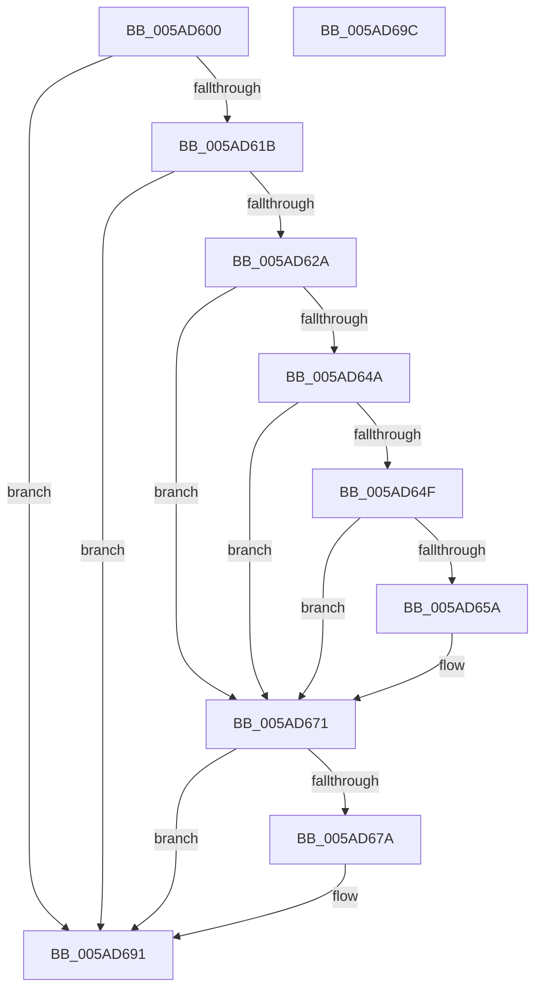

# _asan_store1

- RVA: `0x005AD600`–`0x005AD69D` (길이 `157` bytes)
- VA: `0x00000001405AD600`
- 실행 섹션: `.text`
- PDB 이름 있음: `예`; PDB Function 태그: `아니요`
- unwind 정보 RVA: `0x0006E5F8`
- 디코드: `43`개 명령, `157/157` bytes 표시
- 미해석 바이트: `0` (있으면 어셈블리에 `.byte`로 보존)

> 이 문서는 커널 이미지의 기계어와 PDB 기호를 분석해 생성했습니다. 4번과 5번은 함수 원형과 자료형을 바이너리 사용 방식에서 추정한 C 해석이며 원본 소스 복구 결과는 아닙니다.

## 1. Dependencies

- 직접 호출 지점: **2**; 고유 호출 대상: **2**
- 직접 호출자로 확인된 함수: **0**
- RIP 상대 이미지 참조: **3**

### Outgoing calls
- `0x005AD66C` → [KasaniReport](KasaniReport_function_005AB0B0.md) (function, `0x005AB0B0`)
- `0x005AD68C` → [KcsanValidateAddress](KcsanValidateAddress_function_005AF5E0.md) (function, `0x005AF5E0`)

### Direct callers
- 이 함수 시작 RVA로 연결되는 직접 call은 확인되지 않았습니다. 간접 호출은 완전히 역산할 수 없습니다.

### Static image references
- `0x005AD60A` → RVA `0x00FCEC6A` (`ALMOSTRO`; read)
- `0x005AD62A` → RVA `0x00FC6ED8` (`ALMOSTRO`; read)
- `0x005AD671` → RVA `0x00F8A7E8` (`.data`; read)

## 2. Other-region calls and transfers

- 다른 실행 섹션으로 향하는 call: **0**
- 별도 외부 분기/꼬리 이동을 확인하지 못했습니다.

## 3. Assembly (complete function range)

```asm
005AD600  48 89 5C 24 08                  mov qword ptr [rsp + 8], rbx
005AD605  57                              push rdi
005AD606  48 83 EC 30                     sub rsp, 0x30
005AD60A  80 3D 59 16 A2 00 00            cmp byte ptr [rip + 0xa21659], 0
005AD611  48 8B D9                        mov rbx, rcx
005AD614  48 8B 7C 24 38                  mov rdi, qword ptr [rsp + 0x38]
005AD619  74 76                           je 0x1405ad691
005AD61B  48 B8 00 00 00 00 00 80 FF FF   movabs rax, 0xffff800000000000
005AD625  48 3B C8                        cmp rcx, rax
005AD628  72 67                           jb 0x1405ad691
005AD62A  48 8B 05 A7 98 A1 00            mov rax, qword ptr [rip + 0xa198a7]
005AD631  48 BA 00 00 00 00 00 80 00 00   movabs rdx, 0x800000000000
005AD63B  48 03 D1                        add rdx, rcx
005AD63E  48 C1 EA 03                     shr rdx, 3
005AD642  0F B6 0C 02                     movzx ecx, byte ptr [rdx + rax]
005AD646  84 C9                           test cl, cl
005AD648  74 27                           je 0x1405ad671
005AD64A  80 F9 08                        cmp cl, 8
005AD64D  7D 22                           jge 0x1405ad671
005AD64F  0F B6 C3                        movzx eax, bl
005AD652  24 07                           and al, 7
005AD654  FE C0                           inc al
005AD656  3A C1                           cmp al, cl
005AD658  7E 17                           jle 0x1405ad671
005AD65A  88 4C 24 20                     mov byte ptr [rsp + 0x20], cl
005AD65E  4C 8B CF                        mov r9, rdi
005AD661  48 8B CB                        mov rcx, rbx
005AD664  41 B0 01                        mov r8b, 1
005AD667  BA 01 00 00 00                  mov edx, 1
005AD66C  E8 3F DA FF FF                  call 0x1405ab0b0
005AD671  80 3D 70 D1 9D 00 00            cmp byte ptr [rip + 0x9dd170], 0
005AD678  74 17                           je 0x1405ad691
005AD67A  45 33 C9                        xor r9d, r9d
005AD67D  48 89 7C 24 20                  mov qword ptr [rsp + 0x20], rdi
005AD682  41 B0 01                        mov r8b, 1
005AD685  48 8B CB                        mov rcx, rbx
005AD688  41 8D 51 01                     lea edx, [r9 + 1]
005AD68C  E8 4F 1F 00 00                  call 0x1405af5e0
005AD691  48 8B 5C 24 40                  mov rbx, qword ptr [rsp + 0x40]
005AD696  48 83 C4 30                     add rsp, 0x30
005AD69A  5F                              pop rdi
005AD69B  C3                              ret
005AD69C  CC                              int3
```

## 4. C-style interpretation (structured pseudocode)

```c
__int64 __fastcall _asan_store1(__int64 a1)
{
    __int64 result;
    __int64 v_rsp;
    unsigned __int8 v_stack_m18;
    unsigned __int64 v_stack_p0;
    unsigned __int64 v_stack_p8;

    v_stack_p8 = v_rbx;
    v_rsp = (v_rsp) - (48);
    if ((*(unsigned __int8 *)(v_rip + 10622553)) == 0) goto loc_005AD691;
    if (a1 < result) goto loc_005AD691;
    a2 = (a2) + (a1);
    a2 = (a2) >> (3);
    if ((unsigned __int8)(*(unsigned __int8 *)(a2 + *(unsigned __int64 *)(v_rip + 10590375) * 1)) == 0) goto loc_005AD671;
    if (((unsigned __int8)(*(unsigned __int8 *)(a2 + *(unsigned __int64 *)(v_rip + 10590375) * 1))) >= 8) goto loc_005AD671;
    result = (unsigned __int8)(((unsigned __int8)(a1)) & (7));
    result = (unsigned __int8)((result) + 1);
    if (((unsigned __int8)(result)) >= = ((unsigned __int8)(*(unsigned __int8 *)(a2 + *(unsigned __int64 *)(v_rip + 10590375) * 1)))) {
        v_stack_m18 = (unsigned __int8)(*(unsigned __int8 *)(a2 + *(unsigned __int64 *)(v_rip + 10590375) * 1));
        a4 = v_stack_p0;
        a1 = a1;
        a3 = 1;
        a2 = 1;
        result = KasaniReport(a1, a2, a3, a4);
    }
    if ((*(unsigned __int8 *)(v_rip + 10342768)) != 0) {
        a4 = 0;
        v_stack_m18 = v_stack_p0;
        a3 = 1;
        a1 = a1;
        a2 = a4 + 1;
        result = KcsanValidateAddress(a1, a2, a3, a4);
    }
    v_rsp = (v_rsp) + (48);
    return result;
}
```

## 5. (Beta) C Style

```c
int64_t _asan_store1(int64_t Arg1)
{
    int64_t result;
    int64_t local_rsp;
    uint8_t v_stack_m18;
    uint64_t v_stack_p0;
    uint64_t v_stack_p8;

    v_stack_p8 = local_rbx;
    local_rsp = (local_rsp) - (48);
    if ((*(uint8_t *)(v_rip + 0xA21659)) == 0) goto loc_005AD691;
    if (Arg1 < result) goto loc_005AD691;
    a2 = (a2) + (Arg1);
    a2 = (a2) >> (3);
    if ((uint8_t)(*(uint8_t *)(a2 + *(uint64_t *)(v_rip + 0xA198A7) * 1)) == 0) goto loc_005AD671;
    if (((uint8_t)(*(uint8_t *)(a2 + *(uint64_t *)(v_rip + 0xA198A7) * 1))) >= 8) goto loc_005AD671;
    result = (uint8_t)(((uint8_t)(Arg1)) & (7));
    result = (uint8_t)((result) + 1);
    if (((uint8_t)(result)) >= = ((uint8_t)(*(uint8_t *)(a2 + *(uint64_t *)(v_rip + 0xA198A7) * 1)))) {
        v_stack_m18 = (uint8_t)(*(uint8_t *)(a2 + *(uint64_t *)(v_rip + 0xA198A7) * 1));
        a4 = v_stack_p0;
        Arg1 = Arg1;
        a3 = 1;
        a2 = 1;
        result = KasaniReport(Arg1, a2, a3, a4);
    }
    if ((*(uint8_t *)(v_rip + 0x9DD170)) != 0) {
        a4 = 0;
        v_stack_m18 = v_stack_p0;
        a3 = 1;
        Arg1 = Arg1;
        a2 = a4 + 1;
        result = KcsanValidateAddress(Arg1, a2, a3, a4);
    }
    local_rsp = (local_rsp) + (48);
    return result;
}
```

## 6. Execution-region graph

[열기: 2D/3D 그래프와 함수 탐색 컨트롤 패널](../../../control-panel.html?section=text&rva=0x005AD600&view=graph)

- 2D 그래프는 위에서 아래로 흐르고, 3D 그래프는 빈 공간을 드래그해 회전합니다. Shift+드래그는 이동, 휠은 확대·축소, 함수 노드 선택은 대상 보고서 이동입니다.

### Static fallback


