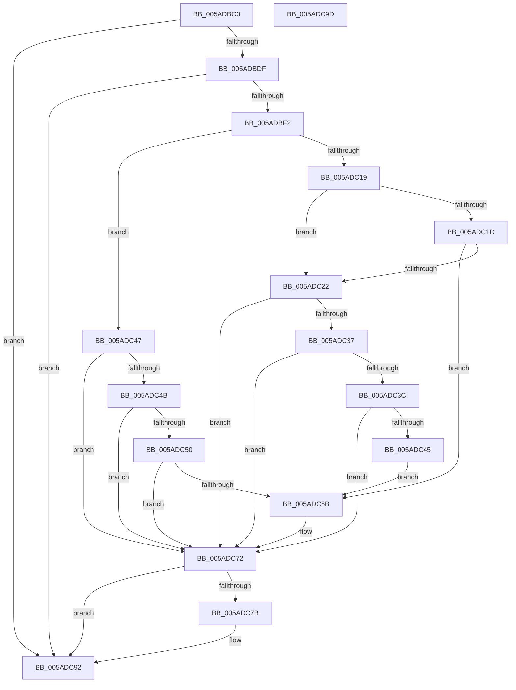

# _asan_store2

- RVA: `0x005ADBC0`–`0x005ADC9E` (길이 `222` bytes)
- VA: `0x00000001405ADBC0`
- 실행 섹션: `.text`
- PDB 이름 있음: `예`; PDB Function 태그: `아니요`
- unwind 정보 RVA: `0x0006E5F8`
- 디코드: `64`개 명령, `222/222` bytes 표시
- 미해석 바이트: `0` (있으면 어셈블리에 `.byte`로 보존)

> 이 문서는 커널 이미지의 기계어와 PDB 기호를 분석해 생성했습니다. 4번과 5번은 함수 원형과 자료형을 바이너리 사용 방식에서 추정한 C 해석이며 원본 소스 복구 결과는 아닙니다.

## 1. Dependencies

- 직접 호출 지점: **2**; 고유 호출 대상: **2**
- 직접 호출자로 확인된 함수: **0**
- RIP 상대 이미지 참조: **3**

### Outgoing calls
- `0x005ADC6D` → [KasaniReport](KasaniReport_function_005AB0B0.md) (function, `0x005AB0B0`)
- `0x005ADC8D` → [KcsanValidateAddress](KcsanValidateAddress_function_005AF5E0.md) (function, `0x005AF5E0`)

### Direct callers
- 이 함수 시작 RVA로 연결되는 직접 call은 확인되지 않았습니다. 간접 호출은 완전히 역산할 수 없습니다.

### Static image references
- `0x005ADBCA` → RVA `0x00FCEC6A` (`ALMOSTRO`; read)
- `0x005ADBF2` → RVA `0x00FC6ED8` (`ALMOSTRO`; read)
- `0x005ADC72` → RVA `0x00F8A7E8` (`.data`; read)

## 2. Other-region calls and transfers

- 다른 실행 섹션으로 향하는 call: **0**
- 별도 외부 분기/꼬리 이동을 확인하지 못했습니다.

## 3. Assembly (complete function range)

```asm
005ADBC0  48 89 5C 24 08                  mov qword ptr [rsp + 8], rbx
005ADBC5  57                              push rdi
005ADBC6  48 83 EC 30                     sub rsp, 0x30
005ADBCA  80 3D 99 10 A2 00 00            cmp byte ptr [rip + 0xa21099], 0
005ADBD1  48 8B D9                        mov rbx, rcx
005ADBD4  48 8B 7C 24 38                  mov rdi, qword ptr [rsp + 0x38]
005ADBD9  0F 84 B3 00 00 00               je 0x1405adc92
005ADBDF  48 B8 00 00 00 00 00 80 FF FF   movabs rax, 0xffff800000000000
005ADBE9  48 3B C8                        cmp rcx, rax
005ADBEC  0F 82 A0 00 00 00               jb 0x1405adc92
005ADBF2  4C 8B 05 DF 92 A1 00            mov r8, qword ptr [rip + 0xa192df]
005ADBF9  49 B9 00 00 00 00 00 80 00 00   movabs r9, 0x800000000000
005ADC03  4A 8D 04 09                     lea rax, [rcx + r9]
005ADC07  48 C1 E8 03                     shr rax, 3
005ADC0B  42 0F B6 0C 00                  movzx ecx, byte ptr [rax + r8]
005ADC10  8B C3                           mov eax, ebx
005ADC12  83 E0 07                        and eax, 7
005ADC15  3C 06                           cmp al, 6
005ADC17  76 2E                           jbe 0x1405adc47
005ADC19  84 C9                           test cl, cl
005ADC1B  74 05                           je 0x1405adc22
005ADC1D  80 F9 08                        cmp cl, 8
005ADC20  7C 39                           jl 0x1405adc5b
005ADC22  48 8D 53 01                     lea rdx, [rbx + 1]
005ADC26  4A 8D 04 0A                     lea rax, [rdx + r9]
005ADC2A  48 C1 E8 03                     shr rax, 3
005ADC2E  42 0F B6 0C 00                  movzx ecx, byte ptr [rax + r8]
005ADC33  84 C9                           test cl, cl
005ADC35  74 3B                           je 0x1405adc72
005ADC37  80 F9 08                        cmp cl, 8
005ADC3A  7D 36                           jge 0x1405adc72
005ADC3C  80 E2 07                        and dl, 7
005ADC3F  FE C2                           inc dl
005ADC41  3A D1                           cmp dl, cl
005ADC43  7E 2D                           jle 0x1405adc72
005ADC45  EB 14                           jmp 0x1405adc5b
005ADC47  84 C9                           test cl, cl
005ADC49  74 27                           je 0x1405adc72
005ADC4B  80 F9 08                        cmp cl, 8
005ADC4E  7D 22                           jge 0x1405adc72
005ADC50  8D 43 01                        lea eax, [rbx + 1]
005ADC53  24 07                           and al, 7
005ADC55  FE C0                           inc al
005ADC57  3A C1                           cmp al, cl
005ADC59  7E 17                           jle 0x1405adc72
005ADC5B  88 4C 24 20                     mov byte ptr [rsp + 0x20], cl
005ADC5F  4C 8B CF                        mov r9, rdi
005ADC62  48 8B CB                        mov rcx, rbx
005ADC65  41 B0 01                        mov r8b, 1
005ADC68  BA 02 00 00 00                  mov edx, 2
005ADC6D  E8 3E D4 FF FF                  call 0x1405ab0b0
005ADC72  80 3D 6F CB 9D 00 00            cmp byte ptr [rip + 0x9dcb6f], 0
005ADC79  74 17                           je 0x1405adc92
005ADC7B  45 33 C9                        xor r9d, r9d
005ADC7E  48 89 7C 24 20                  mov qword ptr [rsp + 0x20], rdi
005ADC83  41 B0 01                        mov r8b, 1
005ADC86  48 8B CB                        mov rcx, rbx
005ADC89  41 8D 51 02                     lea edx, [r9 + 2]
005ADC8D  E8 4E 19 00 00                  call 0x1405af5e0
005ADC92  48 8B 5C 24 40                  mov rbx, qword ptr [rsp + 0x40]
005ADC97  48 83 C4 30                     add rsp, 0x30
005ADC9B  5F                              pop rdi
005ADC9C  C3                              ret
005ADC9D  CC                              int3
```

## 4. C-style interpretation (structured pseudocode)

```c
__int64 __fastcall _asan_store2(__int64 a1)
{
    __int64 result;
    __int64 v_rsp;
    unsigned __int8 v_stack_m18;
    unsigned __int64 v_stack_p0;
    unsigned __int64 v_stack_p8;

    v_stack_p8 = v_rbx;
    v_rsp = (v_rsp) - (48);
    if ((*(unsigned __int8 *)(v_rip + 10621081)) == 0) goto loc_005ADC92;
    if (a1 < result) goto loc_005ADC92;
    result = (a1 + a4 * 1) >> (3);
    result = (unsigned int)(((unsigned int)((unsigned int)(a1))) & (7));
    if (((unsigned __int8)(result)) <= 6) goto loc_005ADC47;
    if ((unsigned __int8)(*(unsigned __int8 *)(result + *(unsigned __int64 *)(v_rip + 10588895) * 1)) == 0) goto loc_005ADC22;
    if (((unsigned __int8)(*(unsigned __int8 *)(result + *(unsigned __int64 *)(v_rip + 10588895) * 1))) < 8) goto loc_005ADC5B;
loc_005ADC22:
    result = (a1 + 1 + a4 * 1) >> (3);
    if ((unsigned __int8)(*(unsigned __int8 *)(result + *(unsigned __int64 *)(v_rip + 10588895) * 1)) == 0) goto loc_005ADC72;
    if (((unsigned __int8)(*(unsigned __int8 *)(result + *(unsigned __int64 *)(v_rip + 10588895) * 1))) >= 8) goto loc_005ADC72;
    a2 = (unsigned __int8)((a1 + 1) & (7));
    a2 = (unsigned __int8)((a2) + 1);
    if (((unsigned __int8)(a2)) <= ((unsigned __int8)(*(unsigned __int8 *)(result + *(unsigned __int64 *)(v_rip + 10588895) * 1)))) goto loc_005ADC72;
    goto loc_005ADC5B;
loc_005ADC47:
    if ((unsigned __int8)(*(unsigned __int8 *)(result + *(unsigned __int64 *)(v_rip + 10588895) * 1)) == 0) goto loc_005ADC72;
    if (((unsigned __int8)(*(unsigned __int8 *)(result + *(unsigned __int64 *)(v_rip + 10588895) * 1))) >= 8) goto loc_005ADC72;
    result = (unsigned __int8)((a1 + 1) & (7));
    result = (unsigned __int8)((result) + 1);
    if (((unsigned __int8)(result)) >= = ((unsigned __int8)(*(unsigned __int8 *)(result + *(unsigned __int64 *)(v_rip + 10588895) * 1)))) {
        v_stack_m18 = (unsigned __int8)(*(unsigned __int8 *)(result + *(unsigned __int64 *)(v_rip + 10588895) * 1));
        a4 = v_stack_p0;
        a1 = a1;
        a3 = 1;
        a2 = 2;
        result = KasaniReport(a1, a2, a3, a4);
    }
    if ((*(unsigned __int8 *)(v_rip + 10341231)) != 0) {
        a4 = 0;
        v_stack_m18 = v_stack_p0;
        a3 = 1;
        a1 = a1;
        a2 = a4 + 2;
        result = KcsanValidateAddress(a1, a2, a3, a4);
    }
    v_rsp = (v_rsp) + (48);
    return result;
}
```

## 5. (Beta) C Style

```c
int64_t _asan_store2(void *Arg1)
{
    uint8_t *arg1 = (uint8_t *)Arg1;

    int64_t result;
    int64_t local_rsp;
    uint8_t v_stack_m18;
    uint64_t v_stack_p0;
    uint64_t v_stack_p8;

    v_stack_p8 = local_rbx;
    local_rsp = (local_rsp) - (48);
    if ((*(uint8_t *)(v_rip + 0xA21099)) == 0) goto loc_005ADC92;
    if (Arg1 < result) goto loc_005ADC92;
    result = (Arg1 + a4 * 1) >> (3);
    result = (uint32_t)(((uint32_t)((uint32_t)(Arg1))) & (7));
    if (((uint8_t)(result)) <= 6) goto loc_005ADC47;
    if ((uint8_t)(*(uint8_t *)(result + *(uint64_t *)(v_rip + 0xA192DF) * 1)) == 0) goto loc_005ADC22;
    if (((uint8_t)(*(uint8_t *)(result + *(uint64_t *)(v_rip + 0xA192DF) * 1))) < 8) goto loc_005ADC5B;
loc_005ADC22:
    result = (Arg1 + 1 + a4 * 1) >> (3);
    if ((uint8_t)(*(uint8_t *)(result + *(uint64_t *)(v_rip + 0xA192DF) * 1)) == 0) goto loc_005ADC72;
    if (((uint8_t)(*(uint8_t *)(result + *(uint64_t *)(v_rip + 0xA192DF) * 1))) >= 8) goto loc_005ADC72;
    a2 = (uint8_t)((Arg1 + 1) & (7));
    a2 = (uint8_t)((a2) + 1);
    if (((uint8_t)(a2)) <= ((uint8_t)(*(uint8_t *)(result + *(uint64_t *)(v_rip + 0xA192DF) * 1)))) goto loc_005ADC72;
    goto loc_005ADC5B;
loc_005ADC47:
    if ((uint8_t)(*(uint8_t *)(result + *(uint64_t *)(v_rip + 0xA192DF) * 1)) == 0) goto loc_005ADC72;
    if (((uint8_t)(*(uint8_t *)(result + *(uint64_t *)(v_rip + 0xA192DF) * 1))) >= 8) goto loc_005ADC72;
    result = (uint8_t)((Arg1 + 1) & (7));
    result = (uint8_t)((result) + 1);
    if (((uint8_t)(result)) >= = ((uint8_t)(*(uint8_t *)(result + *(uint64_t *)(v_rip + 0xA192DF) * 1)))) {
        v_stack_m18 = (uint8_t)(*(uint8_t *)(result + *(uint64_t *)(v_rip + 0xA192DF) * 1));
        a4 = v_stack_p0;
        Arg1 = Arg1;
        a3 = 1;
        a2 = 2;
        result = KasaniReport(Arg1, a2, a3, a4);
    }
    if ((*(uint8_t *)(v_rip + 0x9DCB6F)) != 0) {
        a4 = 0;
        v_stack_m18 = v_stack_p0;
        a3 = 1;
        Arg1 = Arg1;
        a2 = a4 + 2;
        result = KcsanValidateAddress(Arg1, a2, a3, a4);
    }
    local_rsp = (local_rsp) + (48);
    return result;
}
```

### 관측된 메모리 오프셋

구조체 형식이 확인되지 않은 접근은 인자 기준의 오프셋으로만 기록했습니다.

| 기준 인자 | 오프셋 표현 | 폭 (bit) | 접근 |
|---|---:|---:|---|
| `Arg1` | `+ 0x0 + r9*1` | `64` | `R` |
| `Arg1` | `+ 0x1` | `32` | `R` |
| `Arg1` | `+ 0x1` | `64` | `R` |

## 6. Execution-region graph

[열기: 2D/3D 그래프와 함수 탐색 컨트롤 패널](../../../control-panel.html?section=text&rva=0x005ADBC0&view=graph)

- 2D 그래프는 위에서 아래로 흐르고, 3D 그래프는 빈 공간을 드래그해 회전합니다. Shift+드래그는 이동, 휠은 확대·축소, 함수 노드 선택은 대상 보고서 이동입니다.

### Static fallback


