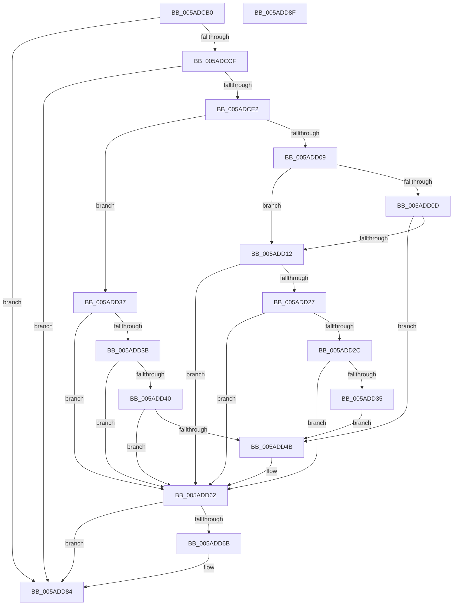

# _asan_store2_volatile

- RVA: `0x005ADCB0`–`0x005ADD90` (길이 `224` bytes)
- VA: `0x00000001405ADCB0`
- 실행 섹션: `.text`
- PDB 이름 있음: `예`; PDB Function 태그: `아니요`
- unwind 정보 RVA: `0x0006E5F8`
- 디코드: `64`개 명령, `224/224` bytes 표시
- 미해석 바이트: `0` (있으면 어셈블리에 `.byte`로 보존)

> 이 문서는 커널 이미지의 기계어와 PDB 기호를 분석해 생성했습니다. 4번과 5번은 함수 원형과 자료형을 바이너리 사용 방식에서 추정한 C 해석이며 원본 소스 복구 결과는 아닙니다.

## 1. Dependencies

- 직접 호출 지점: **2**; 고유 호출 대상: **2**
- 직접 호출자로 확인된 함수: **0**
- RIP 상대 이미지 참조: **3**

### Outgoing calls
- `0x005ADD5D` → [KasaniReport](KasaniReport_function_005AB0B0.md) (function, `0x005AB0B0`)
- `0x005ADD7F` → [KcsanValidateAddress](KcsanValidateAddress_function_005AF5E0.md) (function, `0x005AF5E0`)

### Direct callers
- 이 함수 시작 RVA로 연결되는 직접 call은 확인되지 않았습니다. 간접 호출은 완전히 역산할 수 없습니다.

### Static image references
- `0x005ADCBA` → RVA `0x00FCEC6A` (`ALMOSTRO`; read)
- `0x005ADCE2` → RVA `0x00FC6ED8` (`ALMOSTRO`; read)
- `0x005ADD62` → RVA `0x00F8A7E8` (`.data`; read)

## 2. Other-region calls and transfers

- 다른 실행 섹션으로 향하는 call: **0**
- 별도 외부 분기/꼬리 이동을 확인하지 못했습니다.

## 3. Assembly (complete function range)

```asm
005ADCB0  48 89 5C 24 08                  mov qword ptr [rsp + 8], rbx
005ADCB5  57                              push rdi
005ADCB6  48 83 EC 30                     sub rsp, 0x30
005ADCBA  80 3D A9 0F A2 00 00            cmp byte ptr [rip + 0xa20fa9], 0
005ADCC1  48 8B D9                        mov rbx, rcx
005ADCC4  48 8B 7C 24 38                  mov rdi, qword ptr [rsp + 0x38]
005ADCC9  0F 84 B5 00 00 00               je 0x1405add84
005ADCCF  48 B8 00 00 00 00 00 80 FF FF   movabs rax, 0xffff800000000000
005ADCD9  48 3B C8                        cmp rcx, rax
005ADCDC  0F 82 A2 00 00 00               jb 0x1405add84
005ADCE2  4C 8B 05 EF 91 A1 00            mov r8, qword ptr [rip + 0xa191ef]
005ADCE9  49 B9 00 00 00 00 00 80 00 00   movabs r9, 0x800000000000
005ADCF3  4A 8D 04 09                     lea rax, [rcx + r9]
005ADCF7  48 C1 E8 03                     shr rax, 3
005ADCFB  42 0F B6 0C 00                  movzx ecx, byte ptr [rax + r8]
005ADD00  8B C3                           mov eax, ebx
005ADD02  83 E0 07                        and eax, 7
005ADD05  3C 06                           cmp al, 6
005ADD07  76 2E                           jbe 0x1405add37
005ADD09  84 C9                           test cl, cl
005ADD0B  74 05                           je 0x1405add12
005ADD0D  80 F9 08                        cmp cl, 8
005ADD10  7C 39                           jl 0x1405add4b
005ADD12  48 8D 53 01                     lea rdx, [rbx + 1]
005ADD16  4A 8D 04 0A                     lea rax, [rdx + r9]
005ADD1A  48 C1 E8 03                     shr rax, 3
005ADD1E  42 0F B6 0C 00                  movzx ecx, byte ptr [rax + r8]
005ADD23  84 C9                           test cl, cl
005ADD25  74 3B                           je 0x1405add62
005ADD27  80 F9 08                        cmp cl, 8
005ADD2A  7D 36                           jge 0x1405add62
005ADD2C  80 E2 07                        and dl, 7
005ADD2F  FE C2                           inc dl
005ADD31  3A D1                           cmp dl, cl
005ADD33  7E 2D                           jle 0x1405add62
005ADD35  EB 14                           jmp 0x1405add4b
005ADD37  84 C9                           test cl, cl
005ADD39  74 27                           je 0x1405add62
005ADD3B  80 F9 08                        cmp cl, 8
005ADD3E  7D 22                           jge 0x1405add62
005ADD40  8D 43 01                        lea eax, [rbx + 1]
005ADD43  24 07                           and al, 7
005ADD45  FE C0                           inc al
005ADD47  3A C1                           cmp al, cl
005ADD49  7E 17                           jle 0x1405add62
005ADD4B  88 4C 24 20                     mov byte ptr [rsp + 0x20], cl
005ADD4F  4C 8B CF                        mov r9, rdi
005ADD52  48 8B CB                        mov rcx, rbx
005ADD55  41 B0 01                        mov r8b, 1
005ADD58  BA 02 00 00 00                  mov edx, 2
005ADD5D  E8 4E D3 FF FF                  call 0x1405ab0b0
005ADD62  80 3D 7F CA 9D 00 00            cmp byte ptr [rip + 0x9dca7f], 0
005ADD69  74 19                           je 0x1405add84
005ADD6B  41 B1 01                        mov r9b, 1
005ADD6E  48 89 7C 24 20                  mov qword ptr [rsp + 0x20], rdi
005ADD73  45 0F B6 C1                     movzx r8d, r9b
005ADD77  BA 02 00 00 00                  mov edx, 2
005ADD7C  48 8B CB                        mov rcx, rbx
005ADD7F  E8 5C 18 00 00                  call 0x1405af5e0
005ADD84  48 8B 5C 24 40                  mov rbx, qword ptr [rsp + 0x40]
005ADD89  48 83 C4 30                     add rsp, 0x30
005ADD8D  5F                              pop rdi
005ADD8E  C3                              ret
005ADD8F  CC                              int3
```

## 4. C-style interpretation (structured pseudocode)

```c
__int64 __fastcall _asan_store2_volatile(__int64 a1)
{
    __int64 result;
    __int64 v_rsp;
    unsigned __int8 v_stack_m18;
    unsigned __int64 v_stack_p0;
    unsigned __int64 v_stack_p8;

    v_stack_p8 = v_rbx;
    v_rsp = (v_rsp) - (48);
    if ((*(unsigned __int8 *)(v_rip + 10620841)) == 0) goto loc_005ADD84;
    if (a1 < result) goto loc_005ADD84;
    result = (a1 + a4 * 1) >> (3);
    result = (unsigned int)(((unsigned int)((unsigned int)(a1))) & (7));
    if (((unsigned __int8)(result)) <= 6) goto loc_005ADD37;
    if ((unsigned __int8)(*(unsigned __int8 *)(result + *(unsigned __int64 *)(v_rip + 10588655) * 1)) == 0) goto loc_005ADD12;
    if (((unsigned __int8)(*(unsigned __int8 *)(result + *(unsigned __int64 *)(v_rip + 10588655) * 1))) < 8) goto loc_005ADD4B;
loc_005ADD12:
    result = (a1 + 1 + a4 * 1) >> (3);
    if ((unsigned __int8)(*(unsigned __int8 *)(result + *(unsigned __int64 *)(v_rip + 10588655) * 1)) == 0) goto loc_005ADD62;
    if (((unsigned __int8)(*(unsigned __int8 *)(result + *(unsigned __int64 *)(v_rip + 10588655) * 1))) >= 8) goto loc_005ADD62;
    a2 = (unsigned __int8)((a1 + 1) & (7));
    a2 = (unsigned __int8)((a2) + 1);
    if (((unsigned __int8)(a2)) <= ((unsigned __int8)(*(unsigned __int8 *)(result + *(unsigned __int64 *)(v_rip + 10588655) * 1)))) goto loc_005ADD62;
    goto loc_005ADD4B;
loc_005ADD37:
    if ((unsigned __int8)(*(unsigned __int8 *)(result + *(unsigned __int64 *)(v_rip + 10588655) * 1)) == 0) goto loc_005ADD62;
    if (((unsigned __int8)(*(unsigned __int8 *)(result + *(unsigned __int64 *)(v_rip + 10588655) * 1))) >= 8) goto loc_005ADD62;
    result = (unsigned __int8)((a1 + 1) & (7));
    result = (unsigned __int8)((result) + 1);
    if (((unsigned __int8)(result)) >= = ((unsigned __int8)(*(unsigned __int8 *)(result + *(unsigned __int64 *)(v_rip + 10588655) * 1)))) {
        v_stack_m18 = (unsigned __int8)(*(unsigned __int8 *)(result + *(unsigned __int64 *)(v_rip + 10588655) * 1));
        a4 = v_stack_p0;
        a1 = a1;
        a3 = 1;
        a2 = 2;
        result = KasaniReport(a1, a2, a3, a4);
    }
    if ((*(unsigned __int8 *)(v_rip + 10340991)) != 0) {
        a4 = 1;
        v_stack_m18 = v_stack_p0;
        a3 = (unsigned __int8)(a4);
        a2 = 2;
        a1 = a1;
        result = KcsanValidateAddress(a1, a2, a3, a4);
    }
    v_rsp = (v_rsp) + (48);
    return result;
}
```

## 5. (Beta) C Style

```c
int64_t _asan_store2_volatile(void *Arg1)
{
    uint8_t *arg1 = (uint8_t *)Arg1;

    int64_t result;
    int64_t local_rsp;
    uint8_t v_stack_m18;
    uint64_t v_stack_p0;
    uint64_t v_stack_p8;

    v_stack_p8 = local_rbx;
    local_rsp = (local_rsp) - (48);
    if ((*(uint8_t *)(v_rip + 0xA20FA9)) == 0) goto loc_005ADD84;
    if (Arg1 < result) goto loc_005ADD84;
    result = (Arg1 + a4 * 1) >> (3);
    result = (uint32_t)(((uint32_t)((uint32_t)(Arg1))) & (7));
    if (((uint8_t)(result)) <= 6) goto loc_005ADD37;
    if ((uint8_t)(*(uint8_t *)(result + *(uint64_t *)(v_rip + 0xA191EF) * 1)) == 0) goto loc_005ADD12;
    if (((uint8_t)(*(uint8_t *)(result + *(uint64_t *)(v_rip + 0xA191EF) * 1))) < 8) goto loc_005ADD4B;
loc_005ADD12:
    result = (Arg1 + 1 + a4 * 1) >> (3);
    if ((uint8_t)(*(uint8_t *)(result + *(uint64_t *)(v_rip + 0xA191EF) * 1)) == 0) goto loc_005ADD62;
    if (((uint8_t)(*(uint8_t *)(result + *(uint64_t *)(v_rip + 0xA191EF) * 1))) >= 8) goto loc_005ADD62;
    a2 = (uint8_t)((Arg1 + 1) & (7));
    a2 = (uint8_t)((a2) + 1);
    if (((uint8_t)(a2)) <= ((uint8_t)(*(uint8_t *)(result + *(uint64_t *)(v_rip + 0xA191EF) * 1)))) goto loc_005ADD62;
    goto loc_005ADD4B;
loc_005ADD37:
    if ((uint8_t)(*(uint8_t *)(result + *(uint64_t *)(v_rip + 0xA191EF) * 1)) == 0) goto loc_005ADD62;
    if (((uint8_t)(*(uint8_t *)(result + *(uint64_t *)(v_rip + 0xA191EF) * 1))) >= 8) goto loc_005ADD62;
    result = (uint8_t)((Arg1 + 1) & (7));
    result = (uint8_t)((result) + 1);
    if (((uint8_t)(result)) >= = ((uint8_t)(*(uint8_t *)(result + *(uint64_t *)(v_rip + 0xA191EF) * 1)))) {
        v_stack_m18 = (uint8_t)(*(uint8_t *)(result + *(uint64_t *)(v_rip + 0xA191EF) * 1));
        a4 = v_stack_p0;
        Arg1 = Arg1;
        a3 = 1;
        a2 = 2;
        result = KasaniReport(Arg1, a2, a3, a4);
    }
    if ((*(uint8_t *)(v_rip + 0x9DCA7F)) != 0) {
        a4 = 1;
        v_stack_m18 = v_stack_p0;
        a3 = (uint8_t)(a4);
        a2 = 2;
        Arg1 = Arg1;
        result = KcsanValidateAddress(Arg1, a2, a3, a4);
    }
    local_rsp = (local_rsp) + (48);
    return result;
}
```

### 관측된 메모리 오프셋

구조체 형식이 확인되지 않은 접근은 인자 기준의 오프셋으로만 기록했습니다.

| 기준 인자 | 오프셋 표현 | 폭 (bit) | 접근 |
|---|---:|---:|---|
| `Arg1` | `+ 0x0 + r9*1` | `64` | `R` |
| `Arg1` | `+ 0x1` | `32` | `R` |
| `Arg1` | `+ 0x1` | `64` | `R` |

## 6. Execution-region graph

[열기: 2D/3D 그래프와 함수 탐색 컨트롤 패널](../../../control-panel.html?section=text&rva=0x005ADCB0&view=graph)

- 2D 그래프는 위에서 아래로 흐르고, 3D 그래프는 빈 공간을 드래그해 회전합니다. Shift+드래그는 이동, 휠은 확대·축소, 함수 노드 선택은 대상 보고서 이동입니다.

### Static fallback


