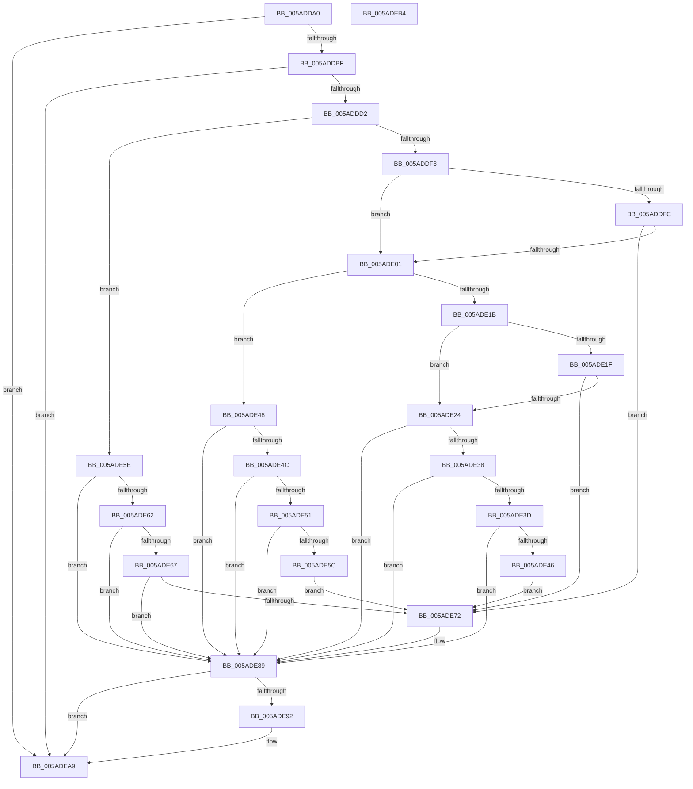

# _asan_store4

- RVA: `0x005ADDA0`–`0x005ADEB5` (길이 `277` bytes)
- VA: `0x00000001405ADDA0`
- 실행 섹션: `.text`
- PDB 이름 있음: `예`; PDB Function 태그: `아니요`
- unwind 정보 RVA: `0x0006E5F8`
- 디코드: `86`개 명령, `277/277` bytes 표시
- 미해석 바이트: `0` (있으면 어셈블리에 `.byte`로 보존)

> 이 문서는 커널 이미지의 기계어와 PDB 기호를 분석해 생성했습니다. 4번과 5번은 함수 원형과 자료형을 바이너리 사용 방식에서 추정한 C 해석이며 원본 소스 복구 결과는 아닙니다.

## 1. Dependencies

- 직접 호출 지점: **2**; 고유 호출 대상: **2**
- 직접 호출자로 확인된 함수: **0**
- RIP 상대 이미지 참조: **3**

### Outgoing calls
- `0x005ADE84` → [KasaniReport](KasaniReport_function_005AB0B0.md) (function, `0x005AB0B0`)
- `0x005ADEA4` → [KcsanValidateAddress](KcsanValidateAddress_function_005AF5E0.md) (function, `0x005AF5E0`)

### Direct callers
- 이 함수 시작 RVA로 연결되는 직접 call은 확인되지 않았습니다. 간접 호출은 완전히 역산할 수 없습니다.

### Static image references
- `0x005ADDAA` → RVA `0x00FCEC6A` (`ALMOSTRO`; read)
- `0x005ADDD2` → RVA `0x00FC6ED8` (`ALMOSTRO`; read)
- `0x005ADE89` → RVA `0x00F8A7E8` (`.data`; read)

## 2. Other-region calls and transfers

- 다른 실행 섹션으로 향하는 call: **0**
- 별도 외부 분기/꼬리 이동을 확인하지 못했습니다.

## 3. Assembly (complete function range)

```asm
005ADDA0  48 89 5C 24 08                  mov qword ptr [rsp + 8], rbx
005ADDA5  57                              push rdi
005ADDA6  48 83 EC 30                     sub rsp, 0x30
005ADDAA  80 3D B9 0E A2 00 00            cmp byte ptr [rip + 0xa20eb9], 0
005ADDB1  48 8B D9                        mov rbx, rcx
005ADDB4  48 8B 7C 24 38                  mov rdi, qword ptr [rsp + 0x38]
005ADDB9  0F 84 EA 00 00 00               je 0x1405adea9
005ADDBF  48 B8 00 00 00 00 00 80 FF FF   movabs rax, 0xffff800000000000
005ADDC9  48 3B C8                        cmp rcx, rax
005ADDCC  0F 82 D7 00 00 00               jb 0x1405adea9
005ADDD2  4C 8B 05 FF 90 A1 00            mov r8, qword ptr [rip + 0xa190ff]
005ADDD9  49 B9 00 00 00 00 00 80 00 00   movabs r9, 0x800000000000
005ADDE3  4A 8D 04 09                     lea rax, [rcx + r9]
005ADDE7  48 C1 E8 03                     shr rax, 3
005ADDEB  42 0F B6 0C 00                  movzx ecx, byte ptr [rax + r8]
005ADDF0  8B C3                           mov eax, ebx
005ADDF2  24 07                           and al, 7
005ADDF4  3C 04                           cmp al, 4
005ADDF6  76 66                           jbe 0x1405ade5e
005ADDF8  84 C9                           test cl, cl
005ADDFA  74 05                           je 0x1405ade01
005ADDFC  80 F9 08                        cmp cl, 8
005ADDFF  7C 71                           jl 0x1405ade72
005ADE01  48 8D 53 02                     lea rdx, [rbx + 2]
005ADE05  4A 8D 04 0A                     lea rax, [rdx + r9]
005ADE09  48 C1 E8 03                     shr rax, 3
005ADE0D  42 0F B6 0C 00                  movzx ecx, byte ptr [rax + r8]
005ADE12  8B C2                           mov eax, edx
005ADE14  83 E0 07                        and eax, 7
005ADE17  3C 06                           cmp al, 6
005ADE19  76 2D                           jbe 0x1405ade48
005ADE1B  84 C9                           test cl, cl
005ADE1D  74 05                           je 0x1405ade24
005ADE1F  80 F9 08                        cmp cl, 8
005ADE22  7C 4E                           jl 0x1405ade72
005ADE24  48 FF C2                        inc rdx
005ADE27  4A 8D 04 0A                     lea rax, [rdx + r9]
005ADE2B  48 C1 E8 03                     shr rax, 3
005ADE2F  42 0F B6 0C 00                  movzx ecx, byte ptr [rax + r8]
005ADE34  84 C9                           test cl, cl
005ADE36  74 51                           je 0x1405ade89
005ADE38  80 F9 08                        cmp cl, 8
005ADE3B  7D 4C                           jge 0x1405ade89
005ADE3D  80 E2 07                        and dl, 7
005ADE40  FE C2                           inc dl
005ADE42  3A D1                           cmp dl, cl
005ADE44  7E 43                           jle 0x1405ade89
005ADE46  EB 2A                           jmp 0x1405ade72
005ADE48  84 C9                           test cl, cl
005ADE4A  74 3D                           je 0x1405ade89
005ADE4C  80 F9 08                        cmp cl, 8
005ADE4F  7D 38                           jge 0x1405ade89
005ADE51  FE C2                           inc dl
005ADE53  80 E2 07                        and dl, 7
005ADE56  FE C2                           inc dl
005ADE58  3A D1                           cmp dl, cl
005ADE5A  7E 2D                           jle 0x1405ade89
005ADE5C  EB 14                           jmp 0x1405ade72
005ADE5E  84 C9                           test cl, cl
005ADE60  74 27                           je 0x1405ade89
005ADE62  80 F9 08                        cmp cl, 8
005ADE65  7D 22                           jge 0x1405ade89
005ADE67  8D 43 03                        lea eax, [rbx + 3]
005ADE6A  24 07                           and al, 7
005ADE6C  FE C0                           inc al
005ADE6E  3A C1                           cmp al, cl
005ADE70  7E 17                           jle 0x1405ade89
005ADE72  88 4C 24 20                     mov byte ptr [rsp + 0x20], cl
005ADE76  4C 8B CF                        mov r9, rdi
005ADE79  48 8B CB                        mov rcx, rbx
005ADE7C  41 B0 01                        mov r8b, 1
005ADE7F  BA 04 00 00 00                  mov edx, 4
005ADE84  E8 27 D2 FF FF                  call 0x1405ab0b0
005ADE89  80 3D 58 C9 9D 00 00            cmp byte ptr [rip + 0x9dc958], 0
005ADE90  74 17                           je 0x1405adea9
005ADE92  45 33 C9                        xor r9d, r9d
005ADE95  48 89 7C 24 20                  mov qword ptr [rsp + 0x20], rdi
005ADE9A  41 B0 01                        mov r8b, 1
005ADE9D  48 8B CB                        mov rcx, rbx
005ADEA0  41 8D 51 04                     lea edx, [r9 + 4]
005ADEA4  E8 37 17 00 00                  call 0x1405af5e0
005ADEA9  48 8B 5C 24 40                  mov rbx, qword ptr [rsp + 0x40]
005ADEAE  48 83 C4 30                     add rsp, 0x30
005ADEB2  5F                              pop rdi
005ADEB3  C3                              ret
005ADEB4  CC                              int3
```

## 4. C-style interpretation (structured pseudocode)

```c
__int64 __fastcall _asan_store4(__int64 a1)
{
    __int64 result;
    __int64 v_rsp;
    unsigned __int8 v_stack_m18;
    unsigned __int64 v_stack_p0;
    unsigned __int64 v_stack_p8;

    v_stack_p8 = v_rbx;
    v_rsp = (v_rsp) - (48);
    if ((*(unsigned __int8 *)(v_rip + 10620601)) == 0) goto loc_005ADEA9;
    if (a1 < result) goto loc_005ADEA9;
    result = (a1 + a4 * 1) >> (3);
    result = (unsigned __int8)(((unsigned int)((unsigned int)(a1))) & (7));
    if (((unsigned __int8)(result)) <= 4) goto loc_005ADE5E;
    if ((unsigned __int8)(*(unsigned __int8 *)(result + *(unsigned __int64 *)(v_rip + 10588415) * 1)) == 0) goto loc_005ADE01;
    if (((unsigned __int8)(*(unsigned __int8 *)(result + *(unsigned __int64 *)(v_rip + 10588415) * 1))) < 8) goto loc_005ADE72;
loc_005ADE01:
    result = (a1 + 2 + a4 * 1) >> (3);
    result = (unsigned int)(((unsigned int)((unsigned int)(a1 + 2))) & (7));
    if (((unsigned __int8)(result)) <= 6) goto loc_005ADE48;
    if ((unsigned __int8)(*(unsigned __int8 *)(result + *(unsigned __int64 *)(v_rip + 10588415) * 1)) == 0) goto loc_005ADE24;
    if (((unsigned __int8)(*(unsigned __int8 *)(result + *(unsigned __int64 *)(v_rip + 10588415) * 1))) < 8) goto loc_005ADE72;
loc_005ADE24:
    a2 = (a1 + 2) + 1;
    result = (a2 + a4 * 1) >> (3);
    if ((unsigned __int8)(*(unsigned __int8 *)(result + *(unsigned __int64 *)(v_rip + 10588415) * 1)) == 0) goto loc_005ADE89;
    if (((unsigned __int8)(*(unsigned __int8 *)(result + *(unsigned __int64 *)(v_rip + 10588415) * 1))) >= 8) goto loc_005ADE89;
    a2 = (unsigned __int8)((a2) & (7));
    a2 = (unsigned __int8)((a2) + 1);
    if (((unsigned __int8)(a2)) <= ((unsigned __int8)(*(unsigned __int8 *)(result + *(unsigned __int64 *)(v_rip + 10588415) * 1)))) goto loc_005ADE89;
    goto loc_005ADE72;
loc_005ADE48:
    if ((unsigned __int8)(*(unsigned __int8 *)(result + *(unsigned __int64 *)(v_rip + 10588415) * 1)) == 0) goto loc_005ADE89;
    if (((unsigned __int8)(*(unsigned __int8 *)(result + *(unsigned __int64 *)(v_rip + 10588415) * 1))) >= 8) goto loc_005ADE89;
    a2 = (unsigned __int8)((a2) + 1);
    a2 = (unsigned __int8)((a2) & (7));
    a2 = (unsigned __int8)((a2) + 1);
    if (((unsigned __int8)(a2)) <= ((unsigned __int8)(*(unsigned __int8 *)(result + *(unsigned __int64 *)(v_rip + 10588415) * 1)))) goto loc_005ADE89;
    goto loc_005ADE72;
loc_005ADE5E:
    if ((unsigned __int8)(*(unsigned __int8 *)(result + *(unsigned __int64 *)(v_rip + 10588415) * 1)) == 0) goto loc_005ADE89;
    if (((unsigned __int8)(*(unsigned __int8 *)(result + *(unsigned __int64 *)(v_rip + 10588415) * 1))) >= 8) goto loc_005ADE89;
    result = (unsigned __int8)((a1 + 3) & (7));
    result = (unsigned __int8)((result) + 1);
    if (((unsigned __int8)(result)) >= = ((unsigned __int8)(*(unsigned __int8 *)(result + *(unsigned __int64 *)(v_rip + 10588415) * 1)))) {
        v_stack_m18 = (unsigned __int8)(*(unsigned __int8 *)(result + *(unsigned __int64 *)(v_rip + 10588415) * 1));
        a4 = v_stack_p0;
        a1 = a1;
        a3 = 1;
        a2 = 4;
        result = KasaniReport(a1, a2, a3, a4);
    }
    if ((*(unsigned __int8 *)(v_rip + 10340696)) != 0) {
        a4 = 0;
        v_stack_m18 = v_stack_p0;
        a3 = 1;
        a1 = a1;
        a2 = a4 + 4;
        result = KcsanValidateAddress(a1, a2, a3, a4);
    }
    v_rsp = (v_rsp) + (48);
    return result;
}
```

## 5. (Beta) C Style

```c
int64_t _asan_store4(void *Arg1)
{
    uint8_t *arg1 = (uint8_t *)Arg1;

    int64_t result;
    int64_t local_rsp;
    uint8_t v_stack_m18;
    uint64_t v_stack_p0;
    uint64_t v_stack_p8;

    v_stack_p8 = local_rbx;
    local_rsp = (local_rsp) - (48);
    if ((*(uint8_t *)(v_rip + 0xA20EB9)) == 0) goto loc_005ADEA9;
    if (Arg1 < result) goto loc_005ADEA9;
    result = (Arg1 + a4 * 1) >> (3);
    result = (uint8_t)(((uint32_t)((uint32_t)(Arg1))) & (7));
    if (((uint8_t)(result)) <= 4) goto loc_005ADE5E;
    if ((uint8_t)(*(uint8_t *)(result + *(uint64_t *)(v_rip + 0xA190FF) * 1)) == 0) goto loc_005ADE01;
    if (((uint8_t)(*(uint8_t *)(result + *(uint64_t *)(v_rip + 0xA190FF) * 1))) < 8) goto loc_005ADE72;
loc_005ADE01:
    result = (Arg1 + 2 + a4 * 1) >> (3);
    result = (uint32_t)(((uint32_t)((uint32_t)(Arg1 + 2))) & (7));
    if (((uint8_t)(result)) <= 6) goto loc_005ADE48;
    if ((uint8_t)(*(uint8_t *)(result + *(uint64_t *)(v_rip + 0xA190FF) * 1)) == 0) goto loc_005ADE24;
    if (((uint8_t)(*(uint8_t *)(result + *(uint64_t *)(v_rip + 0xA190FF) * 1))) < 8) goto loc_005ADE72;
loc_005ADE24:
    a2 = (Arg1 + 2) + 1;
    result = (a2 + a4 * 1) >> (3);
    if ((uint8_t)(*(uint8_t *)(result + *(uint64_t *)(v_rip + 0xA190FF) * 1)) == 0) goto loc_005ADE89;
    if (((uint8_t)(*(uint8_t *)(result + *(uint64_t *)(v_rip + 0xA190FF) * 1))) >= 8) goto loc_005ADE89;
    a2 = (uint8_t)((a2) & (7));
    a2 = (uint8_t)((a2) + 1);
    if (((uint8_t)(a2)) <= ((uint8_t)(*(uint8_t *)(result + *(uint64_t *)(v_rip + 0xA190FF) * 1)))) goto loc_005ADE89;
    goto loc_005ADE72;
loc_005ADE48:
    if ((uint8_t)(*(uint8_t *)(result + *(uint64_t *)(v_rip + 0xA190FF) * 1)) == 0) goto loc_005ADE89;
    if (((uint8_t)(*(uint8_t *)(result + *(uint64_t *)(v_rip + 0xA190FF) * 1))) >= 8) goto loc_005ADE89;
    a2 = (uint8_t)((a2) + 1);
    a2 = (uint8_t)((a2) & (7));
    a2 = (uint8_t)((a2) + 1);
    if (((uint8_t)(a2)) <= ((uint8_t)(*(uint8_t *)(result + *(uint64_t *)(v_rip + 0xA190FF) * 1)))) goto loc_005ADE89;
    goto loc_005ADE72;
loc_005ADE5E:
    if ((uint8_t)(*(uint8_t *)(result + *(uint64_t *)(v_rip + 0xA190FF) * 1)) == 0) goto loc_005ADE89;
    if (((uint8_t)(*(uint8_t *)(result + *(uint64_t *)(v_rip + 0xA190FF) * 1))) >= 8) goto loc_005ADE89;
    result = (uint8_t)((Arg1 + 3) & (7));
    result = (uint8_t)((result) + 1);
    if (((uint8_t)(result)) >= = ((uint8_t)(*(uint8_t *)(result + *(uint64_t *)(v_rip + 0xA190FF) * 1)))) {
        v_stack_m18 = (uint8_t)(*(uint8_t *)(result + *(uint64_t *)(v_rip + 0xA190FF) * 1));
        a4 = v_stack_p0;
        Arg1 = Arg1;
        a3 = 1;
        a2 = 4;
        result = KasaniReport(Arg1, a2, a3, a4);
    }
    if ((*(uint8_t *)(v_rip + 0x9DC958)) != 0) {
        a4 = 0;
        v_stack_m18 = v_stack_p0;
        a3 = 1;
        Arg1 = Arg1;
        a2 = a4 + 4;
        result = KcsanValidateAddress(Arg1, a2, a3, a4);
    }
    local_rsp = (local_rsp) + (48);
    return result;
}
```

### 관측된 메모리 오프셋

구조체 형식이 확인되지 않은 접근은 인자 기준의 오프셋으로만 기록했습니다.

| 기준 인자 | 오프셋 표현 | 폭 (bit) | 접근 |
|---|---:|---:|---|
| `Arg1` | `+ 0x0 + r9*1` | `64` | `R` |
| `Arg1` | `+ 0x2` | `64` | `R` |
| `Arg1` | `+ 0x3` | `32` | `R` |

## 6. Execution-region graph

[열기: 2D/3D 그래프와 함수 탐색 컨트롤 패널](../../../control-panel.html?section=text&rva=0x005ADDA0&view=graph)

- 2D 그래프는 위에서 아래로 흐르고, 3D 그래프는 빈 공간을 드래그해 회전합니다. Shift+드래그는 이동, 휠은 확대·축소, 함수 노드 선택은 대상 보고서 이동입니다.

### Static fallback


