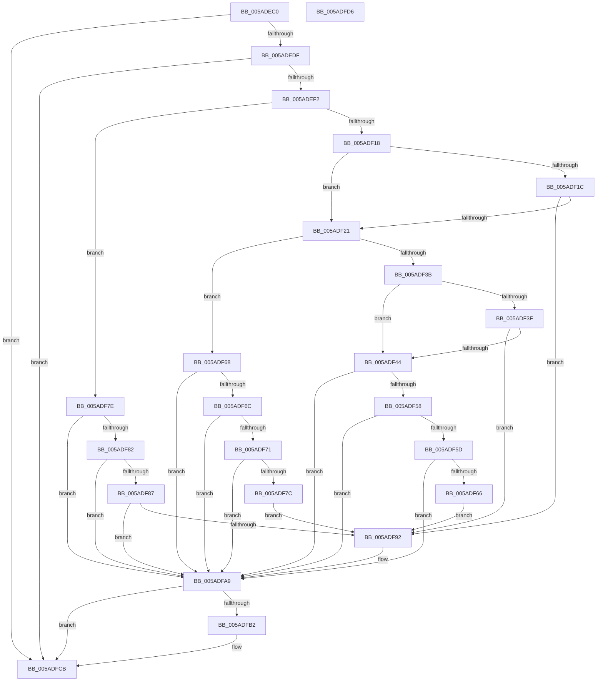

# _asan_store4_volatile

- RVA: `0x005ADEC0`–`0x005ADFD7` (길이 `279` bytes)
- VA: `0x00000001405ADEC0`
- 실행 섹션: `.text`
- PDB 이름 있음: `예`; PDB Function 태그: `아니요`
- unwind 정보 RVA: `0x0006E5F8`
- 디코드: `86`개 명령, `279/279` bytes 표시
- 미해석 바이트: `0` (있으면 어셈블리에 `.byte`로 보존)

> 이 문서는 커널 이미지의 기계어와 PDB 기호를 분석해 생성했습니다. 4번과 5번은 함수 원형과 자료형을 바이너리 사용 방식에서 추정한 C 해석이며 원본 소스 복구 결과는 아닙니다.

## 1. Dependencies

- 직접 호출 지점: **2**; 고유 호출 대상: **2**
- 직접 호출자로 확인된 함수: **0**
- RIP 상대 이미지 참조: **3**

### Outgoing calls
- `0x005ADFA4` → [KasaniReport](KasaniReport_function_005AB0B0.md) (function, `0x005AB0B0`)
- `0x005ADFC6` → [KcsanValidateAddress](KcsanValidateAddress_function_005AF5E0.md) (function, `0x005AF5E0`)

### Direct callers
- 이 함수 시작 RVA로 연결되는 직접 call은 확인되지 않았습니다. 간접 호출은 완전히 역산할 수 없습니다.

### Static image references
- `0x005ADECA` → RVA `0x00FCEC6A` (`ALMOSTRO`; read)
- `0x005ADEF2` → RVA `0x00FC6ED8` (`ALMOSTRO`; read)
- `0x005ADFA9` → RVA `0x00F8A7E8` (`.data`; read)

## 2. Other-region calls and transfers

- 다른 실행 섹션으로 향하는 call: **0**
- 별도 외부 분기/꼬리 이동을 확인하지 못했습니다.

## 3. Assembly (complete function range)

```asm
005ADEC0  48 89 5C 24 08                  mov qword ptr [rsp + 8], rbx
005ADEC5  57                              push rdi
005ADEC6  48 83 EC 30                     sub rsp, 0x30
005ADECA  80 3D 99 0D A2 00 00            cmp byte ptr [rip + 0xa20d99], 0
005ADED1  48 8B D9                        mov rbx, rcx
005ADED4  48 8B 7C 24 38                  mov rdi, qword ptr [rsp + 0x38]
005ADED9  0F 84 EC 00 00 00               je 0x1405adfcb
005ADEDF  48 B8 00 00 00 00 00 80 FF FF   movabs rax, 0xffff800000000000
005ADEE9  48 3B C8                        cmp rcx, rax
005ADEEC  0F 82 D9 00 00 00               jb 0x1405adfcb
005ADEF2  4C 8B 05 DF 8F A1 00            mov r8, qword ptr [rip + 0xa18fdf]
005ADEF9  49 B9 00 00 00 00 00 80 00 00   movabs r9, 0x800000000000
005ADF03  4A 8D 04 09                     lea rax, [rcx + r9]
005ADF07  48 C1 E8 03                     shr rax, 3
005ADF0B  42 0F B6 0C 00                  movzx ecx, byte ptr [rax + r8]
005ADF10  8B C3                           mov eax, ebx
005ADF12  24 07                           and al, 7
005ADF14  3C 04                           cmp al, 4
005ADF16  76 66                           jbe 0x1405adf7e
005ADF18  84 C9                           test cl, cl
005ADF1A  74 05                           je 0x1405adf21
005ADF1C  80 F9 08                        cmp cl, 8
005ADF1F  7C 71                           jl 0x1405adf92
005ADF21  48 8D 53 02                     lea rdx, [rbx + 2]
005ADF25  4A 8D 04 0A                     lea rax, [rdx + r9]
005ADF29  48 C1 E8 03                     shr rax, 3
005ADF2D  42 0F B6 0C 00                  movzx ecx, byte ptr [rax + r8]
005ADF32  8B C2                           mov eax, edx
005ADF34  83 E0 07                        and eax, 7
005ADF37  3C 06                           cmp al, 6
005ADF39  76 2D                           jbe 0x1405adf68
005ADF3B  84 C9                           test cl, cl
005ADF3D  74 05                           je 0x1405adf44
005ADF3F  80 F9 08                        cmp cl, 8
005ADF42  7C 4E                           jl 0x1405adf92
005ADF44  48 FF C2                        inc rdx
005ADF47  4A 8D 04 0A                     lea rax, [rdx + r9]
005ADF4B  48 C1 E8 03                     shr rax, 3
005ADF4F  42 0F B6 0C 00                  movzx ecx, byte ptr [rax + r8]
005ADF54  84 C9                           test cl, cl
005ADF56  74 51                           je 0x1405adfa9
005ADF58  80 F9 08                        cmp cl, 8
005ADF5B  7D 4C                           jge 0x1405adfa9
005ADF5D  80 E2 07                        and dl, 7
005ADF60  FE C2                           inc dl
005ADF62  3A D1                           cmp dl, cl
005ADF64  7E 43                           jle 0x1405adfa9
005ADF66  EB 2A                           jmp 0x1405adf92
005ADF68  84 C9                           test cl, cl
005ADF6A  74 3D                           je 0x1405adfa9
005ADF6C  80 F9 08                        cmp cl, 8
005ADF6F  7D 38                           jge 0x1405adfa9
005ADF71  FE C2                           inc dl
005ADF73  80 E2 07                        and dl, 7
005ADF76  FE C2                           inc dl
005ADF78  3A D1                           cmp dl, cl
005ADF7A  7E 2D                           jle 0x1405adfa9
005ADF7C  EB 14                           jmp 0x1405adf92
005ADF7E  84 C9                           test cl, cl
005ADF80  74 27                           je 0x1405adfa9
005ADF82  80 F9 08                        cmp cl, 8
005ADF85  7D 22                           jge 0x1405adfa9
005ADF87  8D 43 03                        lea eax, [rbx + 3]
005ADF8A  24 07                           and al, 7
005ADF8C  FE C0                           inc al
005ADF8E  3A C1                           cmp al, cl
005ADF90  7E 17                           jle 0x1405adfa9
005ADF92  88 4C 24 20                     mov byte ptr [rsp + 0x20], cl
005ADF96  4C 8B CF                        mov r9, rdi
005ADF99  48 8B CB                        mov rcx, rbx
005ADF9C  41 B0 01                        mov r8b, 1
005ADF9F  BA 04 00 00 00                  mov edx, 4
005ADFA4  E8 07 D1 FF FF                  call 0x1405ab0b0
005ADFA9  80 3D 38 C8 9D 00 00            cmp byte ptr [rip + 0x9dc838], 0
005ADFB0  74 19                           je 0x1405adfcb
005ADFB2  41 B1 01                        mov r9b, 1
005ADFB5  48 89 7C 24 20                  mov qword ptr [rsp + 0x20], rdi
005ADFBA  45 0F B6 C1                     movzx r8d, r9b
005ADFBE  BA 04 00 00 00                  mov edx, 4
005ADFC3  48 8B CB                        mov rcx, rbx
005ADFC6  E8 15 16 00 00                  call 0x1405af5e0
005ADFCB  48 8B 5C 24 40                  mov rbx, qword ptr [rsp + 0x40]
005ADFD0  48 83 C4 30                     add rsp, 0x30
005ADFD4  5F                              pop rdi
005ADFD5  C3                              ret
005ADFD6  CC                              int3
```

## 4. C-style interpretation (structured pseudocode)

```c
__int64 __fastcall _asan_store4_volatile(__int64 a1)
{
    __int64 result;
    __int64 v_rsp;
    unsigned __int8 v_stack_m18;
    unsigned __int64 v_stack_p0;
    unsigned __int64 v_stack_p8;

    v_stack_p8 = v_rbx;
    v_rsp = (v_rsp) - (48);
    if ((*(unsigned __int8 *)(v_rip + 10620313)) == 0) goto loc_005ADFCB;
    if (a1 < result) goto loc_005ADFCB;
    result = (a1 + a4 * 1) >> (3);
    result = (unsigned __int8)(((unsigned int)((unsigned int)(a1))) & (7));
    if (((unsigned __int8)(result)) <= 4) goto loc_005ADF7E;
    if ((unsigned __int8)(*(unsigned __int8 *)(result + *(unsigned __int64 *)(v_rip + 10588127) * 1)) == 0) goto loc_005ADF21;
    if (((unsigned __int8)(*(unsigned __int8 *)(result + *(unsigned __int64 *)(v_rip + 10588127) * 1))) < 8) goto loc_005ADF92;
loc_005ADF21:
    result = (a1 + 2 + a4 * 1) >> (3);
    result = (unsigned int)(((unsigned int)((unsigned int)(a1 + 2))) & (7));
    if (((unsigned __int8)(result)) <= 6) goto loc_005ADF68;
    if ((unsigned __int8)(*(unsigned __int8 *)(result + *(unsigned __int64 *)(v_rip + 10588127) * 1)) == 0) goto loc_005ADF44;
    if (((unsigned __int8)(*(unsigned __int8 *)(result + *(unsigned __int64 *)(v_rip + 10588127) * 1))) < 8) goto loc_005ADF92;
loc_005ADF44:
    a2 = (a1 + 2) + 1;
    result = (a2 + a4 * 1) >> (3);
    if ((unsigned __int8)(*(unsigned __int8 *)(result + *(unsigned __int64 *)(v_rip + 10588127) * 1)) == 0) goto loc_005ADFA9;
    if (((unsigned __int8)(*(unsigned __int8 *)(result + *(unsigned __int64 *)(v_rip + 10588127) * 1))) >= 8) goto loc_005ADFA9;
    a2 = (unsigned __int8)((a2) & (7));
    a2 = (unsigned __int8)((a2) + 1);
    if (((unsigned __int8)(a2)) <= ((unsigned __int8)(*(unsigned __int8 *)(result + *(unsigned __int64 *)(v_rip + 10588127) * 1)))) goto loc_005ADFA9;
    goto loc_005ADF92;
loc_005ADF68:
    if ((unsigned __int8)(*(unsigned __int8 *)(result + *(unsigned __int64 *)(v_rip + 10588127) * 1)) == 0) goto loc_005ADFA9;
    if (((unsigned __int8)(*(unsigned __int8 *)(result + *(unsigned __int64 *)(v_rip + 10588127) * 1))) >= 8) goto loc_005ADFA9;
    a2 = (unsigned __int8)((a2) + 1);
    a2 = (unsigned __int8)((a2) & (7));
    a2 = (unsigned __int8)((a2) + 1);
    if (((unsigned __int8)(a2)) <= ((unsigned __int8)(*(unsigned __int8 *)(result + *(unsigned __int64 *)(v_rip + 10588127) * 1)))) goto loc_005ADFA9;
    goto loc_005ADF92;
loc_005ADF7E:
    if ((unsigned __int8)(*(unsigned __int8 *)(result + *(unsigned __int64 *)(v_rip + 10588127) * 1)) == 0) goto loc_005ADFA9;
    if (((unsigned __int8)(*(unsigned __int8 *)(result + *(unsigned __int64 *)(v_rip + 10588127) * 1))) >= 8) goto loc_005ADFA9;
    result = (unsigned __int8)((a1 + 3) & (7));
    result = (unsigned __int8)((result) + 1);
    if (((unsigned __int8)(result)) >= = ((unsigned __int8)(*(unsigned __int8 *)(result + *(unsigned __int64 *)(v_rip + 10588127) * 1)))) {
        v_stack_m18 = (unsigned __int8)(*(unsigned __int8 *)(result + *(unsigned __int64 *)(v_rip + 10588127) * 1));
        a4 = v_stack_p0;
        a1 = a1;
        a3 = 1;
        a2 = 4;
        result = KasaniReport(a1, a2, a3, a4);
    }
    if ((*(unsigned __int8 *)(v_rip + 10340408)) != 0) {
        a4 = 1;
        v_stack_m18 = v_stack_p0;
        a3 = (unsigned __int8)(a4);
        a2 = 4;
        a1 = a1;
        result = KcsanValidateAddress(a1, a2, a3, a4);
    }
    v_rsp = (v_rsp) + (48);
    return result;
}
```

## 5. (Beta) C Style

```c
int64_t _asan_store4_volatile(void *Arg1)
{
    uint8_t *arg1 = (uint8_t *)Arg1;

    int64_t result;
    int64_t local_rsp;
    uint8_t v_stack_m18;
    uint64_t v_stack_p0;
    uint64_t v_stack_p8;

    v_stack_p8 = local_rbx;
    local_rsp = (local_rsp) - (48);
    if ((*(uint8_t *)(v_rip + 0xA20D99)) == 0) goto loc_005ADFCB;
    if (Arg1 < result) goto loc_005ADFCB;
    result = (Arg1 + a4 * 1) >> (3);
    result = (uint8_t)(((uint32_t)((uint32_t)(Arg1))) & (7));
    if (((uint8_t)(result)) <= 4) goto loc_005ADF7E;
    if ((uint8_t)(*(uint8_t *)(result + *(uint64_t *)(v_rip + 0xA18FDF) * 1)) == 0) goto loc_005ADF21;
    if (((uint8_t)(*(uint8_t *)(result + *(uint64_t *)(v_rip + 0xA18FDF) * 1))) < 8) goto loc_005ADF92;
loc_005ADF21:
    result = (Arg1 + 2 + a4 * 1) >> (3);
    result = (uint32_t)(((uint32_t)((uint32_t)(Arg1 + 2))) & (7));
    if (((uint8_t)(result)) <= 6) goto loc_005ADF68;
    if ((uint8_t)(*(uint8_t *)(result + *(uint64_t *)(v_rip + 0xA18FDF) * 1)) == 0) goto loc_005ADF44;
    if (((uint8_t)(*(uint8_t *)(result + *(uint64_t *)(v_rip + 0xA18FDF) * 1))) < 8) goto loc_005ADF92;
loc_005ADF44:
    a2 = (Arg1 + 2) + 1;
    result = (a2 + a4 * 1) >> (3);
    if ((uint8_t)(*(uint8_t *)(result + *(uint64_t *)(v_rip + 0xA18FDF) * 1)) == 0) goto loc_005ADFA9;
    if (((uint8_t)(*(uint8_t *)(result + *(uint64_t *)(v_rip + 0xA18FDF) * 1))) >= 8) goto loc_005ADFA9;
    a2 = (uint8_t)((a2) & (7));
    a2 = (uint8_t)((a2) + 1);
    if (((uint8_t)(a2)) <= ((uint8_t)(*(uint8_t *)(result + *(uint64_t *)(v_rip + 0xA18FDF) * 1)))) goto loc_005ADFA9;
    goto loc_005ADF92;
loc_005ADF68:
    if ((uint8_t)(*(uint8_t *)(result + *(uint64_t *)(v_rip + 0xA18FDF) * 1)) == 0) goto loc_005ADFA9;
    if (((uint8_t)(*(uint8_t *)(result + *(uint64_t *)(v_rip + 0xA18FDF) * 1))) >= 8) goto loc_005ADFA9;
    a2 = (uint8_t)((a2) + 1);
    a2 = (uint8_t)((a2) & (7));
    a2 = (uint8_t)((a2) + 1);
    if (((uint8_t)(a2)) <= ((uint8_t)(*(uint8_t *)(result + *(uint64_t *)(v_rip + 0xA18FDF) * 1)))) goto loc_005ADFA9;
    goto loc_005ADF92;
loc_005ADF7E:
    if ((uint8_t)(*(uint8_t *)(result + *(uint64_t *)(v_rip + 0xA18FDF) * 1)) == 0) goto loc_005ADFA9;
    if (((uint8_t)(*(uint8_t *)(result + *(uint64_t *)(v_rip + 0xA18FDF) * 1))) >= 8) goto loc_005ADFA9;
    result = (uint8_t)((Arg1 + 3) & (7));
    result = (uint8_t)((result) + 1);
    if (((uint8_t)(result)) >= = ((uint8_t)(*(uint8_t *)(result + *(uint64_t *)(v_rip + 0xA18FDF) * 1)))) {
        v_stack_m18 = (uint8_t)(*(uint8_t *)(result + *(uint64_t *)(v_rip + 0xA18FDF) * 1));
        a4 = v_stack_p0;
        Arg1 = Arg1;
        a3 = 1;
        a2 = 4;
        result = KasaniReport(Arg1, a2, a3, a4);
    }
    if ((*(uint8_t *)(v_rip + 0x9DC838)) != 0) {
        a4 = 1;
        v_stack_m18 = v_stack_p0;
        a3 = (uint8_t)(a4);
        a2 = 4;
        Arg1 = Arg1;
        result = KcsanValidateAddress(Arg1, a2, a3, a4);
    }
    local_rsp = (local_rsp) + (48);
    return result;
}
```

### 관측된 메모리 오프셋

구조체 형식이 확인되지 않은 접근은 인자 기준의 오프셋으로만 기록했습니다.

| 기준 인자 | 오프셋 표현 | 폭 (bit) | 접근 |
|---|---:|---:|---|
| `Arg1` | `+ 0x0 + r9*1` | `64` | `R` |
| `Arg1` | `+ 0x2` | `64` | `R` |
| `Arg1` | `+ 0x3` | `32` | `R` |

## 6. Execution-region graph

[열기: 2D/3D 그래프와 함수 탐색 컨트롤 패널](../../../control-panel.html?section=text&rva=0x005ADEC0&view=graph)

- 2D 그래프는 위에서 아래로 흐르고, 3D 그래프는 빈 공간을 드래그해 회전합니다. Shift+드래그는 이동, 휠은 확대·축소, 함수 노드 선택은 대상 보고서 이동입니다.

### Static fallback


