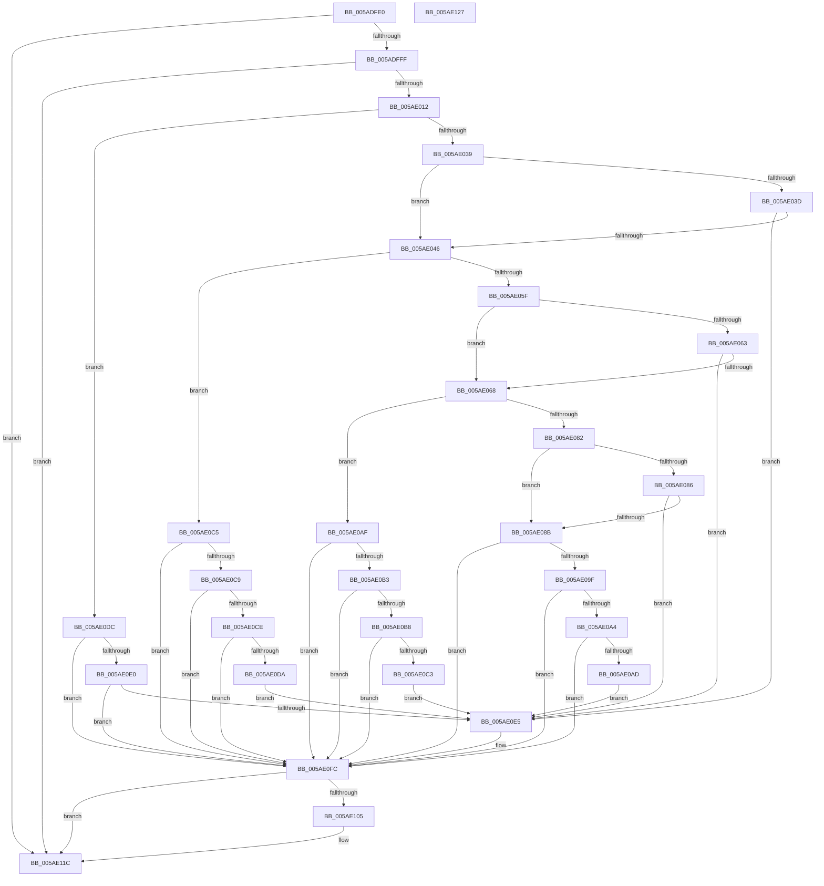

# _asan_store8

- RVA: `0x005ADFE0`–`0x005AE128` (길이 `328` bytes)
- VA: `0x00000001405ADFE0`
- 실행 섹션: `.text`
- PDB 이름 있음: `예`; PDB Function 태그: `아니요`
- unwind 정보 RVA: `0x0006E5F8`
- 디코드: `101`개 명령, `328/328` bytes 표시
- 미해석 바이트: `0` (있으면 어셈블리에 `.byte`로 보존)

> 이 문서는 커널 이미지의 기계어와 PDB 기호를 분석해 생성했습니다. 4번과 5번은 함수 원형과 자료형을 바이너리 사용 방식에서 추정한 C 해석이며 원본 소스 복구 결과는 아닙니다.

## 1. Dependencies

- 직접 호출 지점: **2**; 고유 호출 대상: **2**
- 직접 호출자로 확인된 함수: **0**
- RIP 상대 이미지 참조: **3**

### Outgoing calls
- `0x005AE0F7` → [KasaniReport](KasaniReport_function_005AB0B0.md) (function, `0x005AB0B0`)
- `0x005AE117` → [KcsanValidateAddress](KcsanValidateAddress_function_005AF5E0.md) (function, `0x005AF5E0`)

### Direct callers
- 이 함수 시작 RVA로 연결되는 직접 call은 확인되지 않았습니다. 간접 호출은 완전히 역산할 수 없습니다.

### Static image references
- `0x005ADFEA` → RVA `0x00FCEC6A` (`ALMOSTRO`; read)
- `0x005AE012` → RVA `0x00FC6ED8` (`ALMOSTRO`; read)
- `0x005AE0FC` → RVA `0x00F8A7E8` (`.data`; read)

## 2. Other-region calls and transfers

- 다른 실행 섹션으로 향하는 call: **0**
- 별도 외부 분기/꼬리 이동을 확인하지 못했습니다.

## 3. Assembly (complete function range)

```asm
005ADFE0  48 89 5C 24 08                  mov qword ptr [rsp + 8], rbx
005ADFE5  57                              push rdi
005ADFE6  48 83 EC 30                     sub rsp, 0x30
005ADFEA  80 3D 79 0C A2 00 00            cmp byte ptr [rip + 0xa20c79], 0
005ADFF1  48 8B D9                        mov rbx, rcx
005ADFF4  48 8B 7C 24 38                  mov rdi, qword ptr [rsp + 0x38]
005ADFF9  0F 84 1D 01 00 00               je 0x1405ae11c
005ADFFF  48 B8 00 00 00 00 00 80 FF FF   movabs rax, 0xffff800000000000
005AE009  48 3B C8                        cmp rcx, rax
005AE00C  0F 82 0A 01 00 00               jb 0x1405ae11c
005AE012  4C 8B 05 BF 8E A1 00            mov r8, qword ptr [rip + 0xa18ebf]
005AE019  49 B9 00 00 00 00 00 80 00 00   movabs r9, 0x800000000000
005AE023  4A 8D 04 09                     lea rax, [rcx + r9]
005AE027  48 C1 E8 03                     shr rax, 3
005AE02B  42 0F B6 0C 00                  movzx ecx, byte ptr [rax + r8]
005AE030  F6 C3 07                        test bl, 7
005AE033  0F 86 A3 00 00 00               jbe 0x1405ae0dc
005AE039  84 C9                           test cl, cl
005AE03B  74 09                           je 0x1405ae046
005AE03D  80 F9 08                        cmp cl, 8
005AE040  0F 8C 9F 00 00 00               jl 0x1405ae0e5
005AE046  48 8D 53 04                     lea rdx, [rbx + 4]
005AE04A  4A 8D 04 0A                     lea rax, [rdx + r9]
005AE04E  48 C1 E8 03                     shr rax, 3
005AE052  42 0F B6 0C 00                  movzx ecx, byte ptr [rax + r8]
005AE057  8B C2                           mov eax, edx
005AE059  24 07                           and al, 7
005AE05B  3C 04                           cmp al, 4
005AE05D  76 66                           jbe 0x1405ae0c5
005AE05F  84 C9                           test cl, cl
005AE061  74 05                           je 0x1405ae068
005AE063  80 F9 08                        cmp cl, 8
005AE066  7C 7D                           jl 0x1405ae0e5
005AE068  48 83 C2 02                     add rdx, 2
005AE06C  4A 8D 04 0A                     lea rax, [rdx + r9]
005AE070  48 C1 E8 03                     shr rax, 3
005AE074  42 0F B6 0C 00                  movzx ecx, byte ptr [rax + r8]
005AE079  8B C2                           mov eax, edx
005AE07B  83 E0 07                        and eax, 7
005AE07E  3C 06                           cmp al, 6
005AE080  76 2D                           jbe 0x1405ae0af
005AE082  84 C9                           test cl, cl
005AE084  74 05                           je 0x1405ae08b
005AE086  80 F9 08                        cmp cl, 8
005AE089  7C 5A                           jl 0x1405ae0e5
005AE08B  48 FF C2                        inc rdx
005AE08E  4A 8D 04 0A                     lea rax, [rdx + r9]
005AE092  48 C1 E8 03                     shr rax, 3
005AE096  42 0F B6 0C 00                  movzx ecx, byte ptr [rax + r8]
005AE09B  84 C9                           test cl, cl
005AE09D  74 5D                           je 0x1405ae0fc
005AE09F  80 F9 08                        cmp cl, 8
005AE0A2  7D 58                           jge 0x1405ae0fc
005AE0A4  80 E2 07                        and dl, 7
005AE0A7  FE C2                           inc dl
005AE0A9  3A D1                           cmp dl, cl
005AE0AB  7E 4F                           jle 0x1405ae0fc
005AE0AD  EB 36                           jmp 0x1405ae0e5
005AE0AF  84 C9                           test cl, cl
005AE0B1  74 49                           je 0x1405ae0fc
005AE0B3  80 F9 08                        cmp cl, 8
005AE0B6  7D 44                           jge 0x1405ae0fc
005AE0B8  FE C2                           inc dl
005AE0BA  80 E2 07                        and dl, 7
005AE0BD  FE C2                           inc dl
005AE0BF  3A D1                           cmp dl, cl
005AE0C1  7E 39                           jle 0x1405ae0fc
005AE0C3  EB 20                           jmp 0x1405ae0e5
005AE0C5  84 C9                           test cl, cl
005AE0C7  74 33                           je 0x1405ae0fc
005AE0C9  80 F9 08                        cmp cl, 8
005AE0CC  7D 2E                           jge 0x1405ae0fc
005AE0CE  80 C2 03                        add dl, 3
005AE0D1  80 E2 07                        and dl, 7
005AE0D4  FE C2                           inc dl
005AE0D6  3A D1                           cmp dl, cl
005AE0D8  7E 22                           jle 0x1405ae0fc
005AE0DA  EB 09                           jmp 0x1405ae0e5
005AE0DC  84 C9                           test cl, cl
005AE0DE  74 1C                           je 0x1405ae0fc
005AE0E0  80 F9 08                        cmp cl, 8
005AE0E3  7D 17                           jge 0x1405ae0fc
005AE0E5  88 4C 24 20                     mov byte ptr [rsp + 0x20], cl
005AE0E9  4C 8B CF                        mov r9, rdi
005AE0EC  48 8B CB                        mov rcx, rbx
005AE0EF  41 B0 01                        mov r8b, 1
005AE0F2  BA 08 00 00 00                  mov edx, 8
005AE0F7  E8 B4 CF FF FF                  call 0x1405ab0b0
005AE0FC  80 3D E5 C6 9D 00 00            cmp byte ptr [rip + 0x9dc6e5], 0
005AE103  74 17                           je 0x1405ae11c
005AE105  45 33 C9                        xor r9d, r9d
005AE108  48 89 7C 24 20                  mov qword ptr [rsp + 0x20], rdi
005AE10D  41 B0 01                        mov r8b, 1
005AE110  48 8B CB                        mov rcx, rbx
005AE113  41 8D 51 08                     lea edx, [r9 + 8]
005AE117  E8 C4 14 00 00                  call 0x1405af5e0
005AE11C  48 8B 5C 24 40                  mov rbx, qword ptr [rsp + 0x40]
005AE121  48 83 C4 30                     add rsp, 0x30
005AE125  5F                              pop rdi
005AE126  C3                              ret
005AE127  CC                              int3
```

## 4. C-style interpretation (structured pseudocode)

```c
__int64 __fastcall _asan_store8(__int64 a1)
{
    __int64 result;
    __int64 v_rsp;
    unsigned __int8 v_stack_m18;
    unsigned __int64 v_stack_p0;
    unsigned __int64 v_stack_p8;

    v_stack_p8 = v_rbx;
    v_rsp = (v_rsp) - (48);
    if ((*(unsigned __int8 *)(v_rip + 10620025)) == 0) goto loc_005AE11C;
    if (a1 < result) goto loc_005AE11C;
    result = (a1 + a4 * 1) >> (3);
    if (condition_is_below_or_equal) goto loc_005AE0DC;
    if ((unsigned __int8)(*(unsigned __int8 *)(result + *(unsigned __int64 *)(v_rip + 10587839) * 1)) == 0) goto loc_005AE046;
    if (((unsigned __int8)(*(unsigned __int8 *)(result + *(unsigned __int64 *)(v_rip + 10587839) * 1))) < 8) goto loc_005AE0E5;
loc_005AE046:
    result = (a1 + 4 + a4 * 1) >> (3);
    result = (unsigned __int8)(((unsigned int)((unsigned int)(a1 + 4))) & (7));
    if (((unsigned __int8)(result)) <= 4) goto loc_005AE0C5;
    if ((unsigned __int8)(*(unsigned __int8 *)(result + *(unsigned __int64 *)(v_rip + 10587839) * 1)) == 0) goto loc_005AE068;
    if (((unsigned __int8)(*(unsigned __int8 *)(result + *(unsigned __int64 *)(v_rip + 10587839) * 1))) < 8) goto loc_005AE0E5;
loc_005AE068:
    a2 = (a1 + 4) + (2);
    result = (a2 + a4 * 1) >> (3);
    result = (unsigned int)(((unsigned int)((unsigned int)(a2))) & (7));
    if (((unsigned __int8)(result)) <= 6) goto loc_005AE0AF;
    if ((unsigned __int8)(*(unsigned __int8 *)(result + *(unsigned __int64 *)(v_rip + 10587839) * 1)) == 0) goto loc_005AE08B;
    if (((unsigned __int8)(*(unsigned __int8 *)(result + *(unsigned __int64 *)(v_rip + 10587839) * 1))) < 8) goto loc_005AE0E5;
loc_005AE08B:
    a2 = (a2) + 1;
    result = (a2 + a4 * 1) >> (3);
    if ((unsigned __int8)(*(unsigned __int8 *)(result + *(unsigned __int64 *)(v_rip + 10587839) * 1)) == 0) goto loc_005AE0FC;
    if (((unsigned __int8)(*(unsigned __int8 *)(result + *(unsigned __int64 *)(v_rip + 10587839) * 1))) >= 8) goto loc_005AE0FC;
    a2 = (unsigned __int8)((a2) & (7));
    a2 = (unsigned __int8)((a2) + 1);
    if (((unsigned __int8)(a2)) <= ((unsigned __int8)(*(unsigned __int8 *)(result + *(unsigned __int64 *)(v_rip + 10587839) * 1)))) goto loc_005AE0FC;
    goto loc_005AE0E5;
loc_005AE0AF:
    if ((unsigned __int8)(*(unsigned __int8 *)(result + *(unsigned __int64 *)(v_rip + 10587839) * 1)) == 0) goto loc_005AE0FC;
    if (((unsigned __int8)(*(unsigned __int8 *)(result + *(unsigned __int64 *)(v_rip + 10587839) * 1))) >= 8) goto loc_005AE0FC;
    a2 = (unsigned __int8)((a2) + 1);
    a2 = (unsigned __int8)((a2) & (7));
    a2 = (unsigned __int8)((a2) + 1);
    if (((unsigned __int8)(a2)) <= ((unsigned __int8)(*(unsigned __int8 *)(result + *(unsigned __int64 *)(v_rip + 10587839) * 1)))) goto loc_005AE0FC;
    goto loc_005AE0E5;
loc_005AE0C5:
    if ((unsigned __int8)(*(unsigned __int8 *)(result + *(unsigned __int64 *)(v_rip + 10587839) * 1)) == 0) goto loc_005AE0FC;
    if (((unsigned __int8)(*(unsigned __int8 *)(result + *(unsigned __int64 *)(v_rip + 10587839) * 1))) >= 8) goto loc_005AE0FC;
    a2 = (unsigned __int8)((a2) + (3));
    a2 = (unsigned __int8)((a2) & (7));
    a2 = (unsigned __int8)((a2) + 1);
    if (((unsigned __int8)(a2)) <= ((unsigned __int8)(*(unsigned __int8 *)(result + *(unsigned __int64 *)(v_rip + 10587839) * 1)))) goto loc_005AE0FC;
    goto loc_005AE0E5;
loc_005AE0DC:
    if ((unsigned __int8)(*(unsigned __int8 *)(result + *(unsigned __int64 *)(v_rip + 10587839) * 1)) == 0) goto loc_005AE0FC;
    if (((unsigned __int8)(*(unsigned __int8 *)(result + *(unsigned __int64 *)(v_rip + 10587839) * 1))) < 8) {
        v_stack_m18 = (unsigned __int8)(*(unsigned __int8 *)(result + *(unsigned __int64 *)(v_rip + 10587839) * 1));
        a4 = v_stack_p0;
        a1 = a1;
        a3 = 1;
        a2 = 8;
        result = KasaniReport(a1, a2, a3, a4);
    }
    if ((*(unsigned __int8 *)(v_rip + 10340069)) != 0) {
        a4 = 0;
        v_stack_m18 = v_stack_p0;
        a3 = 1;
        a1 = a1;
        a2 = a4 + 8;
        result = KcsanValidateAddress(a1, a2, a3, a4);
    }
    v_rsp = (v_rsp) + (48);
    return result;
}
```

## 5. (Beta) C Style

```c
int64_t _asan_store8(int64_t Arg1)
{
    int64_t result;
    int64_t local_rsp;
    uint8_t v_stack_m18;
    uint64_t v_stack_p0;
    uint64_t v_stack_p8;

    v_stack_p8 = local_rbx;
    local_rsp = (local_rsp) - (48);
    if ((*(uint8_t *)(v_rip + 0xA20C79)) == 0) goto loc_005AE11C;
    if (Arg1 < result) goto loc_005AE11C;
    result = (Arg1 + a4 * 1) >> (3);
    if (condition_is_below_or_equal) goto loc_005AE0DC;
    if ((uint8_t)(*(uint8_t *)(result + *(uint64_t *)(v_rip + 0xA18EBF) * 1)) == 0) goto loc_005AE046;
    if (((uint8_t)(*(uint8_t *)(result + *(uint64_t *)(v_rip + 0xA18EBF) * 1))) < 8) goto loc_005AE0E5;
loc_005AE046:
    result = (Arg1 + 4 + a4 * 1) >> (3);
    result = (uint8_t)(((uint32_t)((uint32_t)(Arg1 + 4))) & (7));
    if (((uint8_t)(result)) <= 4) goto loc_005AE0C5;
    if ((uint8_t)(*(uint8_t *)(result + *(uint64_t *)(v_rip + 0xA18EBF) * 1)) == 0) goto loc_005AE068;
    if (((uint8_t)(*(uint8_t *)(result + *(uint64_t *)(v_rip + 0xA18EBF) * 1))) < 8) goto loc_005AE0E5;
loc_005AE068:
    a2 = (Arg1 + 4) + (2);
    result = (a2 + a4 * 1) >> (3);
    result = (uint32_t)(((uint32_t)((uint32_t)(a2))) & (7));
    if (((uint8_t)(result)) <= 6) goto loc_005AE0AF;
    if ((uint8_t)(*(uint8_t *)(result + *(uint64_t *)(v_rip + 0xA18EBF) * 1)) == 0) goto loc_005AE08B;
    if (((uint8_t)(*(uint8_t *)(result + *(uint64_t *)(v_rip + 0xA18EBF) * 1))) < 8) goto loc_005AE0E5;
loc_005AE08B:
    a2 = (a2) + 1;
    result = (a2 + a4 * 1) >> (3);
    if ((uint8_t)(*(uint8_t *)(result + *(uint64_t *)(v_rip + 0xA18EBF) * 1)) == 0) goto loc_005AE0FC;
    if (((uint8_t)(*(uint8_t *)(result + *(uint64_t *)(v_rip + 0xA18EBF) * 1))) >= 8) goto loc_005AE0FC;
    a2 = (uint8_t)((a2) & (7));
    a2 = (uint8_t)((a2) + 1);
    if (((uint8_t)(a2)) <= ((uint8_t)(*(uint8_t *)(result + *(uint64_t *)(v_rip + 0xA18EBF) * 1)))) goto loc_005AE0FC;
    goto loc_005AE0E5;
loc_005AE0AF:
    if ((uint8_t)(*(uint8_t *)(result + *(uint64_t *)(v_rip + 0xA18EBF) * 1)) == 0) goto loc_005AE0FC;
    if (((uint8_t)(*(uint8_t *)(result + *(uint64_t *)(v_rip + 0xA18EBF) * 1))) >= 8) goto loc_005AE0FC;
    a2 = (uint8_t)((a2) + 1);
    a2 = (uint8_t)((a2) & (7));
    a2 = (uint8_t)((a2) + 1);
    if (((uint8_t)(a2)) <= ((uint8_t)(*(uint8_t *)(result + *(uint64_t *)(v_rip + 0xA18EBF) * 1)))) goto loc_005AE0FC;
    goto loc_005AE0E5;
loc_005AE0C5:
    if ((uint8_t)(*(uint8_t *)(result + *(uint64_t *)(v_rip + 0xA18EBF) * 1)) == 0) goto loc_005AE0FC;
    if (((uint8_t)(*(uint8_t *)(result + *(uint64_t *)(v_rip + 0xA18EBF) * 1))) >= 8) goto loc_005AE0FC;
    a2 = (uint8_t)((a2) + (3));
    a2 = (uint8_t)((a2) & (7));
    a2 = (uint8_t)((a2) + 1);
    if (((uint8_t)(a2)) <= ((uint8_t)(*(uint8_t *)(result + *(uint64_t *)(v_rip + 0xA18EBF) * 1)))) goto loc_005AE0FC;
    goto loc_005AE0E5;
loc_005AE0DC:
    if ((uint8_t)(*(uint8_t *)(result + *(uint64_t *)(v_rip + 0xA18EBF) * 1)) == 0) goto loc_005AE0FC;
    if (((uint8_t)(*(uint8_t *)(result + *(uint64_t *)(v_rip + 0xA18EBF) * 1))) < 8) {
        v_stack_m18 = (uint8_t)(*(uint8_t *)(result + *(uint64_t *)(v_rip + 0xA18EBF) * 1));
        a4 = v_stack_p0;
        Arg1 = Arg1;
        a3 = 1;
        a2 = 8;
        result = KasaniReport(Arg1, a2, a3, a4);
    }
    if ((*(uint8_t *)(v_rip + 0x9DC6E5)) != 0) {
        a4 = 0;
        v_stack_m18 = v_stack_p0;
        a3 = 1;
        Arg1 = Arg1;
        a2 = a4 + 8;
        result = KcsanValidateAddress(Arg1, a2, a3, a4);
    }
    local_rsp = (local_rsp) + (48);
    return result;
}
```

## 6. Execution-region graph

[열기: 2D/3D 그래프와 함수 탐색 컨트롤 패널](../../../control-panel.html?section=text&rva=0x005ADFE0&view=graph)

- 2D 그래프는 위에서 아래로 흐르고, 3D 그래프는 빈 공간을 드래그해 회전합니다. Shift+드래그는 이동, 휠은 확대·축소, 함수 노드 선택은 대상 보고서 이동입니다.

### Static fallback


