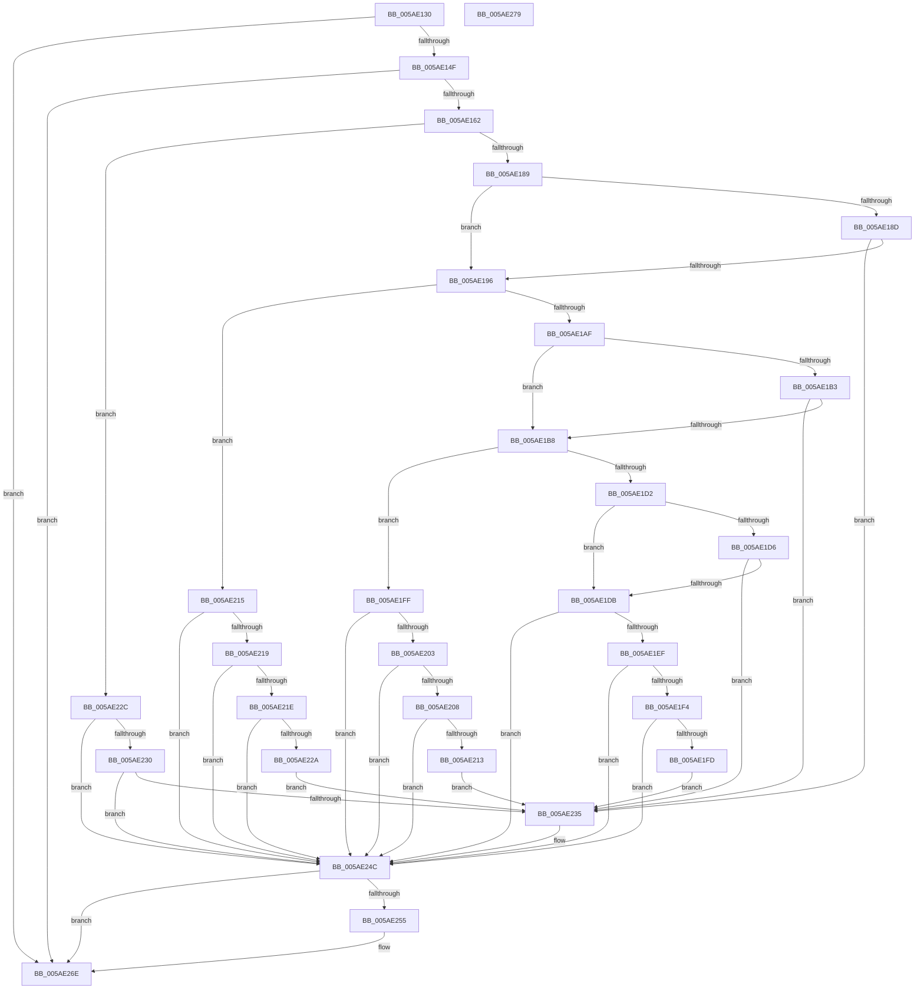

# _asan_store8_volatile

- RVA: `0x005AE130`–`0x005AE27A` (길이 `330` bytes)
- VA: `0x00000001405AE130`
- 실행 섹션: `.text`
- PDB 이름 있음: `예`; PDB Function 태그: `아니요`
- unwind 정보 RVA: `0x0006E5F8`
- 디코드: `101`개 명령, `330/330` bytes 표시
- 미해석 바이트: `0` (있으면 어셈블리에 `.byte`로 보존)

> 이 문서는 커널 이미지의 기계어와 PDB 기호를 분석해 생성했습니다. 4번과 5번은 함수 원형과 자료형을 바이너리 사용 방식에서 추정한 C 해석이며 원본 소스 복구 결과는 아닙니다.

## 1. Dependencies

- 직접 호출 지점: **2**; 고유 호출 대상: **2**
- 직접 호출자로 확인된 함수: **0**
- RIP 상대 이미지 참조: **3**

### Outgoing calls
- `0x005AE247` → [KasaniReport](KasaniReport_function_005AB0B0.md) (function, `0x005AB0B0`)
- `0x005AE269` → [KcsanValidateAddress](KcsanValidateAddress_function_005AF5E0.md) (function, `0x005AF5E0`)

### Direct callers
- 이 함수 시작 RVA로 연결되는 직접 call은 확인되지 않았습니다. 간접 호출은 완전히 역산할 수 없습니다.

### Static image references
- `0x005AE13A` → RVA `0x00FCEC6A` (`ALMOSTRO`; read)
- `0x005AE162` → RVA `0x00FC6ED8` (`ALMOSTRO`; read)
- `0x005AE24C` → RVA `0x00F8A7E8` (`.data`; read)

## 2. Other-region calls and transfers

- 다른 실행 섹션으로 향하는 call: **0**
- 별도 외부 분기/꼬리 이동을 확인하지 못했습니다.

## 3. Assembly (complete function range)

```asm
005AE130  48 89 5C 24 08                  mov qword ptr [rsp + 8], rbx
005AE135  57                              push rdi
005AE136  48 83 EC 30                     sub rsp, 0x30
005AE13A  80 3D 29 0B A2 00 00            cmp byte ptr [rip + 0xa20b29], 0
005AE141  48 8B D9                        mov rbx, rcx
005AE144  48 8B 7C 24 38                  mov rdi, qword ptr [rsp + 0x38]
005AE149  0F 84 1F 01 00 00               je 0x1405ae26e
005AE14F  48 B8 00 00 00 00 00 80 FF FF   movabs rax, 0xffff800000000000
005AE159  48 3B C8                        cmp rcx, rax
005AE15C  0F 82 0C 01 00 00               jb 0x1405ae26e
005AE162  4C 8B 05 6F 8D A1 00            mov r8, qword ptr [rip + 0xa18d6f]
005AE169  49 B9 00 00 00 00 00 80 00 00   movabs r9, 0x800000000000
005AE173  4A 8D 04 09                     lea rax, [rcx + r9]
005AE177  48 C1 E8 03                     shr rax, 3
005AE17B  42 0F B6 0C 00                  movzx ecx, byte ptr [rax + r8]
005AE180  F6 C3 07                        test bl, 7
005AE183  0F 86 A3 00 00 00               jbe 0x1405ae22c
005AE189  84 C9                           test cl, cl
005AE18B  74 09                           je 0x1405ae196
005AE18D  80 F9 08                        cmp cl, 8
005AE190  0F 8C 9F 00 00 00               jl 0x1405ae235
005AE196  48 8D 53 04                     lea rdx, [rbx + 4]
005AE19A  4A 8D 04 0A                     lea rax, [rdx + r9]
005AE19E  48 C1 E8 03                     shr rax, 3
005AE1A2  42 0F B6 0C 00                  movzx ecx, byte ptr [rax + r8]
005AE1A7  8B C2                           mov eax, edx
005AE1A9  24 07                           and al, 7
005AE1AB  3C 04                           cmp al, 4
005AE1AD  76 66                           jbe 0x1405ae215
005AE1AF  84 C9                           test cl, cl
005AE1B1  74 05                           je 0x1405ae1b8
005AE1B3  80 F9 08                        cmp cl, 8
005AE1B6  7C 7D                           jl 0x1405ae235
005AE1B8  48 83 C2 02                     add rdx, 2
005AE1BC  4A 8D 04 0A                     lea rax, [rdx + r9]
005AE1C0  48 C1 E8 03                     shr rax, 3
005AE1C4  42 0F B6 0C 00                  movzx ecx, byte ptr [rax + r8]
005AE1C9  8B C2                           mov eax, edx
005AE1CB  83 E0 07                        and eax, 7
005AE1CE  3C 06                           cmp al, 6
005AE1D0  76 2D                           jbe 0x1405ae1ff
005AE1D2  84 C9                           test cl, cl
005AE1D4  74 05                           je 0x1405ae1db
005AE1D6  80 F9 08                        cmp cl, 8
005AE1D9  7C 5A                           jl 0x1405ae235
005AE1DB  48 FF C2                        inc rdx
005AE1DE  4A 8D 04 0A                     lea rax, [rdx + r9]
005AE1E2  48 C1 E8 03                     shr rax, 3
005AE1E6  42 0F B6 0C 00                  movzx ecx, byte ptr [rax + r8]
005AE1EB  84 C9                           test cl, cl
005AE1ED  74 5D                           je 0x1405ae24c
005AE1EF  80 F9 08                        cmp cl, 8
005AE1F2  7D 58                           jge 0x1405ae24c
005AE1F4  80 E2 07                        and dl, 7
005AE1F7  FE C2                           inc dl
005AE1F9  3A D1                           cmp dl, cl
005AE1FB  7E 4F                           jle 0x1405ae24c
005AE1FD  EB 36                           jmp 0x1405ae235
005AE1FF  84 C9                           test cl, cl
005AE201  74 49                           je 0x1405ae24c
005AE203  80 F9 08                        cmp cl, 8
005AE206  7D 44                           jge 0x1405ae24c
005AE208  FE C2                           inc dl
005AE20A  80 E2 07                        and dl, 7
005AE20D  FE C2                           inc dl
005AE20F  3A D1                           cmp dl, cl
005AE211  7E 39                           jle 0x1405ae24c
005AE213  EB 20                           jmp 0x1405ae235
005AE215  84 C9                           test cl, cl
005AE217  74 33                           je 0x1405ae24c
005AE219  80 F9 08                        cmp cl, 8
005AE21C  7D 2E                           jge 0x1405ae24c
005AE21E  80 C2 03                        add dl, 3
005AE221  80 E2 07                        and dl, 7
005AE224  FE C2                           inc dl
005AE226  3A D1                           cmp dl, cl
005AE228  7E 22                           jle 0x1405ae24c
005AE22A  EB 09                           jmp 0x1405ae235
005AE22C  84 C9                           test cl, cl
005AE22E  74 1C                           je 0x1405ae24c
005AE230  80 F9 08                        cmp cl, 8
005AE233  7D 17                           jge 0x1405ae24c
005AE235  88 4C 24 20                     mov byte ptr [rsp + 0x20], cl
005AE239  4C 8B CF                        mov r9, rdi
005AE23C  48 8B CB                        mov rcx, rbx
005AE23F  41 B0 01                        mov r8b, 1
005AE242  BA 08 00 00 00                  mov edx, 8
005AE247  E8 64 CE FF FF                  call 0x1405ab0b0
005AE24C  80 3D 95 C5 9D 00 00            cmp byte ptr [rip + 0x9dc595], 0
005AE253  74 19                           je 0x1405ae26e
005AE255  41 B1 01                        mov r9b, 1
005AE258  48 89 7C 24 20                  mov qword ptr [rsp + 0x20], rdi
005AE25D  45 0F B6 C1                     movzx r8d, r9b
005AE261  BA 08 00 00 00                  mov edx, 8
005AE266  48 8B CB                        mov rcx, rbx
005AE269  E8 72 13 00 00                  call 0x1405af5e0
005AE26E  48 8B 5C 24 40                  mov rbx, qword ptr [rsp + 0x40]
005AE273  48 83 C4 30                     add rsp, 0x30
005AE277  5F                              pop rdi
005AE278  C3                              ret
005AE279  CC                              int3
```

## 4. C-style interpretation (structured pseudocode)

```c
__int64 __fastcall _asan_store8_volatile(__int64 a1)
{
    __int64 result;
    __int64 v_rsp;
    unsigned __int8 v_stack_m18;
    unsigned __int64 v_stack_p0;
    unsigned __int64 v_stack_p8;

    v_stack_p8 = v_rbx;
    v_rsp = (v_rsp) - (48);
    if ((*(unsigned __int8 *)(v_rip + 10619689)) == 0) goto loc_005AE26E;
    if (a1 < result) goto loc_005AE26E;
    result = (a1 + a4 * 1) >> (3);
    if (condition_is_below_or_equal) goto loc_005AE22C;
    if ((unsigned __int8)(*(unsigned __int8 *)(result + *(unsigned __int64 *)(v_rip + 10587503) * 1)) == 0) goto loc_005AE196;
    if (((unsigned __int8)(*(unsigned __int8 *)(result + *(unsigned __int64 *)(v_rip + 10587503) * 1))) < 8) goto loc_005AE235;
loc_005AE196:
    result = (a1 + 4 + a4 * 1) >> (3);
    result = (unsigned __int8)(((unsigned int)((unsigned int)(a1 + 4))) & (7));
    if (((unsigned __int8)(result)) <= 4) goto loc_005AE215;
    if ((unsigned __int8)(*(unsigned __int8 *)(result + *(unsigned __int64 *)(v_rip + 10587503) * 1)) == 0) goto loc_005AE1B8;
    if (((unsigned __int8)(*(unsigned __int8 *)(result + *(unsigned __int64 *)(v_rip + 10587503) * 1))) < 8) goto loc_005AE235;
loc_005AE1B8:
    a2 = (a1 + 4) + (2);
    result = (a2 + a4 * 1) >> (3);
    result = (unsigned int)(((unsigned int)((unsigned int)(a2))) & (7));
    if (((unsigned __int8)(result)) <= 6) goto loc_005AE1FF;
    if ((unsigned __int8)(*(unsigned __int8 *)(result + *(unsigned __int64 *)(v_rip + 10587503) * 1)) == 0) goto loc_005AE1DB;
    if (((unsigned __int8)(*(unsigned __int8 *)(result + *(unsigned __int64 *)(v_rip + 10587503) * 1))) < 8) goto loc_005AE235;
loc_005AE1DB:
    a2 = (a2) + 1;
    result = (a2 + a4 * 1) >> (3);
    if ((unsigned __int8)(*(unsigned __int8 *)(result + *(unsigned __int64 *)(v_rip + 10587503) * 1)) == 0) goto loc_005AE24C;
    if (((unsigned __int8)(*(unsigned __int8 *)(result + *(unsigned __int64 *)(v_rip + 10587503) * 1))) >= 8) goto loc_005AE24C;
    a2 = (unsigned __int8)((a2) & (7));
    a2 = (unsigned __int8)((a2) + 1);
    if (((unsigned __int8)(a2)) <= ((unsigned __int8)(*(unsigned __int8 *)(result + *(unsigned __int64 *)(v_rip + 10587503) * 1)))) goto loc_005AE24C;
    goto loc_005AE235;
loc_005AE1FF:
    if ((unsigned __int8)(*(unsigned __int8 *)(result + *(unsigned __int64 *)(v_rip + 10587503) * 1)) == 0) goto loc_005AE24C;
    if (((unsigned __int8)(*(unsigned __int8 *)(result + *(unsigned __int64 *)(v_rip + 10587503) * 1))) >= 8) goto loc_005AE24C;
    a2 = (unsigned __int8)((a2) + 1);
    a2 = (unsigned __int8)((a2) & (7));
    a2 = (unsigned __int8)((a2) + 1);
    if (((unsigned __int8)(a2)) <= ((unsigned __int8)(*(unsigned __int8 *)(result + *(unsigned __int64 *)(v_rip + 10587503) * 1)))) goto loc_005AE24C;
    goto loc_005AE235;
loc_005AE215:
    if ((unsigned __int8)(*(unsigned __int8 *)(result + *(unsigned __int64 *)(v_rip + 10587503) * 1)) == 0) goto loc_005AE24C;
    if (((unsigned __int8)(*(unsigned __int8 *)(result + *(unsigned __int64 *)(v_rip + 10587503) * 1))) >= 8) goto loc_005AE24C;
    a2 = (unsigned __int8)((a2) + (3));
    a2 = (unsigned __int8)((a2) & (7));
    a2 = (unsigned __int8)((a2) + 1);
    if (((unsigned __int8)(a2)) <= ((unsigned __int8)(*(unsigned __int8 *)(result + *(unsigned __int64 *)(v_rip + 10587503) * 1)))) goto loc_005AE24C;
    goto loc_005AE235;
loc_005AE22C:
    if ((unsigned __int8)(*(unsigned __int8 *)(result + *(unsigned __int64 *)(v_rip + 10587503) * 1)) == 0) goto loc_005AE24C;
    if (((unsigned __int8)(*(unsigned __int8 *)(result + *(unsigned __int64 *)(v_rip + 10587503) * 1))) < 8) {
        v_stack_m18 = (unsigned __int8)(*(unsigned __int8 *)(result + *(unsigned __int64 *)(v_rip + 10587503) * 1));
        a4 = v_stack_p0;
        a1 = a1;
        a3 = 1;
        a2 = 8;
        result = KasaniReport(a1, a2, a3, a4);
    }
    if ((*(unsigned __int8 *)(v_rip + 10339733)) != 0) {
        a4 = 1;
        v_stack_m18 = v_stack_p0;
        a3 = (unsigned __int8)(a4);
        a2 = 8;
        a1 = a1;
        result = KcsanValidateAddress(a1, a2, a3, a4);
    }
    v_rsp = (v_rsp) + (48);
    return result;
}
```

## 5. (Beta) C Style

```c
int64_t _asan_store8_volatile(int64_t Arg1)
{
    int64_t result;
    int64_t local_rsp;
    uint8_t v_stack_m18;
    uint64_t v_stack_p0;
    uint64_t v_stack_p8;

    v_stack_p8 = local_rbx;
    local_rsp = (local_rsp) - (48);
    if ((*(uint8_t *)(v_rip + 0xA20B29)) == 0) goto loc_005AE26E;
    if (Arg1 < result) goto loc_005AE26E;
    result = (Arg1 + a4 * 1) >> (3);
    if (condition_is_below_or_equal) goto loc_005AE22C;
    if ((uint8_t)(*(uint8_t *)(result + *(uint64_t *)(v_rip + 0xA18D6F) * 1)) == 0) goto loc_005AE196;
    if (((uint8_t)(*(uint8_t *)(result + *(uint64_t *)(v_rip + 0xA18D6F) * 1))) < 8) goto loc_005AE235;
loc_005AE196:
    result = (Arg1 + 4 + a4 * 1) >> (3);
    result = (uint8_t)(((uint32_t)((uint32_t)(Arg1 + 4))) & (7));
    if (((uint8_t)(result)) <= 4) goto loc_005AE215;
    if ((uint8_t)(*(uint8_t *)(result + *(uint64_t *)(v_rip + 0xA18D6F) * 1)) == 0) goto loc_005AE1B8;
    if (((uint8_t)(*(uint8_t *)(result + *(uint64_t *)(v_rip + 0xA18D6F) * 1))) < 8) goto loc_005AE235;
loc_005AE1B8:
    a2 = (Arg1 + 4) + (2);
    result = (a2 + a4 * 1) >> (3);
    result = (uint32_t)(((uint32_t)((uint32_t)(a2))) & (7));
    if (((uint8_t)(result)) <= 6) goto loc_005AE1FF;
    if ((uint8_t)(*(uint8_t *)(result + *(uint64_t *)(v_rip + 0xA18D6F) * 1)) == 0) goto loc_005AE1DB;
    if (((uint8_t)(*(uint8_t *)(result + *(uint64_t *)(v_rip + 0xA18D6F) * 1))) < 8) goto loc_005AE235;
loc_005AE1DB:
    a2 = (a2) + 1;
    result = (a2 + a4 * 1) >> (3);
    if ((uint8_t)(*(uint8_t *)(result + *(uint64_t *)(v_rip + 0xA18D6F) * 1)) == 0) goto loc_005AE24C;
    if (((uint8_t)(*(uint8_t *)(result + *(uint64_t *)(v_rip + 0xA18D6F) * 1))) >= 8) goto loc_005AE24C;
    a2 = (uint8_t)((a2) & (7));
    a2 = (uint8_t)((a2) + 1);
    if (((uint8_t)(a2)) <= ((uint8_t)(*(uint8_t *)(result + *(uint64_t *)(v_rip + 0xA18D6F) * 1)))) goto loc_005AE24C;
    goto loc_005AE235;
loc_005AE1FF:
    if ((uint8_t)(*(uint8_t *)(result + *(uint64_t *)(v_rip + 0xA18D6F) * 1)) == 0) goto loc_005AE24C;
    if (((uint8_t)(*(uint8_t *)(result + *(uint64_t *)(v_rip + 0xA18D6F) * 1))) >= 8) goto loc_005AE24C;
    a2 = (uint8_t)((a2) + 1);
    a2 = (uint8_t)((a2) & (7));
    a2 = (uint8_t)((a2) + 1);
    if (((uint8_t)(a2)) <= ((uint8_t)(*(uint8_t *)(result + *(uint64_t *)(v_rip + 0xA18D6F) * 1)))) goto loc_005AE24C;
    goto loc_005AE235;
loc_005AE215:
    if ((uint8_t)(*(uint8_t *)(result + *(uint64_t *)(v_rip + 0xA18D6F) * 1)) == 0) goto loc_005AE24C;
    if (((uint8_t)(*(uint8_t *)(result + *(uint64_t *)(v_rip + 0xA18D6F) * 1))) >= 8) goto loc_005AE24C;
    a2 = (uint8_t)((a2) + (3));
    a2 = (uint8_t)((a2) & (7));
    a2 = (uint8_t)((a2) + 1);
    if (((uint8_t)(a2)) <= ((uint8_t)(*(uint8_t *)(result + *(uint64_t *)(v_rip + 0xA18D6F) * 1)))) goto loc_005AE24C;
    goto loc_005AE235;
loc_005AE22C:
    if ((uint8_t)(*(uint8_t *)(result + *(uint64_t *)(v_rip + 0xA18D6F) * 1)) == 0) goto loc_005AE24C;
    if (((uint8_t)(*(uint8_t *)(result + *(uint64_t *)(v_rip + 0xA18D6F) * 1))) < 8) {
        v_stack_m18 = (uint8_t)(*(uint8_t *)(result + *(uint64_t *)(v_rip + 0xA18D6F) * 1));
        a4 = v_stack_p0;
        Arg1 = Arg1;
        a3 = 1;
        a2 = 8;
        result = KasaniReport(Arg1, a2, a3, a4);
    }
    if ((*(uint8_t *)(v_rip + 0x9DC595)) != 0) {
        a4 = 1;
        v_stack_m18 = v_stack_p0;
        a3 = (uint8_t)(a4);
        a2 = 8;
        Arg1 = Arg1;
        result = KcsanValidateAddress(Arg1, a2, a3, a4);
    }
    local_rsp = (local_rsp) + (48);
    return result;
}
```

## 6. Execution-region graph

[열기: 2D/3D 그래프와 함수 탐색 컨트롤 패널](../../../control-panel.html?section=text&rva=0x005AE130&view=graph)

- 2D 그래프는 위에서 아래로 흐르고, 3D 그래프는 빈 공간을 드래그해 회전합니다. Shift+드래그는 이동, 휠은 확대·축소, 함수 노드 선택은 대상 보고서 이동입니다.

### Static fallback


