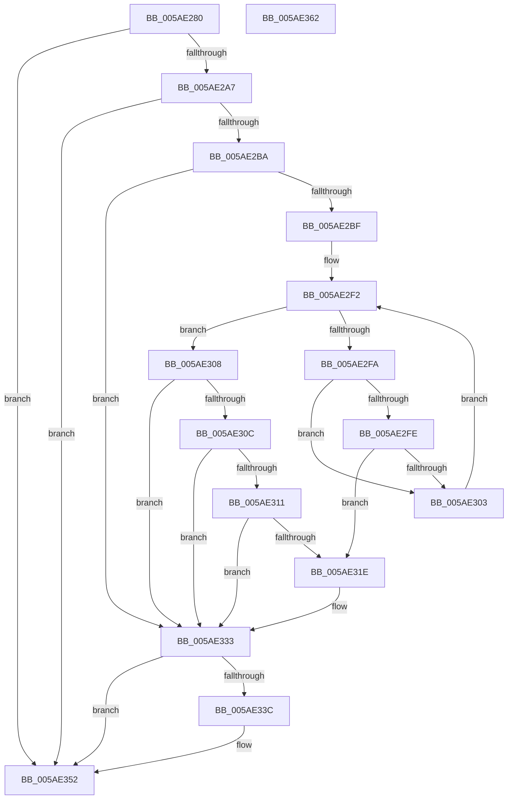

# _asan_storeN

- RVA: `0x005AE280`–`0x005AE363` (길이 `227` bytes)
- VA: `0x00000001405AE280`
- 실행 섹션: `.text`
- PDB 이름 있음: `예`; PDB Function 태그: `아니요`
- unwind 정보 RVA: `0x000794E0`
- 디코드: `62`개 명령, `227/227` bytes 표시
- 미해석 바이트: `0` (있으면 어셈블리에 `.byte`로 보존)

> 이 문서는 커널 이미지의 기계어와 PDB 기호를 분석해 생성했습니다. 4번과 5번은 함수 원형과 자료형을 바이너리 사용 방식에서 추정한 C 해석이며 원본 소스 복구 결과는 아닙니다.

## 1. Dependencies

- 직접 호출 지점: **2**; 고유 호출 대상: **2**
- 직접 호출자로 확인된 함수: **0**
- RIP 상대 이미지 참조: **3**

### Outgoing calls
- `0x005AE32E` → [KasaniReport](KasaniReport_function_005AB0B0.md) (function, `0x005AB0B0`)
- `0x005AE34D` → [KcsanValidateAddress](KcsanValidateAddress_function_005AF5E0.md) (function, `0x005AF5E0`)

### Direct callers
- 이 함수 시작 RVA로 연결되는 직접 call은 확인되지 않았습니다. 간접 호출은 완전히 역산할 수 없습니다.

### Static image references
- `0x005AE28F` → RVA `0x00FCEC6A` (`ALMOSTRO`; read)
- `0x005AE2E0` → RVA `0x00FC6ED8` (`ALMOSTRO`; read)
- `0x005AE333` → RVA `0x00F8A7E8` (`.data`; read)

## 2. Other-region calls and transfers

- 다른 실행 섹션으로 향하는 call: **0**
- 별도 외부 분기/꼬리 이동을 확인하지 못했습니다.

## 3. Assembly (complete function range)

```asm
005AE280  48 89 5C 24 08                  mov qword ptr [rsp + 8], rbx
005AE285  48 89 74 24 10                  mov qword ptr [rsp + 0x10], rsi
005AE28A  57                              push rdi
005AE28B  48 83 EC 30                     sub rsp, 0x30
005AE28F  80 3D D4 09 A2 00 00            cmp byte ptr [rip + 0xa209d4], 0
005AE296  48 8B FA                        mov rdi, rdx
005AE299  48 8B 74 24 38                  mov rsi, qword ptr [rsp + 0x38]
005AE29E  48 8B D9                        mov rbx, rcx
005AE2A1  0F 84 AB 00 00 00               je 0x1405ae352
005AE2A7  48 B8 00 00 00 00 00 80 FF FF   movabs rax, 0xffff800000000000
005AE2B1  48 3B C8                        cmp rcx, rax
005AE2B4  0F 82 98 00 00 00               jb 0x1405ae352
005AE2BA  48 85 D2                        test rdx, rdx
005AE2BD  74 74                           je 0x1405ae333
005AE2BF  48 BA 00 00 00 00 00 80 00 00   movabs rdx, 0x800000000000
005AE2C9  49 B8 FF FF FF FF FF 7F 00 00   movabs r8, 0x7fffffffffff
005AE2D3  48 03 D1                        add rdx, rcx
005AE2D6  4C 03 C1                        add r8, rcx
005AE2D9  48 C1 EA 03                     shr rdx, 3
005AE2DD  4C 03 C7                        add r8, rdi
005AE2E0  48 03 15 F1 8B A1 00            add rdx, qword ptr [rip + 0xa18bf1]
005AE2E7  49 C1 E8 03                     shr r8, 3
005AE2EB  4C 03 05 E6 8B A1 00            add r8, qword ptr [rip + 0xa18be6]
005AE2F2  0F B6 0A                        movzx ecx, byte ptr [rdx]
005AE2F5  49 3B D0                        cmp rdx, r8
005AE2F8  73 0E                           jae 0x1405ae308
005AE2FA  84 C9                           test cl, cl
005AE2FC  74 05                           je 0x1405ae303
005AE2FE  80 F9 08                        cmp cl, 8
005AE301  7C 1B                           jl 0x1405ae31e
005AE303  48 FF C2                        inc rdx
005AE306  EB EA                           jmp 0x1405ae2f2
005AE308  84 C9                           test cl, cl
005AE30A  74 27                           je 0x1405ae333
005AE30C  80 F9 08                        cmp cl, 8
005AE30F  7D 22                           jge 0x1405ae333
005AE311  8D 47 FF                        lea eax, [rdi - 1]
005AE314  02 C3                           add al, bl
005AE316  24 07                           and al, 7
005AE318  FE C0                           inc al
005AE31A  3A C1                           cmp al, cl
005AE31C  7E 15                           jle 0x1405ae333
005AE31E  88 4C 24 20                     mov byte ptr [rsp + 0x20], cl
005AE322  4C 8B CE                        mov r9, rsi
005AE325  48 8B CB                        mov rcx, rbx
005AE328  41 B0 01                        mov r8b, 1
005AE32B  48 8B D7                        mov rdx, rdi
005AE32E  E8 7D CD FF FF                  call 0x1405ab0b0
005AE333  80 3D AE C4 9D 00 00            cmp byte ptr [rip + 0x9dc4ae], 0
005AE33A  74 16                           je 0x1405ae352
005AE33C  45 33 C9                        xor r9d, r9d
005AE33F  48 89 74 24 20                  mov qword ptr [rsp + 0x20], rsi
005AE344  41 B0 01                        mov r8b, 1
005AE347  48 8B D7                        mov rdx, rdi
005AE34A  48 8B CB                        mov rcx, rbx
005AE34D  E8 8E 12 00 00                  call 0x1405af5e0
005AE352  48 8B 5C 24 40                  mov rbx, qword ptr [rsp + 0x40]
005AE357  48 8B 74 24 48                  mov rsi, qword ptr [rsp + 0x48]
005AE35C  48 83 C4 30                     add rsp, 0x30
005AE360  5F                              pop rdi
005AE361  C3                              ret
005AE362  CC                              int3
```

## 4. C-style interpretation (structured pseudocode)

```c
__int64 __fastcall _asan_storeN(__int64 a1, __int64 a2)
{
    __int64 result;
    __int64 v_rsp;
    unsigned __int8 v_stack_m18;
    unsigned __int64 v_stack_p0;
    unsigned __int64 v_stack_p10;
    unsigned __int64 v_stack_p8;

    v_stack_p8 = v_rbx;
    v_stack_p10 = v_rsi;
    v_rsp = (v_rsp) - (48);
    if ((*(unsigned __int8 *)(v_rip + 10619348)) == 0) goto loc_005AE352;
    if (a1 < result) goto loc_005AE352;
    if (a2 == 0) goto loc_005AE333;
    a2 = (a2) + (a1);
    a3 = (a3) + (a1);
    a2 = (a2) >> (3);
    a3 = (a3) + (a2);
    a2 = (a2) + (*(unsigned __int64 *)(v_rip + 10587121));
    a3 = (a3) >> (3);
    a3 = (a3) + (*(unsigned __int64 *)(v_rip + 10587110));
loc_005AE2F2:
    if (a2 >= a3) goto loc_005AE308;
    if ((unsigned __int8)(*(unsigned __int8 *)(a2)) == 0) goto loc_005AE303;
    if (((unsigned __int8)(*(unsigned __int8 *)(a2))) < 8) goto loc_005AE31E;
loc_005AE303:
    a2 = (a2) + 1;
    goto loc_005AE2F2;
loc_005AE308:
    if ((unsigned __int8)(*(unsigned __int8 *)(a2)) == 0) goto loc_005AE333;
    if (((unsigned __int8)(*(unsigned __int8 *)(a2))) >= 8) goto loc_005AE333;
    result = (unsigned __int8)((a2 - 1) + ((unsigned __int8)(a1)));
    result = (unsigned __int8)((result) & (7));
    result = (unsigned __int8)((result) + 1);
    if (((unsigned __int8)(result)) >= = ((unsigned __int8)(*(unsigned __int8 *)(a2)))) {
        v_stack_m18 = (unsigned __int8)(*(unsigned __int8 *)(a2));
        a4 = v_stack_p0;
        a1 = a1;
        a3 = 1;
        a2 = a2;
        result = KasaniReport(a1, a2, a3, a4);
    }
    if ((*(unsigned __int8 *)(v_rip + 10339502)) != 0) {
        a4 = 0;
        v_stack_m18 = v_stack_p0;
        a3 = 1;
        a2 = a2;
        a1 = a1;
        result = KcsanValidateAddress(a1, a2, a3, a4);
    }
    v_rsp = (v_rsp) + (48);
    return result;
}
```

## 5. (Beta) C Style

```c
int64_t _asan_storeN(int64_t Arg1, void *Arg2)
{
    uint8_t *arg2 = (uint8_t *)Arg2;

    int64_t result;
    int64_t local_rsp;
    uint8_t v_stack_m18;
    uint64_t v_stack_p0;
    uint64_t v_stack_p10;
    uint64_t v_stack_p8;

    v_stack_p8 = local_rbx;
    v_stack_p10 = local_rsi;
    local_rsp = (local_rsp) - (48);
    if ((*(uint8_t *)(v_rip + 0xA209D4)) == 0) goto loc_005AE352;
    if (Arg1 < result) goto loc_005AE352;
    if (Arg2 == NULL) goto loc_005AE333;
    Arg2 = (Arg2) + (Arg1);
    a3 = (a3) + (Arg1);
    Arg2 = (Arg2) >> (3);
    a3 = (a3) + (Arg2);
    Arg2 = (Arg2) + (*(uint64_t *)(v_rip + 0xA18BF1));
    a3 = (a3) >> (3);
    a3 = (a3) + (*(uint64_t *)(v_rip + 0xA18BE6));
loc_005AE2F2:
    if (Arg2 >= a3) goto loc_005AE308;
    if ((uint8_t)(*(uint8_t *)(arg2)) == 0) goto loc_005AE303;
    if (((uint8_t)(*(uint8_t *)(arg2))) < 8) goto loc_005AE31E;
loc_005AE303:
    Arg2 = (Arg2) + 1;
    goto loc_005AE2F2;
loc_005AE308:
    if ((uint8_t)(*(uint8_t *)(arg2)) == 0) goto loc_005AE333;
    if (((uint8_t)(*(uint8_t *)(arg2))) >= 8) goto loc_005AE333;
    result = (uint8_t)((Arg2 - 1) + ((uint8_t)(Arg1)));
    result = (uint8_t)((result) & (7));
    result = (uint8_t)((result) + 1);
    if (((uint8_t)(result)) >= = ((uint8_t)(*(uint8_t *)(arg2)))) {
        v_stack_m18 = (uint8_t)(*(uint8_t *)(arg2));
        a4 = v_stack_p0;
        Arg1 = Arg1;
        a3 = 1;
        Arg2 = Arg2;
        result = KasaniReport(Arg1, Arg2, a3, a4);
    }
    if ((*(uint8_t *)(v_rip + 0x9DC4AE)) != 0) {
        a4 = 0;
        v_stack_m18 = v_stack_p0;
        a3 = 1;
        Arg2 = Arg2;
        Arg1 = Arg1;
        result = KcsanValidateAddress(Arg1, Arg2, a3, a4);
    }
    local_rsp = (local_rsp) + (48);
    return result;
}
```

### 관측된 메모리 오프셋

구조체 형식이 확인되지 않은 접근은 인자 기준의 오프셋으로만 기록했습니다.

| 기준 인자 | 오프셋 표현 | 폭 (bit) | 접근 |
|---|---:|---:|---|
| `Arg2` | `- 0x1` | `32` | `R` |

## 6. Execution-region graph

[열기: 2D/3D 그래프와 함수 탐색 컨트롤 패널](../../../control-panel.html?section=text&rva=0x005AE280&view=graph)

- 2D 그래프는 위에서 아래로 흐르고, 3D 그래프는 빈 공간을 드래그해 회전합니다. Shift+드래그는 이동, 휠은 확대·축소, 함수 노드 선택은 대상 보고서 이동입니다.

### Static fallback


