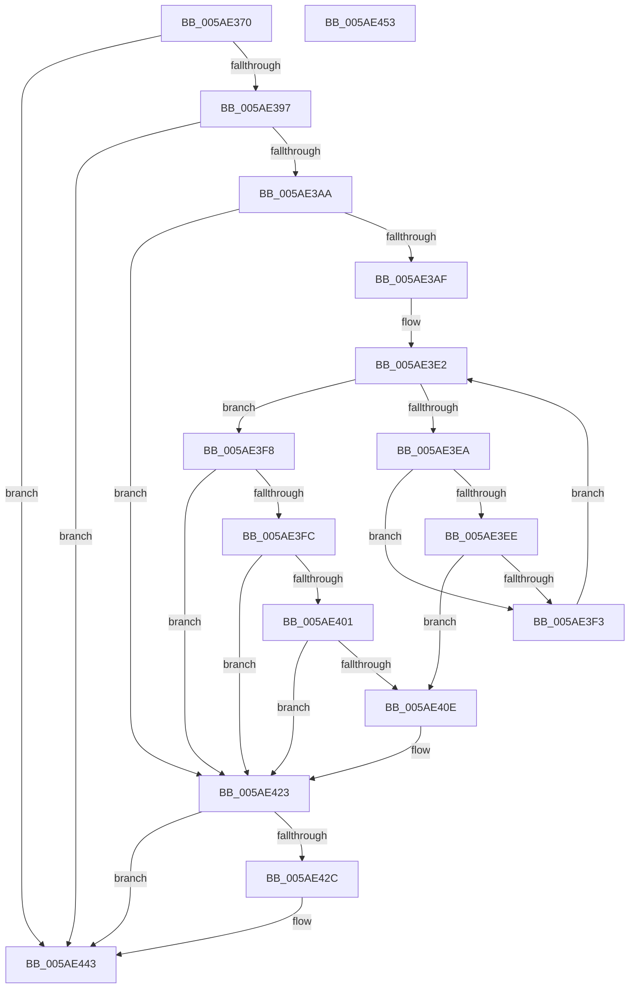

# _asan_storeN_volatile

- RVA: `0x005AE370`–`0x005AE454` (길이 `228` bytes)
- VA: `0x00000001405AE370`
- 실행 섹션: `.text`
- PDB 이름 있음: `예`; PDB Function 태그: `아니요`
- unwind 정보 RVA: `0x000794E0`
- 디코드: `62`개 명령, `228/228` bytes 표시
- 미해석 바이트: `0` (있으면 어셈블리에 `.byte`로 보존)

> 이 문서는 커널 이미지의 기계어와 PDB 기호를 분석해 생성했습니다. 4번과 5번은 함수 원형과 자료형을 바이너리 사용 방식에서 추정한 C 해석이며 원본 소스 복구 결과는 아닙니다.

## 1. Dependencies

- 직접 호출 지점: **2**; 고유 호출 대상: **2**
- 직접 호출자로 확인된 함수: **0**
- RIP 상대 이미지 참조: **3**

### Outgoing calls
- `0x005AE41E` → [KasaniReport](KasaniReport_function_005AB0B0.md) (function, `0x005AB0B0`)
- `0x005AE43E` → [KcsanValidateAddress](KcsanValidateAddress_function_005AF5E0.md) (function, `0x005AF5E0`)

### Direct callers
- 이 함수 시작 RVA로 연결되는 직접 call은 확인되지 않았습니다. 간접 호출은 완전히 역산할 수 없습니다.

### Static image references
- `0x005AE37F` → RVA `0x00FCEC6A` (`ALMOSTRO`; read)
- `0x005AE3D0` → RVA `0x00FC6ED8` (`ALMOSTRO`; read)
- `0x005AE423` → RVA `0x00F8A7E8` (`.data`; read)

## 2. Other-region calls and transfers

- 다른 실행 섹션으로 향하는 call: **0**
- 별도 외부 분기/꼬리 이동을 확인하지 못했습니다.

## 3. Assembly (complete function range)

```asm
005AE370  48 89 5C 24 08                  mov qword ptr [rsp + 8], rbx
005AE375  48 89 74 24 10                  mov qword ptr [rsp + 0x10], rsi
005AE37A  57                              push rdi
005AE37B  48 83 EC 30                     sub rsp, 0x30
005AE37F  80 3D E4 08 A2 00 00            cmp byte ptr [rip + 0xa208e4], 0
005AE386  48 8B FA                        mov rdi, rdx
005AE389  48 8B 74 24 38                  mov rsi, qword ptr [rsp + 0x38]
005AE38E  48 8B D9                        mov rbx, rcx
005AE391  0F 84 AC 00 00 00               je 0x1405ae443
005AE397  48 B8 00 00 00 00 00 80 FF FF   movabs rax, 0xffff800000000000
005AE3A1  48 3B C8                        cmp rcx, rax
005AE3A4  0F 82 99 00 00 00               jb 0x1405ae443
005AE3AA  48 85 D2                        test rdx, rdx
005AE3AD  74 74                           je 0x1405ae423
005AE3AF  48 BA 00 00 00 00 00 80 00 00   movabs rdx, 0x800000000000
005AE3B9  49 B8 FF FF FF FF FF 7F 00 00   movabs r8, 0x7fffffffffff
005AE3C3  48 03 D1                        add rdx, rcx
005AE3C6  4C 03 C1                        add r8, rcx
005AE3C9  48 C1 EA 03                     shr rdx, 3
005AE3CD  4C 03 C7                        add r8, rdi
005AE3D0  48 03 15 01 8B A1 00            add rdx, qword ptr [rip + 0xa18b01]
005AE3D7  49 C1 E8 03                     shr r8, 3
005AE3DB  4C 03 05 F6 8A A1 00            add r8, qword ptr [rip + 0xa18af6]
005AE3E2  0F B6 0A                        movzx ecx, byte ptr [rdx]
005AE3E5  49 3B D0                        cmp rdx, r8
005AE3E8  73 0E                           jae 0x1405ae3f8
005AE3EA  84 C9                           test cl, cl
005AE3EC  74 05                           je 0x1405ae3f3
005AE3EE  80 F9 08                        cmp cl, 8
005AE3F1  7C 1B                           jl 0x1405ae40e
005AE3F3  48 FF C2                        inc rdx
005AE3F6  EB EA                           jmp 0x1405ae3e2
005AE3F8  84 C9                           test cl, cl
005AE3FA  74 27                           je 0x1405ae423
005AE3FC  80 F9 08                        cmp cl, 8
005AE3FF  7D 22                           jge 0x1405ae423
005AE401  8D 47 FF                        lea eax, [rdi - 1]
005AE404  02 C3                           add al, bl
005AE406  24 07                           and al, 7
005AE408  FE C0                           inc al
005AE40A  3A C1                           cmp al, cl
005AE40C  7E 15                           jle 0x1405ae423
005AE40E  88 4C 24 20                     mov byte ptr [rsp + 0x20], cl
005AE412  4C 8B CE                        mov r9, rsi
005AE415  48 8B CB                        mov rcx, rbx
005AE418  41 B0 01                        mov r8b, 1
005AE41B  48 8B D7                        mov rdx, rdi
005AE41E  E8 8D CC FF FF                  call 0x1405ab0b0
005AE423  80 3D BE C3 9D 00 00            cmp byte ptr [rip + 0x9dc3be], 0
005AE42A  74 17                           je 0x1405ae443
005AE42C  41 B1 01                        mov r9b, 1
005AE42F  48 89 74 24 20                  mov qword ptr [rsp + 0x20], rsi
005AE434  45 0F B6 C1                     movzx r8d, r9b
005AE438  48 8B D7                        mov rdx, rdi
005AE43B  48 8B CB                        mov rcx, rbx
005AE43E  E8 9D 11 00 00                  call 0x1405af5e0
005AE443  48 8B 5C 24 40                  mov rbx, qword ptr [rsp + 0x40]
005AE448  48 8B 74 24 48                  mov rsi, qword ptr [rsp + 0x48]
005AE44D  48 83 C4 30                     add rsp, 0x30
005AE451  5F                              pop rdi
005AE452  C3                              ret
005AE453  CC                              int3
```

## 4. C-style interpretation (structured pseudocode)

```c
__int64 __fastcall _asan_storeN_volatile(__int64 a1, __int64 a2)
{
    __int64 result;
    __int64 v_rsp;
    unsigned __int8 v_stack_m18;
    unsigned __int64 v_stack_p0;
    unsigned __int64 v_stack_p10;
    unsigned __int64 v_stack_p8;

    v_stack_p8 = v_rbx;
    v_stack_p10 = v_rsi;
    v_rsp = (v_rsp) - (48);
    if ((*(unsigned __int8 *)(v_rip + 10619108)) == 0) goto loc_005AE443;
    if (a1 < result) goto loc_005AE443;
    if (a2 == 0) goto loc_005AE423;
    a2 = (a2) + (a1);
    a3 = (a3) + (a1);
    a2 = (a2) >> (3);
    a3 = (a3) + (a2);
    a2 = (a2) + (*(unsigned __int64 *)(v_rip + 10586881));
    a3 = (a3) >> (3);
    a3 = (a3) + (*(unsigned __int64 *)(v_rip + 10586870));
loc_005AE3E2:
    if (a2 >= a3) goto loc_005AE3F8;
    if ((unsigned __int8)(*(unsigned __int8 *)(a2)) == 0) goto loc_005AE3F3;
    if (((unsigned __int8)(*(unsigned __int8 *)(a2))) < 8) goto loc_005AE40E;
loc_005AE3F3:
    a2 = (a2) + 1;
    goto loc_005AE3E2;
loc_005AE3F8:
    if ((unsigned __int8)(*(unsigned __int8 *)(a2)) == 0) goto loc_005AE423;
    if (((unsigned __int8)(*(unsigned __int8 *)(a2))) >= 8) goto loc_005AE423;
    result = (unsigned __int8)((a2 - 1) + ((unsigned __int8)(a1)));
    result = (unsigned __int8)((result) & (7));
    result = (unsigned __int8)((result) + 1);
    if (((unsigned __int8)(result)) >= = ((unsigned __int8)(*(unsigned __int8 *)(a2)))) {
        v_stack_m18 = (unsigned __int8)(*(unsigned __int8 *)(a2));
        a4 = v_stack_p0;
        a1 = a1;
        a3 = 1;
        a2 = a2;
        result = KasaniReport(a1, a2, a3, a4);
    }
    if ((*(unsigned __int8 *)(v_rip + 10339262)) != 0) {
        a4 = 1;
        v_stack_m18 = v_stack_p0;
        a3 = (unsigned __int8)(a4);
        a2 = a2;
        a1 = a1;
        result = KcsanValidateAddress(a1, a2, a3, a4);
    }
    v_rsp = (v_rsp) + (48);
    return result;
}
```

## 5. (Beta) C Style

```c
int64_t _asan_storeN_volatile(int64_t Arg1, void *Arg2)
{
    uint8_t *arg2 = (uint8_t *)Arg2;

    int64_t result;
    int64_t local_rsp;
    uint8_t v_stack_m18;
    uint64_t v_stack_p0;
    uint64_t v_stack_p10;
    uint64_t v_stack_p8;

    v_stack_p8 = local_rbx;
    v_stack_p10 = local_rsi;
    local_rsp = (local_rsp) - (48);
    if ((*(uint8_t *)(v_rip + 0xA208E4)) == 0) goto loc_005AE443;
    if (Arg1 < result) goto loc_005AE443;
    if (Arg2 == NULL) goto loc_005AE423;
    Arg2 = (Arg2) + (Arg1);
    a3 = (a3) + (Arg1);
    Arg2 = (Arg2) >> (3);
    a3 = (a3) + (Arg2);
    Arg2 = (Arg2) + (*(uint64_t *)(v_rip + 0xA18B01));
    a3 = (a3) >> (3);
    a3 = (a3) + (*(uint64_t *)(v_rip + 0xA18AF6));
loc_005AE3E2:
    if (Arg2 >= a3) goto loc_005AE3F8;
    if ((uint8_t)(*(uint8_t *)(arg2)) == 0) goto loc_005AE3F3;
    if (((uint8_t)(*(uint8_t *)(arg2))) < 8) goto loc_005AE40E;
loc_005AE3F3:
    Arg2 = (Arg2) + 1;
    goto loc_005AE3E2;
loc_005AE3F8:
    if ((uint8_t)(*(uint8_t *)(arg2)) == 0) goto loc_005AE423;
    if (((uint8_t)(*(uint8_t *)(arg2))) >= 8) goto loc_005AE423;
    result = (uint8_t)((Arg2 - 1) + ((uint8_t)(Arg1)));
    result = (uint8_t)((result) & (7));
    result = (uint8_t)((result) + 1);
    if (((uint8_t)(result)) >= = ((uint8_t)(*(uint8_t *)(arg2)))) {
        v_stack_m18 = (uint8_t)(*(uint8_t *)(arg2));
        a4 = v_stack_p0;
        Arg1 = Arg1;
        a3 = 1;
        Arg2 = Arg2;
        result = KasaniReport(Arg1, Arg2, a3, a4);
    }
    if ((*(uint8_t *)(v_rip + 0x9DC3BE)) != 0) {
        a4 = 1;
        v_stack_m18 = v_stack_p0;
        a3 = (uint8_t)(a4);
        Arg2 = Arg2;
        Arg1 = Arg1;
        result = KcsanValidateAddress(Arg1, Arg2, a3, a4);
    }
    local_rsp = (local_rsp) + (48);
    return result;
}
```

### 관측된 메모리 오프셋

구조체 형식이 확인되지 않은 접근은 인자 기준의 오프셋으로만 기록했습니다.

| 기준 인자 | 오프셋 표현 | 폭 (bit) | 접근 |
|---|---:|---:|---|
| `Arg2` | `- 0x1` | `32` | `R` |

## 6. Execution-region graph

[열기: 2D/3D 그래프와 함수 탐색 컨트롤 패널](../../../control-panel.html?section=text&rva=0x005AE370&view=graph)

- 2D 그래프는 위에서 아래로 흐르고, 3D 그래프는 빈 공간을 드래그해 회전합니다. Shift+드래그는 이동, 휠은 확대·축소, 함수 노드 선택은 대상 보고서 이동입니다.

### Static fallback


