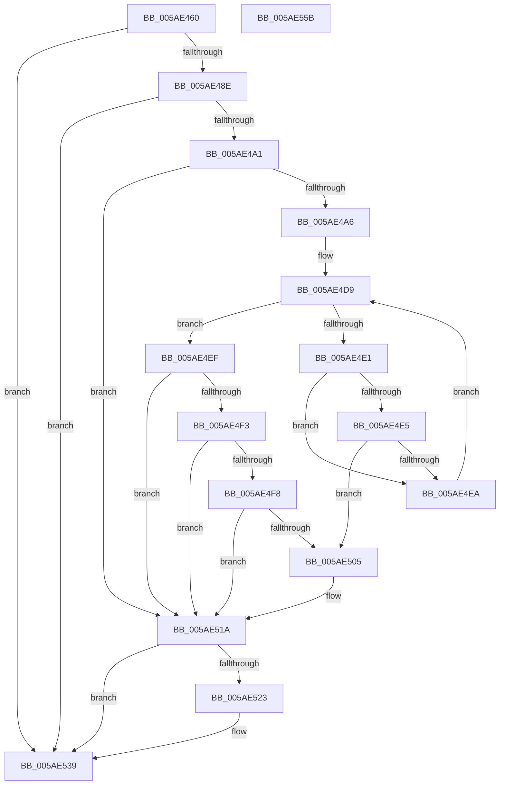

# _asan_wrap_memchr

- RVA: `0x005AE460`–`0x005AE55C` (길이 `252` bytes)
- VA: `0x00000001405AE460`
- 실행 섹션: `.text`
- PDB 이름 있음: `예`; PDB Function 태그: `아니요`
- unwind 정보 RVA: `0x00066400`
- 디코드: `69`개 명령, `252/252` bytes 표시
- 미해석 바이트: `0` (있으면 어셈블리에 `.byte`로 보존)

> 이 문서는 커널 이미지의 기계어와 PDB 기호를 분석해 생성했습니다. 4번과 5번은 함수 원형과 자료형을 바이너리 사용 방식에서 추정한 C 해석이며 원본 소스 복구 결과는 아닙니다.

## 1. Dependencies

- 직접 호출 지점: **3**; 고유 호출 대상: **3**
- 직접 호출자로 확인된 함수: **0**
- RIP 상대 이미지 참조: **3**

### Outgoing calls
- `0x005AE515` → [KasaniReport](KasaniReport_function_005AB0B0.md) (function, `0x005AB0B0`)
- `0x005AE534` → [KcsanValidateAddress](KcsanValidateAddress_function_005AF5E0.md) (function, `0x005AF5E0`)
- `0x005AE541` → [memchr](../50/memchr_function_00500950.md) (function, `0x00500950`)

### Direct callers
- 이 함수 시작 RVA로 연결되는 직접 call은 확인되지 않았습니다. 간접 호출은 완전히 역산할 수 없습니다.

### Static image references
- `0x005AE474` → RVA `0x00FCEC6A` (`ALMOSTRO`; read)
- `0x005AE4C7` → RVA `0x00FC6ED8` (`ALMOSTRO`; read)
- `0x005AE51A` → RVA `0x00F8A7E8` (`.data`; read)

## 2. Other-region calls and transfers

- 다른 실행 섹션으로 향하는 call: **0**
- 별도 외부 분기/꼬리 이동을 확인하지 못했습니다.

## 3. Assembly (complete function range)

```asm
005AE460  48 89 5C 24 08                  mov qword ptr [rsp + 8], rbx
005AE465  48 89 6C 24 10                  mov qword ptr [rsp + 0x10], rbp
005AE46A  48 89 74 24 18                  mov qword ptr [rsp + 0x18], rsi
005AE46F  57                              push rdi
005AE470  48 83 EC 30                     sub rsp, 0x30
005AE474  80 3D EF 07 A2 00 00            cmp byte ptr [rip + 0xa207ef], 0
005AE47B  49 8B F8                        mov rdi, r8
005AE47E  48 8B 74 24 38                  mov rsi, qword ptr [rsp + 0x38]
005AE483  8B EA                           mov ebp, edx
005AE485  48 8B D9                        mov rbx, rcx
005AE488  0F 84 AB 00 00 00               je 0x1405ae539
005AE48E  48 B8 00 00 00 00 00 80 FF FF   movabs rax, 0xffff800000000000
005AE498  48 3B C8                        cmp rcx, rax
005AE49B  0F 82 98 00 00 00               jb 0x1405ae539
005AE4A1  4D 85 C0                        test r8, r8
005AE4A4  74 74                           je 0x1405ae51a
005AE4A6  48 BA 00 00 00 00 00 80 00 00   movabs rdx, 0x800000000000
005AE4B0  49 B8 FF FF FF FF FF 7F 00 00   movabs r8, 0x7fffffffffff
005AE4BA  48 03 D1                        add rdx, rcx
005AE4BD  4C 03 C1                        add r8, rcx
005AE4C0  48 C1 EA 03                     shr rdx, 3
005AE4C4  4C 03 C7                        add r8, rdi
005AE4C7  48 03 15 0A 8A A1 00            add rdx, qword ptr [rip + 0xa18a0a]
005AE4CE  49 C1 E8 03                     shr r8, 3
005AE4D2  4C 03 05 FF 89 A1 00            add r8, qword ptr [rip + 0xa189ff]
005AE4D9  0F B6 0A                        movzx ecx, byte ptr [rdx]
005AE4DC  49 3B D0                        cmp rdx, r8
005AE4DF  73 0E                           jae 0x1405ae4ef
005AE4E1  84 C9                           test cl, cl
005AE4E3  74 05                           je 0x1405ae4ea
005AE4E5  80 F9 08                        cmp cl, 8
005AE4E8  7C 1B                           jl 0x1405ae505
005AE4EA  48 FF C2                        inc rdx
005AE4ED  EB EA                           jmp 0x1405ae4d9
005AE4EF  84 C9                           test cl, cl
005AE4F1  74 27                           je 0x1405ae51a
005AE4F3  80 F9 08                        cmp cl, 8
005AE4F6  7D 22                           jge 0x1405ae51a
005AE4F8  8D 47 FF                        lea eax, [rdi - 1]
005AE4FB  02 C3                           add al, bl
005AE4FD  24 07                           and al, 7
005AE4FF  FE C0                           inc al
005AE501  3A C1                           cmp al, cl
005AE503  7E 15                           jle 0x1405ae51a
005AE505  88 4C 24 20                     mov byte ptr [rsp + 0x20], cl
005AE509  4C 8B CE                        mov r9, rsi
005AE50C  48 8B CB                        mov rcx, rbx
005AE50F  45 33 C0                        xor r8d, r8d
005AE512  48 8B D7                        mov rdx, rdi
005AE515  E8 96 CB FF FF                  call 0x1405ab0b0
005AE51A  80 3D C7 C2 9D 00 00            cmp byte ptr [rip + 0x9dc2c7], 0
005AE521  74 16                           je 0x1405ae539
005AE523  45 33 C9                        xor r9d, r9d
005AE526  48 89 74 24 20                  mov qword ptr [rsp + 0x20], rsi
005AE52B  45 33 C0                        xor r8d, r8d
005AE52E  48 8B D7                        mov rdx, rdi
005AE531  48 8B CB                        mov rcx, rbx
005AE534  E8 A7 10 00 00                  call 0x1405af5e0
005AE539  4C 8B C7                        mov r8, rdi
005AE53C  8B D5                           mov edx, ebp
005AE53E  48 8B CB                        mov rcx, rbx
005AE541  E8 0A 24 F5 FF                  call 0x140500950
005AE546  48 8B 5C 24 40                  mov rbx, qword ptr [rsp + 0x40]
005AE54B  48 8B 6C 24 48                  mov rbp, qword ptr [rsp + 0x48]
005AE550  48 8B 74 24 50                  mov rsi, qword ptr [rsp + 0x50]
005AE555  48 83 C4 30                     add rsp, 0x30
005AE559  5F                              pop rdi
005AE55A  C3                              ret
005AE55B  CC                              int3
```

## 4. C-style interpretation (structured pseudocode)

```c
__int64 __fastcall _asan_wrap_memchr(__int64 a1, int a2, __int64 a3)
{
    __int64 result;
    __int64 v_rsp;
    unsigned __int8 v_stack_m18;
    unsigned __int64 v_stack_p0;
    unsigned __int64 v_stack_p10;
    unsigned __int64 v_stack_p18;
    unsigned __int64 v_stack_p8;

    v_stack_p8 = v_rbx;
    v_stack_p10 = v_rbp;
    v_stack_p18 = v_rsi;
    v_rsp = (v_rsp) - (48);
    if ((*(unsigned __int8 *)(v_rip + 10618863)) == 0) goto loc_005AE539;
    if (a1 < result) goto loc_005AE539;
    if (a3 == 0) goto loc_005AE51A;
    a2 = (a2) + (a1);
    a3 = (a3) + (a1);
    a2 = (a2) >> (3);
    a3 = (a3) + (a3);
    a2 = (a2) + (*(unsigned __int64 *)(v_rip + 10586634));
    a3 = (a3) >> (3);
    a3 = (a3) + (*(unsigned __int64 *)(v_rip + 10586623));
loc_005AE4D9:
    if (a2 >= a3) goto loc_005AE4EF;
    if ((unsigned __int8)(*(unsigned __int8 *)(a2)) == 0) goto loc_005AE4EA;
    if (((unsigned __int8)(*(unsigned __int8 *)(a2))) < 8) goto loc_005AE505;
loc_005AE4EA:
    a2 = (a2) + 1;
    goto loc_005AE4D9;
loc_005AE4EF:
    if ((unsigned __int8)(*(unsigned __int8 *)(a2)) == 0) goto loc_005AE51A;
    if (((unsigned __int8)(*(unsigned __int8 *)(a2))) >= 8) goto loc_005AE51A;
    result = (unsigned __int8)((a3 - 1) + ((unsigned __int8)(a1)));
    result = (unsigned __int8)((result) & (7));
    result = (unsigned __int8)((result) + 1);
    if (((unsigned __int8)(result)) >= = ((unsigned __int8)(*(unsigned __int8 *)(a2)))) {
        v_stack_m18 = (unsigned __int8)(*(unsigned __int8 *)(a2));
        a4 = v_stack_p0;
        a1 = a1;
        a3 = 0;
        a2 = 0;
        result = KasaniReport(a1, a2, a3, a4);
    }
    if ((*(unsigned __int8 *)(v_rip + 10339015)) != 0) {
        a4 = 0;
        v_stack_m18 = v_stack_p0;
        a3 = 0;
        a2 = 0;
        a1 = a1;
        result = KcsanValidateAddress(a1, a2, a3, a4);
    }
    result = memchr(a1, (unsigned int)((unsigned int)((unsigned int)(a2))), 0, a4);
    v_rsp = (v_rsp) + (48);
    return result;
}
```

## 5. (Beta) C Style

```c
int64_t _asan_wrap_memchr(int64_t Arg1, int32_t Arg2, void *Arg3)
{
    uint8_t *arg3 = (uint8_t *)Arg3;

    int64_t result;
    int64_t local_rsp;
    uint8_t v_stack_m18;
    uint64_t v_stack_p0;
    uint64_t v_stack_p10;
    uint64_t v_stack_p18;
    uint64_t v_stack_p8;

    v_stack_p8 = local_rbx;
    v_stack_p10 = local_rbp;
    v_stack_p18 = local_rsi;
    local_rsp = (local_rsp) - (48);
    if ((*(uint8_t *)(v_rip + 0xA207EF)) == 0) goto loc_005AE539;
    if (Arg1 < result) goto loc_005AE539;
    if (Arg3 == NULL) goto loc_005AE51A;
    Arg2 = (Arg2) + (Arg1);
    Arg3 = (Arg3) + (Arg1);
    Arg2 = (Arg2) >> (3);
    Arg3 = (Arg3) + (Arg3);
    Arg2 = (Arg2) + (*(uint64_t *)(v_rip + 0xA18A0A));
    Arg3 = (Arg3) >> (3);
    Arg3 = (Arg3) + (*(uint64_t *)(v_rip + 0xA189FF));
loc_005AE4D9:
    if (Arg2 >= Arg3) goto loc_005AE4EF;
    if ((uint8_t)(*(uint8_t *)(Arg2)) == 0) goto loc_005AE4EA;
    if (((uint8_t)(*(uint8_t *)(Arg2))) < 8) goto loc_005AE505;
loc_005AE4EA:
    Arg2 = (Arg2) + 1;
    goto loc_005AE4D9;
loc_005AE4EF:
    if ((uint8_t)(*(uint8_t *)(Arg2)) == 0) goto loc_005AE51A;
    if (((uint8_t)(*(uint8_t *)(Arg2))) >= 8) goto loc_005AE51A;
    result = (uint8_t)((Arg3 - 1) + ((uint8_t)(Arg1)));
    result = (uint8_t)((result) & (7));
    result = (uint8_t)((result) + 1);
    if (((uint8_t)(result)) >= = ((uint8_t)(*(uint8_t *)(Arg2)))) {
        v_stack_m18 = (uint8_t)(*(uint8_t *)(Arg2));
        a4 = v_stack_p0;
        Arg1 = Arg1;
        Arg3 = 0;
        Arg2 = 0;
        result = KasaniReport(Arg1, Arg2, Arg3, a4);
    }
    if ((*(uint8_t *)(v_rip + 0x9DC2C7)) != 0) {
        a4 = 0;
        v_stack_m18 = v_stack_p0;
        Arg3 = 0;
        Arg2 = 0;
        Arg1 = Arg1;
        result = KcsanValidateAddress(Arg1, Arg2, Arg3, a4);
    }
    result = memchr(Arg1, (uint32_t)((uint32_t)((uint32_t)(Arg2))), 0, a4);
    local_rsp = (local_rsp) + (48);
    return result;
}
```

### 관측된 메모리 오프셋

구조체 형식이 확인되지 않은 접근은 인자 기준의 오프셋으로만 기록했습니다.

| 기준 인자 | 오프셋 표현 | 폭 (bit) | 접근 |
|---|---:|---:|---|
| `Arg3` | `- 0x1` | `32` | `R` |

## 6. Execution-region graph

[열기: 2D/3D 그래프와 함수 탐색 컨트롤 패널](../../../control-panel.html?section=text&rva=0x005AE460&view=graph)

- 2D 그래프는 위에서 아래로 흐르고, 3D 그래프는 빈 공간을 드래그해 회전합니다. Shift+드래그는 이동, 휠은 확대·축소, 함수 노드 선택은 대상 보고서 이동입니다.

### Static fallback


