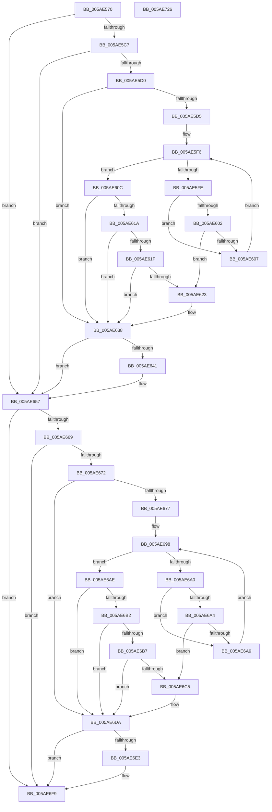

# _asan_wrap_memcmp

- RVA: `0x005AE570`–`0x005AE727` (길이 `439` bytes)
- VA: `0x00000001405AE570`
- 실행 섹션: `.text`
- PDB 이름 있음: `예`; PDB Function 태그: `아니요`
- unwind 정보 RVA: `0x000C953C`
- 디코드: `122`개 명령, `439/439` bytes 표시
- 미해석 바이트: `0` (있으면 어셈블리에 `.byte`로 보존)

> 이 문서는 커널 이미지의 기계어와 PDB 기호를 분석해 생성했습니다. 4번과 5번은 함수 원형과 자료형을 바이너리 사용 방식에서 추정한 C 해석이며 원본 소스 복구 결과는 아닙니다.

## 1. Dependencies

- 직접 호출 지점: **5**; 고유 호출 대상: **3**
- 직접 호출자로 확인된 함수: **0**
- RIP 상대 이미지 참조: **3**

### Outgoing calls
- `0x005AE633` → [KasaniReport](KasaniReport_function_005AB0B0.md) (function, `0x005AB0B0`)
- `0x005AE652` → [KcsanValidateAddress](KcsanValidateAddress_function_005AF5E0.md) (function, `0x005AF5E0`)
- `0x005AE6D5` → [KasaniReport](KasaniReport_function_005AB0B0.md) (function, `0x005AB0B0`)
- `0x005AE6F4` → [KcsanValidateAddress](KcsanValidateAddress_function_005AF5E0.md) (function, `0x005AF5E0`)
- `0x005AE702` → [memcmp](../6C/memcmp_function_006C6B10.md) (function, `0x006C6B10`)

### Direct callers
- 이 함수 시작 RVA로 연결되는 직접 call은 확인되지 않았습니다. 간접 호출은 완전히 역산할 수 없습니다.

### Static image references
- `0x005AE58E` → RVA `0x00FCEC6A` (`ALMOSTRO`; read)
- `0x005AE5E1` → RVA `0x00FC6ED8` (`ALMOSTRO`; read)
- `0x005AE638` → RVA `0x00F8A7E8` (`.data`; read)

## 2. Other-region calls and transfers

- 다른 실행 섹션으로 향하는 call: **0**
- 별도 외부 분기/꼬리 이동을 확인하지 못했습니다.

## 3. Assembly (complete function range)

```asm
005AE570  48 89 5C 24 08                  mov qword ptr [rsp + 8], rbx
005AE575  48 89 6C 24 10                  mov qword ptr [rsp + 0x10], rbp
005AE57A  48 89 74 24 18                  mov qword ptr [rsp + 0x18], rsi
005AE57F  48 89 7C 24 20                  mov qword ptr [rsp + 0x20], rdi
005AE584  41 54                           push r12
005AE586  41 56                           push r14
005AE588  41 57                           push r15
005AE58A  48 83 EC 30                     sub rsp, 0x30
005AE58E  80 3D D5 06 A2 00 00            cmp byte ptr [rip + 0xa206d5], 0
005AE595  49 8B D8                        mov rbx, r8
005AE598  48 8B 6C 24 48                  mov rbp, qword ptr [rsp + 0x48]
005AE59D  48 8B FA                        mov rdi, rdx
005AE5A0  48 8B F1                        mov rsi, rcx
005AE5A3  49 BE 00 00 00 00 00 80 FF FF   movabs r14, 0xffff800000000000
005AE5AD  49 BF 00 00 00 00 00 80 00 00   movabs r15, 0x800000000000
005AE5B7  49 BC FF FF FF FF FF 7F 00 00   movabs r12, 0x7fffffffffff
005AE5C1  0F 84 90 00 00 00               je 0x1405ae657
005AE5C7  49 3B CE                        cmp rcx, r14
005AE5CA  0F 82 87 00 00 00               jb 0x1405ae657
005AE5D0  48 85 DB                        test rbx, rbx
005AE5D3  74 63                           je 0x1405ae638
005AE5D5  4A 8D 14 39                     lea rdx, [rcx + r15]
005AE5D9  48 C1 EA 03                     shr rdx, 3
005AE5DD  4E 8D 04 21                     lea r8, [rcx + r12]
005AE5E1  48 03 15 F0 88 A1 00            add rdx, qword ptr [rip + 0xa188f0]
005AE5E8  4C 03 C3                        add r8, rbx
005AE5EB  49 C1 E8 03                     shr r8, 3
005AE5EF  4C 03 05 E2 88 A1 00            add r8, qword ptr [rip + 0xa188e2]
005AE5F6  0F B6 0A                        movzx ecx, byte ptr [rdx]
005AE5F9  49 3B D0                        cmp rdx, r8
005AE5FC  73 0E                           jae 0x1405ae60c
005AE5FE  84 C9                           test cl, cl
005AE600  74 05                           je 0x1405ae607
005AE602  80 F9 08                        cmp cl, 8
005AE605  7C 1C                           jl 0x1405ae623
005AE607  48 FF C2                        inc rdx
005AE60A  EB EA                           jmp 0x1405ae5f6
005AE60C  8D 43 FF                        lea eax, [rbx - 1]
005AE60F  40 02 C6                        add al, sil
005AE612  24 07                           and al, 7
005AE614  FE C0                           inc al
005AE616  84 C9                           test cl, cl
005AE618  74 1E                           je 0x1405ae638
005AE61A  80 F9 08                        cmp cl, 8
005AE61D  7D 19                           jge 0x1405ae638
005AE61F  3A C1                           cmp al, cl
005AE621  7E 15                           jle 0x1405ae638
005AE623  88 4C 24 20                     mov byte ptr [rsp + 0x20], cl
005AE627  4C 8B CD                        mov r9, rbp
005AE62A  48 8B CE                        mov rcx, rsi
005AE62D  45 33 C0                        xor r8d, r8d
005AE630  48 8B D3                        mov rdx, rbx
005AE633  E8 78 CA FF FF                  call 0x1405ab0b0
005AE638  80 3D A9 C1 9D 00 00            cmp byte ptr [rip + 0x9dc1a9], 0
005AE63F  74 16                           je 0x1405ae657
005AE641  45 33 C9                        xor r9d, r9d
005AE644  48 89 6C 24 20                  mov qword ptr [rsp + 0x20], rbp
005AE649  45 33 C0                        xor r8d, r8d
005AE64C  48 8B D3                        mov rdx, rbx
005AE64F  48 8B CE                        mov rcx, rsi
005AE652  E8 89 0F 00 00                  call 0x1405af5e0
005AE657  80 3D 0C 06 A2 00 00            cmp byte ptr [rip + 0xa2060c], 0
005AE65E  48 8B 6C 24 48                  mov rbp, qword ptr [rsp + 0x48]
005AE663  0F 84 90 00 00 00               je 0x1405ae6f9
005AE669  49 3B FE                        cmp rdi, r14
005AE66C  0F 82 87 00 00 00               jb 0x1405ae6f9
005AE672  48 85 DB                        test rbx, rbx
005AE675  74 63                           je 0x1405ae6da
005AE677  4A 8D 14 3F                     lea rdx, [rdi + r15]
005AE67B  48 C1 EA 03                     shr rdx, 3
005AE67F  4E 8D 04 27                     lea r8, [rdi + r12]
005AE683  48 03 15 4E 88 A1 00            add rdx, qword ptr [rip + 0xa1884e]
005AE68A  4C 03 C3                        add r8, rbx
005AE68D  49 C1 E8 03                     shr r8, 3
005AE691  4C 03 05 40 88 A1 00            add r8, qword ptr [rip + 0xa18840]
005AE698  0F B6 0A                        movzx ecx, byte ptr [rdx]
005AE69B  49 3B D0                        cmp rdx, r8
005AE69E  73 0E                           jae 0x1405ae6ae
005AE6A0  84 C9                           test cl, cl
005AE6A2  74 05                           je 0x1405ae6a9
005AE6A4  80 F9 08                        cmp cl, 8
005AE6A7  7C 1C                           jl 0x1405ae6c5
005AE6A9  48 FF C2                        inc rdx
005AE6AC  EB EA                           jmp 0x1405ae698
005AE6AE  84 C9                           test cl, cl
005AE6B0  74 28                           je 0x1405ae6da
005AE6B2  80 F9 08                        cmp cl, 8
005AE6B5  7D 23                           jge 0x1405ae6da
005AE6B7  8D 43 FF                        lea eax, [rbx - 1]
005AE6BA  40 02 C7                        add al, dil
005AE6BD  24 07                           and al, 7
005AE6BF  FE C0                           inc al
005AE6C1  3A C1                           cmp al, cl
005AE6C3  7E 15                           jle 0x1405ae6da
005AE6C5  88 4C 24 20                     mov byte ptr [rsp + 0x20], cl
005AE6C9  4C 8B CD                        mov r9, rbp
005AE6CC  48 8B CF                        mov rcx, rdi
005AE6CF  45 33 C0                        xor r8d, r8d
005AE6D2  48 8B D3                        mov rdx, rbx
005AE6D5  E8 D6 C9 FF FF                  call 0x1405ab0b0
005AE6DA  80 3D 07 C1 9D 00 00            cmp byte ptr [rip + 0x9dc107], 0
005AE6E1  74 16                           je 0x1405ae6f9
005AE6E3  45 33 C9                        xor r9d, r9d
005AE6E6  48 89 6C 24 20                  mov qword ptr [rsp + 0x20], rbp
005AE6EB  45 33 C0                        xor r8d, r8d
005AE6EE  48 8B D3                        mov rdx, rbx
005AE6F1  48 8B CF                        mov rcx, rdi
005AE6F4  E8 E7 0E 00 00                  call 0x1405af5e0
005AE6F9  4C 8B C3                        mov r8, rbx
005AE6FC  48 8B D7                        mov rdx, rdi
005AE6FF  48 8B CE                        mov rcx, rsi
005AE702  E8 09 84 11 00                  call 0x1406c6b10
005AE707  48 8B 5C 24 50                  mov rbx, qword ptr [rsp + 0x50]
005AE70C  48 8B 6C 24 58                  mov rbp, qword ptr [rsp + 0x58]
005AE711  48 8B 74 24 60                  mov rsi, qword ptr [rsp + 0x60]
005AE716  48 8B 7C 24 68                  mov rdi, qword ptr [rsp + 0x68]
005AE71B  48 83 C4 30                     add rsp, 0x30
005AE71F  41 5F                           pop r15
005AE721  41 5E                           pop r14
005AE723  41 5C                           pop r12
005AE725  C3                              ret
005AE726  CC                              int3
```

## 4. C-style interpretation (structured pseudocode)

```c
__int64 __fastcall _asan_wrap_memcmp(__int64 a1, __int64 a2, __int64 a3)
{
    __int64 result;
    __int64 v_rsp;
    unsigned __int8 v_stack_m28;
    unsigned __int64 v_stack_p0;
    unsigned __int64 v_stack_p10;
    unsigned __int64 v_stack_p18;
    unsigned __int64 v_stack_p20;
    unsigned __int64 v_stack_p8;

    v_stack_p8 = v_rbx;
    v_stack_p10 = v_rbp;
    v_stack_p18 = v_rsi;
    v_stack_p20 = v_rdi;
    v_rsp = (v_rsp) - (48);
    if ((*(unsigned __int8 *)(v_rip + 10618581)) == 0) goto loc_005AE657;
    if (a1 < v_r14) goto loc_005AE657;
    if (a3 == 0) goto loc_005AE638;
    a2 = (a1 + v_r15 * 1) >> (3);
    a2 = (a2) + (*(unsigned __int64 *)(v_rip + 10586352));
    a3 = (a1 + v_r12 * 1) + (a3);
    a3 = (a3) >> (3);
    a3 = (a3) + (*(unsigned __int64 *)(v_rip + 10586338));
loc_005AE5F6:
    if (a2 >= a3) goto loc_005AE60C;
    if ((unsigned __int8)(*(unsigned __int8 *)(a2)) == 0) goto loc_005AE607;
    if (((unsigned __int8)(*(unsigned __int8 *)(a2))) < 8) goto loc_005AE623;
loc_005AE607:
    a2 = (a2) + 1;
    goto loc_005AE5F6;
loc_005AE60C:
    result = (unsigned __int8)((a3 - 1) + ((unsigned __int8)(a1)));
    result = (unsigned __int8)((result) & (7));
    result = (unsigned __int8)((result) + 1);
    if ((unsigned __int8)(*(unsigned __int8 *)(a2)) == 0) goto loc_005AE638;
    if (((unsigned __int8)(*(unsigned __int8 *)(a2))) >= 8) goto loc_005AE638;
    if (((unsigned __int8)(result)) >= = ((unsigned __int8)(*(unsigned __int8 *)(a2)))) {
        v_stack_m28 = (unsigned __int8)(*(unsigned __int8 *)(a2));
        a4 = v_stack_p0;
        a1 = a1;
        a3 = 0;
        a2 = 0;
        result = KasaniReport(a1, a2, a3, a4);
    }
    if ((*(unsigned __int8 *)(v_rip + 10338729)) != 0) {
        a4 = 0;
        v_stack_m28 = v_stack_p0;
        a3 = 0;
        a2 = 0;
        a1 = a1;
        result = KcsanValidateAddress(a1, a2, a3, a4);
    }
    if ((*(unsigned __int8 *)(v_rip + 10618380)) == 0) goto loc_005AE6F9;
    if (a2 < v_r14) goto loc_005AE6F9;
    if (0 == 0) goto loc_005AE6DA;
    a2 = (a2 + v_r15 * 1) >> (3);
    a2 = (a2) + (*(unsigned __int64 *)(v_rip + 10586190));
    a3 = (a2 + v_r12 * 1) + (0);
    a3 = (a3) >> (3);
    a3 = (a3) + (*(unsigned __int64 *)(v_rip + 10586176));
loc_005AE698:
    if (a2 >= a3) goto loc_005AE6AE;
    if ((unsigned __int8)(*(unsigned __int8 *)(a2)) == 0) goto loc_005AE6A9;
    if (((unsigned __int8)(*(unsigned __int8 *)(a2))) < 8) goto loc_005AE6C5;
loc_005AE6A9:
    a2 = (a2) + 1;
    goto loc_005AE698;
loc_005AE6AE:
    if ((unsigned __int8)(*(unsigned __int8 *)(a2)) == 0) goto loc_005AE6DA;
    if (((unsigned __int8)(*(unsigned __int8 *)(a2))) >= 8) goto loc_005AE6DA;
    result = (unsigned __int8)((a3 - 1) + ((unsigned __int8)(a2)));
    result = (unsigned __int8)((result) & (7));
    result = (unsigned __int8)((result) + 1);
    if (((unsigned __int8)(result)) >= = ((unsigned __int8)(*(unsigned __int8 *)(a2)))) {
        v_stack_m28 = (unsigned __int8)(*(unsigned __int8 *)(a2));
        a4 = v_stack_p0;
        a1 = a2;
        a3 = 0;
        a2 = 0;
        result = KasaniReport(a1, a2, a3, a4);
    }
    if ((*(unsigned __int8 *)(v_rip + 10338567)) != 0) {
        a4 = 0;
        v_stack_m28 = v_stack_p0;
        a3 = 0;
        a2 = 0;
        a1 = a2;
        result = KcsanValidateAddress(a1, a2, a3, a4);
    }
    result = memcmp(a1, a2, 0, a4);
    v_rsp = (v_rsp) + (48);
    return result;
}
```

## 5. (Beta) C Style

```c
int64_t _asan_wrap_memcmp(int64_t Arg1, int64_t Arg2, int64_t Arg3)
{
    int64_t result;
    int64_t local_rsp;
    uint8_t v_stack_m28;
    uint64_t v_stack_p0;
    uint64_t v_stack_p10;
    uint64_t v_stack_p18;
    uint64_t v_stack_p20;
    uint64_t v_stack_p8;

    v_stack_p8 = local_rbx;
    v_stack_p10 = local_rbp;
    v_stack_p18 = local_rsi;
    v_stack_p20 = local_rdi;
    local_rsp = (local_rsp) - (48);
    if ((*(uint8_t *)(v_rip + 0xA206D5)) == 0) goto loc_005AE657;
    if (Arg1 < local_r14) goto loc_005AE657;
    if (Arg3 == 0) goto loc_005AE638;
    Arg2 = (Arg1 + local_r15 * 1) >> (3);
    Arg2 = (Arg2) + (*(uint64_t *)(v_rip + 0xA188F0));
    Arg3 = (Arg1 + local_r12 * 1) + (Arg3);
    Arg3 = (Arg3) >> (3);
    Arg3 = (Arg3) + (*(uint64_t *)(v_rip + 0xA188E2));
loc_005AE5F6:
    if (Arg2 >= Arg3) goto loc_005AE60C;
    if ((uint8_t)(*(uint8_t *)(Arg2)) == 0) goto loc_005AE607;
    if (((uint8_t)(*(uint8_t *)(Arg2))) < 8) goto loc_005AE623;
loc_005AE607:
    Arg2 = (Arg2) + 1;
    goto loc_005AE5F6;
loc_005AE60C:
    result = (uint8_t)((Arg3 - 1) + ((uint8_t)(Arg1)));
    result = (uint8_t)((result) & (7));
    result = (uint8_t)((result) + 1);
    if ((uint8_t)(*(uint8_t *)(Arg2)) == 0) goto loc_005AE638;
    if (((uint8_t)(*(uint8_t *)(Arg2))) >= 8) goto loc_005AE638;
    if (((uint8_t)(result)) >= = ((uint8_t)(*(uint8_t *)(Arg2)))) {
        v_stack_m28 = (uint8_t)(*(uint8_t *)(Arg2));
        a4 = v_stack_p0;
        Arg1 = Arg1;
        Arg3 = 0;
        Arg2 = 0;
        result = KasaniReport(Arg1, Arg2, Arg3, a4);
    }
    if ((*(uint8_t *)(v_rip + 0x9DC1A9)) != 0) {
        a4 = 0;
        v_stack_m28 = v_stack_p0;
        Arg3 = 0;
        Arg2 = 0;
        Arg1 = Arg1;
        result = KcsanValidateAddress(Arg1, Arg2, Arg3, a4);
    }
    if ((*(uint8_t *)(v_rip + 0xA2060C)) == 0) goto loc_005AE6F9;
    if (Arg2 < local_r14) goto loc_005AE6F9;
    if (0 == 0) goto loc_005AE6DA;
    Arg2 = (Arg2 + local_r15 * 1) >> (3);
    Arg2 = (Arg2) + (*(uint64_t *)(v_rip + 0xA1884E));
    Arg3 = (Arg2 + local_r12 * 1) + (0);
    Arg3 = (Arg3) >> (3);
    Arg3 = (Arg3) + (*(uint64_t *)(v_rip + 0xA18840));
loc_005AE698:
    if (Arg2 >= Arg3) goto loc_005AE6AE;
    if ((uint8_t)(*(uint8_t *)(Arg2)) == 0) goto loc_005AE6A9;
    if (((uint8_t)(*(uint8_t *)(Arg2))) < 8) goto loc_005AE6C5;
loc_005AE6A9:
    Arg2 = (Arg2) + 1;
    goto loc_005AE698;
loc_005AE6AE:
    if ((uint8_t)(*(uint8_t *)(Arg2)) == 0) goto loc_005AE6DA;
    if (((uint8_t)(*(uint8_t *)(Arg2))) >= 8) goto loc_005AE6DA;
    result = (uint8_t)((Arg3 - 1) + ((uint8_t)(Arg2)));
    result = (uint8_t)((result) & (7));
    result = (uint8_t)((result) + 1);
    if (((uint8_t)(result)) >= = ((uint8_t)(*(uint8_t *)(Arg2)))) {
        v_stack_m28 = (uint8_t)(*(uint8_t *)(Arg2));
        a4 = v_stack_p0;
        Arg1 = Arg2;
        Arg3 = 0;
        Arg2 = 0;
        result = KasaniReport(Arg1, Arg2, Arg3, a4);
    }
    if ((*(uint8_t *)(v_rip + 0x9DC107)) != 0) {
        a4 = 0;
        v_stack_m28 = v_stack_p0;
        Arg3 = 0;
        Arg2 = 0;
        Arg1 = Arg2;
        result = KcsanValidateAddress(Arg1, Arg2, Arg3, a4);
    }
    result = memcmp(Arg1, Arg2, 0, a4);
    local_rsp = (local_rsp) + (48);
    return result;
}
```

## 6. Execution-region graph

[열기: 2D/3D 그래프와 함수 탐색 컨트롤 패널](../../../control-panel.html?section=text&rva=0x005AE570&view=graph)

- 2D 그래프는 위에서 아래로 흐르고, 3D 그래프는 빈 공간을 드래그해 회전합니다. Shift+드래그는 이동, 휠은 확대·축소, 함수 노드 선택은 대상 보고서 이동입니다.

### Static fallback


