# _asan_wrap_strcat

- RVA: `0x005AE730`–`0x005AE981` (길이 `593` bytes)
- VA: `0x00000001405AE730`
- 실행 섹션: `.text`
- PDB 이름 있음: `예`; PDB Function 태그: `아니요`
- unwind 정보 RVA: `0x0008C20C`
- 디코드: `171`개 명령, `593/593` bytes 표시
- 미해석 바이트: `0` (있으면 어셈블리에 `.byte`로 보존)

> 이 문서는 커널 이미지의 기계어와 PDB 기호를 분석해 생성했습니다. 4번과 5번은 함수 원형과 자료형을 바이너리 사용 방식에서 추정한 C 해석이며 원본 소스 복구 결과는 아닙니다.

## 1. Dependencies

- 직접 호출 지점: **6**; 고유 호출 대상: **2**
- 직접 호출자로 확인된 함수: **0**
- RIP 상대 이미지 참조: **3**

### Outgoing calls
- `0x005AE7C1` → [KasaniReport](KasaniReport_function_005AB0B0.md) (function, `0x005AB0B0`)
- `0x005AE7E1` → [KcsanValidateAddress](KcsanValidateAddress_function_005AF5E0.md) (function, `0x005AF5E0`)
- `0x005AE854` → [KasaniReport](KasaniReport_function_005AB0B0.md) (function, `0x005AB0B0`)
- `0x005AE874` → [KcsanValidateAddress](KcsanValidateAddress_function_005AF5E0.md) (function, `0x005AF5E0`)
- `0x005AE91C` → [KasaniReport](KasaniReport_function_005AB0B0.md) (function, `0x005AB0B0`)
- `0x005AE93B` → [KcsanValidateAddress](KcsanValidateAddress_function_005AF5E0.md) (function, `0x005AF5E0`)

### Direct callers
- 이 함수 시작 RVA로 연결되는 직접 call은 확인되지 않았습니다. 간접 호출은 완전히 역산할 수 없습니다.

### Static image references
- `0x005AE77B` → RVA `0x00FCEC6A` (`ALMOSTRO`; read)
- `0x005AE789` → RVA `0x00FC6ED8` (`ALMOSTRO`; read)
- `0x005AE7C6` → RVA `0x00F8A7E8` (`.data`; read)

## 2. Other-region calls and transfers

- 다른 실행 섹션으로 향하는 call: **0**
- 별도 외부 분기/꼬리 이동을 확인하지 못했습니다.

## 3. Assembly (complete function range)

```asm
005AE730  48 89 5C 24 08                  mov qword ptr [rsp + 8], rbx
005AE735  48 89 6C 24 10                  mov qword ptr [rsp + 0x10], rbp
005AE73A  48 89 74 24 18                  mov qword ptr [rsp + 0x18], rsi
005AE73F  57                              push rdi
005AE740  41 54                           push r12
005AE742  41 55                           push r13
005AE744  41 56                           push r14
005AE746  41 57                           push r15
005AE748  48 83 EC 30                     sub rsp, 0x30
005AE74C  48 8B 6C 24 58                  mov rbp, qword ptr [rsp + 0x58]
005AE751  33 FF                           xor edi, edi
005AE753  49 BF 00 00 00 00 00 80 00 00   movabs r15, 0x800000000000
005AE75D  8B F7                           mov esi, edi
005AE75F  4C 03 F9                        add r15, rcx
005AE762  4C 8B E2                        mov r12, rdx
005AE765  4C 8B F1                        mov r14, rcx
005AE768  48 8B D9                        mov rbx, rcx
005AE76B  49 BD 00 00 00 00 00 80 FF FF   movabs r13, 0xffff800000000000
005AE775  48 83 FE FF                     cmp rsi, -1
005AE779  73 78                           jae 0x1405ae7f3
005AE77B  40 38 3D E8 04 A2 00            cmp byte ptr [rip + 0xa204e8], dil
005AE782  74 62                           je 0x1405ae7e6
005AE784  49 3B DD                        cmp rbx, r13
005AE787  72 5D                           jb 0x1405ae7e6
005AE789  48 8B 05 48 87 A1 00            mov rax, qword ptr [rip + 0xa18748]
005AE790  49 8D 0C 37                     lea rcx, [r15 + rsi]
005AE794  48 C1 E9 03                     shr rcx, 3
005AE798  0F B6 14 01                     movzx edx, byte ptr [rcx + rax]
005AE79C  0F B6 C3                        movzx eax, bl
005AE79F  24 07                           and al, 7
005AE7A1  FE C0                           inc al
005AE7A3  84 D2                           test dl, dl
005AE7A5  74 1F                           je 0x1405ae7c6
005AE7A7  80 FA 08                        cmp dl, 8
005AE7AA  7D 1A                           jge 0x1405ae7c6
005AE7AC  3A C2                           cmp al, dl
005AE7AE  7E 16                           jle 0x1405ae7c6
005AE7B0  45 33 C0                        xor r8d, r8d
005AE7B3  88 54 24 20                     mov byte ptr [rsp + 0x20], dl
005AE7B7  4C 8B CD                        mov r9, rbp
005AE7BA  48 8B CB                        mov rcx, rbx
005AE7BD  41 8D 50 01                     lea edx, [r8 + 1]
005AE7C1  E8 EA C8 FF FF                  call 0x1405ab0b0
005AE7C6  40 38 3D 1B C0 9D 00            cmp byte ptr [rip + 0x9dc01b], dil
005AE7CD  74 17                           je 0x1405ae7e6
005AE7CF  45 33 C9                        xor r9d, r9d
005AE7D2  48 89 6C 24 20                  mov qword ptr [rsp + 0x20], rbp
005AE7D7  45 33 C0                        xor r8d, r8d
005AE7DA  48 8B CB                        mov rcx, rbx
005AE7DD  41 8D 51 01                     lea edx, [r9 + 1]
005AE7E1  E8 FA 0D 00 00                  call 0x1405af5e0
005AE7E6  0F B6 03                        movzx eax, byte ptr [rbx]
005AE7E9  48 FF C6                        inc rsi
005AE7EC  48 FF C3                        inc rbx
005AE7EF  84 C0                           test al, al
005AE7F1  75 82                           jne 0x1405ae775
005AE7F3  48 8B 6C 24 58                  mov rbp, qword ptr [rsp + 0x58]
005AE7F8  49 BF 00 00 00 00 00 80 00 00   movabs r15, 0x800000000000
005AE802  4D 03 FC                        add r15, r12
005AE805  49 8B DC                        mov rbx, r12
005AE808  48 83 FF FF                     cmp rdi, -1
005AE80C  73 78                           jae 0x1405ae886
005AE80E  80 3D 55 04 A2 00 00            cmp byte ptr [rip + 0xa20455], 0
005AE815  74 62                           je 0x1405ae879
005AE817  49 3B DD                        cmp rbx, r13
005AE81A  72 5D                           jb 0x1405ae879
005AE81C  48 8B 05 B5 86 A1 00            mov rax, qword ptr [rip + 0xa186b5]
005AE823  49 8D 0C 3F                     lea rcx, [r15 + rdi]
005AE827  48 C1 E9 03                     shr rcx, 3
005AE82B  0F B6 14 01                     movzx edx, byte ptr [rcx + rax]
005AE82F  0F B6 C3                        movzx eax, bl
005AE832  24 07                           and al, 7
005AE834  FE C0                           inc al
005AE836  84 D2                           test dl, dl
005AE838  74 1F                           je 0x1405ae859
005AE83A  80 FA 08                        cmp dl, 8
005AE83D  7D 1A                           jge 0x1405ae859
005AE83F  3A C2                           cmp al, dl
005AE841  7E 16                           jle 0x1405ae859
005AE843  45 33 C0                        xor r8d, r8d
005AE846  88 54 24 20                     mov byte ptr [rsp + 0x20], dl
005AE84A  4C 8B CD                        mov r9, rbp
005AE84D  48 8B CB                        mov rcx, rbx
005AE850  41 8D 50 01                     lea edx, [r8 + 1]
005AE854  E8 57 C8 FF FF                  call 0x1405ab0b0
005AE859  80 3D 88 BF 9D 00 00            cmp byte ptr [rip + 0x9dbf88], 0
005AE860  74 17                           je 0x1405ae879
005AE862  45 33 C9                        xor r9d, r9d
005AE865  48 89 6C 24 20                  mov qword ptr [rsp + 0x20], rbp
005AE86A  45 33 C0                        xor r8d, r8d
005AE86D  48 8B CB                        mov rcx, rbx
005AE870  41 8D 51 01                     lea edx, [r9 + 1]
005AE874  E8 67 0D 00 00                  call 0x1405af5e0
005AE879  0F B6 03                        movzx eax, byte ptr [rbx]
005AE87C  48 FF C7                        inc rdi
005AE87F  48 FF C3                        inc rbx
005AE882  84 C0                           test al, al
005AE884  75 82                           jne 0x1405ae808
005AE886  48 8B 6C 24 58                  mov rbp, qword ptr [rsp + 0x58]
005AE88B  4A 8D 1C 36                     lea rbx, [rsi + r14]
005AE88F  48 FF CF                        dec rdi
005AE892  80 3D D1 03 A2 00 00            cmp byte ptr [rip + 0xa203d1], 0
005AE899  0F 84 A1 00 00 00               je 0x1405ae940
005AE89F  49 3B DD                        cmp rbx, r13
005AE8A2  0F 82 98 00 00 00               jb 0x1405ae940
005AE8A8  48 85 FF                        test rdi, rdi
005AE8AB  74 74                           je 0x1405ae921
005AE8AD  48 BA 00 00 00 00 00 80 00 00   movabs rdx, 0x800000000000
005AE8B7  49 B8 FF FF FF FF FF 7F 00 00   movabs r8, 0x7fffffffffff
005AE8C1  48 03 D3                        add rdx, rbx
005AE8C4  4C 03 C3                        add r8, rbx
005AE8C7  48 C1 EA 03                     shr rdx, 3
005AE8CB  4C 03 C7                        add r8, rdi
005AE8CE  48 03 15 03 86 A1 00            add rdx, qword ptr [rip + 0xa18603]
005AE8D5  49 C1 E8 03                     shr r8, 3
005AE8D9  4C 03 05 F8 85 A1 00            add r8, qword ptr [rip + 0xa185f8]
005AE8E0  0F B6 0A                        movzx ecx, byte ptr [rdx]
005AE8E3  49 3B D0                        cmp rdx, r8
005AE8E6  73 0E                           jae 0x1405ae8f6
005AE8E8  84 C9                           test cl, cl
005AE8EA  74 05                           je 0x1405ae8f1
005AE8EC  80 F9 08                        cmp cl, 8
005AE8EF  7C 1B                           jl 0x1405ae90c
005AE8F1  48 FF C2                        inc rdx
005AE8F4  EB EA                           jmp 0x1405ae8e0
005AE8F6  84 C9                           test cl, cl
005AE8F8  74 27                           je 0x1405ae921
005AE8FA  80 F9 08                        cmp cl, 8
005AE8FD  7D 22                           jge 0x1405ae921
005AE8FF  8D 47 FF                        lea eax, [rdi - 1]
005AE902  02 C3                           add al, bl
005AE904  24 07                           and al, 7
005AE906  FE C0                           inc al
005AE908  3A C1                           cmp al, cl
005AE90A  7E 15                           jle 0x1405ae921
005AE90C  88 4C 24 20                     mov byte ptr [rsp + 0x20], cl
005AE910  4C 8B CD                        mov r9, rbp
005AE913  48 8B CB                        mov rcx, rbx
005AE916  41 B0 01                        mov r8b, 1
005AE919  48 8B D7                        mov rdx, rdi
005AE91C  E8 8F C7 FF FF                  call 0x1405ab0b0
005AE921  80 3D C0 BE 9D 00 00            cmp byte ptr [rip + 0x9dbec0], 0
005AE928  74 16                           je 0x1405ae940
005AE92A  45 33 C9                        xor r9d, r9d
005AE92D  48 89 6C 24 20                  mov qword ptr [rsp + 0x20], rbp
005AE932  41 B0 01                        mov r8b, 1
005AE935  48 8B D7                        mov rdx, rdi
005AE938  48 8B CB                        mov rcx, rbx
005AE93B  E8 A0 0C 00 00                  call 0x1405af5e0
005AE940  49 8D 4E FF                     lea rcx, [r14 - 1]
005AE944  80 79 01 00                     cmp byte ptr [rcx + 1], 0
005AE948  48 8D 49 01                     lea rcx, [rcx + 1]
005AE94C  75 F6                           jne 0x1405ae944
005AE94E  33 D2                           xor edx, edx
005AE950  41 0F B6 04 14                  movzx eax, byte ptr [r12 + rdx]
005AE955  88 04 11                        mov byte ptr [rcx + rdx], al
005AE958  48 8D 52 01                     lea rdx, [rdx + 1]
005AE95C  84 C0                           test al, al
005AE95E  75 F0                           jne 0x1405ae950
005AE960  48 8B 5C 24 60                  mov rbx, qword ptr [rsp + 0x60]
005AE965  49 8B C6                        mov rax, r14
005AE968  48 8B 6C 24 68                  mov rbp, qword ptr [rsp + 0x68]
005AE96D  48 8B 74 24 70                  mov rsi, qword ptr [rsp + 0x70]
005AE972  48 83 C4 30                     add rsp, 0x30
005AE976  41 5F                           pop r15
005AE978  41 5E                           pop r14
005AE97A  41 5D                           pop r13
005AE97C  41 5C                           pop r12
005AE97E  5F                              pop rdi
005AE97F  C3                              ret
005AE980  CC                              int3
```

## 4. C-style interpretation (structured pseudocode)

```c
__int64 __fastcall _asan_wrap_strcat(__int64 a1, __int64 a2, int a3)
{
    __int64 result;
    __int64 v_r15;
    __int64 v_rbx;
    __int64 v_rdi;
    __int64 v_rsi;
    __int64 v_rsp;
    unsigned __int8 v_stack_m38;
    unsigned __int64 v_stack_p0;
    unsigned __int64 v_stack_p10;
    unsigned __int64 v_stack_p18;
    unsigned __int64 v_stack_p8;

    v_stack_p8 = v_rbx;
    v_stack_p10 = v_rbp;
    v_stack_p18 = v_rsi;
    v_rsp = (v_rsp) - (48);
    v_rdi = 0;
    v_r15 = (v_r15) + (a1);
loc_005AE775:
    if (0 >= -1) goto loc_005AE7F3;
    if ((*(unsigned __int8 *)(v_rip + 10618088)) == 0) goto loc_005AE7E6;
    if (a1 < v_r13) goto loc_005AE7E6;
    a1 = (v_r15 + 0 * 1) >> (3);
    result = (unsigned __int8)(((unsigned __int8)(a1)) & (7));
    result = (unsigned __int8)((result) + 1);
    if ((unsigned __int8)(*(unsigned __int8 *)(a1 + *(unsigned __int64 *)(v_rip + 10585928) * 1)) == 0) goto loc_005AE7C6;
    if (((unsigned __int8)(*(unsigned __int8 *)(a1 + *(unsigned __int64 *)(v_rip + 10585928) * 1))) >= 8) goto loc_005AE7C6;
    if (((unsigned __int8)(result)) >= = ((unsigned __int8)(*(unsigned __int8 *)(a1 + *(unsigned __int64 *)(v_rip + 10585928) * 1)))) {
        a3 = 0;
        v_stack_m38 = (unsigned __int8)(*(unsigned __int8 *)(a1 + *(unsigned __int64 *)(v_rip + 10585928) * 1));
        a4 = v_stack_p0;
        a1 = a1;
        a2 = a3 + 1;
        result = KasaniReport(a1, a2, a3, a4);
    }
    if ((*(unsigned __int8 *)(v_rip + 10338331)) != 0) {
        a4 = 0;
        v_stack_m38 = v_stack_p0;
        a3 = 0;
        a1 = a1;
        a2 = a4 + 1;
        result = KcsanValidateAddress(a1, a2, a3, a4);
    }
    v_rsi = (0) + 1;
    v_rbx = (a1) + 1;
    if ((unsigned __int8)(*(unsigned __int8 *)(a1)) != 0) goto loc_005AE775;
loc_005AE7F3:
    v_r15 = (v_r15) + (a2);
loc_005AE808:
    if (0 >= -1) goto loc_005AE886;
    if ((*(unsigned __int8 *)(v_rip + 10617941)) == 0) goto loc_005AE879;
    if (a2 < v_r13) goto loc_005AE879;
    a1 = (v_r15 + v_rdi * 1) >> (3);
    result = (unsigned __int8)(((unsigned __int8)(a2)) & (7));
    result = (unsigned __int8)((result) + 1);
    if ((unsigned __int8)(*(unsigned __int8 *)(a1 + *(unsigned __int64 *)(v_rip + 10585781) * 1)) == 0) goto loc_005AE859;
    if (((unsigned __int8)(*(unsigned __int8 *)(a1 + *(unsigned __int64 *)(v_rip + 10585781) * 1))) >= 8) goto loc_005AE859;
    if (((unsigned __int8)(result)) >= = ((unsigned __int8)(*(unsigned __int8 *)(a1 + *(unsigned __int64 *)(v_rip + 10585781) * 1)))) {
        a3 = 0;
        v_stack_m38 = (unsigned __int8)(*(unsigned __int8 *)(a1 + *(unsigned __int64 *)(v_rip + 10585781) * 1));
        a4 = v_stack_p0;
        a1 = a2;
        a2 = a3 + 1;
        result = KasaniReport(a1, a2, a3, a4);
    }
    if ((*(unsigned __int8 *)(v_rip + 10338184)) != 0) {
        a4 = 0;
        v_stack_m38 = v_stack_p0;
        a3 = 0;
        a1 = a2;
        a2 = a4 + 1;
        result = KcsanValidateAddress(a1, a2, a3, a4);
    }
    v_rdi = (v_rdi) + 1;
    v_rbx = (a2) + 1;
    if ((unsigned __int8)(*(unsigned __int8 *)(a2)) != 0) goto loc_005AE808;
loc_005AE886:
    v_rdi = (v_rdi) - 1;
    if ((*(unsigned __int8 *)(v_rip + 10617809)) == 0) goto loc_005AE940;
    if ((v_rsi + a1 * 1) < v_r13) goto loc_005AE940;
    if (v_rdi == 0) goto loc_005AE921;
    a2 = (a2) + (v_rsi + a1 * 1);
    a3 = (a3) + (v_rsi + a1 * 1);
    a2 = (a2) >> (3);
    a3 = (a3) + (v_rdi);
    a2 = (a2) + (*(unsigned __int64 *)(v_rip + 10585603));
    a3 = (a3) >> (3);
    a3 = (a3) + (*(unsigned __int64 *)(v_rip + 10585592));
loc_005AE8E0:
    if (a2 >= a3) goto loc_005AE8F6;
    if ((unsigned __int8)(*(unsigned __int8 *)(a2)) == 0) goto loc_005AE8F1;
    if (((unsigned __int8)(*(unsigned __int8 *)(a2))) < 8) goto loc_005AE90C;
loc_005AE8F1:
    a2 = (a2) + 1;
    goto loc_005AE8E0;
loc_005AE8F6:
    if ((unsigned __int8)(*(unsigned __int8 *)(a2)) == 0) goto loc_005AE921;
    if (((unsigned __int8)(*(unsigned __int8 *)(a2))) >= 8) goto loc_005AE921;
    result = (unsigned __int8)((v_rdi - 1) + ((unsigned __int8)(v_rsi + a1 * 1)));
    result = (unsigned __int8)((result) & (7));
    result = (unsigned __int8)((result) + 1);
    if (((unsigned __int8)(result)) >= = ((unsigned __int8)(*(unsigned __int8 *)(a2)))) {
        v_stack_m38 = (unsigned __int8)(*(unsigned __int8 *)(a2));
        a4 = v_stack_p0;
        a1 = v_rsi + a1 * 1;
        a3 = 1;
        a2 = v_rdi;
        result = KasaniReport(a1, a2, a3, a4);
    }
    if ((*(unsigned __int8 *)(v_rip + 10337984)) != 0) {
        a4 = 0;
        v_stack_m38 = v_stack_p0;
        a3 = 1;
        a2 = v_rdi;
        a1 = v_rsi + a1 * 1;
        result = KcsanValidateAddress(a1, a2, a3, a4);
    }
loc_005AE944:
    if ((*(unsigned __int8 *)(a1 - 1 + 1)) != 0) goto loc_005AE944;
    a2 = 0;
loc_005AE950:
    *(unsigned __int8 *)(a1 - 1 + 1 + a2 * 1) = (unsigned __int8)(*(unsigned __int8 *)(a2 + a2 * 1));
    if ((unsigned __int8)(*(unsigned __int8 *)(a2 + a2 * 1)) != 0) goto loc_005AE950;
    v_rsp = (v_rsp) + (48);
    return a1;
}
```

## 5. (Beta) C Style

```c
void *_asan_wrap_strcat(void *Arg1, void *Arg2, int32_t Arg3)
{
    uint8_t *arg1 = (uint8_t *)Arg1;
    uint8_t *arg2 = (uint8_t *)Arg2;

    int64_t result;
    int64_t local_r15;
    int64_t local_rbx;
    int64_t local_rdi;
    int64_t local_rsi;
    int64_t local_rsp;
    uint8_t v_stack_m38;
    uint64_t v_stack_p0;
    uint64_t v_stack_p10;
    uint64_t v_stack_p18;
    uint64_t v_stack_p8;

    v_stack_p8 = local_rbx;
    v_stack_p10 = local_rbp;
    v_stack_p18 = local_rsi;
    local_rsp = (local_rsp) - (48);
    local_rdi = 0;
    local_r15 = (local_r15) + (Arg1);
loc_005AE775:
    if (0 >= -1) goto loc_005AE7F3;
    if ((*(uint8_t *)(v_rip + 0xA204E8)) == 0) goto loc_005AE7E6;
    if (Arg1 < local_r13) goto loc_005AE7E6;
    Arg1 = (local_r15 + 0 * 1) >> (3);
    result = (uint8_t)(((uint8_t)(Arg1)) & (7));
    result = (uint8_t)((result) + 1);
    if ((uint8_t)(*(uint8_t *)(arg1 + *(uint64_t *)(v_rip + 0xA18748) * 1)) == 0) goto loc_005AE7C6;
    if (((uint8_t)(*(uint8_t *)(arg1 + *(uint64_t *)(v_rip + 0xA18748) * 1))) >= 8) goto loc_005AE7C6;
    if (((uint8_t)(result)) >= = ((uint8_t)(*(uint8_t *)(arg1 + *(uint64_t *)(v_rip + 0xA18748) * 1)))) {
        Arg3 = 0;
        v_stack_m38 = (uint8_t)(*(uint8_t *)(arg1 + *(uint64_t *)(v_rip + 0xA18748) * 1));
        a4 = v_stack_p0;
        Arg1 = Arg1;
        Arg2 = Arg3 + 1;
        result = KasaniReport(Arg1, Arg2, Arg3, a4);
    }
    if ((*(uint8_t *)(v_rip + 0x9DC01B)) != 0) {
        a4 = 0;
        v_stack_m38 = v_stack_p0;
        Arg3 = 0;
        Arg1 = Arg1;
        Arg2 = a4 + 1;
        result = KcsanValidateAddress(Arg1, Arg2, Arg3, a4);
    }
    local_rsi = (0) + 1;
    local_rbx = (Arg1) + 1;
    if ((uint8_t)(*(uint8_t *)(arg1)) != 0) goto loc_005AE775;
loc_005AE7F3:
    local_r15 = (local_r15) + (Arg2);
loc_005AE808:
    if (0 >= -1) goto loc_005AE886;
    if ((*(uint8_t *)(v_rip + 0xA20455)) == 0) goto loc_005AE879;
    if (Arg2 < local_r13) goto loc_005AE879;
    Arg1 = (local_r15 + local_rdi * 1) >> (3);
    result = (uint8_t)(((uint8_t)(Arg2)) & (7));
    result = (uint8_t)((result) + 1);
    if ((uint8_t)(*(uint8_t *)(arg1 + *(uint64_t *)(v_rip + 0xA186B5) * 1)) == 0) goto loc_005AE859;
    if (((uint8_t)(*(uint8_t *)(arg1 + *(uint64_t *)(v_rip + 0xA186B5) * 1))) >= 8) goto loc_005AE859;
    if (((uint8_t)(result)) >= = ((uint8_t)(*(uint8_t *)(arg1 + *(uint64_t *)(v_rip + 0xA186B5) * 1)))) {
        Arg3 = 0;
        v_stack_m38 = (uint8_t)(*(uint8_t *)(arg1 + *(uint64_t *)(v_rip + 0xA186B5) * 1));
        a4 = v_stack_p0;
        Arg1 = Arg2;
        Arg2 = Arg3 + 1;
        result = KasaniReport(Arg1, Arg2, Arg3, a4);
    }
    if ((*(uint8_t *)(v_rip + 0x9DBF88)) != 0) {
        a4 = 0;
        v_stack_m38 = v_stack_p0;
        Arg3 = 0;
        Arg1 = Arg2;
        Arg2 = a4 + 1;
        result = KcsanValidateAddress(Arg1, Arg2, Arg3, a4);
    }
    local_rdi = (local_rdi) + 1;
    local_rbx = (Arg2) + 1;
    if ((uint8_t)(*(uint8_t *)(arg2)) != 0) goto loc_005AE808;
loc_005AE886:
    local_rdi = (local_rdi) - 1;
    if ((*(uint8_t *)(v_rip + 0xA203D1)) == 0) goto loc_005AE940;
    if ((local_rsi + Arg1 * 1) < local_r13) goto loc_005AE940;
    if (local_rdi == 0) goto loc_005AE921;
    Arg2 = (Arg2) + (local_rsi + Arg1 * 1);
    Arg3 = (Arg3) + (local_rsi + Arg1 * 1);
    Arg2 = (Arg2) >> (3);
    Arg3 = (Arg3) + (local_rdi);
    Arg2 = (Arg2) + (*(uint64_t *)(v_rip + 0xA18603));
    Arg3 = (Arg3) >> (3);
    Arg3 = (Arg3) + (*(uint64_t *)(v_rip + 0xA185F8));
loc_005AE8E0:
    if (Arg2 >= Arg3) goto loc_005AE8F6;
    if ((uint8_t)(*(uint8_t *)(arg2)) == 0) goto loc_005AE8F1;
    if (((uint8_t)(*(uint8_t *)(arg2))) < 8) goto loc_005AE90C;
loc_005AE8F1:
    Arg2 = (Arg2) + 1;
    goto loc_005AE8E0;
loc_005AE8F6:
    if ((uint8_t)(*(uint8_t *)(arg2)) == 0) goto loc_005AE921;
    if (((uint8_t)(*(uint8_t *)(arg2))) >= 8) goto loc_005AE921;
    result = (uint8_t)((local_rdi - 1) + ((uint8_t)(local_rsi + Arg1 * 1)));
    result = (uint8_t)((result) & (7));
    result = (uint8_t)((result) + 1);
    if (((uint8_t)(result)) >= = ((uint8_t)(*(uint8_t *)(arg2)))) {
        v_stack_m38 = (uint8_t)(*(uint8_t *)(arg2));
        a4 = v_stack_p0;
        Arg1 = local_rsi + Arg1 * 1;
        Arg3 = 1;
        Arg2 = local_rdi;
        result = KasaniReport(Arg1, Arg2, Arg3, a4);
    }
    if ((*(uint8_t *)(v_rip + 0x9DBEC0)) != 0) {
        a4 = 0;
        v_stack_m38 = v_stack_p0;
        Arg3 = 1;
        Arg2 = local_rdi;
        Arg1 = local_rsi + Arg1 * 1;
        result = KcsanValidateAddress(Arg1, Arg2, Arg3, a4);
    }
loc_005AE944:
    if ((*(uint8_t *)(arg1 - 0x1 + 0x1)) != 0) goto loc_005AE944;
    Arg2 = 0;
loc_005AE950:
    *(uint8_t *)(arg1 - 0x1 + 0x1 + arg2 * 1) = (uint8_t)(*(uint8_t *)(arg2 + arg2 * 1));
    if ((uint8_t)(*(uint8_t *)(arg2 + arg2 * 1)) != 0) goto loc_005AE950;
    local_rsp = (local_rsp) + (48);
    return Arg1;
}
```

### 관측된 메모리 오프셋

구조체 형식이 확인되지 않은 접근은 인자 기준의 오프셋으로만 기록했습니다.

| 기준 인자 | 오프셋 표현 | 폭 (bit) | 접근 |
|---|---:|---:|---|
| `Arg1` | `- 0x1` | `64` | `R` |
| `Arg1` | `+ 0x0 + rdx*1` | `8` | `W` |
| `Arg1` | `+ 0x1` | `8` | `R` |
| `Arg1` | `+ 0x1` | `64` | `R` |
| `Arg2` | `+ 0x0 + rdx*1` | `8` | `R` |

## 6. Execution-region graph

[열기: 2D/3D 그래프와 함수 탐색 컨트롤 패널](../../../control-panel.html?section=text&rva=0x005AE730&view=graph)

- 2D 그래프는 위에서 아래로 흐르고, 3D 그래프는 빈 공간을 드래그해 회전합니다. Shift+드래그는 이동, 휠은 확대·축소, 함수 노드 선택은 대상 보고서 이동입니다.

### Static fallback

```mermaid
flowchart TD
  bb_005AE730[BB_005AE730]
  bb_005AE775[BB_005AE775]
  bb_005AE77B[BB_005AE77B]
  bb_005AE784[BB_005AE784]
  bb_005AE789[BB_005AE789]
  bb_005AE7A7[BB_005AE7A7]
  bb_005AE7AC[BB_005AE7AC]
  bb_005AE7B0[BB_005AE7B0]
  bb_005AE7C6[BB_005AE7C6]
  bb_005AE7CF[BB_005AE7CF]
  bb_005AE7E6[BB_005AE7E6]
  bb_005AE7F3[BB_005AE7F3]
  bb_005AE808[BB_005AE808]
  bb_005AE80E[BB_005AE80E]
  bb_005AE817[BB_005AE817]
  bb_005AE81C[BB_005AE81C]
  bb_005AE83A[BB_005AE83A]
  bb_005AE83F[BB_005AE83F]
  bb_005AE843[BB_005AE843]
  bb_005AE859[BB_005AE859]
  bb_005AE862[BB_005AE862]
  bb_005AE879[BB_005AE879]
  bb_005AE886[BB_005AE886]
  bb_005AE89F[BB_005AE89F]
  bb_005AE8A8[BB_005AE8A8]
  bb_005AE8AD[BB_005AE8AD]
  bb_005AE8E0[BB_005AE8E0]
  bb_005AE8E8[BB_005AE8E8]
  bb_005AE8EC[BB_005AE8EC]
  bb_005AE8F1[BB_005AE8F1]
  bb_005AE8F6[BB_005AE8F6]
  bb_005AE8FA[BB_005AE8FA]
  bb_005AE8FF[BB_005AE8FF]
  bb_005AE90C[BB_005AE90C]
  bb_005AE921[BB_005AE921]
  bb_005AE92A[BB_005AE92A]
  bb_005AE940[BB_005AE940]
  bb_005AE944[BB_005AE944]
  bb_005AE94E[BB_005AE94E]
  bb_005AE950[BB_005AE950]
  bb_005AE960[BB_005AE960]
  bb_005AE980[BB_005AE980]
  bb_005AE730 -->|flow| bb_005AE775
  bb_005AE775 -->|branch| bb_005AE7F3
  bb_005AE775 -->|fallthrough| bb_005AE77B
  bb_005AE77B -->|branch| bb_005AE7E6
  bb_005AE77B -->|fallthrough| bb_005AE784
  bb_005AE784 -->|branch| bb_005AE7E6
  bb_005AE784 -->|fallthrough| bb_005AE789
  bb_005AE789 -->|branch| bb_005AE7C6
  bb_005AE789 -->|fallthrough| bb_005AE7A7
  bb_005AE7A7 -->|branch| bb_005AE7C6
  bb_005AE7A7 -->|fallthrough| bb_005AE7AC
  bb_005AE7AC -->|branch| bb_005AE7C6
  bb_005AE7AC -->|fallthrough| bb_005AE7B0
  bb_005AE7B0 -->|flow| bb_005AE7C6
  bb_005AE7C6 -->|branch| bb_005AE7E6
  bb_005AE7C6 -->|fallthrough| bb_005AE7CF
  bb_005AE7CF -->|flow| bb_005AE7E6
  bb_005AE7E6 -->|branch| bb_005AE775
  bb_005AE7E6 -->|fallthrough| bb_005AE7F3
  bb_005AE7F3 -->|flow| bb_005AE808
  bb_005AE808 -->|branch| bb_005AE886
  bb_005AE808 -->|fallthrough| bb_005AE80E
  bb_005AE80E -->|branch| bb_005AE879
  bb_005AE80E -->|fallthrough| bb_005AE817
  bb_005AE817 -->|branch| bb_005AE879
  bb_005AE817 -->|fallthrough| bb_005AE81C
  bb_005AE81C -->|branch| bb_005AE859
  bb_005AE81C -->|fallthrough| bb_005AE83A
  bb_005AE83A -->|branch| bb_005AE859
  bb_005AE83A -->|fallthrough| bb_005AE83F
  bb_005AE83F -->|branch| bb_005AE859
  bb_005AE83F -->|fallthrough| bb_005AE843
  bb_005AE843 -->|flow| bb_005AE859
  bb_005AE859 -->|branch| bb_005AE879
  bb_005AE859 -->|fallthrough| bb_005AE862
  bb_005AE862 -->|flow| bb_005AE879
  bb_005AE879 -->|branch| bb_005AE808
  bb_005AE879 -->|fallthrough| bb_005AE886
  bb_005AE886 -->|branch| bb_005AE940
  bb_005AE886 -->|fallthrough| bb_005AE89F
  bb_005AE89F -->|branch| bb_005AE940
  bb_005AE89F -->|fallthrough| bb_005AE8A8
  bb_005AE8A8 -->|branch| bb_005AE921
  bb_005AE8A8 -->|fallthrough| bb_005AE8AD
  bb_005AE8AD -->|flow| bb_005AE8E0
  bb_005AE8E0 -->|branch| bb_005AE8F6
  bb_005AE8E0 -->|fallthrough| bb_005AE8E8
  bb_005AE8E8 -->|branch| bb_005AE8F1
  bb_005AE8E8 -->|fallthrough| bb_005AE8EC
  bb_005AE8EC -->|branch| bb_005AE90C
  bb_005AE8EC -->|fallthrough| bb_005AE8F1
  bb_005AE8F1 -->|branch| bb_005AE8E0
  bb_005AE8F6 -->|branch| bb_005AE921
  bb_005AE8F6 -->|fallthrough| bb_005AE8FA
  bb_005AE8FA -->|branch| bb_005AE921
  bb_005AE8FA -->|fallthrough| bb_005AE8FF
  bb_005AE8FF -->|branch| bb_005AE921
  bb_005AE8FF -->|fallthrough| bb_005AE90C
  bb_005AE90C -->|flow| bb_005AE921
  bb_005AE921 -->|branch| bb_005AE940
  bb_005AE921 -->|fallthrough| bb_005AE92A
  bb_005AE92A -->|flow| bb_005AE940
  bb_005AE940 -->|flow| bb_005AE944
  bb_005AE944 -->|branch| bb_005AE944
  bb_005AE944 -->|fallthrough| bb_005AE94E
  bb_005AE94E -->|flow| bb_005AE950
  bb_005AE950 -->|branch| bb_005AE950
  bb_005AE950 -->|fallthrough| bb_005AE960
```


