# _asan_wrap_strcmp

- RVA: `0x005AE990`–`0x005AEB1F` (길이 `399` bytes)
- VA: `0x00000001405AE990`
- 실행 섹션: `.text`
- PDB 이름 있음: `예`; PDB Function 태그: `아니요`
- unwind 정보 RVA: `0x000C953C`
- 디코드: `117`개 명령, `399/399` bytes 표시
- 미해석 바이트: `0` (있으면 어셈블리에 `.byte`로 보존)

> 이 문서는 커널 이미지의 기계어와 PDB 기호를 분석해 생성했습니다. 4번과 5번은 함수 원형과 자료형을 바이너리 사용 방식에서 추정한 C 해석이며 원본 소스 복구 결과는 아닙니다.

## 1. Dependencies

- 직접 호출 지점: **4**; 고유 호출 대상: **2**
- 직접 호출자로 확인된 함수: **0**
- RIP 상대 이미지 참조: **3**

### Outgoing calls
- `0x005AEA27` → [KasaniReport](KasaniReport_function_005AB0B0.md) (function, `0x005AB0B0`)
- `0x005AEA47` → [KcsanValidateAddress](KcsanValidateAddress_function_005AF5E0.md) (function, `0x005AF5E0`)
- `0x005AEAB5` → [KasaniReport](KasaniReport_function_005AB0B0.md) (function, `0x005AB0B0`)
- `0x005AEAD5` → [KcsanValidateAddress](KcsanValidateAddress_function_005AF5E0.md) (function, `0x005AF5E0`)

### Direct callers
- 이 함수 시작 RVA로 연결되는 직접 call은 확인되지 않았습니다. 간접 호출은 완전히 역산할 수 없습니다.

### Static image references
- `0x005AE9E4` → RVA `0x00FCEC6A` (`ALMOSTRO`; read)
- `0x005AE9F2` → RVA `0x00FC6ED8` (`ALMOSTRO`; read)
- `0x005AEA2C` → RVA `0x00F8A7E8` (`.data`; read)

## 2. Other-region calls and transfers

- 다른 실행 섹션으로 향하는 call: **0**
- 별도 외부 분기/꼬리 이동을 확인하지 못했습니다.

## 3. Assembly (complete function range)

```asm
005AE990  48 89 5C 24 08                  mov qword ptr [rsp + 8], rbx
005AE995  48 89 6C 24 10                  mov qword ptr [rsp + 0x10], rbp
005AE99A  48 89 74 24 18                  mov qword ptr [rsp + 0x18], rsi
005AE99F  48 89 7C 24 20                  mov qword ptr [rsp + 0x20], rdi
005AE9A4  41 54                           push r12
005AE9A6  41 56                           push r14
005AE9A8  41 57                           push r15
005AE9AA  48 83 EC 30                     sub rsp, 0x30
005AE9AE  48 8B 6C 24 48                  mov rbp, qword ptr [rsp + 0x48]
005AE9B3  49 BF 00 00 00 00 00 80 FF FF   movabs r15, 0xffff800000000000
005AE9BD  4D 8B F7                        mov r14, r15
005AE9C0  48 8B F2                        mov rsi, rdx
005AE9C3  4C 2B F1                        sub r14, rcx
005AE9C6  48 8B D9                        mov rbx, rcx
005AE9C9  48 8B F9                        mov rdi, rcx
005AE9CC  49 BC 00 00 00 00 00 80 00 00   movabs r12, 0x800000000000
005AE9D6  4A 8D 0C 27                     lea rcx, [rdi + r12]
005AE9DA  49 8D 04 0E                     lea rax, [r14 + rcx]
005AE9DE  48 83 F8 FF                     cmp rax, -1
005AE9E2  73 72                           jae 0x1405aea56
005AE9E4  80 3D 7F 02 A2 00 00            cmp byte ptr [rip + 0xa2027f], 0
005AE9EB  74 5F                           je 0x1405aea4c
005AE9ED  49 3B FF                        cmp rdi, r15
005AE9F0  72 5A                           jb 0x1405aea4c
005AE9F2  48 8B 05 DF 84 A1 00            mov rax, qword ptr [rip + 0xa184df]
005AE9F9  48 C1 E9 03                     shr rcx, 3
005AE9FD  0F B6 0C 01                     movzx ecx, byte ptr [rcx + rax]
005AEA01  84 C9                           test cl, cl
005AEA03  74 27                           je 0x1405aea2c
005AEA05  80 F9 08                        cmp cl, 8
005AEA08  7D 22                           jge 0x1405aea2c
005AEA0A  40 0F B6 C7                     movzx eax, dil
005AEA0E  24 07                           and al, 7
005AEA10  FE C0                           inc al
005AEA12  3A C1                           cmp al, cl
005AEA14  7E 16                           jle 0x1405aea2c
005AEA16  45 33 C0                        xor r8d, r8d
005AEA19  88 4C 24 20                     mov byte ptr [rsp + 0x20], cl
005AEA1D  4C 8B CD                        mov r9, rbp
005AEA20  48 8B CF                        mov rcx, rdi
005AEA23  41 8D 50 01                     lea edx, [r8 + 1]
005AEA27  E8 84 C6 FF FF                  call 0x1405ab0b0
005AEA2C  80 3D B5 BD 9D 00 00            cmp byte ptr [rip + 0x9dbdb5], 0
005AEA33  74 17                           je 0x1405aea4c
005AEA35  45 33 C9                        xor r9d, r9d
005AEA38  48 89 6C 24 20                  mov qword ptr [rsp + 0x20], rbp
005AEA3D  45 33 C0                        xor r8d, r8d
005AEA40  48 8B CF                        mov rcx, rdi
005AEA43  41 8D 51 01                     lea edx, [r9 + 1]
005AEA47  E8 94 0B 00 00                  call 0x1405af5e0
005AEA4C  0F B6 07                        movzx eax, byte ptr [rdi]
005AEA4F  48 FF C7                        inc rdi
005AEA52  84 C0                           test al, al
005AEA54  75 80                           jne 0x1405ae9d6
005AEA56  48 8B 6C 24 48                  mov rbp, qword ptr [rsp + 0x48]
005AEA5B  4D 8B F7                        mov r14, r15
005AEA5E  4C 2B F6                        sub r14, rsi
005AEA61  48 8B FE                        mov rdi, rsi
005AEA64  4A 8D 0C 27                     lea rcx, [rdi + r12]
005AEA68  49 8D 04 0E                     lea rax, [r14 + rcx]
005AEA6C  48 83 F8 FF                     cmp rax, -1
005AEA70  73 72                           jae 0x1405aeae4
005AEA72  80 3D F1 01 A2 00 00            cmp byte ptr [rip + 0xa201f1], 0
005AEA79  74 5F                           je 0x1405aeada
005AEA7B  49 3B FF                        cmp rdi, r15
005AEA7E  72 5A                           jb 0x1405aeada
005AEA80  48 8B 05 51 84 A1 00            mov rax, qword ptr [rip + 0xa18451]
005AEA87  48 C1 E9 03                     shr rcx, 3
005AEA8B  0F B6 0C 01                     movzx ecx, byte ptr [rcx + rax]
005AEA8F  84 C9                           test cl, cl
005AEA91  74 27                           je 0x1405aeaba
005AEA93  80 F9 08                        cmp cl, 8
005AEA96  7D 22                           jge 0x1405aeaba
005AEA98  40 0F B6 C7                     movzx eax, dil
005AEA9C  24 07                           and al, 7
005AEA9E  FE C0                           inc al
005AEAA0  3A C1                           cmp al, cl
005AEAA2  7E 16                           jle 0x1405aeaba
005AEAA4  45 33 C0                        xor r8d, r8d
005AEAA7  88 4C 24 20                     mov byte ptr [rsp + 0x20], cl
005AEAAB  4C 8B CD                        mov r9, rbp
005AEAAE  48 8B CF                        mov rcx, rdi
005AEAB1  41 8D 50 01                     lea edx, [r8 + 1]
005AEAB5  E8 F6 C5 FF FF                  call 0x1405ab0b0
005AEABA  80 3D 27 BD 9D 00 00            cmp byte ptr [rip + 0x9dbd27], 0
005AEAC1  74 17                           je 0x1405aeada
005AEAC3  45 33 C9                        xor r9d, r9d
005AEAC6  48 89 6C 24 20                  mov qword ptr [rsp + 0x20], rbp
005AEACB  45 33 C0                        xor r8d, r8d
005AEACE  48 8B CF                        mov rcx, rdi
005AEAD1  41 8D 51 01                     lea edx, [r9 + 1]
005AEAD5  E8 06 0B 00 00                  call 0x1405af5e0
005AEADA  0F B6 07                        movzx eax, byte ptr [rdi]
005AEADD  48 FF C7                        inc rdi
005AEAE0  84 C0                           test al, al
005AEAE2  75 80                           jne 0x1405aea64
005AEAE4  48 2B F3                        sub rsi, rbx
005AEAE7  0F B6 03                        movzx eax, byte ptr [rbx]
005AEAEA  3A 04 33                        cmp al, byte ptr [rbx + rsi]
005AEAED  75 0B                           jne 0x1405aeafa
005AEAEF  48 FF C3                        inc rbx
005AEAF2  84 C0                           test al, al
005AEAF4  75 F1                           jne 0x1405aeae7
005AEAF6  33 C0                           xor eax, eax
005AEAF8  EB 05                           jmp 0x1405aeaff
005AEAFA  1B C0                           sbb eax, eax
005AEAFC  83 C8 01                        or eax, 1
005AEAFF  48 8B 5C 24 50                  mov rbx, qword ptr [rsp + 0x50]
005AEB04  48 8B 6C 24 58                  mov rbp, qword ptr [rsp + 0x58]
005AEB09  48 8B 74 24 60                  mov rsi, qword ptr [rsp + 0x60]
005AEB0E  48 8B 7C 24 68                  mov rdi, qword ptr [rsp + 0x68]
005AEB13  48 83 C4 30                     add rsp, 0x30
005AEB17  41 5F                           pop r15
005AEB19  41 5E                           pop r14
005AEB1B  41 5C                           pop r12
005AEB1D  C3                              ret
005AEB1E  CC                              int3
```

## 4. C-style interpretation (structured pseudocode)

```c
__int64 __fastcall _asan_wrap_strcmp(__int64 a1, __int64 a2, int a3)
{
    __int64 result;
    __int64 v_r14;
    __int64 v_rbx;
    __int64 v_rdi;
    __int64 v_rsi;
    __int64 v_rsp;
    unsigned __int8 v_stack_m28;
    unsigned __int64 v_stack_p0;
    unsigned __int64 v_stack_p10;
    unsigned __int64 v_stack_p18;
    unsigned __int64 v_stack_p20;
    unsigned __int64 v_stack_p8;

    v_stack_p8 = v_rbx;
    v_stack_p10 = v_rbp;
    v_stack_p18 = v_rsi;
    v_stack_p20 = v_rdi;
    v_rsp = (v_rsp) - (48);
    v_r14 = (v_r15) - (a1);
loc_005AE9D6:
    if ((v_r14 + a1 + v_r12 * 1 * 1) >= -1) goto loc_005AEA56;
    if ((*(unsigned __int8 *)(v_rip + 10617471)) == 0) goto loc_005AEA4C;
    if (a1 < v_r15) goto loc_005AEA4C;
    a1 = (a1 + v_r12 * 1) >> (3);
    if ((unsigned __int8)(*(unsigned __int8 *)(a1 + *(unsigned __int64 *)(v_rip + 10585311) * 1)) == 0) goto loc_005AEA2C;
    if (((unsigned __int8)(*(unsigned __int8 *)(a1 + *(unsigned __int64 *)(v_rip + 10585311) * 1))) >= 8) goto loc_005AEA2C;
    result = (unsigned __int8)(((unsigned __int8)(a1)) & (7));
    result = (unsigned __int8)((result) + 1);
    if (((unsigned __int8)(result)) >= = ((unsigned __int8)(*(unsigned __int8 *)(a1 + *(unsigned __int64 *)(v_rip + 10585311) * 1)))) {
        a3 = 0;
        v_stack_m28 = (unsigned __int8)(*(unsigned __int8 *)(a1 + *(unsigned __int64 *)(v_rip + 10585311) * 1));
        a4 = v_stack_p0;
        a1 = a1;
        a2 = a3 + 1;
        result = KasaniReport(a1, a2, a3, a4);
    }
    if ((*(unsigned __int8 *)(v_rip + 10337717)) != 0) {
        a4 = 0;
        v_stack_m28 = v_stack_p0;
        a3 = 0;
        a1 = a1;
        a2 = a4 + 1;
        result = KcsanValidateAddress(a1, a2, a3, a4);
    }
    v_rdi = (a1) + 1;
    if ((unsigned __int8)(*(unsigned __int8 *)(a1)) != 0) goto loc_005AE9D6;
loc_005AEA56:
    v_r14 = (v_r15) - (a2);
loc_005AEA64:
    if ((v_r14 + a2 + v_r12 * 1 * 1) >= -1) goto loc_005AEAE4;
    if ((*(unsigned __int8 *)(v_rip + 10617329)) == 0) goto loc_005AEADA;
    if (a2 < v_r15) goto loc_005AEADA;
    a1 = (a2 + v_r12 * 1) >> (3);
    if ((unsigned __int8)(*(unsigned __int8 *)(a1 + *(unsigned __int64 *)(v_rip + 10585169) * 1)) == 0) goto loc_005AEABA;
    if (((unsigned __int8)(*(unsigned __int8 *)(a1 + *(unsigned __int64 *)(v_rip + 10585169) * 1))) >= 8) goto loc_005AEABA;
    result = (unsigned __int8)(((unsigned __int8)(a2)) & (7));
    result = (unsigned __int8)((result) + 1);
    if (((unsigned __int8)(result)) >= = ((unsigned __int8)(*(unsigned __int8 *)(a1 + *(unsigned __int64 *)(v_rip + 10585169) * 1)))) {
        a3 = 0;
        v_stack_m28 = (unsigned __int8)(*(unsigned __int8 *)(a1 + *(unsigned __int64 *)(v_rip + 10585169) * 1));
        a4 = v_stack_p0;
        a1 = a2;
        a2 = a3 + 1;
        result = KasaniReport(a1, a2, a3, a4);
    }
    if ((*(unsigned __int8 *)(v_rip + 10337575)) != 0) {
        a4 = 0;
        v_stack_m28 = v_stack_p0;
        a3 = 0;
        a1 = a2;
        a2 = a4 + 1;
        result = KcsanValidateAddress(a1, a2, a3, a4);
    }
    v_rdi = (a2) + 1;
    if ((unsigned __int8)(*(unsigned __int8 *)(a2)) != 0) goto loc_005AEA64;
loc_005AEAE4:
    v_rsi = (a2) - (a1);
loc_005AEAE7:
    if (((unsigned __int8)(*(unsigned __int8 *)(a1))) != (*(unsigned __int8 *)(a1 + v_rsi * 1))) goto loc_005AEAFA;
    v_rbx = (a1) + 1;
    if ((unsigned __int8)(*(unsigned __int8 *)(a1)) != 0) goto loc_005AEAE7;
    result = 0;
    goto loc_005AEAFF;
loc_005AEAFA:
    result = (unsigned int)((result) | (1));
loc_005AEAFF:
    v_rsp = (v_rsp) + (48);
    return result;
}
```

## 5. (Beta) C Style

```c
int64_t _asan_wrap_strcmp(int64_t Arg1, int64_t Arg2, int32_t Arg3)
{
    int64_t result;
    int64_t local_r14;
    int64_t local_rbx;
    int64_t local_rdi;
    int64_t local_rsi;
    int64_t local_rsp;
    uint8_t v_stack_m28;
    uint64_t v_stack_p0;
    uint64_t v_stack_p10;
    uint64_t v_stack_p18;
    uint64_t v_stack_p20;
    uint64_t v_stack_p8;

    v_stack_p8 = local_rbx;
    v_stack_p10 = local_rbp;
    v_stack_p18 = local_rsi;
    v_stack_p20 = local_rdi;
    local_rsp = (local_rsp) - (48);
    local_r14 = (local_r15) - (Arg1);
loc_005AE9D6:
    if ((local_r14 + Arg1 + local_r12 * 1 * 1) >= -1) goto loc_005AEA56;
    if ((*(uint8_t *)(v_rip + 0xA2027F)) == 0) goto loc_005AEA4C;
    if (Arg1 < local_r15) goto loc_005AEA4C;
    Arg1 = (Arg1 + local_r12 * 1) >> (3);
    if ((uint8_t)(*(uint8_t *)(Arg1 + *(uint64_t *)(v_rip + 0xA184DF) * 1)) == 0) goto loc_005AEA2C;
    if (((uint8_t)(*(uint8_t *)(Arg1 + *(uint64_t *)(v_rip + 0xA184DF) * 1))) >= 8) goto loc_005AEA2C;
    result = (uint8_t)(((uint8_t)(Arg1)) & (7));
    result = (uint8_t)((result) + 1);
    if (((uint8_t)(result)) >= = ((uint8_t)(*(uint8_t *)(Arg1 + *(uint64_t *)(v_rip + 0xA184DF) * 1)))) {
        Arg3 = 0;
        v_stack_m28 = (uint8_t)(*(uint8_t *)(Arg1 + *(uint64_t *)(v_rip + 0xA184DF) * 1));
        a4 = v_stack_p0;
        Arg1 = Arg1;
        Arg2 = Arg3 + 1;
        result = KasaniReport(Arg1, Arg2, Arg3, a4);
    }
    if ((*(uint8_t *)(v_rip + 0x9DBDB5)) != 0) {
        a4 = 0;
        v_stack_m28 = v_stack_p0;
        Arg3 = 0;
        Arg1 = Arg1;
        Arg2 = a4 + 1;
        result = KcsanValidateAddress(Arg1, Arg2, Arg3, a4);
    }
    local_rdi = (Arg1) + 1;
    if ((uint8_t)(*(uint8_t *)(Arg1)) != 0) goto loc_005AE9D6;
loc_005AEA56:
    local_r14 = (local_r15) - (Arg2);
loc_005AEA64:
    if ((local_r14 + Arg2 + local_r12 * 1 * 1) >= -1) goto loc_005AEAE4;
    if ((*(uint8_t *)(v_rip + 0xA201F1)) == 0) goto loc_005AEADA;
    if (Arg2 < local_r15) goto loc_005AEADA;
    Arg1 = (Arg2 + local_r12 * 1) >> (3);
    if ((uint8_t)(*(uint8_t *)(Arg1 + *(uint64_t *)(v_rip + 0xA18451) * 1)) == 0) goto loc_005AEABA;
    if (((uint8_t)(*(uint8_t *)(Arg1 + *(uint64_t *)(v_rip + 0xA18451) * 1))) >= 8) goto loc_005AEABA;
    result = (uint8_t)(((uint8_t)(Arg2)) & (7));
    result = (uint8_t)((result) + 1);
    if (((uint8_t)(result)) >= = ((uint8_t)(*(uint8_t *)(Arg1 + *(uint64_t *)(v_rip + 0xA18451) * 1)))) {
        Arg3 = 0;
        v_stack_m28 = (uint8_t)(*(uint8_t *)(Arg1 + *(uint64_t *)(v_rip + 0xA18451) * 1));
        a4 = v_stack_p0;
        Arg1 = Arg2;
        Arg2 = Arg3 + 1;
        result = KasaniReport(Arg1, Arg2, Arg3, a4);
    }
    if ((*(uint8_t *)(v_rip + 0x9DBD27)) != 0) {
        a4 = 0;
        v_stack_m28 = v_stack_p0;
        Arg3 = 0;
        Arg1 = Arg2;
        Arg2 = a4 + 1;
        result = KcsanValidateAddress(Arg1, Arg2, Arg3, a4);
    }
    local_rdi = (Arg2) + 1;
    if ((uint8_t)(*(uint8_t *)(Arg2)) != 0) goto loc_005AEA64;
loc_005AEAE4:
    local_rsi = (Arg2) - (Arg1);
loc_005AEAE7:
    if (((uint8_t)(*(uint8_t *)(Arg1))) != (*(uint8_t *)(Arg1 + local_rsi * 1))) goto loc_005AEAFA;
    local_rbx = (Arg1) + 1;
    if ((uint8_t)(*(uint8_t *)(Arg1)) != 0) goto loc_005AEAE7;
    result = 0;
    goto loc_005AEAFF;
loc_005AEAFA:
    result = (uint32_t)((result) | (1));
loc_005AEAFF:
    local_rsp = (local_rsp) + (48);
    return result;
}
```

## 6. Execution-region graph

[열기: 2D/3D 그래프와 함수 탐색 컨트롤 패널](../../../control-panel.html?section=text&rva=0x005AE990&view=graph)

- 2D 그래프는 위에서 아래로 흐르고, 3D 그래프는 빈 공간을 드래그해 회전합니다. Shift+드래그는 이동, 휠은 확대·축소, 함수 노드 선택은 대상 보고서 이동입니다.

### Static fallback

```mermaid
flowchart TD
  bb_005AE990[BB_005AE990]
  bb_005AE9D6[BB_005AE9D6]
  bb_005AE9E4[BB_005AE9E4]
  bb_005AE9ED[BB_005AE9ED]
  bb_005AE9F2[BB_005AE9F2]
  bb_005AEA05[BB_005AEA05]
  bb_005AEA0A[BB_005AEA0A]
  bb_005AEA16[BB_005AEA16]
  bb_005AEA2C[BB_005AEA2C]
  bb_005AEA35[BB_005AEA35]
  bb_005AEA4C[BB_005AEA4C]
  bb_005AEA56[BB_005AEA56]
  bb_005AEA64[BB_005AEA64]
  bb_005AEA72[BB_005AEA72]
  bb_005AEA7B[BB_005AEA7B]
  bb_005AEA80[BB_005AEA80]
  bb_005AEA93[BB_005AEA93]
  bb_005AEA98[BB_005AEA98]
  bb_005AEAA4[BB_005AEAA4]
  bb_005AEABA[BB_005AEABA]
  bb_005AEAC3[BB_005AEAC3]
  bb_005AEADA[BB_005AEADA]
  bb_005AEAE4[BB_005AEAE4]
  bb_005AEAE7[BB_005AEAE7]
  bb_005AEAEF[BB_005AEAEF]
  bb_005AEAF6[BB_005AEAF6]
  bb_005AEAFA[BB_005AEAFA]
  bb_005AEAFF[BB_005AEAFF]
  bb_005AEB1E[BB_005AEB1E]
  bb_005AE990 -->|flow| bb_005AE9D6
  bb_005AE9D6 -->|branch| bb_005AEA56
  bb_005AE9D6 -->|fallthrough| bb_005AE9E4
  bb_005AE9E4 -->|branch| bb_005AEA4C
  bb_005AE9E4 -->|fallthrough| bb_005AE9ED
  bb_005AE9ED -->|branch| bb_005AEA4C
  bb_005AE9ED -->|fallthrough| bb_005AE9F2
  bb_005AE9F2 -->|branch| bb_005AEA2C
  bb_005AE9F2 -->|fallthrough| bb_005AEA05
  bb_005AEA05 -->|branch| bb_005AEA2C
  bb_005AEA05 -->|fallthrough| bb_005AEA0A
  bb_005AEA0A -->|branch| bb_005AEA2C
  bb_005AEA0A -->|fallthrough| bb_005AEA16
  bb_005AEA16 -->|flow| bb_005AEA2C
  bb_005AEA2C -->|branch| bb_005AEA4C
  bb_005AEA2C -->|fallthrough| bb_005AEA35
  bb_005AEA35 -->|flow| bb_005AEA4C
  bb_005AEA4C -->|branch| bb_005AE9D6
  bb_005AEA4C -->|fallthrough| bb_005AEA56
  bb_005AEA56 -->|flow| bb_005AEA64
  bb_005AEA64 -->|branch| bb_005AEAE4
  bb_005AEA64 -->|fallthrough| bb_005AEA72
  bb_005AEA72 -->|branch| bb_005AEADA
  bb_005AEA72 -->|fallthrough| bb_005AEA7B
  bb_005AEA7B -->|branch| bb_005AEADA
  bb_005AEA7B -->|fallthrough| bb_005AEA80
  bb_005AEA80 -->|branch| bb_005AEABA
  bb_005AEA80 -->|fallthrough| bb_005AEA93
  bb_005AEA93 -->|branch| bb_005AEABA
  bb_005AEA93 -->|fallthrough| bb_005AEA98
  bb_005AEA98 -->|branch| bb_005AEABA
  bb_005AEA98 -->|fallthrough| bb_005AEAA4
  bb_005AEAA4 -->|flow| bb_005AEABA
  bb_005AEABA -->|branch| bb_005AEADA
  bb_005AEABA -->|fallthrough| bb_005AEAC3
  bb_005AEAC3 -->|flow| bb_005AEADA
  bb_005AEADA -->|branch| bb_005AEA64
  bb_005AEADA -->|fallthrough| bb_005AEAE4
  bb_005AEAE4 -->|flow| bb_005AEAE7
  bb_005AEAE7 -->|branch| bb_005AEAFA
  bb_005AEAE7 -->|fallthrough| bb_005AEAEF
  bb_005AEAEF -->|branch| bb_005AEAE7
  bb_005AEAEF -->|fallthrough| bb_005AEAF6
  bb_005AEAF6 -->|branch| bb_005AEAFF
  bb_005AEAFA -->|flow| bb_005AEAFF
```


