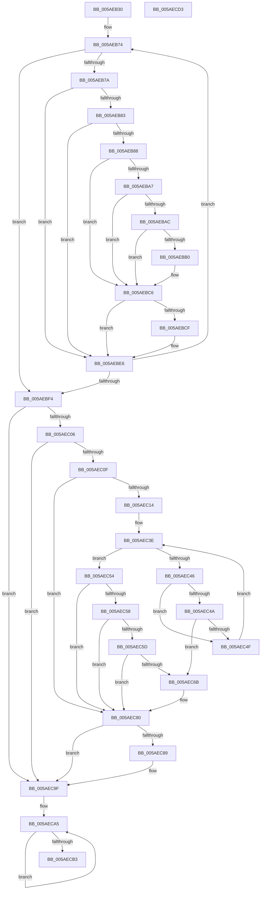

# _asan_wrap_strcpy

- RVA: `0x005AEB30`–`0x005AECD4` (길이 `420` bytes)
- VA: `0x00000001405AEB30`
- 실행 섹션: `.text`
- PDB 이름 있음: `예`; PDB Function 태그: `아니요`
- unwind 정보 RVA: `0x0008C20C`
- 디코드: `122`개 명령, `420/420` bytes 표시
- 미해석 바이트: `0` (있으면 어셈블리에 `.byte`로 보존)

> 이 문서는 커널 이미지의 기계어와 PDB 기호를 분석해 생성했습니다. 4번과 5번은 함수 원형과 자료형을 바이너리 사용 방식에서 추정한 C 해석이며 원본 소스 복구 결과는 아닙니다.

## 1. Dependencies

- 직접 호출 지점: **4**; 고유 호출 대상: **2**
- 직접 호출자로 확인된 함수: **0**
- RIP 상대 이미지 참조: **3**

### Outgoing calls
- `0x005AEBC1` → [KasaniReport](KasaniReport_function_005AB0B0.md) (function, `0x005AB0B0`)
- `0x005AEBE1` → [KcsanValidateAddress](KcsanValidateAddress_function_005AF5E0.md) (function, `0x005AF5E0`)
- `0x005AEC7B` → [KasaniReport](KasaniReport_function_005AB0B0.md) (function, `0x005AB0B0`)
- `0x005AEC9A` → [KcsanValidateAddress](KcsanValidateAddress_function_005AF5E0.md) (function, `0x005AF5E0`)

### Direct callers
- 이 함수 시작 RVA로 연결되는 직접 call은 확인되지 않았습니다. 간접 호출은 완전히 역산할 수 없습니다.

### Static image references
- `0x005AEB7A` → RVA `0x00FCEC6A` (`ALMOSTRO`; read)
- `0x005AEB88` → RVA `0x00FC6ED8` (`ALMOSTRO`; read)
- `0x005AEBC6` → RVA `0x00F8A7E8` (`.data`; read)

## 2. Other-region calls and transfers

- 다른 실행 섹션으로 향하는 call: **0**
- 별도 외부 분기/꼬리 이동을 확인하지 못했습니다.

## 3. Assembly (complete function range)

```asm
005AEB30  48 89 5C 24 08                  mov qword ptr [rsp + 8], rbx
005AEB35  48 89 6C 24 10                  mov qword ptr [rsp + 0x10], rbp
005AEB3A  48 89 74 24 18                  mov qword ptr [rsp + 0x18], rsi
005AEB3F  57                              push rdi
005AEB40  41 54                           push r12
005AEB42  41 55                           push r13
005AEB44  41 56                           push r14
005AEB46  41 57                           push r15
005AEB48  48 83 EC 30                     sub rsp, 0x30
005AEB4C  48 8B 6C 24 58                  mov rbp, qword ptr [rsp + 0x58]
005AEB51  49 BD 00 00 00 00 00 80 00 00   movabs r13, 0x800000000000
005AEB5B  48 8B FA                        mov rdi, rdx
005AEB5E  48 8B F1                        mov rsi, rcx
005AEB61  4C 8B F2                        mov r14, rdx
005AEB64  33 DB                           xor ebx, ebx
005AEB66  49 BC 00 00 00 00 00 80 FF FF   movabs r12, 0xffff800000000000
005AEB70  4E 8D 3C 2A                     lea r15, [rdx + r13]
005AEB74  48 83 FB FF                     cmp rbx, -1
005AEB78  73 7A                           jae 0x1405aebf4
005AEB7A  80 3D E9 00 A2 00 00            cmp byte ptr [rip + 0xa200e9], 0
005AEB81  74 63                           je 0x1405aebe6
005AEB83  4D 3B F4                        cmp r14, r12
005AEB86  72 5E                           jb 0x1405aebe6
005AEB88  48 8B 05 49 83 A1 00            mov rax, qword ptr [rip + 0xa18349]
005AEB8F  49 8D 0C 1F                     lea rcx, [r15 + rbx]
005AEB93  48 C1 E9 03                     shr rcx, 3
005AEB97  0F B6 14 01                     movzx edx, byte ptr [rcx + rax]
005AEB9B  41 0F B6 C6                     movzx eax, r14b
005AEB9F  24 07                           and al, 7
005AEBA1  FE C0                           inc al
005AEBA3  84 D2                           test dl, dl
005AEBA5  74 1F                           je 0x1405aebc6
005AEBA7  80 FA 08                        cmp dl, 8
005AEBAA  7D 1A                           jge 0x1405aebc6
005AEBAC  3A C2                           cmp al, dl
005AEBAE  7E 16                           jle 0x1405aebc6
005AEBB0  45 33 C0                        xor r8d, r8d
005AEBB3  88 54 24 20                     mov byte ptr [rsp + 0x20], dl
005AEBB7  4C 8B CD                        mov r9, rbp
005AEBBA  49 8B CE                        mov rcx, r14
005AEBBD  41 8D 50 01                     lea edx, [r8 + 1]
005AEBC1  E8 EA C4 FF FF                  call 0x1405ab0b0
005AEBC6  80 3D 1B BC 9D 00 00            cmp byte ptr [rip + 0x9dbc1b], 0
005AEBCD  74 17                           je 0x1405aebe6
005AEBCF  45 33 C9                        xor r9d, r9d
005AEBD2  48 89 6C 24 20                  mov qword ptr [rsp + 0x20], rbp
005AEBD7  45 33 C0                        xor r8d, r8d
005AEBDA  49 8B CE                        mov rcx, r14
005AEBDD  41 8D 51 01                     lea edx, [r9 + 1]
005AEBE1  E8 FA 09 00 00                  call 0x1405af5e0
005AEBE6  41 0F B6 06                     movzx eax, byte ptr [r14]
005AEBEA  48 FF C3                        inc rbx
005AEBED  49 FF C6                        inc r14
005AEBF0  84 C0                           test al, al
005AEBF2  75 80                           jne 0x1405aeb74
005AEBF4  80 3D 6F 00 A2 00 00            cmp byte ptr [rip + 0xa2006f], 0
005AEBFB  48 8B 6C 24 58                  mov rbp, qword ptr [rsp + 0x58]
005AEC00  0F 84 99 00 00 00               je 0x1405aec9f
005AEC06  49 3B F4                        cmp rsi, r12
005AEC09  0F 82 90 00 00 00               jb 0x1405aec9f
005AEC0F  48 85 DB                        test rbx, rbx
005AEC12  74 6C                           je 0x1405aec80
005AEC14  49 B8 FF FF FF FF FF 7F 00 00   movabs r8, 0x7fffffffffff
005AEC1E  4A 8D 14 2E                     lea rdx, [rsi + r13]
005AEC22  4C 03 C3                        add r8, rbx
005AEC25  48 C1 EA 03                     shr rdx, 3
005AEC29  48 03 15 A8 82 A1 00            add rdx, qword ptr [rip + 0xa182a8]
005AEC30  4C 03 C6                        add r8, rsi
005AEC33  49 C1 E8 03                     shr r8, 3
005AEC37  4C 03 05 9A 82 A1 00            add r8, qword ptr [rip + 0xa1829a]
005AEC3E  0F B6 0A                        movzx ecx, byte ptr [rdx]
005AEC41  49 3B D0                        cmp rdx, r8
005AEC44  73 0E                           jae 0x1405aec54
005AEC46  84 C9                           test cl, cl
005AEC48  74 05                           je 0x1405aec4f
005AEC4A  80 F9 08                        cmp cl, 8
005AEC4D  7C 1C                           jl 0x1405aec6b
005AEC4F  48 FF C2                        inc rdx
005AEC52  EB EA                           jmp 0x1405aec3e
005AEC54  84 C9                           test cl, cl
005AEC56  74 28                           je 0x1405aec80
005AEC58  80 F9 08                        cmp cl, 8
005AEC5B  7D 23                           jge 0x1405aec80
005AEC5D  8D 43 FF                        lea eax, [rbx - 1]
005AEC60  40 02 C6                        add al, sil
005AEC63  24 07                           and al, 7
005AEC65  FE C0                           inc al
005AEC67  3A C1                           cmp al, cl
005AEC69  7E 15                           jle 0x1405aec80
005AEC6B  88 4C 24 20                     mov byte ptr [rsp + 0x20], cl
005AEC6F  4C 8B CD                        mov r9, rbp
005AEC72  48 8B CE                        mov rcx, rsi
005AEC75  41 B0 01                        mov r8b, 1
005AEC78  48 8B D3                        mov rdx, rbx
005AEC7B  E8 30 C4 FF FF                  call 0x1405ab0b0
005AEC80  80 3D 61 BB 9D 00 00            cmp byte ptr [rip + 0x9dbb61], 0
005AEC87  74 16                           je 0x1405aec9f
005AEC89  45 33 C9                        xor r9d, r9d
005AEC8C  48 89 6C 24 20                  mov qword ptr [rsp + 0x20], rbp
005AEC91  41 B0 01                        mov r8b, 1
005AEC94  48 8B D3                        mov rdx, rbx
005AEC97  48 8B CE                        mov rcx, rsi
005AEC9A  E8 41 09 00 00                  call 0x1405af5e0
005AEC9F  48 8B CE                        mov rcx, rsi
005AECA2  48 2B CF                        sub rcx, rdi
005AECA5  0F B6 07                        movzx eax, byte ptr [rdi]
005AECA8  88 04 39                        mov byte ptr [rcx + rdi], al
005AECAB  48 8D 7F 01                     lea rdi, [rdi + 1]
005AECAF  84 C0                           test al, al
005AECB1  75 F2                           jne 0x1405aeca5
005AECB3  48 8B 5C 24 60                  mov rbx, qword ptr [rsp + 0x60]
005AECB8  48 8B C6                        mov rax, rsi
005AECBB  48 8B 74 24 70                  mov rsi, qword ptr [rsp + 0x70]
005AECC0  48 8B 6C 24 68                  mov rbp, qword ptr [rsp + 0x68]
005AECC5  48 83 C4 30                     add rsp, 0x30
005AECC9  41 5F                           pop r15
005AECCB  41 5E                           pop r14
005AECCD  41 5D                           pop r13
005AECCF  41 5C                           pop r12
005AECD1  5F                              pop rdi
005AECD2  C3                              ret
005AECD3  CC                              int3
```

## 4. C-style interpretation (structured pseudocode)

```c
__int64 __fastcall _asan_wrap_strcpy(__int64 a1, __int64 a2, int a3)
{
    __int64 result;
    __int64 v_r14;
    __int64 v_rbx;
    __int64 v_rsp;
    unsigned __int8 v_stack_m38;
    unsigned __int64 v_stack_p0;
    unsigned __int64 v_stack_p10;
    unsigned __int64 v_stack_p18;
    unsigned __int64 v_stack_p8;

    v_stack_p8 = v_rbx;
    v_stack_p10 = v_rbp;
    v_stack_p18 = v_rsi;
    v_rsp = (v_rsp) - (48);
    v_rbx = 0;
loc_005AEB74:
    if (0 >= -1) goto loc_005AEBF4;
    if ((*(unsigned __int8 *)(v_rip + 10617065)) == 0) goto loc_005AEBE6;
    if (a2 < v_r12) goto loc_005AEBE6;
    a1 = (a2 + v_r13 * 1 + v_rbx * 1) >> (3);
    result = (unsigned __int8)(((unsigned __int8)(a2)) & (7));
    result = (unsigned __int8)((result) + 1);
    if ((unsigned __int8)(*(unsigned __int8 *)(a1 + *(unsigned __int64 *)(v_rip + 10584905) * 1)) == 0) goto loc_005AEBC6;
    if (((unsigned __int8)(*(unsigned __int8 *)(a1 + *(unsigned __int64 *)(v_rip + 10584905) * 1))) >= 8) goto loc_005AEBC6;
    if (((unsigned __int8)(result)) >= = ((unsigned __int8)(*(unsigned __int8 *)(a1 + *(unsigned __int64 *)(v_rip + 10584905) * 1)))) {
        a3 = 0;
        v_stack_m38 = (unsigned __int8)(*(unsigned __int8 *)(a1 + *(unsigned __int64 *)(v_rip + 10584905) * 1));
        a4 = v_stack_p0;
        a1 = a2;
        a2 = a3 + 1;
        result = KasaniReport(a1, a2, a3, a4);
    }
    if ((*(unsigned __int8 *)(v_rip + 10337307)) != 0) {
        a4 = 0;
        v_stack_m38 = v_stack_p0;
        a3 = 0;
        a1 = a2;
        a2 = a4 + 1;
        result = KcsanValidateAddress(a1, a2, a3, a4);
    }
    v_rbx = (v_rbx) + 1;
    v_r14 = (a2) + 1;
    if ((unsigned __int8)(*(unsigned __int8 *)(a2)) != 0) goto loc_005AEB74;
loc_005AEBF4:
    if ((*(unsigned __int8 *)(v_rip + 10616943)) == 0) goto loc_005AEC9F;
    if (a1 < v_r12) goto loc_005AEC9F;
    if (v_rbx == 0) goto loc_005AEC80;
    a3 = (a3) + (v_rbx);
    a2 = (a1 + v_r13 * 1) >> (3);
    a2 = (a2) + (*(unsigned __int64 *)(v_rip + 10584744));
    a3 = (a3) + (a1);
    a3 = (a3) >> (3);
    a3 = (a3) + (*(unsigned __int64 *)(v_rip + 10584730));
loc_005AEC3E:
    if (a2 >= a3) goto loc_005AEC54;
    if ((unsigned __int8)(*(unsigned __int8 *)(a2)) == 0) goto loc_005AEC4F;
    if (((unsigned __int8)(*(unsigned __int8 *)(a2))) < 8) goto loc_005AEC6B;
loc_005AEC4F:
    a2 = (a2) + 1;
    goto loc_005AEC3E;
loc_005AEC54:
    if ((unsigned __int8)(*(unsigned __int8 *)(a2)) == 0) goto loc_005AEC80;
    if (((unsigned __int8)(*(unsigned __int8 *)(a2))) >= 8) goto loc_005AEC80;
    result = (unsigned __int8)((v_rbx - 1) + ((unsigned __int8)(a1)));
    result = (unsigned __int8)((result) & (7));
    result = (unsigned __int8)((result) + 1);
    if (((unsigned __int8)(result)) >= = ((unsigned __int8)(*(unsigned __int8 *)(a2)))) {
        v_stack_m38 = (unsigned __int8)(*(unsigned __int8 *)(a2));
        a4 = v_stack_p0;
        a1 = a1;
        a3 = 1;
        a2 = v_rbx;
        result = KasaniReport(a1, a2, a3, a4);
    }
    if ((*(unsigned __int8 *)(v_rip + 10337121)) != 0) {
        a4 = 0;
        v_stack_m38 = v_stack_p0;
        a3 = 1;
        a2 = v_rbx;
        a1 = a1;
        result = KcsanValidateAddress(a1, a2, a3, a4);
    }
    a1 = (a1) - (a2);
loc_005AECA5:
    *(unsigned __int8 *)(a1 + a2 * 1) = (unsigned __int8)(*(unsigned __int8 *)(a2));
    if ((unsigned __int8)(*(unsigned __int8 *)(a2)) != 0) goto loc_005AECA5;
    v_rsp = (v_rsp) + (48);
    return a1;
}
```

## 5. (Beta) C Style

```c
int64_t _asan_wrap_strcpy(int64_t Arg1, void *Arg2, int32_t Arg3)
{
    uint8_t *arg2 = (uint8_t *)Arg2;

    int64_t result;
    int64_t local_r14;
    int64_t local_rbx;
    int64_t local_rsp;
    uint8_t v_stack_m38;
    uint64_t v_stack_p0;
    uint64_t v_stack_p10;
    uint64_t v_stack_p18;
    uint64_t v_stack_p8;

    v_stack_p8 = local_rbx;
    v_stack_p10 = local_rbp;
    v_stack_p18 = local_rsi;
    local_rsp = (local_rsp) - (48);
    local_rbx = 0;
loc_005AEB74:
    if (0 >= -1) goto loc_005AEBF4;
    if ((*(uint8_t *)(v_rip + 0xA200E9)) == 0) goto loc_005AEBE6;
    if (Arg2 < local_r12) goto loc_005AEBE6;
    Arg1 = (Arg2 + local_r13 * 1 + local_rbx * 1) >> (3);
    result = (uint8_t)(((uint8_t)(Arg2)) & (7));
    result = (uint8_t)((result) + 1);
    if ((uint8_t)(*(uint8_t *)(Arg1 + *(uint64_t *)(v_rip + 0xA18349) * 1)) == 0) goto loc_005AEBC6;
    if (((uint8_t)(*(uint8_t *)(Arg1 + *(uint64_t *)(v_rip + 0xA18349) * 1))) >= 8) goto loc_005AEBC6;
    if (((uint8_t)(result)) >= = ((uint8_t)(*(uint8_t *)(Arg1 + *(uint64_t *)(v_rip + 0xA18349) * 1)))) {
        Arg3 = 0;
        v_stack_m38 = (uint8_t)(*(uint8_t *)(Arg1 + *(uint64_t *)(v_rip + 0xA18349) * 1));
        a4 = v_stack_p0;
        Arg1 = Arg2;
        Arg2 = Arg3 + 1;
        result = KasaniReport(Arg1, Arg2, Arg3, a4);
    }
    if ((*(uint8_t *)(v_rip + 0x9DBC1B)) != 0) {
        a4 = 0;
        v_stack_m38 = v_stack_p0;
        Arg3 = 0;
        Arg1 = Arg2;
        Arg2 = a4 + 1;
        result = KcsanValidateAddress(Arg1, Arg2, Arg3, a4);
    }
    local_rbx = (local_rbx) + 1;
    local_r14 = (Arg2) + 1;
    if ((uint8_t)(*(uint8_t *)(arg2)) != 0) goto loc_005AEB74;
loc_005AEBF4:
    if ((*(uint8_t *)(v_rip + 0xA2006F)) == 0) goto loc_005AEC9F;
    if (Arg1 < local_r12) goto loc_005AEC9F;
    if (local_rbx == 0) goto loc_005AEC80;
    Arg3 = (Arg3) + (local_rbx);
    Arg2 = (Arg1 + local_r13 * 1) >> (3);
    Arg2 = (Arg2) + (*(uint64_t *)(v_rip + 0xA182A8));
    Arg3 = (Arg3) + (Arg1);
    Arg3 = (Arg3) >> (3);
    Arg3 = (Arg3) + (*(uint64_t *)(v_rip + 0xA1829A));
loc_005AEC3E:
    if (Arg2 >= Arg3) goto loc_005AEC54;
    if ((uint8_t)(*(uint8_t *)(arg2)) == 0) goto loc_005AEC4F;
    if (((uint8_t)(*(uint8_t *)(arg2))) < 8) goto loc_005AEC6B;
loc_005AEC4F:
    Arg2 = (Arg2) + 1;
    goto loc_005AEC3E;
loc_005AEC54:
    if ((uint8_t)(*(uint8_t *)(arg2)) == 0) goto loc_005AEC80;
    if (((uint8_t)(*(uint8_t *)(arg2))) >= 8) goto loc_005AEC80;
    result = (uint8_t)((local_rbx - 1) + ((uint8_t)(Arg1)));
    result = (uint8_t)((result) & (7));
    result = (uint8_t)((result) + 1);
    if (((uint8_t)(result)) >= = ((uint8_t)(*(uint8_t *)(arg2)))) {
        v_stack_m38 = (uint8_t)(*(uint8_t *)(arg2));
        a4 = v_stack_p0;
        Arg1 = Arg1;
        Arg3 = 1;
        Arg2 = local_rbx;
        result = KasaniReport(Arg1, Arg2, Arg3, a4);
    }
    if ((*(uint8_t *)(v_rip + 0x9DBB61)) != 0) {
        a4 = 0;
        v_stack_m38 = v_stack_p0;
        Arg3 = 1;
        Arg2 = local_rbx;
        Arg1 = Arg1;
        result = KcsanValidateAddress(Arg1, Arg2, Arg3, a4);
    }
    Arg1 = (Arg1) - (Arg2);
loc_005AECA5:
    *(uint8_t *)(Arg1 + arg2 * 1) = (uint8_t)(*(uint8_t *)(arg2));
    if ((uint8_t)(*(uint8_t *)(arg2)) != 0) goto loc_005AECA5;
    local_rsp = (local_rsp) + (48);
    return Arg1;
}
```

### 관측된 메모리 오프셋

구조체 형식이 확인되지 않은 접근은 인자 기준의 오프셋으로만 기록했습니다.

| 기준 인자 | 오프셋 표현 | 폭 (bit) | 접근 |
|---|---:|---:|---|
| `Arg2` | `+ 0x0` | `8` | `R` |
| `Arg2` | `+ 0x0 + r13*1` | `64` | `R` |
| `Arg2` | `+ 0x0 + rbx*1` | `64` | `R` |
| `Arg2` | `+ 0x1` | `64` | `R` |

## 6. Execution-region graph

[열기: 2D/3D 그래프와 함수 탐색 컨트롤 패널](../../../control-panel.html?section=text&rva=0x005AEB30&view=graph)

- 2D 그래프는 위에서 아래로 흐르고, 3D 그래프는 빈 공간을 드래그해 회전합니다. Shift+드래그는 이동, 휠은 확대·축소, 함수 노드 선택은 대상 보고서 이동입니다.

### Static fallback


