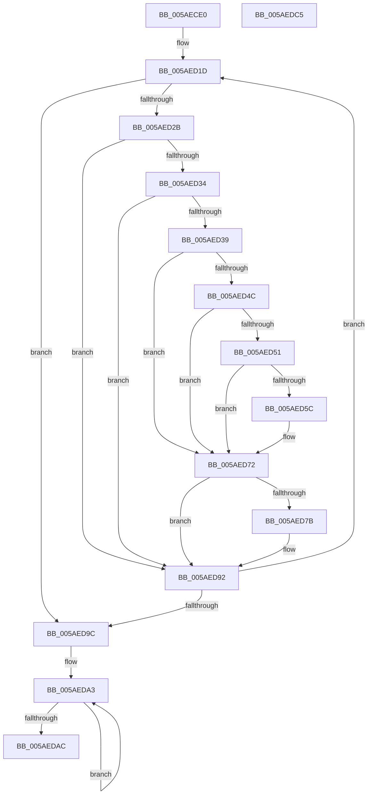

# _asan_wrap_strlen

- RVA: `0x005AECE0`–`0x005AEDC6` (길이 `230` bytes)
- VA: `0x00000001405AECE0`
- 실행 섹션: `.text`
- PDB 이름 있음: `예`; PDB Function 태그: `아니요`
- unwind 정보 RVA: `0x00084C9C`
- 디코드: `65`개 명령, `230/230` bytes 표시
- 미해석 바이트: `0` (있으면 어셈블리에 `.byte`로 보존)

> 이 문서는 커널 이미지의 기계어와 PDB 기호를 분석해 생성했습니다. 4번과 5번은 함수 원형과 자료형을 바이너리 사용 방식에서 추정한 C 해석이며 원본 소스 복구 결과는 아닙니다.

## 1. Dependencies

- 직접 호출 지점: **2**; 고유 호출 대상: **2**
- 직접 호출자로 확인된 함수: **0**
- RIP 상대 이미지 참조: **3**

### Outgoing calls
- `0x005AED6D` → [KasaniReport](KasaniReport_function_005AB0B0.md) (function, `0x005AB0B0`)
- `0x005AED8D` → [KcsanValidateAddress](KcsanValidateAddress_function_005AF5E0.md) (function, `0x005AF5E0`)

### Direct callers
- 이 함수 시작 RVA로 연결되는 직접 call은 확인되지 않았습니다. 간접 호출은 완전히 역산할 수 없습니다.

### Static image references
- `0x005AED2B` → RVA `0x00FCEC6A` (`ALMOSTRO`; read)
- `0x005AED39` → RVA `0x00FC6ED8` (`ALMOSTRO`; read)
- `0x005AED72` → RVA `0x00F8A7E8` (`.data`; read)

## 2. Other-region calls and transfers

- 다른 실행 섹션으로 향하는 call: **0**
- 별도 외부 분기/꼬리 이동을 확인하지 못했습니다.

## 3. Assembly (complete function range)

```asm
005AECE0  48 89 5C 24 08                  mov qword ptr [rsp + 8], rbx
005AECE5  48 89 6C 24 10                  mov qword ptr [rsp + 0x10], rbp
005AECEA  48 89 74 24 18                  mov qword ptr [rsp + 0x18], rsi
005AECEF  57                              push rdi
005AECF0  41 56                           push r14
005AECF2  41 57                           push r15
005AECF4  48 83 EC 30                     sub rsp, 0x30
005AECF8  48 8B 6C 24 48                  mov rbp, qword ptr [rsp + 0x48]
005AECFD  49 BE 00 00 00 00 00 80 FF FF   movabs r14, 0xffff800000000000
005AED07  49 8B F6                        mov rsi, r14
005AED0A  48 8B F9                        mov rdi, rcx
005AED0D  48 2B F1                        sub rsi, rcx
005AED10  48 8B D9                        mov rbx, rcx
005AED13  49 BF 00 00 00 00 00 80 00 00   movabs r15, 0x800000000000
005AED1D  4A 8D 0C 3B                     lea rcx, [rbx + r15]
005AED21  48 8D 04 0E                     lea rax, [rsi + rcx]
005AED25  48 83 F8 FF                     cmp rax, -1
005AED29  73 71                           jae 0x1405aed9c
005AED2B  80 3D 38 FF A1 00 00            cmp byte ptr [rip + 0xa1ff38], 0
005AED32  74 5E                           je 0x1405aed92
005AED34  49 3B DE                        cmp rbx, r14
005AED37  72 59                           jb 0x1405aed92
005AED39  48 8B 05 98 81 A1 00            mov rax, qword ptr [rip + 0xa18198]
005AED40  48 C1 E9 03                     shr rcx, 3
005AED44  0F B6 0C 01                     movzx ecx, byte ptr [rcx + rax]
005AED48  84 C9                           test cl, cl
005AED4A  74 26                           je 0x1405aed72
005AED4C  80 F9 08                        cmp cl, 8
005AED4F  7D 21                           jge 0x1405aed72
005AED51  0F B6 C3                        movzx eax, bl
005AED54  24 07                           and al, 7
005AED56  FE C0                           inc al
005AED58  3A C1                           cmp al, cl
005AED5A  7E 16                           jle 0x1405aed72
005AED5C  45 33 C0                        xor r8d, r8d
005AED5F  88 4C 24 20                     mov byte ptr [rsp + 0x20], cl
005AED63  4C 8B CD                        mov r9, rbp
005AED66  48 8B CB                        mov rcx, rbx
005AED69  41 8D 50 01                     lea edx, [r8 + 1]
005AED6D  E8 3E C3 FF FF                  call 0x1405ab0b0
005AED72  80 3D 6F BA 9D 00 00            cmp byte ptr [rip + 0x9dba6f], 0
005AED79  74 17                           je 0x1405aed92
005AED7B  45 33 C9                        xor r9d, r9d
005AED7E  48 89 6C 24 20                  mov qword ptr [rsp + 0x20], rbp
005AED83  45 33 C0                        xor r8d, r8d
005AED86  48 8B CB                        mov rcx, rbx
005AED89  41 8D 51 01                     lea edx, [r9 + 1]
005AED8D  E8 4E 08 00 00                  call 0x1405af5e0
005AED92  0F B6 03                        movzx eax, byte ptr [rbx]
005AED95  48 FF C3                        inc rbx
005AED98  84 C0                           test al, al
005AED9A  75 81                           jne 0x1405aed1d
005AED9C  48 C7 C0 FF FF FF FF            mov rax, 0xffffffffffffffff
005AEDA3  48 FF C0                        inc rax
005AEDA6  80 3C 07 00                     cmp byte ptr [rdi + rax], 0
005AEDAA  75 F7                           jne 0x1405aeda3
005AEDAC  48 8B 5C 24 50                  mov rbx, qword ptr [rsp + 0x50]
005AEDB1  48 8B 6C 24 58                  mov rbp, qword ptr [rsp + 0x58]
005AEDB6  48 8B 74 24 60                  mov rsi, qword ptr [rsp + 0x60]
005AEDBB  48 83 C4 30                     add rsp, 0x30
005AEDBF  41 5F                           pop r15
005AEDC1  41 5E                           pop r14
005AEDC3  5F                              pop rdi
005AEDC4  C3                              ret
005AEDC5  CC                              int3
```

## 4. C-style interpretation (structured pseudocode)

```c
__int64 __fastcall _asan_wrap_strlen(__int64 a1, __int64 a2, int a3)
{
    __int64 result;
    __int64 v_rbx;
    __int64 v_rsi;
    __int64 v_rsp;
    unsigned __int8 v_stack_m28;
    unsigned __int64 v_stack_p0;
    unsigned __int64 v_stack_p10;
    unsigned __int64 v_stack_p18;
    unsigned __int64 v_stack_p8;

    v_stack_p8 = v_rbx;
    v_stack_p10 = v_rbp;
    v_stack_p18 = v_rsi;
    v_rsp = (v_rsp) - (48);
    v_rsi = (v_r14) - (a1);
loc_005AED1D:
    if ((v_rsi + a1 + v_r15 * 1 * 1) >= -1) goto loc_005AED9C;
    if ((*(unsigned __int8 *)(v_rip + 10616632)) == 0) goto loc_005AED92;
    if (a1 < v_r14) goto loc_005AED92;
    a1 = (a1 + v_r15 * 1) >> (3);
    if ((unsigned __int8)(*(unsigned __int8 *)(a1 + *(unsigned __int64 *)(v_rip + 10584472) * 1)) == 0) goto loc_005AED72;
    if (((unsigned __int8)(*(unsigned __int8 *)(a1 + *(unsigned __int64 *)(v_rip + 10584472) * 1))) >= 8) goto loc_005AED72;
    result = (unsigned __int8)(((unsigned __int8)(a1)) & (7));
    result = (unsigned __int8)((result) + 1);
    if (((unsigned __int8)(result)) >= = ((unsigned __int8)(*(unsigned __int8 *)(a1 + *(unsigned __int64 *)(v_rip + 10584472) * 1)))) {
        a3 = 0;
        v_stack_m28 = (unsigned __int8)(*(unsigned __int8 *)(a1 + *(unsigned __int64 *)(v_rip + 10584472) * 1));
        a4 = v_stack_p0;
        a1 = a1;
        a2 = a3 + 1;
        result = KasaniReport(a1, a2, a3, a4);
    }
    if ((*(unsigned __int8 *)(v_rip + 10336879)) != 0) {
        a4 = 0;
        v_stack_m28 = v_stack_p0;
        a3 = 0;
        a1 = a1;
        a2 = a4 + 1;
        result = KcsanValidateAddress(a1, a2, a3, a4);
    }
    v_rbx = (a1) + 1;
    if ((unsigned __int8)(*(unsigned __int8 *)(a1)) != 0) goto loc_005AED1D;
loc_005AED9C:
loc_005AEDA3:
    result = (-1) + 1;
    if ((*(unsigned __int8 *)(a1 + result * 1)) != 0) goto loc_005AEDA3;
    v_rsp = (v_rsp) + (48);
    return result;
}
```

## 5. (Beta) C Style

```c
int64_t _asan_wrap_strlen(void *Arg1, int64_t Arg2, int32_t Arg3)
{
    uint8_t *arg1 = (uint8_t *)Arg1;

    int64_t result;
    int64_t local_rbx;
    int64_t local_rsi;
    int64_t local_rsp;
    uint8_t v_stack_m28;
    uint64_t v_stack_p0;
    uint64_t v_stack_p10;
    uint64_t v_stack_p18;
    uint64_t v_stack_p8;

    v_stack_p8 = local_rbx;
    v_stack_p10 = local_rbp;
    v_stack_p18 = local_rsi;
    local_rsp = (local_rsp) - (48);
    local_rsi = (local_r14) - (Arg1);
loc_005AED1D:
    if ((local_rsi + Arg1 + local_r15 * 1 * 1) >= -1) goto loc_005AED9C;
    if ((*(uint8_t *)(v_rip + 0xA1FF38)) == 0) goto loc_005AED92;
    if (Arg1 < local_r14) goto loc_005AED92;
    Arg1 = (Arg1 + local_r15 * 1) >> (3);
    if ((uint8_t)(*(uint8_t *)(arg1 + *(uint64_t *)(v_rip + 0xA18198) * 1)) == 0) goto loc_005AED72;
    if (((uint8_t)(*(uint8_t *)(arg1 + *(uint64_t *)(v_rip + 0xA18198) * 1))) >= 8) goto loc_005AED72;
    result = (uint8_t)(((uint8_t)(Arg1)) & (7));
    result = (uint8_t)((result) + 1);
    if (((uint8_t)(result)) >= = ((uint8_t)(*(uint8_t *)(arg1 + *(uint64_t *)(v_rip + 0xA18198) * 1)))) {
        Arg3 = 0;
        v_stack_m28 = (uint8_t)(*(uint8_t *)(arg1 + *(uint64_t *)(v_rip + 0xA18198) * 1));
        a4 = v_stack_p0;
        Arg1 = Arg1;
        Arg2 = Arg3 + 1;
        result = KasaniReport(Arg1, Arg2, Arg3, a4);
    }
    if ((*(uint8_t *)(v_rip + 0x9DBA6F)) != 0) {
        a4 = 0;
        v_stack_m28 = v_stack_p0;
        Arg3 = 0;
        Arg1 = Arg1;
        Arg2 = a4 + 1;
        result = KcsanValidateAddress(Arg1, Arg2, Arg3, a4);
    }
    local_rbx = (Arg1) + 1;
    if ((uint8_t)(*(uint8_t *)(arg1)) != 0) goto loc_005AED1D;
loc_005AED9C:
loc_005AEDA3:
    result = (-1) + 1;
    if ((*(uint8_t *)(arg1 + result * 1)) != 0) goto loc_005AEDA3;
    local_rsp = (local_rsp) + (48);
    return result;
}
```

### 관측된 메모리 오프셋

구조체 형식이 확인되지 않은 접근은 인자 기준의 오프셋으로만 기록했습니다.

| 기준 인자 | 오프셋 표현 | 폭 (bit) | 접근 |
|---|---:|---:|---|
| `Arg1` | `+ 0x0 + rax*1` | `8` | `R` |

## 6. Execution-region graph

[열기: 2D/3D 그래프와 함수 탐색 컨트롤 패널](../../../control-panel.html?section=text&rva=0x005AECE0&view=graph)

- 2D 그래프는 위에서 아래로 흐르고, 3D 그래프는 빈 공간을 드래그해 회전합니다. Shift+드래그는 이동, 휠은 확대·축소, 함수 노드 선택은 대상 보고서 이동입니다.

### Static fallback


