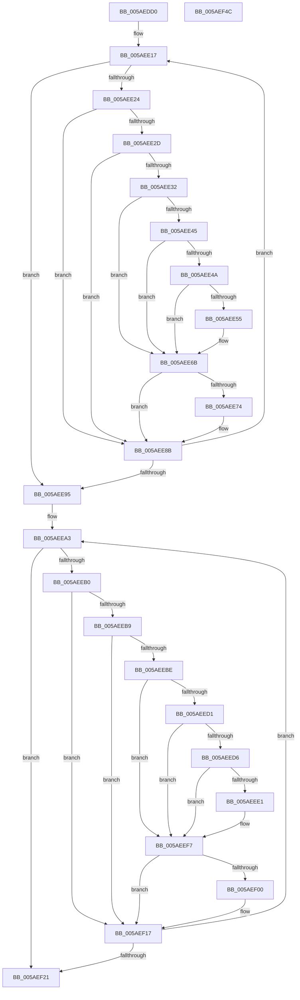

# _asan_wrap_strncmp

- RVA: `0x005AEDD0`–`0x005AEF4D` (길이 `381` bytes)
- VA: `0x00000001405AEDD0`
- 실행 섹션: `.text`
- PDB 이름 있음: `예`; PDB Function 태그: `아니요`
- unwind 정보 RVA: `0x0008C20C`
- 디코드: `113`개 명령, `381/381` bytes 표시
- 미해석 바이트: `0` (있으면 어셈블리에 `.byte`로 보존)

> 이 문서는 커널 이미지의 기계어와 PDB 기호를 분석해 생성했습니다. 4번과 5번은 함수 원형과 자료형을 바이너리 사용 방식에서 추정한 C 해석이며 원본 소스 복구 결과는 아닙니다.

## 1. Dependencies

- 직접 호출 지점: **5**; 고유 호출 대상: **3**
- 직접 호출자로 확인된 함수: **0**
- RIP 상대 이미지 참조: **3**

### Outgoing calls
- `0x005AEE66` → [KasaniReport](KasaniReport_function_005AB0B0.md) (function, `0x005AB0B0`)
- `0x005AEE86` → [KcsanValidateAddress](KcsanValidateAddress_function_005AF5E0.md) (function, `0x005AF5E0`)
- `0x005AEEF2` → [KasaniReport](KasaniReport_function_005AB0B0.md) (function, `0x005AB0B0`)
- `0x005AEF12` → [KcsanValidateAddress](KcsanValidateAddress_function_005AF5E0.md) (function, `0x005AF5E0`)
- `0x005AEF2A` → [strncmp](../6C/strncmp_function_006C6720.md) (function, `0x006C6720`)

### Direct callers
- 이 함수 시작 RVA로 연결되는 직접 call은 확인되지 않았습니다. 간접 호출은 완전히 역산할 수 없습니다.

### Static image references
- `0x005AEE24` → RVA `0x00FCEC6A` (`ALMOSTRO`; read)
- `0x005AEE32` → RVA `0x00FC6ED8` (`ALMOSTRO`; read)
- `0x005AEE6B` → RVA `0x00F8A7E8` (`.data`; read)

## 2. Other-region calls and transfers

- 다른 실행 섹션으로 향하는 call: **0**
- 별도 외부 분기/꼬리 이동을 확인하지 못했습니다.

## 3. Assembly (complete function range)

```asm
005AEDD0  48 89 5C 24 08                  mov qword ptr [rsp + 8], rbx
005AEDD5  48 89 6C 24 10                  mov qword ptr [rsp + 0x10], rbp
005AEDDA  48 89 74 24 18                  mov qword ptr [rsp + 0x18], rsi
005AEDDF  57                              push rdi
005AEDE0  41 54                           push r12
005AEDE2  41 55                           push r13
005AEDE4  41 56                           push r14
005AEDE6  41 57                           push r15
005AEDE8  48 83 EC 30                     sub rsp, 0x30
005AEDEC  48 8B 74 24 58                  mov rsi, qword ptr [rsp + 0x58]
005AEDF1  49 BC 00 00 00 00 00 80 FF FF   movabs r12, 0xffff800000000000
005AEDFB  49 8B FC                        mov rdi, r12
005AEDFE  4D 8B F0                        mov r14, r8
005AEE01  48 2B F9                        sub rdi, rcx
005AEE04  48 8B EA                        mov rbp, rdx
005AEE07  4C 8B F9                        mov r15, rcx
005AEE0A  48 8B D9                        mov rbx, rcx
005AEE0D  49 BD 00 00 00 00 00 80 00 00   movabs r13, 0x800000000000
005AEE17  4A 8D 0C 2B                     lea rcx, [rbx + r13]
005AEE1B  48 8D 04 0F                     lea rax, [rdi + rcx]
005AEE1F  49 3B C6                        cmp rax, r14
005AEE22  73 71                           jae 0x1405aee95
005AEE24  80 3D 3F FE A1 00 00            cmp byte ptr [rip + 0xa1fe3f], 0
005AEE2B  74 5E                           je 0x1405aee8b
005AEE2D  49 3B DC                        cmp rbx, r12
005AEE30  72 59                           jb 0x1405aee8b
005AEE32  48 8B 05 9F 80 A1 00            mov rax, qword ptr [rip + 0xa1809f]
005AEE39  48 C1 E9 03                     shr rcx, 3
005AEE3D  0F B6 0C 01                     movzx ecx, byte ptr [rcx + rax]
005AEE41  84 C9                           test cl, cl
005AEE43  74 26                           je 0x1405aee6b
005AEE45  80 F9 08                        cmp cl, 8
005AEE48  7D 21                           jge 0x1405aee6b
005AEE4A  0F B6 C3                        movzx eax, bl
005AEE4D  24 07                           and al, 7
005AEE4F  FE C0                           inc al
005AEE51  3A C1                           cmp al, cl
005AEE53  7E 16                           jle 0x1405aee6b
005AEE55  45 33 C0                        xor r8d, r8d
005AEE58  88 4C 24 20                     mov byte ptr [rsp + 0x20], cl
005AEE5C  4C 8B CE                        mov r9, rsi
005AEE5F  48 8B CB                        mov rcx, rbx
005AEE62  41 8D 50 01                     lea edx, [r8 + 1]
005AEE66  E8 45 C2 FF FF                  call 0x1405ab0b0
005AEE6B  80 3D 76 B9 9D 00 00            cmp byte ptr [rip + 0x9db976], 0
005AEE72  74 17                           je 0x1405aee8b
005AEE74  45 33 C9                        xor r9d, r9d
005AEE77  48 89 74 24 20                  mov qword ptr [rsp + 0x20], rsi
005AEE7C  45 33 C0                        xor r8d, r8d
005AEE7F  48 8B CB                        mov rcx, rbx
005AEE82  41 8D 51 01                     lea edx, [r9 + 1]
005AEE86  E8 55 07 00 00                  call 0x1405af5e0
005AEE8B  0F B6 03                        movzx eax, byte ptr [rbx]
005AEE8E  48 FF C3                        inc rbx
005AEE91  84 C0                           test al, al
005AEE93  75 82                           jne 0x1405aee17
005AEE95  48 8B 74 24 58                  mov rsi, qword ptr [rsp + 0x58]
005AEE9A  49 8B FC                        mov rdi, r12
005AEE9D  48 2B FD                        sub rdi, rbp
005AEEA0  48 8B DD                        mov rbx, rbp
005AEEA3  4A 8D 0C 2B                     lea rcx, [rbx + r13]
005AEEA7  48 8D 04 0F                     lea rax, [rdi + rcx]
005AEEAB  49 3B C6                        cmp rax, r14
005AEEAE  73 71                           jae 0x1405aef21
005AEEB0  80 3D B3 FD A1 00 00            cmp byte ptr [rip + 0xa1fdb3], 0
005AEEB7  74 5E                           je 0x1405aef17
005AEEB9  49 3B DC                        cmp rbx, r12
005AEEBC  72 59                           jb 0x1405aef17
005AEEBE  48 8B 05 13 80 A1 00            mov rax, qword ptr [rip + 0xa18013]
005AEEC5  48 C1 E9 03                     shr rcx, 3
005AEEC9  0F B6 0C 01                     movzx ecx, byte ptr [rcx + rax]
005AEECD  84 C9                           test cl, cl
005AEECF  74 26                           je 0x1405aeef7
005AEED1  80 F9 08                        cmp cl, 8
005AEED4  7D 21                           jge 0x1405aeef7
005AEED6  0F B6 C3                        movzx eax, bl
005AEED9  24 07                           and al, 7
005AEEDB  FE C0                           inc al
005AEEDD  3A C1                           cmp al, cl
005AEEDF  7E 16                           jle 0x1405aeef7
005AEEE1  45 33 C0                        xor r8d, r8d
005AEEE4  88 4C 24 20                     mov byte ptr [rsp + 0x20], cl
005AEEE8  4C 8B CE                        mov r9, rsi
005AEEEB  48 8B CB                        mov rcx, rbx
005AEEEE  41 8D 50 01                     lea edx, [r8 + 1]
005AEEF2  E8 B9 C1 FF FF                  call 0x1405ab0b0
005AEEF7  80 3D EA B8 9D 00 00            cmp byte ptr [rip + 0x9db8ea], 0
005AEEFE  74 17                           je 0x1405aef17
005AEF00  45 33 C9                        xor r9d, r9d
005AEF03  48 89 74 24 20                  mov qword ptr [rsp + 0x20], rsi
005AEF08  45 33 C0                        xor r8d, r8d
005AEF0B  48 8B CB                        mov rcx, rbx
005AEF0E  41 8D 51 01                     lea edx, [r9 + 1]
005AEF12  E8 C9 06 00 00                  call 0x1405af5e0
005AEF17  0F B6 03                        movzx eax, byte ptr [rbx]
005AEF1A  48 FF C3                        inc rbx
005AEF1D  84 C0                           test al, al
005AEF1F  75 82                           jne 0x1405aeea3
005AEF21  4D 8B C6                        mov r8, r14
005AEF24  48 8B D5                        mov rdx, rbp
005AEF27  49 8B CF                        mov rcx, r15
005AEF2A  E8 F1 77 11 00                  call 0x1406c6720
005AEF2F  48 8B 5C 24 60                  mov rbx, qword ptr [rsp + 0x60]
005AEF34  48 8B 6C 24 68                  mov rbp, qword ptr [rsp + 0x68]
005AEF39  48 8B 74 24 70                  mov rsi, qword ptr [rsp + 0x70]
005AEF3E  48 83 C4 30                     add rsp, 0x30
005AEF42  41 5F                           pop r15
005AEF44  41 5E                           pop r14
005AEF46  41 5D                           pop r13
005AEF48  41 5C                           pop r12
005AEF4A  5F                              pop rdi
005AEF4B  C3                              ret
005AEF4C  CC                              int3
```

## 4. C-style interpretation (structured pseudocode)

```c
__int64 __fastcall _asan_wrap_strncmp(__int64 a1, __int64 a2, __int64 a3)
{
    __int64 result;
    __int64 v_rbx;
    __int64 v_rdi;
    __int64 v_rsp;
    unsigned __int8 v_stack_m38;
    unsigned __int64 v_stack_p0;
    unsigned __int64 v_stack_p10;
    unsigned __int64 v_stack_p18;
    unsigned __int64 v_stack_p8;

    v_stack_p8 = v_rbx;
    v_stack_p10 = v_rbp;
    v_stack_p18 = v_rsi;
    v_rsp = (v_rsp) - (48);
    v_rdi = (v_r12) - (a1);
loc_005AEE17:
    if ((v_rdi + a1 + v_r13 * 1 * 1) >= a3) goto loc_005AEE95;
    if ((*(unsigned __int8 *)(v_rip + 10616383)) == 0) goto loc_005AEE8B;
    if (a1 < v_r12) goto loc_005AEE8B;
    a1 = (a1 + v_r13 * 1) >> (3);
    if ((unsigned __int8)(*(unsigned __int8 *)(a1 + *(unsigned __int64 *)(v_rip + 10584223) * 1)) == 0) goto loc_005AEE6B;
    if (((unsigned __int8)(*(unsigned __int8 *)(a1 + *(unsigned __int64 *)(v_rip + 10584223) * 1))) >= 8) goto loc_005AEE6B;
    result = (unsigned __int8)(((unsigned __int8)(a1)) & (7));
    result = (unsigned __int8)((result) + 1);
    if (((unsigned __int8)(result)) >= = ((unsigned __int8)(*(unsigned __int8 *)(a1 + *(unsigned __int64 *)(v_rip + 10584223) * 1)))) {
        a3 = 0;
        v_stack_m38 = (unsigned __int8)(*(unsigned __int8 *)(a1 + *(unsigned __int64 *)(v_rip + 10584223) * 1));
        a4 = v_stack_p0;
        a1 = a1;
        a2 = a3 + 1;
        result = KasaniReport(a1, a2, a3, a4);
    }
    if ((*(unsigned __int8 *)(v_rip + 10336630)) != 0) {
        a4 = 0;
        v_stack_m38 = v_stack_p0;
        a3 = 0;
        a1 = a1;
        a2 = a4 + 1;
        result = KcsanValidateAddress(a1, a2, a3, a4);
    }
    v_rbx = (a1) + 1;
    if ((unsigned __int8)(*(unsigned __int8 *)(a1)) != 0) goto loc_005AEE17;
loc_005AEE95:
    v_rdi = (v_r12) - (a2);
loc_005AEEA3:
    if ((v_rdi + a2 + v_r13 * 1 * 1) >= 0) goto loc_005AEF21;
    if ((*(unsigned __int8 *)(v_rip + 10616243)) == 0) goto loc_005AEF17;
    if (a2 < v_r12) goto loc_005AEF17;
    a1 = (a2 + v_r13 * 1) >> (3);
    if ((unsigned __int8)(*(unsigned __int8 *)(a1 + *(unsigned __int64 *)(v_rip + 10584083) * 1)) == 0) goto loc_005AEEF7;
    if (((unsigned __int8)(*(unsigned __int8 *)(a1 + *(unsigned __int64 *)(v_rip + 10584083) * 1))) >= 8) goto loc_005AEEF7;
    result = (unsigned __int8)(((unsigned __int8)(a2)) & (7));
    result = (unsigned __int8)((result) + 1);
    if (((unsigned __int8)(result)) >= = ((unsigned __int8)(*(unsigned __int8 *)(a1 + *(unsigned __int64 *)(v_rip + 10584083) * 1)))) {
        a3 = 0;
        v_stack_m38 = (unsigned __int8)(*(unsigned __int8 *)(a1 + *(unsigned __int64 *)(v_rip + 10584083) * 1));
        a4 = v_stack_p0;
        a1 = a2;
        a2 = a3 + 1;
        result = KasaniReport(a1, a2, a3, a4);
    }
    if ((*(unsigned __int8 *)(v_rip + 10336490)) != 0) {
        a4 = 0;
        v_stack_m38 = v_stack_p0;
        a3 = 0;
        a1 = a2;
        a2 = a4 + 1;
        result = KcsanValidateAddress(a1, a2, a3, a4);
    }
    v_rbx = (a2) + 1;
    if ((unsigned __int8)(*(unsigned __int8 *)(a2)) != 0) goto loc_005AEEA3;
loc_005AEF21:
    result = strncmp(a1, a2, 0, a4);
    v_rsp = (v_rsp) + (48);
    return result;
}
```

## 5. (Beta) C Style

```c
int64_t _asan_wrap_strncmp(int64_t Arg1, int64_t Arg2, int64_t Arg3)
{
    int64_t result;
    int64_t local_rbx;
    int64_t local_rdi;
    int64_t local_rsp;
    uint8_t v_stack_m38;
    uint64_t v_stack_p0;
    uint64_t v_stack_p10;
    uint64_t v_stack_p18;
    uint64_t v_stack_p8;

    v_stack_p8 = local_rbx;
    v_stack_p10 = local_rbp;
    v_stack_p18 = local_rsi;
    local_rsp = (local_rsp) - (48);
    local_rdi = (local_r12) - (Arg1);
loc_005AEE17:
    if ((local_rdi + Arg1 + local_r13 * 1 * 1) >= Arg3) goto loc_005AEE95;
    if ((*(uint8_t *)(v_rip + 0xA1FE3F)) == 0) goto loc_005AEE8B;
    if (Arg1 < local_r12) goto loc_005AEE8B;
    Arg1 = (Arg1 + local_r13 * 1) >> (3);
    if ((uint8_t)(*(uint8_t *)(Arg1 + *(uint64_t *)(v_rip + 0xA1809F) * 1)) == 0) goto loc_005AEE6B;
    if (((uint8_t)(*(uint8_t *)(Arg1 + *(uint64_t *)(v_rip + 0xA1809F) * 1))) >= 8) goto loc_005AEE6B;
    result = (uint8_t)(((uint8_t)(Arg1)) & (7));
    result = (uint8_t)((result) + 1);
    if (((uint8_t)(result)) >= = ((uint8_t)(*(uint8_t *)(Arg1 + *(uint64_t *)(v_rip + 0xA1809F) * 1)))) {
        Arg3 = 0;
        v_stack_m38 = (uint8_t)(*(uint8_t *)(Arg1 + *(uint64_t *)(v_rip + 0xA1809F) * 1));
        a4 = v_stack_p0;
        Arg1 = Arg1;
        Arg2 = Arg3 + 1;
        result = KasaniReport(Arg1, Arg2, Arg3, a4);
    }
    if ((*(uint8_t *)(v_rip + 0x9DB976)) != 0) {
        a4 = 0;
        v_stack_m38 = v_stack_p0;
        Arg3 = 0;
        Arg1 = Arg1;
        Arg2 = a4 + 1;
        result = KcsanValidateAddress(Arg1, Arg2, Arg3, a4);
    }
    local_rbx = (Arg1) + 1;
    if ((uint8_t)(*(uint8_t *)(Arg1)) != 0) goto loc_005AEE17;
loc_005AEE95:
    local_rdi = (local_r12) - (Arg2);
loc_005AEEA3:
    if ((local_rdi + Arg2 + local_r13 * 1 * 1) >= 0) goto loc_005AEF21;
    if ((*(uint8_t *)(v_rip + 0xA1FDB3)) == 0) goto loc_005AEF17;
    if (Arg2 < local_r12) goto loc_005AEF17;
    Arg1 = (Arg2 + local_r13 * 1) >> (3);
    if ((uint8_t)(*(uint8_t *)(Arg1 + *(uint64_t *)(v_rip + 0xA18013) * 1)) == 0) goto loc_005AEEF7;
    if (((uint8_t)(*(uint8_t *)(Arg1 + *(uint64_t *)(v_rip + 0xA18013) * 1))) >= 8) goto loc_005AEEF7;
    result = (uint8_t)(((uint8_t)(Arg2)) & (7));
    result = (uint8_t)((result) + 1);
    if (((uint8_t)(result)) >= = ((uint8_t)(*(uint8_t *)(Arg1 + *(uint64_t *)(v_rip + 0xA18013) * 1)))) {
        Arg3 = 0;
        v_stack_m38 = (uint8_t)(*(uint8_t *)(Arg1 + *(uint64_t *)(v_rip + 0xA18013) * 1));
        a4 = v_stack_p0;
        Arg1 = Arg2;
        Arg2 = Arg3 + 1;
        result = KasaniReport(Arg1, Arg2, Arg3, a4);
    }
    if ((*(uint8_t *)(v_rip + 0x9DB8EA)) != 0) {
        a4 = 0;
        v_stack_m38 = v_stack_p0;
        Arg3 = 0;
        Arg1 = Arg2;
        Arg2 = a4 + 1;
        result = KcsanValidateAddress(Arg1, Arg2, Arg3, a4);
    }
    local_rbx = (Arg2) + 1;
    if ((uint8_t)(*(uint8_t *)(Arg2)) != 0) goto loc_005AEEA3;
loc_005AEF21:
    result = strncmp(Arg1, Arg2, 0, a4);
    local_rsp = (local_rsp) + (48);
    return result;
}
```

## 6. Execution-region graph

[열기: 2D/3D 그래프와 함수 탐색 컨트롤 패널](../../../control-panel.html?section=text&rva=0x005AEDD0&view=graph)

- 2D 그래프는 위에서 아래로 흐르고, 3D 그래프는 빈 공간을 드래그해 회전합니다. Shift+드래그는 이동, 휠은 확대·축소, 함수 노드 선택은 대상 보고서 이동입니다.

### Static fallback


