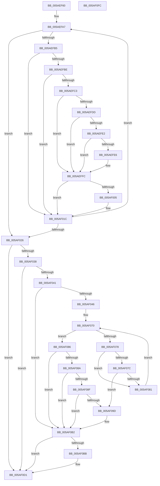

# _asan_wrap_strncpy

- RVA: `0x005AEF60`–`0x005AF0FD` (길이 `413` bytes)
- VA: `0x00000001405AEF60`
- 실행 섹션: `.text`
- PDB 이름 있음: `예`; PDB Function 태그: `아니요`
- unwind 정보 RVA: `0x0008C20C`
- 디코드: `119`개 명령, `413/413` bytes 표시
- 미해석 바이트: `0` (있으면 어셈블리에 `.byte`로 보존)

> 이 문서는 커널 이미지의 기계어와 PDB 기호를 분석해 생성했습니다. 4번과 5번은 함수 원형과 자료형을 바이너리 사용 방식에서 추정한 C 해석이며 원본 소스 복구 결과는 아닙니다.

## 1. Dependencies

- 직접 호출 지점: **5**; 고유 호출 대상: **3**
- 직접 호출자로 확인된 함수: **0**
- RIP 상대 이미지 참조: **3**

### Outgoing calls
- `0x005AEFF7` → [KasaniReport](KasaniReport_function_005AB0B0.md) (function, `0x005AB0B0`)
- `0x005AF017` → [KcsanValidateAddress](KcsanValidateAddress_function_005AF5E0.md) (function, `0x005AF5E0`)
- `0x005AF0AD` → [KasaniReport](KasaniReport_function_005AB0B0.md) (function, `0x005AB0B0`)
- `0x005AF0CC` → [KcsanValidateAddress](KcsanValidateAddress_function_005AF5E0.md) (function, `0x005AF5E0`)
- `0x005AF0DA` → [strncpy](../6C/strncpy_function_006C7360.md) (function, `0x006C7360`)

### Direct callers
- 이 함수 시작 RVA로 연결되는 직접 call은 확인되지 않았습니다. 간접 호출은 완전히 역산할 수 없습니다.

### Static image references
- `0x005AEFB5` → RVA `0x00FCEC6A` (`ALMOSTRO`; read)
- `0x005AEFC3` → RVA `0x00FC6ED8` (`ALMOSTRO`; read)
- `0x005AEFFC` → RVA `0x00F8A7E8` (`.data`; read)

## 2. Other-region calls and transfers

- 다른 실행 섹션으로 향하는 call: **0**
- 별도 외부 분기/꼬리 이동을 확인하지 못했습니다.

## 3. Assembly (complete function range)

```asm
005AEF60  48 89 5C 24 08                  mov qword ptr [rsp + 8], rbx
005AEF65  48 89 6C 24 10                  mov qword ptr [rsp + 0x10], rbp
005AEF6A  48 89 74 24 18                  mov qword ptr [rsp + 0x18], rsi
005AEF6F  57                              push rdi
005AEF70  41 54                           push r12
005AEF72  41 55                           push r13
005AEF74  41 56                           push r14
005AEF76  41 57                           push r15
005AEF78  48 83 EC 30                     sub rsp, 0x30
005AEF7C  48 8B 6C 24 58                  mov rbp, qword ptr [rsp + 0x58]
005AEF81  49 BC 00 00 00 00 00 80 FF FF   movabs r12, 0xffff800000000000
005AEF8B  4D 8B F4                        mov r14, r12
005AEF8E  49 8B F0                        mov rsi, r8
005AEF91  4C 2B F2                        sub r14, rdx
005AEF94  4C 8B FA                        mov r15, rdx
005AEF97  48 8B F9                        mov rdi, rcx
005AEF9A  48 8B DA                        mov rbx, rdx
005AEF9D  49 BD 00 00 00 00 00 80 00 00   movabs r13, 0x800000000000
005AEFA7  4A 8D 0C 2B                     lea rcx, [rbx + r13]
005AEFAB  49 8D 04 0E                     lea rax, [r14 + rcx]
005AEFAF  48 83 F8 FF                     cmp rax, -1
005AEFB3  73 71                           jae 0x1405af026
005AEFB5  80 3D AE FC A1 00 00            cmp byte ptr [rip + 0xa1fcae], 0
005AEFBC  74 5E                           je 0x1405af01c
005AEFBE  49 3B DC                        cmp rbx, r12
005AEFC1  72 59                           jb 0x1405af01c
005AEFC3  48 8B 05 0E 7F A1 00            mov rax, qword ptr [rip + 0xa17f0e]
005AEFCA  48 C1 E9 03                     shr rcx, 3
005AEFCE  0F B6 0C 01                     movzx ecx, byte ptr [rcx + rax]
005AEFD2  0F B6 C3                        movzx eax, bl
005AEFD5  24 07                           and al, 7
005AEFD7  FE C0                           inc al
005AEFD9  84 C9                           test cl, cl
005AEFDB  74 1F                           je 0x1405aeffc
005AEFDD  80 F9 08                        cmp cl, 8
005AEFE0  7D 1A                           jge 0x1405aeffc
005AEFE2  3A C1                           cmp al, cl
005AEFE4  7E 16                           jle 0x1405aeffc
005AEFE6  45 33 C0                        xor r8d, r8d
005AEFE9  88 4C 24 20                     mov byte ptr [rsp + 0x20], cl
005AEFED  4C 8B CD                        mov r9, rbp
005AEFF0  48 8B CB                        mov rcx, rbx
005AEFF3  41 8D 50 01                     lea edx, [r8 + 1]
005AEFF7  E8 B4 C0 FF FF                  call 0x1405ab0b0
005AEFFC  80 3D E5 B7 9D 00 00            cmp byte ptr [rip + 0x9db7e5], 0
005AF003  74 17                           je 0x1405af01c
005AF005  45 33 C9                        xor r9d, r9d
005AF008  48 89 6C 24 20                  mov qword ptr [rsp + 0x20], rbp
005AF00D  45 33 C0                        xor r8d, r8d
005AF010  48 8B CB                        mov rcx, rbx
005AF013  41 8D 51 01                     lea edx, [r9 + 1]
005AF017  E8 C4 05 00 00                  call 0x1405af5e0
005AF01C  0F B6 03                        movzx eax, byte ptr [rbx]
005AF01F  48 FF C3                        inc rbx
005AF022  84 C0                           test al, al
005AF024  75 81                           jne 0x1405aefa7
005AF026  80 3D 3D FC A1 00 00            cmp byte ptr [rip + 0xa1fc3d], 0
005AF02D  48 8B 5C 24 58                  mov rbx, qword ptr [rsp + 0x58]
005AF032  0F 84 99 00 00 00               je 0x1405af0d1
005AF038  49 3B FC                        cmp rdi, r12
005AF03B  0F 82 90 00 00 00               jb 0x1405af0d1
005AF041  48 85 F6                        test rsi, rsi
005AF044  74 6C                           je 0x1405af0b2
005AF046  49 B8 FF FF FF FF FF 7F 00 00   movabs r8, 0x7fffffffffff
005AF050  4A 8D 14 2F                     lea rdx, [rdi + r13]
005AF054  4C 03 C7                        add r8, rdi
005AF057  48 C1 EA 03                     shr rdx, 3
005AF05B  48 03 15 76 7E A1 00            add rdx, qword ptr [rip + 0xa17e76]
005AF062  4C 03 C6                        add r8, rsi
005AF065  49 C1 E8 03                     shr r8, 3
005AF069  4C 03 05 68 7E A1 00            add r8, qword ptr [rip + 0xa17e68]
005AF070  0F B6 0A                        movzx ecx, byte ptr [rdx]
005AF073  49 3B D0                        cmp rdx, r8
005AF076  73 0E                           jae 0x1405af086
005AF078  84 C9                           test cl, cl
005AF07A  74 05                           je 0x1405af081
005AF07C  80 F9 08                        cmp cl, 8
005AF07F  7C 1C                           jl 0x1405af09d
005AF081  48 FF C2                        inc rdx
005AF084  EB EA                           jmp 0x1405af070
005AF086  84 C9                           test cl, cl
005AF088  74 28                           je 0x1405af0b2
005AF08A  80 F9 08                        cmp cl, 8
005AF08D  7D 23                           jge 0x1405af0b2
005AF08F  8D 47 FF                        lea eax, [rdi - 1]
005AF092  40 02 C6                        add al, sil
005AF095  24 07                           and al, 7
005AF097  FE C0                           inc al
005AF099  3A C1                           cmp al, cl
005AF09B  7E 15                           jle 0x1405af0b2
005AF09D  88 4C 24 20                     mov byte ptr [rsp + 0x20], cl
005AF0A1  4C 8B CB                        mov r9, rbx
005AF0A4  48 8B CF                        mov rcx, rdi
005AF0A7  41 B0 01                        mov r8b, 1
005AF0AA  48 8B D6                        mov rdx, rsi
005AF0AD  E8 FE BF FF FF                  call 0x1405ab0b0
005AF0B2  80 3D 2F B7 9D 00 00            cmp byte ptr [rip + 0x9db72f], 0
005AF0B9  74 16                           je 0x1405af0d1
005AF0BB  45 33 C9                        xor r9d, r9d
005AF0BE  48 89 5C 24 20                  mov qword ptr [rsp + 0x20], rbx
005AF0C3  41 B0 01                        mov r8b, 1
005AF0C6  48 8B D6                        mov rdx, rsi
005AF0C9  48 8B CF                        mov rcx, rdi
005AF0CC  E8 0F 05 00 00                  call 0x1405af5e0
005AF0D1  4C 8B C6                        mov r8, rsi
005AF0D4  49 8B D7                        mov rdx, r15
005AF0D7  48 8B CF                        mov rcx, rdi
005AF0DA  E8 81 82 11 00                  call 0x1406c7360
005AF0DF  48 8B 5C 24 60                  mov rbx, qword ptr [rsp + 0x60]
005AF0E4  48 8B 6C 24 68                  mov rbp, qword ptr [rsp + 0x68]
005AF0E9  48 8B 74 24 70                  mov rsi, qword ptr [rsp + 0x70]
005AF0EE  48 83 C4 30                     add rsp, 0x30
005AF0F2  41 5F                           pop r15
005AF0F4  41 5E                           pop r14
005AF0F6  41 5D                           pop r13
005AF0F8  41 5C                           pop r12
005AF0FA  5F                              pop rdi
005AF0FB  C3                              ret
005AF0FC  CC                              int3
```

## 4. C-style interpretation (structured pseudocode)

```c
__int64 __fastcall _asan_wrap_strncpy(__int64 a1, __int64 a2, __int64 a3)
{
    __int64 result;
    __int64 v_r14;
    __int64 v_rbx;
    __int64 v_rsp;
    unsigned __int8 v_stack_m38;
    unsigned __int64 v_stack_p0;
    unsigned __int64 v_stack_p10;
    unsigned __int64 v_stack_p18;
    unsigned __int64 v_stack_p8;

    v_stack_p8 = v_rbx;
    v_stack_p10 = v_rbp;
    v_stack_p18 = v_rsi;
    v_rsp = (v_rsp) - (48);
    v_r14 = (v_r12) - (a2);
loc_005AEFA7:
    if ((v_r14 + a2 + v_r13 * 1 * 1) >= -1) goto loc_005AF026;
    if ((*(unsigned __int8 *)(v_rip + 10615982)) == 0) goto loc_005AF01C;
    if (a2 < v_r12) goto loc_005AF01C;
    a1 = (a2 + v_r13 * 1) >> (3);
    result = (unsigned __int8)(((unsigned __int8)(a2)) & (7));
    result = (unsigned __int8)((result) + 1);
    if ((unsigned __int8)(*(unsigned __int8 *)(a1 + *(unsigned __int64 *)(v_rip + 10583822) * 1)) == 0) goto loc_005AEFFC;
    if (((unsigned __int8)(*(unsigned __int8 *)(a1 + *(unsigned __int64 *)(v_rip + 10583822) * 1))) >= 8) goto loc_005AEFFC;
    if (((unsigned __int8)(result)) >= = ((unsigned __int8)(*(unsigned __int8 *)(a1 + *(unsigned __int64 *)(v_rip + 10583822) * 1)))) {
        a3 = 0;
        v_stack_m38 = (unsigned __int8)(*(unsigned __int8 *)(a1 + *(unsigned __int64 *)(v_rip + 10583822) * 1));
        a4 = v_stack_p0;
        a1 = a2;
        a2 = a3 + 1;
        result = KasaniReport(a1, a2, a3, a4);
    }
    if ((*(unsigned __int8 *)(v_rip + 10336229)) != 0) {
        a4 = 0;
        v_stack_m38 = v_stack_p0;
        a3 = 0;
        a1 = a2;
        a2 = a4 + 1;
        result = KcsanValidateAddress(a1, a2, a3, a4);
    }
    v_rbx = (a2) + 1;
    if ((unsigned __int8)(*(unsigned __int8 *)(a2)) != 0) goto loc_005AEFA7;
loc_005AF026:
    if ((*(unsigned __int8 *)(v_rip + 10615869)) == 0) goto loc_005AF0D1;
    if (a1 < v_r12) goto loc_005AF0D1;
    if (0 == 0) goto loc_005AF0B2;
    a3 = (a3) + (a1);
    a2 = (a1 + v_r13 * 1) >> (3);
    a2 = (a2) + (*(unsigned __int64 *)(v_rip + 10583670));
    a3 = (a3) + (a3);
    a3 = (a3) >> (3);
    a3 = (a3) + (*(unsigned __int64 *)(v_rip + 10583656));
loc_005AF070:
    if (a2 >= a3) goto loc_005AF086;
    if ((unsigned __int8)(*(unsigned __int8 *)(a2)) == 0) goto loc_005AF081;
    if (((unsigned __int8)(*(unsigned __int8 *)(a2))) < 8) goto loc_005AF09D;
loc_005AF081:
    a2 = (a2) + 1;
    goto loc_005AF070;
loc_005AF086:
    if ((unsigned __int8)(*(unsigned __int8 *)(a2)) == 0) goto loc_005AF0B2;
    if (((unsigned __int8)(*(unsigned __int8 *)(a2))) >= 8) goto loc_005AF0B2;
    result = (unsigned __int8)((a1 - 1) + ((unsigned __int8)(a3)));
    result = (unsigned __int8)((result) & (7));
    result = (unsigned __int8)((result) + 1);
    if (((unsigned __int8)(result)) >= = ((unsigned __int8)(*(unsigned __int8 *)(a2)))) {
        v_stack_m38 = (unsigned __int8)(*(unsigned __int8 *)(a2));
        a4 = v_stack_p0;
        a1 = a1;
        a3 = 1;
        a2 = a3;
        result = KasaniReport(a1, a2, a3, a4);
    }
    if ((*(unsigned __int8 *)(v_rip + 10336047)) != 0) {
        a4 = 0;
        v_stack_m38 = v_stack_p0;
        a3 = 1;
        a2 = a3;
        a1 = a1;
        result = KcsanValidateAddress(a1, a2, a3, a4);
    }
    result = strncpy(a1, a2, a3, a4);
    v_rsp = (v_rsp) + (48);
    return result;
}
```

## 5. (Beta) C Style

```c
int64_t _asan_wrap_strncpy(int64_t Arg1, int64_t Arg2, int64_t Arg3)
{
    int64_t result;
    int64_t local_r14;
    int64_t local_rbx;
    int64_t local_rsp;
    uint8_t v_stack_m38;
    uint64_t v_stack_p0;
    uint64_t v_stack_p10;
    uint64_t v_stack_p18;
    uint64_t v_stack_p8;

    v_stack_p8 = local_rbx;
    v_stack_p10 = local_rbp;
    v_stack_p18 = local_rsi;
    local_rsp = (local_rsp) - (48);
    local_r14 = (local_r12) - (Arg2);
loc_005AEFA7:
    if ((local_r14 + Arg2 + local_r13 * 1 * 1) >= -1) goto loc_005AF026;
    if ((*(uint8_t *)(v_rip + 0xA1FCAE)) == 0) goto loc_005AF01C;
    if (Arg2 < local_r12) goto loc_005AF01C;
    Arg1 = (Arg2 + local_r13 * 1) >> (3);
    result = (uint8_t)(((uint8_t)(Arg2)) & (7));
    result = (uint8_t)((result) + 1);
    if ((uint8_t)(*(uint8_t *)(Arg1 + *(uint64_t *)(v_rip + 0xA17F0E) * 1)) == 0) goto loc_005AEFFC;
    if (((uint8_t)(*(uint8_t *)(Arg1 + *(uint64_t *)(v_rip + 0xA17F0E) * 1))) >= 8) goto loc_005AEFFC;
    if (((uint8_t)(result)) >= = ((uint8_t)(*(uint8_t *)(Arg1 + *(uint64_t *)(v_rip + 0xA17F0E) * 1)))) {
        Arg3 = 0;
        v_stack_m38 = (uint8_t)(*(uint8_t *)(Arg1 + *(uint64_t *)(v_rip + 0xA17F0E) * 1));
        a4 = v_stack_p0;
        Arg1 = Arg2;
        Arg2 = Arg3 + 1;
        result = KasaniReport(Arg1, Arg2, Arg3, a4);
    }
    if ((*(uint8_t *)(v_rip + 0x9DB7E5)) != 0) {
        a4 = 0;
        v_stack_m38 = v_stack_p0;
        Arg3 = 0;
        Arg1 = Arg2;
        Arg2 = a4 + 1;
        result = KcsanValidateAddress(Arg1, Arg2, Arg3, a4);
    }
    local_rbx = (Arg2) + 1;
    if ((uint8_t)(*(uint8_t *)(Arg2)) != 0) goto loc_005AEFA7;
loc_005AF026:
    if ((*(uint8_t *)(v_rip + 0xA1FC3D)) == 0) goto loc_005AF0D1;
    if (Arg1 < local_r12) goto loc_005AF0D1;
    if (0 == 0) goto loc_005AF0B2;
    Arg3 = (Arg3) + (Arg1);
    Arg2 = (Arg1 + local_r13 * 1) >> (3);
    Arg2 = (Arg2) + (*(uint64_t *)(v_rip + 0xA17E76));
    Arg3 = (Arg3) + (Arg3);
    Arg3 = (Arg3) >> (3);
    Arg3 = (Arg3) + (*(uint64_t *)(v_rip + 0xA17E68));
loc_005AF070:
    if (Arg2 >= Arg3) goto loc_005AF086;
    if ((uint8_t)(*(uint8_t *)(Arg2)) == 0) goto loc_005AF081;
    if (((uint8_t)(*(uint8_t *)(Arg2))) < 8) goto loc_005AF09D;
loc_005AF081:
    Arg2 = (Arg2) + 1;
    goto loc_005AF070;
loc_005AF086:
    if ((uint8_t)(*(uint8_t *)(Arg2)) == 0) goto loc_005AF0B2;
    if (((uint8_t)(*(uint8_t *)(Arg2))) >= 8) goto loc_005AF0B2;
    result = (uint8_t)((Arg1 - 1) + ((uint8_t)(Arg3)));
    result = (uint8_t)((result) & (7));
    result = (uint8_t)((result) + 1);
    if (((uint8_t)(result)) >= = ((uint8_t)(*(uint8_t *)(Arg2)))) {
        v_stack_m38 = (uint8_t)(*(uint8_t *)(Arg2));
        a4 = v_stack_p0;
        Arg1 = Arg1;
        Arg3 = 1;
        Arg2 = Arg3;
        result = KasaniReport(Arg1, Arg2, Arg3, a4);
    }
    if ((*(uint8_t *)(v_rip + 0x9DB72F)) != 0) {
        a4 = 0;
        v_stack_m38 = v_stack_p0;
        Arg3 = 1;
        Arg2 = Arg3;
        Arg1 = Arg1;
        result = KcsanValidateAddress(Arg1, Arg2, Arg3, a4);
    }
    result = strncpy(Arg1, Arg2, Arg3, a4);
    local_rsp = (local_rsp) + (48);
    return result;
}
```

## 6. Execution-region graph

[열기: 2D/3D 그래프와 함수 탐색 컨트롤 패널](../../../control-panel.html?section=text&rva=0x005AEF60&view=graph)

- 2D 그래프는 위에서 아래로 흐르고, 3D 그래프는 빈 공간을 드래그해 회전합니다. Shift+드래그는 이동, 휠은 확대·축소, 함수 노드 선택은 대상 보고서 이동입니다.

### Static fallback


