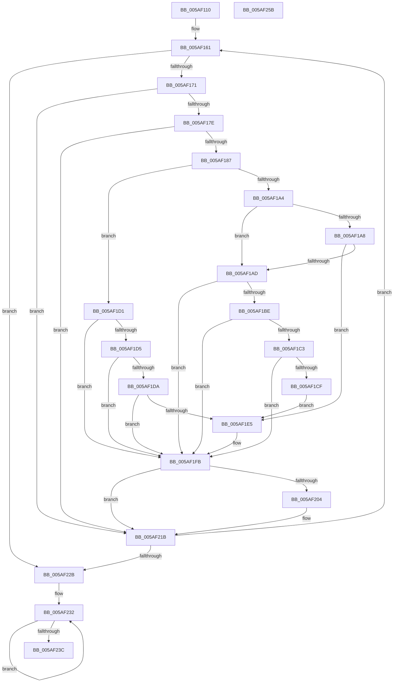

# _asan_wrap_wcslen

- RVA: `0x005AF110`–`0x005AF25C` (길이 `332` bytes)
- VA: `0x00000001405AF110`
- 실행 섹션: `.text`
- PDB 이름 있음: `예`; PDB Function 태그: `아니요`
- unwind 정보 RVA: `0x000C953C`
- 디코드: `91`개 명령, `332/332` bytes 표시
- 미해석 바이트: `0` (있으면 어셈블리에 `.byte`로 보존)

> 이 문서는 커널 이미지의 기계어와 PDB 기호를 분석해 생성했습니다. 4번과 5번은 함수 원형과 자료형을 바이너리 사용 방식에서 추정한 C 해석이며 원본 소스 복구 결과는 아닙니다.

## 1. Dependencies

- 직접 호출 지점: **2**; 고유 호출 대상: **2**
- 직접 호출자로 확인된 함수: **0**
- RIP 상대 이미지 참조: **3**

### Outgoing calls
- `0x005AF1F6` → [KasaniReport](KasaniReport_function_005AB0B0.md) (function, `0x005AB0B0`)
- `0x005AF216` → [KcsanValidateAddress](KcsanValidateAddress_function_005AF5E0.md) (function, `0x005AF5E0`)

### Direct callers
- 이 함수 시작 RVA로 연결되는 직접 call은 확인되지 않았습니다. 간접 호출은 완전히 역산할 수 없습니다.

### Static image references
- `0x005AF171` → RVA `0x00FCEC6A` (`ALMOSTRO`; read)
- `0x005AF187` → RVA `0x00FC6ED8` (`ALMOSTRO`; read)
- `0x005AF1FB` → RVA `0x00F8A7E8` (`.data`; read)

## 2. Other-region calls and transfers

- 다른 실행 섹션으로 향하는 call: **0**
- 별도 외부 분기/꼬리 이동을 확인하지 못했습니다.

## 3. Assembly (complete function range)

```asm
005AF110  48 89 5C 24 08                  mov qword ptr [rsp + 8], rbx
005AF115  48 89 6C 24 10                  mov qword ptr [rsp + 0x10], rbp
005AF11A  48 89 74 24 18                  mov qword ptr [rsp + 0x18], rsi
005AF11F  48 89 7C 24 20                  mov qword ptr [rsp + 0x20], rdi
005AF124  41 54                           push r12
005AF126  41 56                           push r14
005AF128  41 57                           push r15
005AF12A  48 83 EC 30                     sub rsp, 0x30
005AF12E  48 8B 74 24 48                  mov rsi, qword ptr [rsp + 0x48]
005AF133  4C 8D 79 01                     lea r15, [rcx + 1]
005AF137  48 BD 01 00 00 00 00 80 00 00   movabs rbp, 0x800000000001
005AF141  49 BE 00 00 00 00 00 80 00 00   movabs r14, 0x800000000000
005AF14B  48 03 E9                        add rbp, rcx
005AF14E  48 8B F9                        mov rdi, rcx
005AF151  4C 03 F1                        add r14, rcx
005AF154  48 8B D9                        mov rbx, rcx
005AF157  49 BC 00 00 00 00 00 80 FF FF   movabs r12, 0xffff800000000000
005AF161  48 8B D3                        mov rdx, rbx
005AF164  48 2B D7                        sub rdx, rdi
005AF167  48 83 FA FF                     cmp rdx, -1
005AF16B  0F 83 BA 00 00 00               jae 0x1405af22b
005AF171  80 3D F2 FA A1 00 00            cmp byte ptr [rip + 0xa1faf2], 0
005AF178  0F 84 9D 00 00 00               je 0x1405af21b
005AF17E  49 3B DC                        cmp rbx, r12
005AF181  0F 82 94 00 00 00               jb 0x1405af21b
005AF187  4C 8B 05 4A 7D A1 00            mov r8, qword ptr [rip + 0xa17d4a]
005AF18E  4A 8D 04 32                     lea rax, [rdx + r14]
005AF192  48 C1 E8 03                     shr rax, 3
005AF196  42 0F B6 0C 00                  movzx ecx, byte ptr [rax + r8]
005AF19B  8B C3                           mov eax, ebx
005AF19D  83 E0 07                        and eax, 7
005AF1A0  3C 06                           cmp al, 6
005AF1A2  76 2D                           jbe 0x1405af1d1
005AF1A4  84 C9                           test cl, cl
005AF1A6  74 05                           je 0x1405af1ad
005AF1A8  80 F9 08                        cmp cl, 8
005AF1AB  7C 38                           jl 0x1405af1e5
005AF1AD  48 8D 04 2A                     lea rax, [rdx + rbp]
005AF1B1  48 C1 E8 03                     shr rax, 3
005AF1B5  42 0F B6 0C 00                  movzx ecx, byte ptr [rax + r8]
005AF1BA  84 C9                           test cl, cl
005AF1BC  74 3D                           je 0x1405af1fb
005AF1BE  80 F9 08                        cmp cl, 8
005AF1C1  7D 38                           jge 0x1405af1fb
005AF1C3  41 02 D7                        add dl, r15b
005AF1C6  80 E2 07                        and dl, 7
005AF1C9  FE C2                           inc dl
005AF1CB  3A D1                           cmp dl, cl
005AF1CD  7E 2C                           jle 0x1405af1fb
005AF1CF  EB 14                           jmp 0x1405af1e5
005AF1D1  84 C9                           test cl, cl
005AF1D3  74 26                           je 0x1405af1fb
005AF1D5  80 F9 08                        cmp cl, 8
005AF1D8  7D 21                           jge 0x1405af1fb
005AF1DA  8D 43 01                        lea eax, [rbx + 1]
005AF1DD  24 07                           and al, 7
005AF1DF  FE C0                           inc al
005AF1E1  3A C1                           cmp al, cl
005AF1E3  7E 16                           jle 0x1405af1fb
005AF1E5  45 33 C0                        xor r8d, r8d
005AF1E8  88 4C 24 20                     mov byte ptr [rsp + 0x20], cl
005AF1EC  4C 8B CE                        mov r9, rsi
005AF1EF  48 8B CB                        mov rcx, rbx
005AF1F2  41 8D 50 02                     lea edx, [r8 + 2]
005AF1F6  E8 B5 BE FF FF                  call 0x1405ab0b0
005AF1FB  80 3D E6 B5 9D 00 00            cmp byte ptr [rip + 0x9db5e6], 0
005AF202  74 17                           je 0x1405af21b
005AF204  45 33 C9                        xor r9d, r9d
005AF207  48 89 74 24 20                  mov qword ptr [rsp + 0x20], rsi
005AF20C  45 33 C0                        xor r8d, r8d
005AF20F  48 8B CB                        mov rcx, rbx
005AF212  41 8D 51 02                     lea edx, [r9 + 2]
005AF216  E8 C5 03 00 00                  call 0x1405af5e0
005AF21B  0F B7 03                        movzx eax, word ptr [rbx]
005AF21E  48 83 C3 02                     add rbx, 2
005AF222  66 85 C0                        test ax, ax
005AF225  0F 85 36 FF FF FF               jne 0x1405af161
005AF22B  48 C7 C0 FF FF FF FF            mov rax, 0xffffffffffffffff
005AF232  48 FF C0                        inc rax
005AF235  66 83 3C 47 00                  cmp word ptr [rdi + rax*2], 0
005AF23A  75 F6                           jne 0x1405af232
005AF23C  48 8B 5C 24 50                  mov rbx, qword ptr [rsp + 0x50]
005AF241  48 8B 6C 24 58                  mov rbp, qword ptr [rsp + 0x58]
005AF246  48 8B 74 24 60                  mov rsi, qword ptr [rsp + 0x60]
005AF24B  48 8B 7C 24 68                  mov rdi, qword ptr [rsp + 0x68]
005AF250  48 83 C4 30                     add rsp, 0x30
005AF254  41 5F                           pop r15
005AF256  41 5E                           pop r14
005AF258  41 5C                           pop r12
005AF25A  C3                              ret
005AF25B  CC                              int3
```

## 4. C-style interpretation (structured pseudocode)

```c
__int64 __fastcall _asan_wrap_wcslen(__int64 a1)
{
    __int64 result;
    __int64 v_r14;
    __int64 v_rbp;
    __int64 v_rbx;
    __int64 v_rsp;
    unsigned __int8 v_stack_m28;
    unsigned __int64 v_stack_p0;
    unsigned __int64 v_stack_p10;
    unsigned __int64 v_stack_p18;
    unsigned __int64 v_stack_p20;
    unsigned __int64 v_stack_p8;

    v_stack_p8 = v_rbx;
    v_stack_p10 = v_rbp;
    v_stack_p18 = v_rsi;
    v_stack_p20 = v_rdi;
    v_rsp = (v_rsp) - (48);
    v_rbp = (v_rbp) + (a1);
    v_r14 = (v_r14) + (a1);
loc_005AF161:
    a2 = (a1) - (a1);
    if (a2 >= -1) goto loc_005AF22B;
    if ((*(unsigned __int8 *)(v_rip + 10615538)) == 0) goto loc_005AF21B;
    if (a1 < v_r12) goto loc_005AF21B;
    result = (a2 + v_r14 * 1) >> (3);
    result = (unsigned int)(((unsigned int)((unsigned int)(a1))) & (7));
    if (((unsigned __int8)(result)) <= 6) goto loc_005AF1D1;
    if ((unsigned __int8)(*(unsigned __int8 *)(result + *(unsigned __int64 *)(v_rip + 10583370) * 1)) == 0) goto loc_005AF1AD;
    if (((unsigned __int8)(*(unsigned __int8 *)(result + *(unsigned __int64 *)(v_rip + 10583370) * 1))) < 8) goto loc_005AF1E5;
loc_005AF1AD:
    result = (a2 + v_rbp * 1) >> (3);
    if ((unsigned __int8)(*(unsigned __int8 *)(result + *(unsigned __int64 *)(v_rip + 10583370) * 1)) == 0) goto loc_005AF1FB;
    if (((unsigned __int8)(*(unsigned __int8 *)(result + *(unsigned __int64 *)(v_rip + 10583370) * 1))) >= 8) goto loc_005AF1FB;
    a2 = (unsigned __int8)((a2) + ((unsigned __int8)(a1 + 1)));
    a2 = (unsigned __int8)((a2) & (7));
    a2 = (unsigned __int8)((a2) + 1);
    if (((unsigned __int8)(a2)) <= ((unsigned __int8)(*(unsigned __int8 *)(result + *(unsigned __int64 *)(v_rip + 10583370) * 1)))) goto loc_005AF1FB;
    goto loc_005AF1E5;
loc_005AF1D1:
    if ((unsigned __int8)(*(unsigned __int8 *)(result + *(unsigned __int64 *)(v_rip + 10583370) * 1)) == 0) goto loc_005AF1FB;
    if (((unsigned __int8)(*(unsigned __int8 *)(result + *(unsigned __int64 *)(v_rip + 10583370) * 1))) >= 8) goto loc_005AF1FB;
    result = (unsigned __int8)((a1 + 1) & (7));
    result = (unsigned __int8)((result) + 1);
    if (((unsigned __int8)(result)) >= = ((unsigned __int8)(*(unsigned __int8 *)(result + *(unsigned __int64 *)(v_rip + 10583370) * 1)))) {
        a3 = 0;
        v_stack_m28 = (unsigned __int8)(*(unsigned __int8 *)(result + *(unsigned __int64 *)(v_rip + 10583370) * 1));
        a4 = v_stack_p0;
        a1 = a1;
        a2 = a3 + 2;
        result = KasaniReport(a1, a2, a3, a4);
    }
    if ((*(unsigned __int8 *)(v_rip + 10335718)) != 0) {
        a4 = 0;
        v_stack_m28 = v_stack_p0;
        a3 = 0;
        a1 = a1;
        a2 = a4 + 2;
        result = KcsanValidateAddress(a1, a2, a3, a4);
    }
    v_rbx = (a1) + (2);
    if ((unsigned __int16)(*(unsigned __int16 *)(a1)) != 0) goto loc_005AF161;
loc_005AF22B:
loc_005AF232:
    result = (-1) + 1;
    if ((*(unsigned __int16 *)(a1 + result * 2)) != 0) goto loc_005AF232;
    v_rsp = (v_rsp) + (48);
    return result;
}
```

## 5. (Beta) C Style

```c
int64_t _asan_wrap_wcslen(void *Arg1)
{
    uint8_t *arg1 = (uint8_t *)Arg1;

    int64_t result;
    int64_t local_r14;
    int64_t local_rbp;
    int64_t local_rbx;
    int64_t local_rsp;
    uint8_t v_stack_m28;
    uint64_t v_stack_p0;
    uint64_t v_stack_p10;
    uint64_t v_stack_p18;
    uint64_t v_stack_p20;
    uint64_t v_stack_p8;

    v_stack_p8 = local_rbx;
    v_stack_p10 = local_rbp;
    v_stack_p18 = local_rsi;
    v_stack_p20 = local_rdi;
    local_rsp = (local_rsp) - (48);
    local_rbp = (local_rbp) + (Arg1);
    local_r14 = (local_r14) + (Arg1);
loc_005AF161:
    a2 = (Arg1) - (Arg1);
    if (a2 >= -1) goto loc_005AF22B;
    if ((*(uint8_t *)(v_rip + 0xA1FAF2)) == 0) goto loc_005AF21B;
    if (Arg1 < local_r12) goto loc_005AF21B;
    result = (a2 + local_r14 * 1) >> (3);
    result = (uint32_t)(((uint32_t)((uint32_t)(Arg1))) & (7));
    if (((uint8_t)(result)) <= 6) goto loc_005AF1D1;
    if ((uint8_t)(*(uint8_t *)(result + *(uint64_t *)(v_rip + 0xA17D4A) * 1)) == 0) goto loc_005AF1AD;
    if (((uint8_t)(*(uint8_t *)(result + *(uint64_t *)(v_rip + 0xA17D4A) * 1))) < 8) goto loc_005AF1E5;
loc_005AF1AD:
    result = (a2 + local_rbp * 1) >> (3);
    if ((uint8_t)(*(uint8_t *)(result + *(uint64_t *)(v_rip + 0xA17D4A) * 1)) == 0) goto loc_005AF1FB;
    if (((uint8_t)(*(uint8_t *)(result + *(uint64_t *)(v_rip + 0xA17D4A) * 1))) >= 8) goto loc_005AF1FB;
    a2 = (uint8_t)((a2) + ((uint8_t)(Arg1 + 1)));
    a2 = (uint8_t)((a2) & (7));
    a2 = (uint8_t)((a2) + 1);
    if (((uint8_t)(a2)) <= ((uint8_t)(*(uint8_t *)(result + *(uint64_t *)(v_rip + 0xA17D4A) * 1)))) goto loc_005AF1FB;
    goto loc_005AF1E5;
loc_005AF1D1:
    if ((uint8_t)(*(uint8_t *)(result + *(uint64_t *)(v_rip + 0xA17D4A) * 1)) == 0) goto loc_005AF1FB;
    if (((uint8_t)(*(uint8_t *)(result + *(uint64_t *)(v_rip + 0xA17D4A) * 1))) >= 8) goto loc_005AF1FB;
    result = (uint8_t)((Arg1 + 1) & (7));
    result = (uint8_t)((result) + 1);
    if (((uint8_t)(result)) >= = ((uint8_t)(*(uint8_t *)(result + *(uint64_t *)(v_rip + 0xA17D4A) * 1)))) {
        a3 = 0;
        v_stack_m28 = (uint8_t)(*(uint8_t *)(result + *(uint64_t *)(v_rip + 0xA17D4A) * 1));
        a4 = v_stack_p0;
        Arg1 = Arg1;
        a2 = a3 + 2;
        result = KasaniReport(Arg1, a2, a3, a4);
    }
    if ((*(uint8_t *)(v_rip + 0x9DB5E6)) != 0) {
        a4 = 0;
        v_stack_m28 = v_stack_p0;
        a3 = 0;
        Arg1 = Arg1;
        a2 = a4 + 2;
        result = KcsanValidateAddress(Arg1, a2, a3, a4);
    }
    local_rbx = (Arg1) + (2);
    if ((uint16_t)(*(uint16_t *)(arg1)) != 0) goto loc_005AF161;
loc_005AF22B:
loc_005AF232:
    result = (-1) + 1;
    if ((*(uint16_t *)(arg1 + result * 2)) != 0) goto loc_005AF232;
    local_rsp = (local_rsp) + (48);
    return result;
}
```

### 관측된 메모리 오프셋

구조체 형식이 확인되지 않은 접근은 인자 기준의 오프셋으로만 기록했습니다.

| 기준 인자 | 오프셋 표현 | 폭 (bit) | 접근 |
|---|---:|---:|---|
| `Arg1` | `+ 0x0 + rax*2` | `16` | `R` |
| `Arg1` | `+ 0x1` | `64` | `R` |

## 6. Execution-region graph

[열기: 2D/3D 그래프와 함수 탐색 컨트롤 패널](../../../control-panel.html?section=text&rva=0x005AF110&view=graph)

- 2D 그래프는 위에서 아래로 흐르고, 3D 그래프는 빈 공간을 드래그해 회전합니다. Shift+드래그는 이동, 휠은 확대·축소, 함수 노드 선택은 대상 보고서 이동입니다.

### Static fallback


