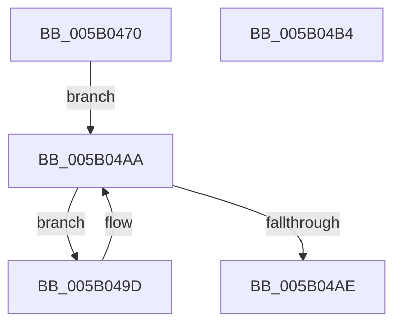

# DpxAcquireSimpleRundown

- RVA: `0x005B0470`–`0x005B04B5` (길이 `69` bytes)
- VA: `0x00000001405B0470`
- 실행 섹션: `.text`
- PDB 이름 있음: `예`; PDB Function 태그: `아니요`
- unwind 정보 RVA: `0x0005CF00`
- 디코드: `21`개 명령, `69/69` bytes 표시
- 미해석 바이트: `0` (있으면 어셈블리에 `.byte`로 보존)

> 이 문서는 커널 이미지의 기계어와 PDB 기호를 분석해 생성했습니다. 4번과 5번은 함수 원형과 자료형을 바이너리 사용 방식에서 추정한 C 해석이며 원본 소스 복구 결과는 아닙니다.

## 1. Dependencies

- 직접 호출 지점: **1**; 고유 호출 대상: **1**
- 직접 호출자로 확인된 함수: **1**
- RIP 상대 이미지 참조: **0**

### Outgoing calls
- `0x005B04A2` → [KeYieldProcessorEx](../3F/KeYieldProcessorEx_function_003FBD00.md) (function, `0x003FBD00`)

### Direct callers
- [DpxEndpointWrappedCall](../../drvprx/BC/DpxEndpointWrappedCall_function_00BCF010.md) at `0x00BCF070`

### Static image references
- 디코드된 RIP-relative 메모리 참조가 없습니다.

## 2. Other-region calls and transfers

- 다른 실행 섹션으로 향하는 call: **0**
- 별도 외부 분기/꼬리 이동을 확인하지 못했습니다.

## 3. Assembly (complete function range)

```asm
005B0470  40 53                           push rbx
005B0472  48 83 EC 20                     sub rsp, 0x20
005B0476  65 8B 14 25 A4 01 00 00         mov edx, dword ptr gs:[0x1a4]
005B047E  B8 02 00 00 00                  mov eax, 2
005B0483  8B 59 08                        mov ebx, dword ptr [rcx + 8]
005B0486  FF CB                           dec ebx
005B0488  23 DA                           and ebx, edx
005B048A  0F AF 59 0C                     imul ebx, dword ptr [rcx + 0xc]
005B048E  48 03 19                        add rbx, qword ptr [rcx]
005B0491  83 64 24 30 00                  and dword ptr [rsp + 0x30], 0
005B0496  F0 48 0F C1 03                  lock xadd qword ptr [rbx], rax
005B049B  EB 0D                           jmp 0x1405b04aa
005B049D  48 8D 4C 24 30                  lea rcx, [rsp + 0x30]
005B04A2  E8 59 B8 E4 FF                  call 0x1403fbd00
005B04A7  48 8B 03                        mov rax, qword ptr [rbx]
005B04AA  A8 01                           test al, 1
005B04AC  75 EF                           jne 0x1405b049d
005B04AE  48 83 C4 20                     add rsp, 0x20
005B04B2  5B                              pop rbx
005B04B3  C3                              ret
005B04B4  CC                              int3
```

## 4. C-style interpretation (structured pseudocode)

```c
__int64 __fastcall DpxAcquireSimpleRundown(__int64 a1)
{
    __int64 result;
    __int64 v_rbx;
    __int64 v_rsp;
    unsigned int v_stack_p8;

    v_rsp = (v_rsp) - (32);
    v_rbx = (unsigned int)(((unsigned int)(*(unsigned int *)(a1 + 8))) - 1);
    v_rbx = (unsigned int)((v_rbx) & ((unsigned int)((unsigned int)(*(unsigned int *)(gs_base + (0 + 420))))));
    v_rbx = (unsigned int)((v_rbx) * (*(unsigned int *)(a1 + 12)));
    v_rbx = (v_rbx) + (*(unsigned __int64 *)(a1));
    goto loc_005B04AA;
loc_005B049D:
    result = KeYieldProcessorEx(v_stack_p8, (unsigned int)(*(unsigned int *)(gs_base + (0 + 420))), a3, a4);
loc_005B04AA:
    if ((((unsigned __int8)(*(unsigned __int64 *)(v_rbx))) & (1)) != 0) goto loc_005B049D;
    v_rsp = (v_rsp) + (32);
    return *(unsigned __int64 *)(v_rbx);
}
```

## 5. (Beta) C Style

```c
int64_t DpxAcquireSimpleRundown(void *Arg1)
{
    uint8_t *arg1 = (uint8_t *)Arg1;

    int64_t result;
    int64_t local_rbx;
    int64_t local_rsp;
    uint32_t v_stack_p8;

    local_rsp = (local_rsp) - (32);
    local_rbx = (uint32_t)(((uint32_t)(*(uint32_t *)(arg1 + 0x8))) - 1);
    local_rbx = (uint32_t)((local_rbx) & ((uint32_t)((uint32_t)(*(uint32_t *)(gs_base + (0 + 0x1A4))))));
    local_rbx = (uint32_t)((local_rbx) * (*(uint32_t *)(arg1 + 0xC)));
    local_rbx = (local_rbx) + (*(uint64_t *)(arg1));
    goto loc_005B04AA;
loc_005B049D:
    result = KeYieldProcessorEx(v_stack_p8, (uint32_t)(*(uint32_t *)(gs_base + (0 + 0x1A4))), a3, a4);
loc_005B04AA:
    if ((((uint8_t)(*(uint64_t *)(local_rbx))) & (1)) != 0) goto loc_005B049D;
    local_rsp = (local_rsp) + (32);
    return *(uint64_t *)(local_rbx);
}
```

### 관측된 메모리 오프셋

구조체 형식이 확인되지 않은 접근은 인자 기준의 오프셋으로만 기록했습니다.

| 기준 인자 | 오프셋 표현 | 폭 (bit) | 접근 |
|---|---:|---:|---|
| `Arg1` | `+ 0x0` | `64` | `R` |
| `Arg1` | `+ 0x8` | `32` | `R` |
| `Arg1` | `+ 0xC` | `32` | `R` |

## 6. Execution-region graph

[열기: 2D/3D 그래프와 함수 탐색 컨트롤 패널](../../../control-panel.html?section=text&rva=0x005B0470&view=graph)

- 2D 그래프는 위에서 아래로 흐르고, 3D 그래프는 빈 공간을 드래그해 회전합니다. Shift+드래그는 이동, 휠은 확대·축소, 함수 노드 선택은 대상 보고서 이동입니다.

### Static fallback


