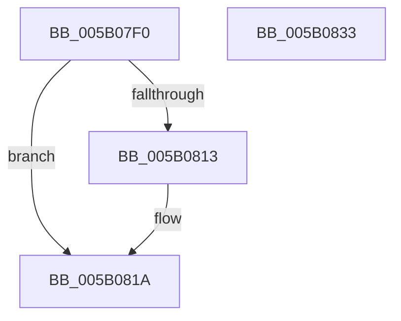

# KdAcquireDebuggerLock

- RVA: `0x005B07F0`–`0x005B0834` (길이 `68` bytes)
- VA: `0x00000001405B07F0`
- 실행 섹션: `.text`
- PDB 이름 있음: `예`; PDB Function 태그: `아니요`
- unwind 정보 RVA: `0x0005CAAC`
- 디코드: `19`개 명령, `68/68` bytes 표시
- 미해석 바이트: `0` (있으면 어셈블리에 `.byte`로 보존)

> 이 문서는 커널 이미지의 기계어와 PDB 기호를 분석해 생성했습니다. 4번과 5번은 함수 원형과 자료형을 바이너리 사용 방식에서 추정한 C 해석이며 원본 소스 복구 결과는 아닙니다.

## 1. Dependencies

- 직접 호출 지점: **2**; 고유 호출 대상: **2**
- 직접 호출자로 확인된 함수: **0**
- RIP 상대 이미지 참조: **2**

### Outgoing calls
- `0x005B0815` → [KiRaiseIrqlProcessIrqlFlags](../4F/KiRaiseIrqlProcessIrqlFlags_function_004F56FC.md) (function, `0x004F56FC`)
- `0x005B0823` → [KeAcquireSpinLockAtDpcLevel](../20/KeAcquireSpinLockAtDpcLevel_function_00208430.md) (function, `0x00208430`)

### Direct callers
- 이 함수 시작 RVA로 연결되는 직접 call은 확인되지 않았습니다. 간접 호출은 완전히 역산할 수 없습니다.

### Static image references
- `0x005B080A` → RVA `0x00FC6D20` (`ALMOSTRO`; read)
- `0x005B081A` → RVA `0x00FCF280` (`CACHEALI`; read)

## 2. Other-region calls and transfers

- 다른 실행 섹션으로 향하는 call: **0**
- 별도 외부 분기/꼬리 이동을 확인하지 못했습니다.

## 3. Assembly (complete function range)

```asm
005B07F0  48 89 5C 24 08                  mov qword ptr [rsp + 8], rbx
005B07F5  57                              push rdi
005B07F6  48 83 EC 20                     sub rsp, 0x20
005B07FA  48 8B F9                        mov rdi, rcx
005B07FD  44 0F 20 C3                     mov rbx, cr8
005B0801  BA 02 00 00 00                  mov edx, 2
005B0806  44 0F 22 C2                     mov cr8, rdx
005B080A  83 3D 0F 65 A1 00 00            cmp dword ptr [rip + 0xa1650f], 0
005B0811  74 07                           je 0x1405b081a
005B0813  8A CB                           mov cl, bl
005B0815  E8 E2 4E F4 FF                  call 0x1404f56fc
005B081A  48 8D 0D 5F EA A1 00            lea rcx, [rip + 0xa1ea5f]
005B0821  88 1F                           mov byte ptr [rdi], bl
005B0823  E8 08 7C C5 FF                  call 0x140208430
005B0828  48 8B 5C 24 30                  mov rbx, qword ptr [rsp + 0x30]
005B082D  48 83 C4 20                     add rsp, 0x20
005B0831  5F                              pop rdi
005B0832  C3                              ret
005B0833  CC                              int3
```

## 4. C-style interpretation (structured pseudocode)

```c
__int64 __fastcall KdAcquireDebuggerLock(__int64 a1)
{
    __int64 result;
    __int64 v_rsp;
    unsigned __int64 v_stack_p8;

    v_stack_p8 = v_rbx;
    v_rsp = (v_rsp) - (32);
    if ((*(unsigned int *)(v_rip + 10577167)) != 0) {
        a1 = (unsigned __int8)(v_cr8);
        result = KiRaiseIrqlProcessIrqlFlags(a1, 2, a3, a4);
    }
    *(unsigned __int8 *)(a1) = (unsigned __int8)(v_cr8);
    result = KeAcquireSpinLockAtDpcLevel(v_rip + 10611295, 2, a3, a4);
    v_rsp = (v_rsp) + (32);
    return result;
}
```

## 5. (Beta) C Style

```c
int64_t KdAcquireDebuggerLock(void *Arg1)
{
    uint8_t *arg1 = (uint8_t *)Arg1;

    int64_t result;
    int64_t local_rsp;
    uint64_t v_stack_p8;

    v_stack_p8 = local_rbx;
    local_rsp = (local_rsp) - (32);
    if ((*(uint32_t *)(v_rip + 0xA1650F)) != 0) {
        Arg1 = (uint8_t)(v_cr8);
        result = KiRaiseIrqlProcessIrqlFlags(Arg1, 2, a3, a4);
    }
    *(uint8_t *)(arg1) = (uint8_t)(v_cr8);
    result = KeAcquireSpinLockAtDpcLevel(v_rip + 10611295, 2, a3, a4);
    local_rsp = (local_rsp) + (32);
    return result;
}
```

### 관측된 메모리 오프셋

구조체 형식이 확인되지 않은 접근은 인자 기준의 오프셋으로만 기록했습니다.

| 기준 인자 | 오프셋 표현 | 폭 (bit) | 접근 |
|---|---:|---:|---|
| `Arg1` | `+ 0x0` | `8` | `W` |

## 6. Execution-region graph

[열기: 2D/3D 그래프와 함수 탐색 컨트롤 패널](../../../control-panel.html?section=text&rva=0x005B07F0&view=graph)

- 2D 그래프는 위에서 아래로 흐르고, 3D 그래프는 빈 공간을 드래그해 회전합니다. Shift+드래그는 이동, 휠은 확대·축소, 함수 노드 선택은 대상 보고서 이동입니다.

### Static fallback


