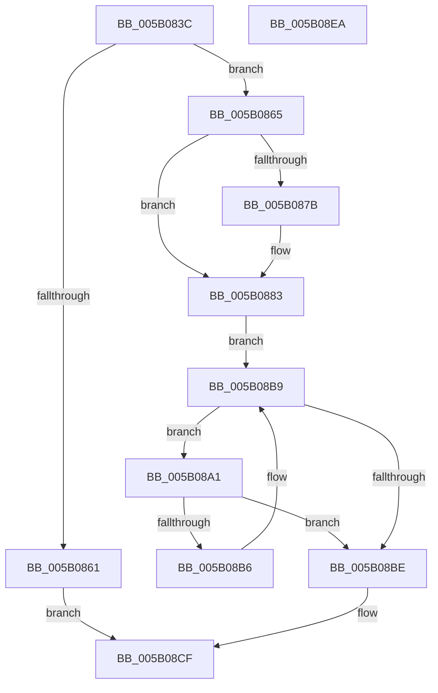

# KdCallPowerHandlers

- RVA: `0x005B083C`–`0x005B08EB` (길이 `175` bytes)
- VA: `0x00000001405B083C`
- 실행 섹션: `.text`
- PDB 이름 있음: `예`; PDB Function 태그: `아니요`
- unwind 정보 RVA: `0x0005E6B4`
- 디코드: `47`개 명령, `175/175` bytes 표시
- 미해석 바이트: `0` (있으면 어셈블리에 `.byte`로 보존)

> 이 문서는 커널 이미지의 기계어와 PDB 기호를 분석해 생성했습니다. 4번과 5번은 함수 원형과 자료형을 바이너리 사용 방식에서 추정한 C 해석이며 원본 소스 복구 결과는 아닙니다.

## 1. Dependencies

- 직접 호출 지점: **4**; 고유 호출 대상: **4**
- 직접 호출자로 확인된 함수: **3**
- RIP 상대 이미지 참조: **3**

### Outgoing calls
- `0x005B087E` → [KiRaiseIrqlProcessIrqlFlags](../4F/KiRaiseIrqlProcessIrqlFlags_function_004F56FC.md) (function, `0x004F56FC`)
- `0x005B088A` → [KeAcquireSpinLockAtDpcLevel](../20/KeAcquireSpinLockAtDpcLevel_function_00208430.md) (function, `0x00208430`)
- `0x005B08AB` → [guard_dispatch_icall](../6B/guard_dispatch_icall_function_006BAAD0.md) (function, `0x006BAAD0`)
- `0x005B08C8` → [KeReleaseSpinLock](../39/KeReleaseSpinLock_function_00392BA0.md) (function, `0x00392BA0`)

### Direct callers
- [PpmEnterCoordinatedIdle](../2D/PpmEnterCoordinatedIdle_function_002D19B0.md) at `0x002D1A54`
- [PopFxDebuggerPowerCriticalTransitionCallback](../5D/PopFxDebuggerPowerCriticalTransitionCallback_function_005DA4A0.md) at `0x005DA4CA`
- [PopFxDebuggerPowerCriticalTransitionCallback](../5D/PopFxDebuggerPowerCriticalTransitionCallback_function_005DA4A0.md) at `0x005DA4EE`
- [sub_006DD378](../6D/Unknown_function_006DD378.md) at `0x006DD4DB`

### Static image references
- `0x005B0855` → RVA `0x00F55C90` (`.data`; read)
- `0x005B0872` → RVA `0x00FC6D20` (`ALMOSTRO`; read)
- `0x005B0883` → RVA `0x00E664A0` (`.data`; read)

## 2. Other-region calls and transfers

- 다른 실행 섹션으로 향하는 call: **0**
- 별도 외부 분기/꼬리 이동을 확인하지 못했습니다.

## 3. Assembly (complete function range)

```asm
005B083C  48 8B C4                        mov rax, rsp
005B083F  48 89 58 08                     mov qword ptr [rax + 8], rbx
005B0843  48 89 68 10                     mov qword ptr [rax + 0x10], rbp
005B0847  48 89 70 18                     mov qword ptr [rax + 0x18], rsi
005B084B  48 89 78 20                     mov qword ptr [rax + 0x20], rdi
005B084F  41 56                           push r14
005B0851  48 83 EC 20                     sub rsp, 0x20
005B0855  48 83 3D 33 54 9A 00 00         cmp qword ptr [rip + 0x9a5433], 0
005B085D  8B E9                           mov ebp, ecx
005B085F  75 04                           jne 0x1405b0865
005B0861  33 C0                           xor eax, eax
005B0863  EB 6A                           jmp 0x1405b08cf
005B0865  44 0F 20 C7                     mov rdi, cr8
005B0869  BA 0F 00 00 00                  mov edx, 0xf
005B086E  44 0F 22 C2                     mov cr8, rdx
005B0872  83 3D A7 64 A1 00 00            cmp dword ptr [rip + 0xa164a7], 0
005B0879  74 08                           je 0x1405b0883
005B087B  40 8A CF                        mov cl, dil
005B087E  E8 79 4E F4 FF                  call 0x1404f56fc
005B0883  48 8D 0D 16 5C 8B 00            lea rcx, [rip + 0x8b5c16]
005B088A  E8 A1 7B C5 FF                  call 0x140208430
005B088F  48 8B 1D FA 53 9A 00            mov rbx, qword ptr [rip + 0x9a53fa]
005B0896  4C 8D 35 F3 53 9A 00            lea r14, [rip + 0x9a53f3]
005B089D  33 F6                           xor esi, esi
005B089F  EB 18                           jmp 0x1405b08b9
005B08A1  48 8B 43 10                     mov rax, qword ptr [rbx + 0x10]
005B08A5  8B CD                           mov ecx, ebp
005B08A7  48 8B 53 18                     mov rdx, qword ptr [rbx + 0x18]
005B08AB  E8 20 A2 10 00                  call 0x1406baad0
005B08B0  8B F0                           mov esi, eax
005B08B2  85 C0                           test eax, eax
005B08B4  78 08                           js 0x1405b08be
005B08B6  48 8B 1B                        mov rbx, qword ptr [rbx]
005B08B9  49 3B DE                        cmp rbx, r14
005B08BC  75 E3                           jne 0x1405b08a1
005B08BE  40 8A D7                        mov dl, dil
005B08C1  48 8D 0D D8 5B 8B 00            lea rcx, [rip + 0x8b5bd8]
005B08C8  E8 D3 22 DE FF                  call 0x140392ba0
005B08CD  8B C6                           mov eax, esi
005B08CF  48 8B 5C 24 30                  mov rbx, qword ptr [rsp + 0x30]
005B08D4  48 8B 6C 24 38                  mov rbp, qword ptr [rsp + 0x38]
005B08D9  48 8B 74 24 40                  mov rsi, qword ptr [rsp + 0x40]
005B08DE  48 8B 7C 24 48                  mov rdi, qword ptr [rsp + 0x48]
005B08E3  48 83 C4 20                     add rsp, 0x20
005B08E7  41 5E                           pop r14
005B08E9  C3                              ret
005B08EA  CC                              int3
```

## 4. C-style interpretation (structured pseudocode)

```c
__int64 __fastcall KdCallPowerHandlers(int a1)
{
    __int64 result;
    __int64 v_rsi;
    __int64 v_rsp;
    unsigned __int64 v_stack_p10;
    unsigned __int64 v_stack_p18;
    unsigned __int64 v_stack_p20;
    unsigned __int64 v_stack_p8;

    *(unsigned __int64 *)(v_rsp + 8) = v_rbx;
    *(unsigned __int64 *)(v_rsp + 16) = v_rbp;
    *(unsigned __int64 *)(v_rsp + 24) = v_rsi;
    *(unsigned __int64 *)(v_rsp + 32) = v_rdi;
    v_rsp = (v_rsp) - (32);
    if ((*(unsigned __int64 *)(v_rip + 10114099)) != 0) goto loc_005B0865;
    result = 0;
    goto loc_005B08CF;
loc_005B0865:
    if ((*(unsigned int *)(v_rip + 10577063)) != 0) {
        a1 = (unsigned __int8)(v_cr8);
        result = KiRaiseIrqlProcessIrqlFlags(a1, 15, a3, a4);
    }
    result = KeAcquireSpinLockAtDpcLevel(v_rip + 9133078, 15, a3, a4);
    v_rsi = 0;
    goto loc_005B08B9;
loc_005B08A1:
    result = guard_dispatch_icall((unsigned int)((unsigned int)((unsigned int)(a1))), *(unsigned __int64 *)(*(unsigned __int64 *)(v_rip + 10114042) + 24), a3, a4);
    if (sign_flag) goto loc_005B08BE;
loc_005B08B9:
    if ((*(unsigned __int64 *)(*(unsigned __int64 *)(v_rip + 10114042))) != (v_rip + 10114035)) goto loc_005B08A1;
loc_005B08BE:
    result = KeReleaseSpinLock(v_rip + 9133016, (unsigned __int8)(v_cr8), a3, a4);
loc_005B08CF:
    v_rsp = (v_rsp) + (32);
    return (unsigned int)((unsigned int)((unsigned int)((unsigned int)(result))));
}
```

## 5. (Beta) C Style

```c
int64_t KdCallPowerHandlers(int32_t Arg1)
{
    int64_t result;
    int64_t local_rsi;
    int64_t local_rsp;
    uint64_t v_stack_p10;
    uint64_t v_stack_p18;
    uint64_t v_stack_p20;
    uint64_t v_stack_p8;

    *(uint64_t *)(local_rsp + 0x8) = local_rbx;
    *(uint64_t *)(local_rsp + 0x10) = local_rbp;
    *(uint64_t *)(local_rsp + 0x18) = local_rsi;
    *(uint64_t *)(local_rsp + 0x20) = local_rdi;
    local_rsp = (local_rsp) - (32);
    if ((*(uint64_t *)(v_rip + 0x9A5433)) != 0) goto loc_005B0865;
    result = 0;
    goto loc_005B08CF;
loc_005B0865:
    if ((*(uint32_t *)(v_rip + 0xA164A7)) != 0) {
        Arg1 = (uint8_t)(v_cr8);
        result = KiRaiseIrqlProcessIrqlFlags(Arg1, 15, a3, a4);
    }
    result = KeAcquireSpinLockAtDpcLevel(v_rip + 9133078, 15, a3, a4);
    local_rsi = 0;
    goto loc_005B08B9;
loc_005B08A1:
    result = guard_dispatch_icall((uint32_t)((uint32_t)((uint32_t)(Arg1))), *(uint64_t *)(*(uint64_t *)(v_rip + 0x9A53FA) + 0x18), a3, a4);
    if (sign_flag) goto loc_005B08BE;
loc_005B08B9:
    if ((*(uint64_t *)(*(uint64_t *)(v_rip + 0x9A53FA))) != (v_rip + 10114035)) goto loc_005B08A1;
loc_005B08BE:
    result = KeReleaseSpinLock(v_rip + 9133016, (uint8_t)(v_cr8), a3, a4);
loc_005B08CF:
    local_rsp = (local_rsp) + (32);
    return (uint32_t)((uint32_t)((uint32_t)((uint32_t)(result))));
}
```

## 6. Execution-region graph

[열기: 2D/3D 그래프와 함수 탐색 컨트롤 패널](../../../control-panel.html?section=text&rva=0x005B083C&view=graph)

- 2D 그래프는 위에서 아래로 흐르고, 3D 그래프는 빈 공간을 드래그해 회전합니다. Shift+드래그는 이동, 휠은 확대·축소, 함수 노드 선택은 대상 보고서 이동입니다.

### Static fallback


