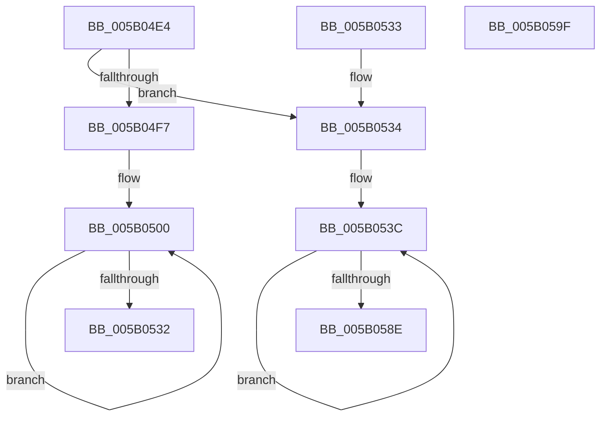

# KdCopyDataBlock

- RVA: `0x005B04E4`–`0x005B05A0` (길이 `188` bytes)
- VA: `0x00000001405B04E4`
- 실행 섹션: `.text`
- PDB 이름 있음: `예`; PDB Function 태그: `아니요`
- unwind 정보 RVA: `0x000DB714`
- 디코드: `48`개 명령, `188/188` bytes 표시
- 미해석 바이트: `0` (있으면 어셈블리에 `.byte`로 보존)

> 이 문서는 커널 이미지의 기계어와 PDB 기호를 분석해 생성했습니다. 4번과 5번은 함수 원형과 자료형을 바이너리 사용 방식에서 추정한 C 해석이며 원본 소스 복구 결과는 아닙니다.

## 1. Dependencies

- 직접 호출 지점: **0**; 고유 호출 대상: **0**
- 직접 호출자로 확인된 함수: **4**
- RIP 상대 이미지 참조: **4**

### Outgoing calls
- 직접 디코드된 call 명령이 없습니다.

### Direct callers
- [KeCapturePersistentThreadState](../43/KeCapturePersistentThreadState_function_00435D90.md) at `0x0043607E`
- [IoFillTriageDumpBuffer](../59/IoFillTriageDumpBuffer_function_005921CC.md) at `0x00592703`
- [IopInitializeInMemoryDumpData](../59/IopInitializeInMemoryDumpData_function_005957E0.md) at `0x00595938`
- [KdDecodeDataBlock](KdDecodeDataBlock_function_005B05A8.md) at `0x005B05BC`

### Static image references
- `0x005B04E4` → RVA `0x00E663E8` (`.data`; read)
- `0x005B04EB` → RVA `0x00E01060` (`.data`; read)
- `0x005B0500` → RVA `0x00FC6F78` (`ALMOSTRO`; read)
- `0x005B051D` → RVA `0x00FC7250` (`ALMOSTRO`; read)

## 2. Other-region calls and transfers

- 다른 실행 섹션으로 향하는 call: **0**
- 별도 외부 분기/꼬리 이동을 확인하지 못했습니다.

## 3. Assembly (complete function range)

```asm
005B04E4  80 3D FD 5E 8B 00 00            cmp byte ptr [rip + 0x8b5efd], 0
005B04EB  48 8D 15 6E 0B 85 00            lea rdx, [rip + 0x850b6e]
005B04F2  4C 8B C1                        mov r8, rcx
005B04F5  74 3D                           je 0x1405b0534
005B04F7  41 B9 74 00 00 00               mov r9d, 0x74
005B04FD  4C 2B C2                        sub r8, rdx
005B0500  48 8B 0D 71 6A A1 00            mov rcx, qword ptr [rip + 0xa16a71]
005B0507  48 8B 02                        mov rax, qword ptr [rdx]
005B050A  48 33 C1                        xor rax, rcx
005B050D  48 D3 C0                        rol rax, cl
005B0510  48 8D 0D D1 5E 8B 00            lea rcx, [rip + 0x8b5ed1]
005B0517  48 33 C1                        xor rax, rcx
005B051A  48 0F C8                        bswap rax
005B051D  48 33 05 2C 6D A1 00            xor rax, qword ptr [rip + 0xa16d2c]
005B0524  49 89 04 10                     mov qword ptr [r8 + rdx], rax
005B0528  48 8D 52 08                     lea rdx, [rdx + 8]
005B052C  41 83 C1 FF                     add r9d, -1
005B0530  75 CE                           jne 0x1405b0500
005B0532  C3                              ret
005B0533  CC                              int3
005B0534  B8 07 00 00 00                  mov eax, 7
005B0539  8D 48 79                        lea ecx, [rax + 0x79]
005B053C  0F 10 02                        movups xmm0, xmmword ptr [rdx]
005B053F  41 0F 11 00                     movups xmmword ptr [r8], xmm0
005B0543  0F 10 4A 10                     movups xmm1, xmmword ptr [rdx + 0x10]
005B0547  41 0F 11 48 10                  movups xmmword ptr [r8 + 0x10], xmm1
005B054C  0F 10 42 20                     movups xmm0, xmmword ptr [rdx + 0x20]
005B0550  41 0F 11 40 20                  movups xmmword ptr [r8 + 0x20], xmm0
005B0555  0F 10 4A 30                     movups xmm1, xmmword ptr [rdx + 0x30]
005B0559  41 0F 11 48 30                  movups xmmword ptr [r8 + 0x30], xmm1
005B055E  0F 10 42 40                     movups xmm0, xmmword ptr [rdx + 0x40]
005B0562  41 0F 11 40 40                  movups xmmword ptr [r8 + 0x40], xmm0
005B0567  0F 10 4A 50                     movups xmm1, xmmword ptr [rdx + 0x50]
005B056B  41 0F 11 48 50                  movups xmmword ptr [r8 + 0x50], xmm1
005B0570  0F 10 42 60                     movups xmm0, xmmword ptr [rdx + 0x60]
005B0574  41 0F 11 40 60                  movups xmmword ptr [r8 + 0x60], xmm0
005B0579  4C 03 C1                        add r8, rcx
005B057C  0F 10 4A 70                     movups xmm1, xmmword ptr [rdx + 0x70]
005B0580  48 03 D1                        add rdx, rcx
005B0583  41 0F 11 48 F0                  movups xmmword ptr [r8 - 0x10], xmm1
005B0588  48 83 E8 01                     sub rax, 1
005B058C  75 AE                           jne 0x1405b053c
005B058E  0F 10 02                        movups xmm0, xmmword ptr [rdx]
005B0591  41 0F 11 00                     movups xmmword ptr [r8], xmm0
005B0595  0F 10 4A 10                     movups xmm1, xmmword ptr [rdx + 0x10]
005B0599  41 0F 11 48 10                  movups xmmword ptr [r8 + 0x10], xmm1
005B059E  C3                              ret
005B059F  CC                              int3
```

## 4. C-style interpretation (structured pseudocode)

```c
__int64 __fastcall KdCopyDataBlock(__int64 a1)
{
    __int64 result;

    if ((*(unsigned __int8 *)(v_rip + 9133821)) == 0) goto loc_005B0534;
    a3 = (a1) - (v_rip + 8719214);
loc_005B0500:
    result = (*(unsigned __int64 *)(v_rip + 8719214)) ^ (*(unsigned __int64 *)(v_rip + 10578545));
    result = (result) ^ (v_rip + 9133777);
    result = (result) ^ (*(unsigned __int64 *)(v_rip + 10579244));
    *(unsigned __int64 *)(a3 + v_rip + 8719214 * 1) = result;
    a4 = (unsigned int)((116) + (-1));
    if (condition_is_not_equal) goto loc_005B0500;
    return result;
loc_005B0534:
loc_005B053C:
    *(unsigned __int64 *)(a3) = v_xmm0;
    *(unsigned __int64 *)(a3 + 16) = v_xmm1;
    *(unsigned __int64 *)(a3 + 32) = v_xmm0;
    *(unsigned __int64 *)(a3 + 48) = v_xmm1;
    *(unsigned __int64 *)(a3 + 64) = v_xmm0;
    *(unsigned __int64 *)(a3 + 80) = v_xmm1;
    *(unsigned __int64 *)(a3 + 96) = v_xmm0;
    a3 = (a3) + (7 + 121);
    a2 = (v_rip + 8719214 + 8) + (7 + 121);
    *(unsigned __int64 *)(a3 - 16) = v_xmm1;
    result = (7) - (1);
    if (condition_is_not_equal) goto loc_005B053C;
    *(unsigned __int64 *)(a3) = v_xmm0;
    *(unsigned __int64 *)(a3 + 16) = v_xmm1;
    return result;
}
```

## 5. (Beta) C Style

```c
int64_t KdCopyDataBlock(void *Arg1)
{
    uint8_t *arg1 = (uint8_t *)Arg1;

    int64_t result;

    if ((*(uint8_t *)(v_rip + 0x8B5EFD)) == 0) goto loc_005B0534;
    a3 = (Arg1) - (v_rip + 8719214);
loc_005B0500:
    result = (*(uint64_t *)(v_rip + 0x850B6E)) ^ (*(uint64_t *)(v_rip + 0xA16A71));
    result = (result) ^ (v_rip + 9133777);
    result = (result) ^ (*(uint64_t *)(v_rip + 0xA16D2C));
    *(uint64_t *)(a3 + v_rip + 0x850B6E * 1) = result;
    a4 = (uint32_t)((116) + (-1));
    if (condition_is_not_equal) goto loc_005B0500;
    return result;
loc_005B0534:
loc_005B053C:
    *(uint64_t *)(a3) = v_xmm0;
    *(uint64_t *)(a3 + 0x10) = v_xmm1;
    *(uint64_t *)(a3 + 0x20) = v_xmm0;
    *(uint64_t *)(a3 + 0x30) = v_xmm1;
    *(uint64_t *)(a3 + 0x40) = v_xmm0;
    *(uint64_t *)(a3 + 0x50) = v_xmm1;
    *(uint64_t *)(a3 + 0x60) = v_xmm0;
    a3 = (a3) + (7 + 121);
    a2 = (v_rip + 8719214 + 8) + (7 + 121);
    *(uint64_t *)(a3 - 0x10) = v_xmm1;
    result = (7) - (1);
    if (condition_is_not_equal) goto loc_005B053C;
    *(uint64_t *)(a3) = v_xmm0;
    *(uint64_t *)(a3 + 0x10) = v_xmm1;
    return result;
}
```

### 관측된 메모리 오프셋

구조체 형식이 확인되지 않은 접근은 인자 기준의 오프셋으로만 기록했습니다.

| 기준 인자 | 오프셋 표현 | 폭 (bit) | 접근 |
|---|---:|---:|---|
| `Arg1` | `- 0x10` | `128` | `R` |
| `Arg1` | `+ 0x0` | `128` | `R` |
| `Arg1` | `+ 0x0 + rdx*1` | `64` | `W` |
| `Arg1` | `+ 0x10` | `128` | `R` |
| `Arg1` | `+ 0x20` | `128` | `R` |
| `Arg1` | `+ 0x30` | `128` | `R` |
| `Arg1` | `+ 0x40` | `128` | `R` |
| `Arg1` | `+ 0x50` | `128` | `R` |
| `Arg1` | `+ 0x60` | `128` | `R` |

## 6. Execution-region graph

[열기: 2D/3D 그래프와 함수 탐색 컨트롤 패널](../../../control-panel.html?section=text&rva=0x005B04E4&view=graph)

- 2D 그래프는 위에서 아래로 흐르고, 3D 그래프는 빈 공간을 드래그해 회전합니다. Shift+드래그는 이동, 휠은 확대·축소, 함수 노드 선택은 대상 보고서 이동입니다.

### Static fallback


