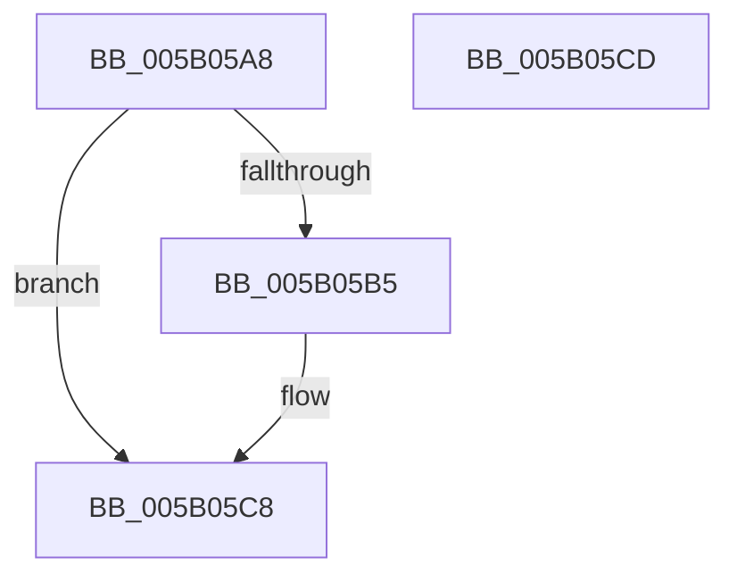

# KdDecodeDataBlock

- RVA: `0x005B05A8`–`0x005B05CE` (길이 `38` bytes)
- VA: `0x00000001405B05A8`
- 실행 섹션: `.text`
- PDB 이름 있음: `예`; PDB Function 태그: `아니요`
- unwind 정보 RVA: `0x0005C788`
- 디코드: `9`개 명령, `38/38` bytes 표시
- 미해석 바이트: `0` (있으면 어셈블리에 `.byte`로 보존)

> 이 문서는 커널 이미지의 기계어와 PDB 기호를 분석해 생성했습니다. 4번과 5번은 함수 원형과 자료형을 바이너리 사용 방식에서 추정한 C 해석이며 원본 소스 복구 결과는 아닙니다.

## 1. Dependencies

- 직접 호출 지점: **1**; 고유 호출 대상: **1**
- 직접 호출자로 확인된 함수: **2**
- RIP 상대 이미지 참조: **3**

### Outgoing calls
- `0x005B05BC` → [KdCopyDataBlock](KdCopyDataBlock_function_005B04E4.md) (function, `0x005B04E4`)

### Direct callers
- [IopLiveDumpCollectPages](../59/IopLiveDumpCollectPages_function_0059B328.md) at `0x0059B60F`
- [KeBugCheck2](KeBugCheck2_function_005B27D0.md) at `0x005B36C8`

### Static image references
- `0x005B05AC` → RVA `0x00E663E8` (`.data`; read)
- `0x005B05B5` → RVA `0x00E01060` (`.data`; read)
- `0x005B05C1` → RVA `0x00E663E8` (`.data`; write)

## 2. Other-region calls and transfers

- 다른 실행 섹션으로 향하는 call: **0**
- 별도 외부 분기/꼬리 이동을 확인하지 못했습니다.

## 3. Assembly (complete function range)

```asm
005B05A8  48 83 EC 28                     sub rsp, 0x28
005B05AC  80 3D 35 5E 8B 00 00            cmp byte ptr [rip + 0x8b5e35], 0
005B05B3  74 13                           je 0x1405b05c8
005B05B5  48 8D 0D A4 0A 85 00            lea rcx, [rip + 0x850aa4]
005B05BC  E8 23 FF FF FF                  call 0x1405b04e4
005B05C1  C6 05 20 5E 8B 00 00            mov byte ptr [rip + 0x8b5e20], 0
005B05C8  48 83 C4 28                     add rsp, 0x28
005B05CC  C3                              ret
005B05CD  CC                              int3
```

## 4. C-style interpretation (structured pseudocode)

```c
__int64 __fastcall KdDecodeDataBlock(void)
{
    __int64 result;
    __int64 v_rsp;

    v_rsp = (v_rsp) - (40);
    if ((*(unsigned __int8 *)(v_rip + 9133621)) != 0) {
        a1 = v_rip + 8719012;
        result = KdCopyDataBlock(a1, a2, a3, a4);
        *(unsigned __int8 *)(v_rip + 9133600) = 0;
    }
    v_rsp = (v_rsp) + (40);
    return result;
}
```

## 5. (Beta) C Style

```c
void KdDecodeDataBlock(void)
{
    int64_t result;
    int64_t local_rsp;

    local_rsp = (local_rsp) - (40);
    if ((*(uint8_t *)(v_rip + 0x8B5E35)) != 0) {
        a1 = v_rip + 8719012;
        result = KdCopyDataBlock(a1, a2, a3, a4);
        *(uint8_t *)(v_rip + 0x8B5E20) = 0;
    }
    local_rsp = (local_rsp) + (40);
    return result;
}
```

## 6. Execution-region graph

[열기: 2D/3D 그래프와 함수 탐색 컨트롤 패널](../../../control-panel.html?section=text&rva=0x005B05A8&view=graph)

- 2D 그래프는 위에서 아래로 흐르고, 3D 그래프는 빈 공간을 드래그해 회전합니다. Shift+드래그는 이동, 휠은 확대·축소, 함수 노드 선택은 대상 보고서 이동입니다.

### Static fallback


