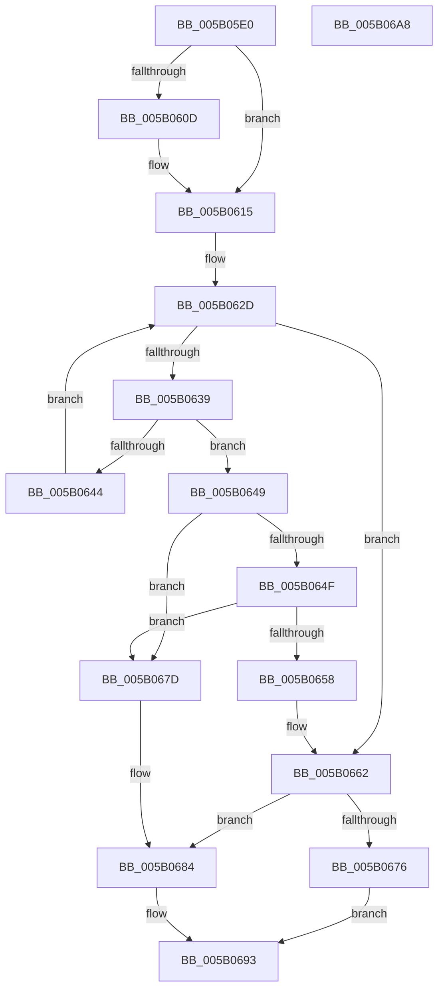

# KdDeregisterPowerHandler

- RVA: `0x005B05E0`–`0x005B06A9` (길이 `201` bytes)
- VA: `0x00000001405B05E0`
- 실행 섹션: `.text`
- PDB 이름 있음: `예`; PDB Function 태그: `아니요`
- unwind 정보 RVA: `0x0005C954`
- 디코드: `55`개 명령, `201/201` bytes 표시
- 미해석 바이트: `0` (있으면 어셈블리에 `.byte`로 보존)

> 이 문서는 커널 이미지의 기계어와 PDB 기호를 분석해 생성했습니다. 4번과 5번은 함수 원형과 자료형을 바이너리 사용 방식에서 추정한 C 해석이며 원본 소스 복구 결과는 아닙니다.

## 1. Dependencies

- 직접 호출 지점: **4**; 고유 호출 대상: **4**
- 직접 호출자로 확인된 함수: **0**
- RIP 상대 이미지 참조: **3**

### Outgoing calls
- `0x005B0610` → [KiRaiseIrqlProcessIrqlFlags](../4F/KiRaiseIrqlProcessIrqlFlags_function_004F56FC.md) (function, `0x004F56FC`)
- `0x005B061C` → [KeAcquireSpinLockAtDpcLevel](../20/KeAcquireSpinLockAtDpcLevel_function_00208430.md) (function, `0x00208430`)
- `0x005B066C` → [KeReleaseSpinLock](../39/KeReleaseSpinLock_function_00392BA0.md) (function, `0x00392BA0`)
- `0x005B068C` → [ExFreePoolWithTag](../../poolcode/B8/ExFreePoolWithTag_function_00B82870.md) (function, `0x00B82870`)

### Direct callers
- 이 함수 시작 RVA로 연결되는 직접 call은 확인되지 않았습니다. 간접 호출은 완전히 역산할 수 없습니다.

### Static image references
- `0x005B0604` → RVA `0x00FC6D20` (`ALMOSTRO`; read)
- `0x005B0615` → RVA `0x00E664A0` (`.data`; read)
- `0x005B0621` → RVA `0x00F55C90` (`.data`; read)

## 2. Other-region calls and transfers

- 다른 실행 섹션으로 향하는 call: **1**
  - `0x005B068C` → [ExFreePoolWithTag](../../poolcode/B8/ExFreePoolWithTag_function_00B82870.md) (`.text` → `POOLCODE`)
- 별도 외부 분기/꼬리 이동을 확인하지 못했습니다.

## 3. Assembly (complete function range)

```asm
005B05E0  48 89 5C 24 08                  mov qword ptr [rsp + 8], rbx
005B05E5  48 89 6C 24 10                  mov qword ptr [rsp + 0x10], rbp
005B05EA  48 89 74 24 18                  mov qword ptr [rsp + 0x18], rsi
005B05EF  57                              push rdi
005B05F0  48 83 EC 20                     sub rsp, 0x20
005B05F4  48 8B E9                        mov rbp, rcx
005B05F7  44 0F 20 C6                     mov rsi, cr8
005B05FB  BA 0F 00 00 00                  mov edx, 0xf
005B0600  44 0F 22 C2                     mov cr8, rdx
005B0604  83 3D 15 67 A1 00 00            cmp dword ptr [rip + 0xa16715], 0
005B060B  74 08                           je 0x1405b0615
005B060D  40 8A CE                        mov cl, sil
005B0610  E8 E7 50 F4 FF                  call 0x1404f56fc
005B0615  48 8D 0D 84 5E 8B 00            lea rcx, [rip + 0x8b5e84]
005B061C  E8 0F 7E C5 FF                  call 0x140208430
005B0621  48 8B 05 68 56 9A 00            mov rax, qword ptr [rip + 0x9a5668]
005B0628  33 DB                           xor ebx, ebx
005B062A  40 32 FF                        xor dil, dil
005B062D  48 8D 0D 5C 56 9A 00            lea rcx, [rip + 0x9a565c]
005B0634  48 3B C1                        cmp rax, rcx
005B0637  74 29                           je 0x1405b0662
005B0639  48 8B 08                        mov rcx, qword ptr [rax]
005B063C  48 8B D8                        mov rbx, rax
005B063F  48 3B E8                        cmp rbp, rax
005B0642  74 05                           je 0x1405b0649
005B0644  48 8B C1                        mov rax, rcx
005B0647  EB E4                           jmp 0x1405b062d
005B0649  48 39 41 08                     cmp qword ptr [rcx + 8], rax
005B064D  75 2E                           jne 0x1405b067d
005B064F  48 8B 50 08                     mov rdx, qword ptr [rax + 8]
005B0653  48 39 02                        cmp qword ptr [rdx], rax
005B0656  75 25                           jne 0x1405b067d
005B0658  48 89 0A                        mov qword ptr [rdx], rcx
005B065B  40 B7 01                        mov dil, 1
005B065E  48 89 51 08                     mov qword ptr [rcx + 8], rdx
005B0662  40 8A D6                        mov dl, sil
005B0665  48 8D 0D 34 5E 8B 00            lea rcx, [rip + 0x8b5e34]
005B066C  E8 2F 25 DE FF                  call 0x140392ba0
005B0671  40 84 FF                        test dil, dil
005B0674  75 0E                           jne 0x1405b0684
005B0676  B8 25 02 00 C0                  mov eax, 0xc0000225
005B067B  EB 16                           jmp 0x1405b0693
005B067D  B9 03 00 00 00                  mov ecx, 3
005B0682  CD 29                           int 0x29
005B0684  BA 4B 64 49 6F                  mov edx, 0x6f49644b
005B0689  48 8B CB                        mov rcx, rbx
005B068C  E8 DF 21 5D 00                  call 0x140b82870
005B0691  33 C0                           xor eax, eax
005B0693  48 8B 5C 24 30                  mov rbx, qword ptr [rsp + 0x30]
005B0698  48 8B 6C 24 38                  mov rbp, qword ptr [rsp + 0x38]
005B069D  48 8B 74 24 40                  mov rsi, qword ptr [rsp + 0x40]
005B06A2  48 83 C4 20                     add rsp, 0x20
005B06A6  5F                              pop rdi
005B06A7  C3                              ret
005B06A8  CC                              int3
```

## 4. C-style interpretation (structured pseudocode)

```c
__int64 __fastcall KdDeregisterPowerHandler(__int64 a1)
{
    __int64 result;
    __int64 v_rbx;
    __int64 v_rdi;
    __int64 v_rsp;
    unsigned __int64 v_stack_p10;
    unsigned __int64 v_stack_p18;
    unsigned __int64 v_stack_p8;

    v_stack_p8 = v_rbx;
    v_stack_p10 = v_rbp;
    v_stack_p18 = v_rsi;
    v_rsp = (v_rsp) - (32);
    if ((*(unsigned int *)(v_rip + 10577685)) != 0) {
        a1 = (unsigned __int8)(v_cr8);
        result = KiRaiseIrqlProcessIrqlFlags(a1, 15, a3, a4);
    }
    result = KeAcquireSpinLockAtDpcLevel(v_rip + 9133700, 15, a3, a4);
    v_rbx = 0;
    v_rdi = 0;
loc_005B062D:
    if ((*(unsigned __int64 *)(v_rip + 10114664)) == (v_rip + 10114652)) goto loc_005B0662;
    if (a1 == (*(unsigned __int64 *)(v_rip + 10114664))) goto loc_005B0649;
    goto loc_005B062D;
loc_005B0649:
    if ((*(unsigned __int64 *)(*(unsigned __int64 *)(*(unsigned __int64 *)(v_rip + 10114664)) + 8)) != (*(unsigned __int64 *)(*(unsigned __int64 *)(v_rip + 10114664)))) goto loc_005B067D;
    if ((*(unsigned __int64 *)(*(unsigned __int64 *)(*(unsigned __int64 *)(*(unsigned __int64 *)(v_rip + 10114664)) + 8))) != (*(unsigned __int64 *)(*(unsigned __int64 *)(v_rip + 10114664)))) goto loc_005B067D;
    *(unsigned __int64 *)(*(unsigned __int64 *)(*(unsigned __int64 *)(*(unsigned __int64 *)(v_rip + 10114664)) + 8)) = *(unsigned __int64 *)(*(unsigned __int64 *)(v_rip + 10114664));
    *(unsigned __int64 *)(*(unsigned __int64 *)(*(unsigned __int64 *)(v_rip + 10114664)) + 8) = *(unsigned __int64 *)(*(unsigned __int64 *)(*(unsigned __int64 *)(v_rip + 10114664)) + 8);
loc_005B0662:
    result = KeReleaseSpinLock(v_rip + 9133620, (unsigned __int8)(v_cr8), a3, a4);
    if (1 != 0) goto loc_005B0684;
    goto loc_005B0693;
loc_005B067D:
loc_005B0684:
    result = ExFreePoolWithTag(*(unsigned __int64 *)(v_rip + 10114664), (unsigned int)(0x6F49644BULL), a3, a4);
    result = 0;
loc_005B0693:
    v_rsp = (v_rsp) + (32);
    return result;
}
```

## 5. (Beta) C Style

```c
int64_t KdDeregisterPowerHandler(int64_t Arg1)
{
    int64_t result;
    int64_t local_rbx;
    int64_t local_rdi;
    int64_t local_rsp;
    uint64_t v_stack_p10;
    uint64_t v_stack_p18;
    uint64_t v_stack_p8;

    v_stack_p8 = local_rbx;
    v_stack_p10 = local_rbp;
    v_stack_p18 = local_rsi;
    local_rsp = (local_rsp) - (32);
    if ((*(uint32_t *)(v_rip + 0xA16715)) != 0) {
        Arg1 = (uint8_t)(v_cr8);
        result = KiRaiseIrqlProcessIrqlFlags(Arg1, 15, a3, a4);
    }
    result = KeAcquireSpinLockAtDpcLevel(v_rip + 9133700, 15, a3, a4);
    local_rbx = 0;
    local_rdi = 0;
loc_005B062D:
    if ((*(uint64_t *)(v_rip + 0x9A5668)) == (v_rip + 10114652)) goto loc_005B0662;
    if (Arg1 == (*(uint64_t *)(v_rip + 0x9A5668))) goto loc_005B0649;
    goto loc_005B062D;
loc_005B0649:
    if ((*(uint64_t *)(*(uint64_t *)(*(uint64_t *)(v_rip + 0x9A5668)) + 0x8)) != (*(uint64_t *)(*(uint64_t *)(v_rip + 0x9A5668)))) goto loc_005B067D;
    if ((*(uint64_t *)(*(uint64_t *)(*(uint64_t *)(*(uint64_t *)(v_rip + 0x9A5668)) + 0x8))) != (*(uint64_t *)(*(uint64_t *)(v_rip + 0x9A5668)))) goto loc_005B067D;
    *(uint64_t *)(*(uint64_t *)(*(uint64_t *)(*(uint64_t *)(v_rip + 0x9A5668)) + 0x8)) = *(uint64_t *)(*(uint64_t *)(v_rip + 0x9A5668));
    *(uint64_t *)(*(uint64_t *)(*(uint64_t *)(v_rip + 0x9A5668)) + 0x8) = *(uint64_t *)(*(uint64_t *)(*(uint64_t *)(v_rip + 0x9A5668)) + 0x8);
loc_005B0662:
    result = KeReleaseSpinLock(v_rip + 9133620, (uint8_t)(v_cr8), a3, a4);
    if (1 != 0) goto loc_005B0684;
    goto loc_005B0693;
loc_005B067D:
loc_005B0684:
    result = ExFreePoolWithTag(*(uint64_t *)(v_rip + 0x9A5668), (uint32_t)(0x6F49644BULL), a3, a4);
    result = 0;
loc_005B0693:
    local_rsp = (local_rsp) + (32);
    return result;
}
```

## 6. Execution-region graph

[열기: 2D/3D 그래프와 함수 탐색 컨트롤 패널](../../../control-panel.html?section=text&rva=0x005B05E0&view=graph)

- 2D 그래프는 위에서 아래로 흐르고, 3D 그래프는 빈 공간을 드래그해 회전합니다. Shift+드래그는 이동, 휠은 확대·축소, 함수 노드 선택은 대상 보고서 이동입니다.

### Static fallback


