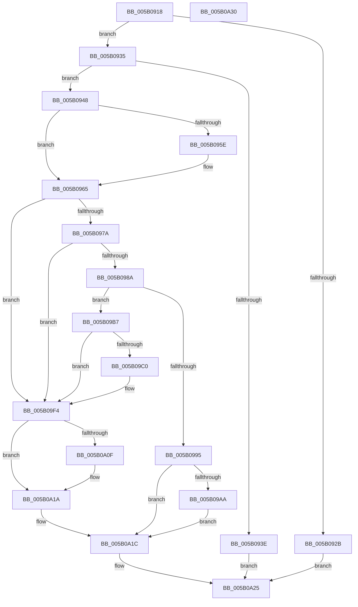

# KdDisableDebuggerWithLock

- RVA: `0x005B0918`–`0x005B0A31` (길이 `281` bytes)
- VA: `0x00000001405B0918`
- 실행 섹션: `.text`
- PDB 이름 있음: `예`; PDB Function 태그: `아니요`
- unwind 정보 RVA: `0x0005CAAC`
- 디코드: `66`개 명령, `281/281` bytes 표시
- 미해석 바이트: `0` (있으면 어셈블리에 `.byte`로 보존)

> 이 문서는 커널 이미지의 기계어와 PDB 기호를 분석해 생성했습니다. 4번과 5번은 함수 원형과 자료형을 바이너리 사용 방식에서 추정한 C 해석이며 원본 소스 복구 결과는 아닙니다.

## 1. Dependencies

- 직접 호출 지점: **9**; 고유 호출 대상: **7**
- 직접 호출자로 확인된 함수: **2**
- RIP 상대 이미지 참조: **12**

### Outgoing calls
- `0x005B0960` → [KiRaiseIrqlProcessIrqlFlags](../4F/KiRaiseIrqlProcessIrqlFlags_function_004F56FC.md) (function, `0x004F56FC`)
- `0x005B096C` → [KeAcquireSpinLockAtDpcLevel](../20/KeAcquireSpinLockAtDpcLevel_function_00208430.md) (function, `0x00208430`)
- `0x005B098A` → [KdpAllowDisable](../../pagekd/B8/KdpAllowDisable_function_00B895A0.md) (function, `0x00B895A0`)
- `0x005B099C` → [KxReleaseSpinLock](../20/KxReleaseSpinLock_function_00206670.md) (function, `0x00206670`)
- `0x005B09B0` → [KiLowerIrqlProcessIrqlFlags](../4F/KiLowerIrqlProcessIrqlFlags_function_004F5698.md) (function, `0x004F5698`)
- `0x005B09C0` → [KdpSuspendAllBreakpoints](../../pagekd/B8/KdpSuspendAllBreakpoints_function_00B89CA0.md) (function, `0x00B89CA0`)
- `0x005B09EF` → [KdPowerTransitionEx](../4D/KdPowerTransitionEx_function_004D9150.md) (function, `0x004D9150`)
- `0x005B0A01` → [KxReleaseSpinLock](../20/KxReleaseSpinLock_function_00206670.md) (function, `0x00206670`)
- `0x005B0A15` → [KiLowerIrqlProcessIrqlFlags](../4F/KiLowerIrqlProcessIrqlFlags_function_004F5698.md) (function, `0x004F5698`)

### Direct callers
- [KdDisableDebugger](KdDisableDebugger_function_005B0900.md) at `0x005B0904`
- [KdInitSystem](../../pagekd/B8/KdInitSystem_function_00B85E30.md) at `0x00B863D7`

### Static image references
- `0x005B0922` → RVA `0x00E0AA1C` (`.data`; read)
- `0x005B0935` → RVA `0x00F55CB2` (`.data`; read)
- `0x005B0955` → RVA `0x00FC6D20` (`ALMOSTRO`; read)
- `0x005B0965` → RVA `0x00FCF280` (`CACHEALI`; read)
- `0x005B0971` → RVA `0x00E66744` (`.data`; read)
- `0x005B097A` → RVA `0x00F475F8` (`.data`; read)
- `0x005B0980` → RVA `0x00E66748` (`.data`; write)
- `0x005B09C5` → RVA `0x00FC5008` (`ALMOSTRO`; read)
- `0x005B09DA` → RVA `0x00E664A8` (`.data`; read/write)
- `0x005B09E1` → RVA `0x00F475DC` (`.data`; write)
- `0x005B09E8` → RVA `0x00F475F8` (`.data`; write)
- `0x005B09F4` → RVA `0x00E66744` (`.data`; read/write)

## 2. Other-region calls and transfers

- 다른 실행 섹션으로 향하는 call: **2**
  - `0x005B098A` → [KdpAllowDisable](../../pagekd/B8/KdpAllowDisable_function_00B895A0.md) (`.text` → `PAGEKD`)
  - `0x005B09C0` → [KdpSuspendAllBreakpoints](../../pagekd/B8/KdpSuspendAllBreakpoints_function_00B89CA0.md) (`.text` → `PAGEKD`)
- 별도 외부 분기/꼬리 이동을 확인하지 못했습니다.

## 3. Assembly (complete function range)

```asm
005B0918  48 89 5C 24 08                  mov qword ptr [rsp + 8], rbx
005B091D  57                              push rdi
005B091E  48 83 EC 20                     sub rsp, 0x20
005B0922  80 3D F3 A0 85 00 00            cmp byte ptr [rip + 0x85a0f3], 0
005B0929  74 0A                           je 0x1405b0935
005B092B  B8 54 03 00 C0                  mov eax, 0xc0000354
005B0930  E9 F0 00 00 00                  jmp 0x1405b0a25
005B0935  80 3D 76 53 9A 00 00            cmp byte ptr [rip + 0x9a5376], 0
005B093C  74 0A                           je 0x1405b0948
005B093E  B8 22 00 00 C0                  mov eax, 0xc0000022
005B0943  E9 DD 00 00 00                  jmp 0x1405b0a25
005B0948  44 0F 20 C3                     mov rbx, cr8
005B094C  BA 02 00 00 00                  mov edx, 2
005B0951  44 0F 22 C2                     mov cr8, rdx
005B0955  83 3D C4 63 A1 00 00            cmp dword ptr [rip + 0xa163c4], 0
005B095C  74 07                           je 0x1405b0965
005B095E  8A CB                           mov cl, bl
005B0960  E8 97 4D F4 FF                  call 0x1404f56fc
005B0965  48 8D 0D 14 E9 A1 00            lea rcx, [rip + 0xa1e914]
005B096C  E8 BF 7A C5 FF                  call 0x140208430
005B0971  83 3D CC 5D 8B 00 00            cmp dword ptr [rip + 0x8b5dcc], 0
005B0978  75 7A                           jne 0x1405b09f4
005B097A  8A 05 78 6C 99 00               mov al, byte ptr [rip + 0x996c78]
005B0980  88 05 C2 5D 8B 00               mov byte ptr [rip + 0x8b5dc2], al
005B0986  84 C0                           test al, al
005B0988  74 6A                           je 0x1405b09f4
005B098A  E8 11 8C 5D 00                  call 0x140b895a0
005B098F  8B F8                           mov edi, eax
005B0991  85 C0                           test eax, eax
005B0993  79 22                           jns 0x1405b09b7
005B0995  48 8D 0D E4 E8 A1 00            lea rcx, [rip + 0xa1e8e4]
005B099C  E8 CF 5C C5 FF                  call 0x140206670
005B09A1  83 3D 78 63 A1 00 00            cmp dword ptr [rip + 0xa16378], 0
005B09A8  74 72                           je 0x1405b0a1c
005B09AA  44 0F 20 C1                     mov rcx, cr8
005B09AE  8A D3                           mov dl, bl
005B09B0  E8 E3 4C F4 FF                  call 0x1404f5698
005B09B5  EB 65                           jmp 0x1405b0a1c
005B09B7  80 3D 3A 6C 99 00 00            cmp byte ptr [rip + 0x996c3a], 0
005B09BE  74 34                           je 0x1405b09f4
005B09C0  E8 DB 92 5D 00                  call 0x140b89ca0
005B09C5  48 8B 05 3C 46 A1 00            mov rax, qword ptr [rip + 0xa1463c]
005B09CC  33 D2                           xor edx, edx
005B09CE  B9 04 00 00 40                  mov ecx, 0x40000004
005B09D3  C6 80 D4 02 00 00 00            mov byte ptr [rax + 0x2d4], 0
005B09DA  83 25 C7 5A 8B 00 00            and dword ptr [rip + 0x8b5ac7], 0
005B09E1  C6 05 F4 6B 99 00 01            mov byte ptr [rip + 0x996bf4], 1
005B09E8  C6 05 09 6C 99 00 00            mov byte ptr [rip + 0x996c09], 0
005B09EF  E8 5C 87 F2 FF                  call 0x1404d9150
005B09F4  FF 05 4A 5D 8B 00               inc dword ptr [rip + 0x8b5d4a]
005B09FA  48 8D 0D 7F E8 A1 00            lea rcx, [rip + 0xa1e87f]
005B0A01  E8 6A 5C C5 FF                  call 0x140206670
005B0A06  83 3D 13 63 A1 00 00            cmp dword ptr [rip + 0xa16313], 0
005B0A0D  74 0B                           je 0x1405b0a1a
005B0A0F  44 0F 20 C1                     mov rcx, cr8
005B0A13  8A D3                           mov dl, bl
005B0A15  E8 7E 4C F4 FF                  call 0x1404f5698
005B0A1A  33 FF                           xor edi, edi
005B0A1C  0F B6 C3                        movzx eax, bl
005B0A1F  44 0F 22 C0                     mov cr8, rax
005B0A23  8B C7                           mov eax, edi
005B0A25  48 8B 5C 24 30                  mov rbx, qword ptr [rsp + 0x30]
005B0A2A  48 83 C4 20                     add rsp, 0x20
005B0A2E  5F                              pop rdi
005B0A2F  C3                              ret
005B0A30  CC                              int3
```

## 4. C-style interpretation (structured pseudocode)

```c
__int64 __fastcall KdDisableDebuggerWithLock(void)
{
    __int64 result;
    __int64 v_rdi;
    __int64 v_rsp;
    unsigned __int64 v_stack_p8;

    v_stack_p8 = v_rbx;
    v_rsp = (v_rsp) - (32);
    if ((*(unsigned __int8 *)(v_rip + 8757491)) == 0) goto loc_005B0935;
    goto loc_005B0A25;
loc_005B0935:
    if ((*(unsigned __int8 *)(v_rip + 10113910)) == 0) goto loc_005B0948;
    goto loc_005B0A25;
loc_005B0948:
    result = (unsigned int)(0xC0000022ULL);
    if ((*(unsigned int *)(v_rip + 10576836)) != 0) {
        a1 = (unsigned __int8)(v_cr8);
        result = KiRaiseIrqlProcessIrqlFlags(a1, 2, a3, a4);
    }
    result = KeAcquireSpinLockAtDpcLevel(v_rip + 10610964, 2, a3, a4);
    if ((*(unsigned int *)(v_rip + 9133516)) != 0) goto loc_005B09F4;
    *(unsigned __int8 *)(v_rip + 9133506) = (unsigned __int8)(*(unsigned __int8 *)(v_rip + 10054776));
    if ((unsigned __int8)(*(unsigned __int8 *)(v_rip + 10054776)) == 0) goto loc_005B09F4;
    result = KdpAllowDisable(v_rip + 10610964, 2, a3, a4);
    if (!sign_flag) goto loc_005B09B7;
    result = KxReleaseSpinLock(v_rip + 10610916, 2, a3, a4);
    if ((*(unsigned int *)(v_rip + 10576760)) == 0) goto loc_005B0A1C;
    result = KiLowerIrqlProcessIrqlFlags(2, (unsigned __int8)(v_cr8), a3, a4);
    goto loc_005B0A1C;
loc_005B09B7:
    if ((*(unsigned __int8 *)(v_rip + 10054714)) != 0) {
        result = KdpSuspendAllBreakpoints(2, (unsigned __int8)(v_cr8), a3, a4);
        result = *(unsigned __int64 *)(v_rip + 10569276);
        a2 = 0;
        a1 = 0x40000004ULL;
        *(unsigned __int8 *)(result + 724) = 0;
        *(unsigned __int8 *)(v_rip + 10054644) = 1;
        *(unsigned __int8 *)(v_rip + 10054665) = 0;
        result = KdPowerTransitionEx(a1, a2, a3, a4);
    }
    result = KxReleaseSpinLock(v_rip + 10610815, a2, a3, a4);
    if ((*(unsigned int *)(v_rip + 10576659)) != 0) {
        a1 = 2;
        a2 = (unsigned __int8)(v_cr8);
        result = KiLowerIrqlProcessIrqlFlags(a1, a2, a3, a4);
    }
    v_rdi = 0;
loc_005B0A1C:
loc_005B0A25:
    v_rsp = (v_rsp) + (32);
    return 0;
}
```

## 5. (Beta) C Style

```c
void KdDisableDebuggerWithLock(void)
{
    int64_t result;
    int64_t local_rdi;
    int64_t local_rsp;
    uint64_t v_stack_p8;

    v_stack_p8 = local_rbx;
    local_rsp = (local_rsp) - (32);
    if ((*(uint8_t *)(v_rip + 0x85A0F3)) == 0) goto loc_005B0935;
    goto loc_005B0A25;
loc_005B0935:
    if ((*(uint8_t *)(v_rip + 0x9A5376)) == 0) goto loc_005B0948;
    goto loc_005B0A25;
loc_005B0948:
    result = (uint32_t)(0xC0000022ULL);
    if ((*(uint32_t *)(v_rip + 0xA163C4)) != 0) {
        a1 = (uint8_t)(v_cr8);
        result = KiRaiseIrqlProcessIrqlFlags(a1, 2, a3, a4);
    }
    result = KeAcquireSpinLockAtDpcLevel(v_rip + 10610964, 2, a3, a4);
    if ((*(uint32_t *)(v_rip + 0x8B5DCC)) != 0) goto loc_005B09F4;
    *(uint8_t *)(v_rip + 0x8B5DC2) = (uint8_t)(*(uint8_t *)(v_rip + 0x996C78));
    if ((uint8_t)(*(uint8_t *)(v_rip + 0x996C78)) == 0) goto loc_005B09F4;
    result = KdpAllowDisable(v_rip + 10610964, 2, a3, a4);
    if (!sign_flag) goto loc_005B09B7;
    result = KxReleaseSpinLock(v_rip + 10610916, 2, a3, a4);
    if ((*(uint32_t *)(v_rip + 0xA16378)) == 0) goto loc_005B0A1C;
    result = KiLowerIrqlProcessIrqlFlags(2, (uint8_t)(v_cr8), a3, a4);
    goto loc_005B0A1C;
loc_005B09B7:
    if ((*(uint8_t *)(v_rip + 0x996C3A)) != 0) {
        result = KdpSuspendAllBreakpoints(2, (uint8_t)(v_cr8), a3, a4);
        result = *(uint64_t *)(v_rip + 0xA1463C);
        a2 = 0;
        a1 = 0x40000004ULL;
        *(uint8_t *)(result + 0x2D4) = 0;
        *(uint8_t *)(v_rip + 0x996BF4) = 1;
        *(uint8_t *)(v_rip + 0x996C09) = 0;
        result = KdPowerTransitionEx(a1, a2, a3, a4);
    }
    result = KxReleaseSpinLock(v_rip + 10610815, a2, a3, a4);
    if ((*(uint32_t *)(v_rip + 0xA16313)) != 0) {
        a1 = 2;
        a2 = (uint8_t)(v_cr8);
        result = KiLowerIrqlProcessIrqlFlags(a1, a2, a3, a4);
    }
    local_rdi = 0;
loc_005B0A1C:
loc_005B0A25:
    local_rsp = (local_rsp) + (32);
    return 0;
}
```

## 6. Execution-region graph

[열기: 2D/3D 그래프와 함수 탐색 컨트롤 패널](../../../control-panel.html?section=text&rva=0x005B0918&view=graph)

- 2D 그래프는 위에서 아래로 흐르고, 3D 그래프는 빈 공간을 드래그해 회전합니다. Shift+드래그는 이동, 휠은 확대·축소, 함수 노드 선택은 대상 보고서 이동입니다.

### Static fallback


