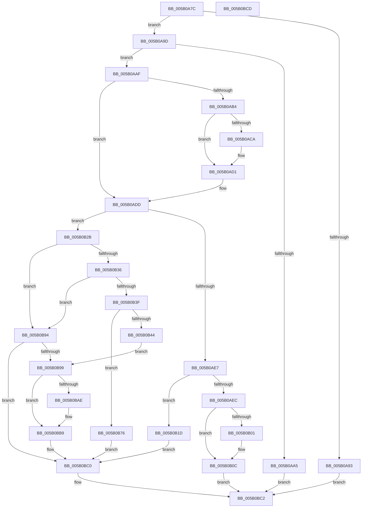

# KdEnableDebuggerWithLock

- RVA: `0x005B0A7C`–`0x005B0BCE` (길이 `338` bytes)
- VA: `0x00000001405B0A7C`
- 실행 섹션: `.text`
- PDB 이름 있음: `예`; PDB Function 태그: `아니요`
- unwind 정보 RVA: `0x0005CAAC`
- 디코드: `84`개 명령, `338/338` bytes 표시
- 미해석 바이트: `0` (있으면 어셈블리에 `.byte`로 보존)

> 이 문서는 커널 이미지의 기계어와 PDB 기호를 분석해 생성했습니다. 4번과 5번은 함수 원형과 자료형을 바이너리 사용 방식에서 추정한 C 해석이며 원본 소스 복구 결과는 아닙니다.

## 1. Dependencies

- 직접 호출 지점: **11**; 고유 호출 대상: **7**
- 직접 호출자로 확인된 함수: **2**
- RIP 상대 이미지 참조: **11**

### Outgoing calls
- `0x005B0ACC` → [KiRaiseIrqlProcessIrqlFlags](../4F/KiRaiseIrqlProcessIrqlFlags_function_004F56FC.md) (function, `0x004F56FC`)
- `0x005B0AD8` → [KeAcquireSpinLockAtDpcLevel](../20/KeAcquireSpinLockAtDpcLevel_function_00208430.md) (function, `0x00208430`)
- `0x005B0AF3` → [KxReleaseSpinLock](../20/KxReleaseSpinLock_function_00206670.md) (function, `0x00206670`)
- `0x005B0B07` → [KiLowerIrqlProcessIrqlFlags](../4F/KiLowerIrqlProcessIrqlFlags_function_004F5698.md) (function, `0x004F5698`)
- `0x005B0B21` → [KdInitSystem](../../pagekd/B8/KdInitSystem_function_00B85E30.md) (function, `0x00B85E30`)
- `0x005B0B4B` → [KdPowerTransitionEx](../4D/KdPowerTransitionEx_function_004D9150.md) (function, `0x004D9150`)
- `0x005B0B6F` → [KdpRestoreAllBreakpoints](../../pagekd/B8/KdpRestoreAllBreakpoints_function_00B89C58.md) (function, `0x00B89C58`)
- `0x005B0B81` → [KdInitSystem](../../pagekd/B8/KdInitSystem_function_00B85E30.md) (function, `0x00B85E30`)
- `0x005B0B86` → [KdpRestoreAllBreakpoints](../../pagekd/B8/KdpRestoreAllBreakpoints_function_00B89C58.md) (function, `0x00B89C58`)
- `0x005B0BA0` → [KxReleaseSpinLock](../20/KxReleaseSpinLock_function_00206670.md) (function, `0x00206670`)
- `0x005B0BB4` → [KiLowerIrqlProcessIrqlFlags](../4F/KiLowerIrqlProcessIrqlFlags_function_004F5698.md) (function, `0x004F5698`)

### Direct callers
- [KdEnableDebugger](KdEnableDebugger_function_005B0A40.md) at `0x005B0A59`
- [KeBugCheck2](KeBugCheck2_function_005B27D0.md) at `0x005B363B`

### Static image references
- `0x005B0A8B` → RVA `0x00E0AA1C` (`.data`; read)
- `0x005B0A9D` → RVA `0x00F55CB2` (`.data`; read)
- `0x005B0AC1` → RVA `0x00FC6D20` (`ALMOSTRO`; read)
- `0x005B0AD1` → RVA `0x00FCF280` (`CACHEALI`; read)
- `0x005B0ADD` → RVA `0x00E66744` (`.data`; read)
- `0x005B0B2E` → RVA `0x00E66744` (`.data`; write)
- `0x005B0B36` → RVA `0x00E66748` (`.data`; read)
- `0x005B0B50` → RVA `0x00FC5008` (`ALMOSTRO`; read)
- `0x005B0B57` → RVA `0x00E664A8` (`.data`; write)
- `0x005B0B61` → RVA `0x00F475F8` (`.data`; write)
- `0x005B0B78` → RVA `0x00E66740` (`.data`; write)

## 2. Other-region calls and transfers

- 다른 실행 섹션으로 향하는 call: **4**
  - `0x005B0B21` → [KdInitSystem](../../pagekd/B8/KdInitSystem_function_00B85E30.md) (`.text` → `PAGEKD`)
  - `0x005B0B6F` → [KdpRestoreAllBreakpoints](../../pagekd/B8/KdpRestoreAllBreakpoints_function_00B89C58.md) (`.text` → `PAGEKD`)
  - `0x005B0B81` → [KdInitSystem](../../pagekd/B8/KdInitSystem_function_00B85E30.md) (`.text` → `PAGEKD`)
  - `0x005B0B86` → [KdpRestoreAllBreakpoints](../../pagekd/B8/KdpRestoreAllBreakpoints_function_00B89C58.md) (`.text` → `PAGEKD`)
- 별도 외부 분기/꼬리 이동을 확인하지 못했습니다.

## 3. Assembly (complete function range)

```asm
005B0A7C  48 89 5C 24 08                  mov qword ptr [rsp + 8], rbx
005B0A81  57                              push rdi
005B0A82  48 83 EC 20                     sub rsp, 0x20
005B0A86  32 DB                           xor bl, bl
005B0A88  40 8A F9                        mov dil, cl
005B0A8B  38 1D 8B 9F 85 00               cmp byte ptr [rip + 0x859f8b], bl
005B0A91  74 0A                           je 0x1405b0a9d
005B0A93  B8 54 03 00 C0                  mov eax, 0xc0000354
005B0A98  E9 25 01 00 00                  jmp 0x1405b0bc2
005B0A9D  38 1D 0F 52 9A 00               cmp byte ptr [rip + 0x9a520f], bl
005B0AA3  74 0A                           je 0x1405b0aaf
005B0AA5  B8 22 00 00 C0                  mov eax, 0xc0000022
005B0AAA  E9 13 01 00 00                  jmp 0x1405b0bc2
005B0AAF  40 84 FF                        test dil, dil
005B0AB2  74 29                           je 0x1405b0add
005B0AB4  44 0F 20 C3                     mov rbx, cr8
005B0AB8  BA 02 00 00 00                  mov edx, 2
005B0ABD  44 0F 22 C2                     mov cr8, rdx
005B0AC1  83 3D 58 62 A1 00 00            cmp dword ptr [rip + 0xa16258], 0
005B0AC8  74 07                           je 0x1405b0ad1
005B0ACA  8A CB                           mov cl, bl
005B0ACC  E8 2B 4C F4 FF                  call 0x1404f56fc
005B0AD1  48 8D 0D A8 E7 A1 00            lea rcx, [rip + 0xa1e7a8]
005B0AD8  E8 53 79 C5 FF                  call 0x140208430
005B0ADD  8B 05 61 5C 8B 00               mov eax, dword ptr [rip + 0x8b5c61]
005B0AE3  85 C0                           test eax, eax
005B0AE5  75 44                           jne 0x1405b0b2b
005B0AE7  40 84 FF                        test dil, dil
005B0AEA  74 31                           je 0x1405b0b1d
005B0AEC  48 8D 0D 8D E7 A1 00            lea rcx, [rip + 0xa1e78d]
005B0AF3  E8 78 5B C5 FF                  call 0x140206670
005B0AF8  83 3D 21 62 A1 00 00            cmp dword ptr [rip + 0xa16221], 0
005B0AFF  74 0B                           je 0x1405b0b0c
005B0B01  44 0F 20 C1                     mov rcx, cr8
005B0B05  8A D3                           mov dl, bl
005B0B07  E8 8C 4B F4 FF                  call 0x1404f5698
005B0B0C  0F B6 C3                        movzx eax, bl
005B0B0F  44 0F 22 C0                     mov cr8, rax
005B0B13  B8 0D 00 00 C0                  mov eax, 0xc000000d
005B0B18  E9 A5 00 00 00                  jmp 0x1405b0bc2
005B0B1D  33 D2                           xor edx, edx
005B0B1F  33 C9                           xor ecx, ecx
005B0B21  E8 0A 53 5D 00                  call 0x140b85e30
005B0B26  E9 95 00 00 00                  jmp 0x1405b0bc0
005B0B2B  83 E8 01                        sub eax, 1
005B0B2E  89 05 10 5C 8B 00               mov dword ptr [rip + 0x8b5c10], eax
005B0B34  75 5E                           jne 0x1405b0b94
005B0B36  80 3D 0B 5C 8B 00 00            cmp byte ptr [rip + 0x8b5c0b], 0
005B0B3D  74 55                           je 0x1405b0b94
005B0B3F  40 84 FF                        test dil, dil
005B0B42  74 32                           je 0x1405b0b76
005B0B44  33 D2                           xor edx, edx
005B0B46  B9 01 00 00 40                  mov ecx, 0x40000001
005B0B4B  E8 00 86 F2 FF                  call 0x1404d9150
005B0B50  48 8B 05 B1 44 A1 00            mov rax, qword ptr [rip + 0xa144b1]
005B0B57  C7 05 47 59 8B 00 01 00 00 00   mov dword ptr [rip + 0x8b5947], 1
005B0B61  C6 05 90 6A 99 00 01            mov byte ptr [rip + 0x996a90], 1
005B0B68  C6 80 D4 02 00 00 01            mov byte ptr [rax + 0x2d4], 1
005B0B6F  E8 E4 90 5D 00                  call 0x140b89c58
005B0B74  EB 23                           jmp 0x1405b0b99
005B0B76  33 D2                           xor edx, edx
005B0B78  C6 05 C1 5B 8B 00 01            mov byte ptr [rip + 0x8b5bc1], 1
005B0B7F  33 C9                           xor ecx, ecx
005B0B81  E8 AA 52 5D 00                  call 0x140b85e30
005B0B86  E8 CD 90 5D 00                  call 0x140b89c58
005B0B8B  C6 05 AE 5B 8B 00 00            mov byte ptr [rip + 0x8b5bae], 0
005B0B92  EB 2C                           jmp 0x1405b0bc0
005B0B94  40 84 FF                        test dil, dil
005B0B97  74 27                           je 0x1405b0bc0
005B0B99  48 8D 0D E0 E6 A1 00            lea rcx, [rip + 0xa1e6e0]
005B0BA0  E8 CB 5A C5 FF                  call 0x140206670
005B0BA5  83 3D 74 61 A1 00 00            cmp dword ptr [rip + 0xa16174], 0
005B0BAC  74 0B                           je 0x1405b0bb9
005B0BAE  44 0F 20 C1                     mov rcx, cr8
005B0BB2  8A D3                           mov dl, bl
005B0BB4  E8 DF 4A F4 FF                  call 0x1404f5698
005B0BB9  0F B6 C3                        movzx eax, bl
005B0BBC  44 0F 22 C0                     mov cr8, rax
005B0BC0  33 C0                           xor eax, eax
005B0BC2  48 8B 5C 24 30                  mov rbx, qword ptr [rsp + 0x30]
005B0BC7  48 83 C4 20                     add rsp, 0x20
005B0BCB  5F                              pop rdi
005B0BCC  C3                              ret
005B0BCD  CC                              int3
```

## 4. C-style interpretation (structured pseudocode)

```c
__int64 __fastcall KdEnableDebuggerWithLock(unsigned __int8 a1)
{
    __int64 result;
    __int64 v_rbx;
    __int64 v_rsp;
    unsigned __int64 v_stack_p8;

    v_stack_p8 = v_rbx;
    v_rsp = (v_rsp) - (32);
    v_rbx = 0;
    if ((*(unsigned __int8 *)(v_rip + 8757131)) == 0) goto loc_005B0A9D;
    goto loc_005B0BC2;
loc_005B0A9D:
    if ((*(unsigned __int8 *)(v_rip + 10113551)) == 0) goto loc_005B0AAF;
    goto loc_005B0BC2;
loc_005B0AAF:
    if (a1 == 0) goto loc_005B0ADD;
    result = (unsigned int)(0xC0000022ULL);
    if ((*(unsigned int *)(v_rip + 10576472)) != 0) {
        a1 = (unsigned __int8)(v_cr8);
        result = KiRaiseIrqlProcessIrqlFlags(a1, 2, a3, a4);
    }
    result = KeAcquireSpinLockAtDpcLevel(v_rip + 10610600, 2, a3, a4);
loc_005B0ADD:
    if ((unsigned int)((unsigned int)(*(unsigned int *)(v_rip + 9133153))) != 0) goto loc_005B0B2B;
    if (a1 == 0) goto loc_005B0B1D;
    result = KxReleaseSpinLock(v_rip + 10610573, 2, a3, a4);
    if ((*(unsigned int *)(v_rip + 10576417)) != 0) {
        a1 = 2;
        a2 = (unsigned __int8)(v_cr8);
        result = KiLowerIrqlProcessIrqlFlags(a1, a2, a3, a4);
    }
    goto loc_005B0BC2;
loc_005B0B1D:
    a2 = 0;
    a1 = 0;
    result = KdInitSystem(a1, a2, a3, a4);
    goto loc_005B0BC0;
loc_005B0B2B:
    result = (unsigned int)((result) - (1));
    *(unsigned int *)(v_rip + 9133072) = (unsigned int)(result);
    if (condition_is_not_equal) goto loc_005B0B94;
    if ((*(unsigned __int8 *)(v_rip + 9133067)) == 0) goto loc_005B0B94;
    if (0 == 0) goto loc_005B0B76;
    a2 = 0;
    result = KdPowerTransitionEx((unsigned int)(0x40000001ULL), a2, a3, a4);
    *(unsigned int *)(v_rip + 9132359) = 1;
    *(unsigned __int8 *)(v_rip + 10054288) = 1;
    *(unsigned __int8 *)(*(unsigned __int64 *)(v_rip + 10568881) + 724) = 1;
    result = KdpRestoreAllBreakpoints((unsigned int)(0x40000001ULL), a2, a3, a4);
    goto loc_005B0B99;
loc_005B0B76:
    a2 = 0;
    *(unsigned __int8 *)(v_rip + 9132993) = 1;
    a1 = 0;
    result = KdInitSystem(a1, a2, a3, a4);
    result = KdpRestoreAllBreakpoints(a1, a2, a3, a4);
    *(unsigned __int8 *)(v_rip + 9132974) = 0;
    goto loc_005B0BC0;
loc_005B0B94:
    if (0 == 0) goto loc_005B0BC0;
loc_005B0B99:
    result = KxReleaseSpinLock(v_rip + 10610400, a2, a3, a4);
    if ((*(unsigned int *)(v_rip + 10576244)) != 0) {
        a1 = (unsigned __int8)(v_cr8);
        a2 = (unsigned __int8)(v_cr8);
        result = KiLowerIrqlProcessIrqlFlags(a1, a2, a3, a4);
    }
loc_005B0BC0:
    result = 0;
loc_005B0BC2:
    v_rsp = (v_rsp) + (32);
    return result;
}
```

## 5. (Beta) C Style

```c
int64_t KdEnableDebuggerWithLock(uint8_t Arg1)
{
    int64_t result;
    int64_t local_rbx;
    int64_t local_rsp;
    uint64_t v_stack_p8;

    v_stack_p8 = local_rbx;
    local_rsp = (local_rsp) - (32);
    local_rbx = 0;
    if ((*(uint8_t *)(v_rip + 0x859F8B)) == 0) goto loc_005B0A9D;
    goto loc_005B0BC2;
loc_005B0A9D:
    if ((*(uint8_t *)(v_rip + 0x9A520F)) == 0) goto loc_005B0AAF;
    goto loc_005B0BC2;
loc_005B0AAF:
    if (Arg1 == 0) goto loc_005B0ADD;
    result = (uint32_t)(0xC0000022ULL);
    if ((*(uint32_t *)(v_rip + 0xA16258)) != 0) {
        Arg1 = (uint8_t)(v_cr8);
        result = KiRaiseIrqlProcessIrqlFlags(Arg1, 2, a3, a4);
    }
    result = KeAcquireSpinLockAtDpcLevel(v_rip + 10610600, 2, a3, a4);
loc_005B0ADD:
    if ((uint32_t)((uint32_t)(*(uint32_t *)(v_rip + 0x8B5C61))) != 0) goto loc_005B0B2B;
    if (Arg1 == 0) goto loc_005B0B1D;
    result = KxReleaseSpinLock(v_rip + 10610573, 2, a3, a4);
    if ((*(uint32_t *)(v_rip + 0xA16221)) != 0) {
        Arg1 = 2;
        a2 = (uint8_t)(v_cr8);
        result = KiLowerIrqlProcessIrqlFlags(Arg1, a2, a3, a4);
    }
    goto loc_005B0BC2;
loc_005B0B1D:
    a2 = 0;
    Arg1 = 0;
    result = KdInitSystem(Arg1, a2, a3, a4);
    goto loc_005B0BC0;
loc_005B0B2B:
    result = (uint32_t)((result) - (1));
    *(uint32_t *)(v_rip + 0x8B5C10) = (uint32_t)(result);
    if (condition_is_not_equal) goto loc_005B0B94;
    if ((*(uint8_t *)(v_rip + 0x8B5C0B)) == 0) goto loc_005B0B94;
    if (0 == 0) goto loc_005B0B76;
    a2 = 0;
    result = KdPowerTransitionEx((uint32_t)(0x40000001ULL), a2, a3, a4);
    *(uint32_t *)(v_rip + 0x8B5947) = 1;
    *(uint8_t *)(v_rip + 0x996A90) = 1;
    *(uint8_t *)(*(uint64_t *)(v_rip + 0xA144B1) + 0x2D4) = 1;
    result = KdpRestoreAllBreakpoints((uint32_t)(0x40000001ULL), a2, a3, a4);
    goto loc_005B0B99;
loc_005B0B76:
    a2 = 0;
    *(uint8_t *)(v_rip + 0x8B5BC1) = 1;
    Arg1 = 0;
    result = KdInitSystem(Arg1, a2, a3, a4);
    result = KdpRestoreAllBreakpoints(Arg1, a2, a3, a4);
    *(uint8_t *)(v_rip + 0x8B5BAE) = 0;
    goto loc_005B0BC0;
loc_005B0B94:
    if (0 == 0) goto loc_005B0BC0;
loc_005B0B99:
    result = KxReleaseSpinLock(v_rip + 10610400, a2, a3, a4);
    if ((*(uint32_t *)(v_rip + 0xA16174)) != 0) {
        Arg1 = (uint8_t)(v_cr8);
        a2 = (uint8_t)(v_cr8);
        result = KiLowerIrqlProcessIrqlFlags(Arg1, a2, a3, a4);
    }
loc_005B0BC0:
    result = 0;
loc_005B0BC2:
    local_rsp = (local_rsp) + (32);
    return result;
}
```

## 6. Execution-region graph

[열기: 2D/3D 그래프와 함수 탐색 컨트롤 패널](../../../control-panel.html?section=text&rva=0x005B0A7C&view=graph)

- 2D 그래프는 위에서 아래로 흐르고, 3D 그래프는 빈 공간을 드래그해 회전합니다. Shift+드래그는 이동, 휠은 확대·축소, 함수 노드 선택은 대상 보고서 이동입니다.

### Static fallback


