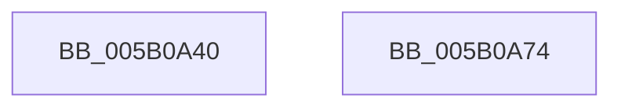

# KdEnableDebugger

- RVA: `0x005B0A40`–`0x005B0A75` (길이 `53` bytes)
- VA: `0x00000001405B0A40`
- 실행 섹션: `.text`
- PDB 이름 있음: `예`; PDB Function 태그: `아니요`
- unwind 정보 RVA: `0x0005CAAC`
- 디코드: `17`개 명령, `53/53` bytes 표시
- 미해석 바이트: `0` (있으면 어셈블리에 `.byte`로 보존)

> 이 문서는 커널 이미지의 기계어와 PDB 기호를 분석해 생성했습니다. 4번과 5번은 함수 원형과 자료형을 바이너리 사용 방식에서 추정한 C 해석이며 원본 소스 복구 결과는 아닙니다.

## 1. Dependencies

- 직접 호출 지점: **3**; 고유 호출 대상: **2**
- 직접 호출자로 확인된 함수: **5**
- RIP 상대 이미지 참조: **0**

### Outgoing calls
- `0x005B0A4F` → [KeRelaxTimingConstraints](KeRelaxTimingConstraints_function_005B59C8.md) (function, `0x005B59C8`)
- `0x005B0A59` → [KdEnableDebuggerWithLock](KdEnableDebuggerWithLock_function_005B0A7C.md) (function, `0x005B0A7C`)
- `0x005B0A62` → [KeRelaxTimingConstraints](KeRelaxTimingConstraints_function_005B59C8.md) (function, `0x005B59C8`)

### Direct callers
- [KdpStub](../43/KdpStub_function_004316C0.md) at `0x0043176C`
- [sub_00B3F842](../../page/B3/Unknown_function_00B3F842.md) at `0x00B3FAF5`
- [KeCheckedKernelInitialize](../../init/BE/KeCheckedKernelInitialize_function_00BEFA6C.md) at `0x00BEFAF9`
- [KiFilterFiberContext](../../init/BE/KiFilterFiberContext_function_00BEFB50.md) at `0x00BEFF6A`
- [sub_00C7F7B0](../../init/C7/Unknown_function_00C7F7B0.md) at `0x00C7F83B`

### Static image references
- 디코드된 RIP-relative 메모리 참조가 없습니다.

## 2. Other-region calls and transfers

- 다른 실행 섹션으로 향하는 call: **0**
- 별도 외부 분기/꼬리 이동을 확인하지 못했습니다.

## 3. Assembly (complete function range)

```asm
005B0A40  48 89 5C 24 08                  mov qword ptr [rsp + 8], rbx
005B0A45  57                              push rdi
005B0A46  48 83 EC 20                     sub rsp, 0x20
005B0A4A  B9 01 00 00 00                  mov ecx, 1
005B0A4F  E8 74 4F 00 00                  call 0x1405b59c8
005B0A54  B1 01                           mov cl, 1
005B0A56  0F B6 F8                        movzx edi, al
005B0A59  E8 1E 00 00 00                  call 0x1405b0a7c
005B0A5E  8B CF                           mov ecx, edi
005B0A60  8B D8                           mov ebx, eax
005B0A62  E8 61 4F 00 00                  call 0x1405b59c8
005B0A67  8B C3                           mov eax, ebx
005B0A69  48 8B 5C 24 30                  mov rbx, qword ptr [rsp + 0x30]
005B0A6E  48 83 C4 20                     add rsp, 0x20
005B0A72  5F                              pop rdi
005B0A73  C3                              ret
005B0A74  CC                              int3
```

## 4. C-style interpretation (structured pseudocode)

```c
__int64 __fastcall KdEnableDebugger(void)
{
    __int64 result;
    __int64 v_rsp;
    unsigned __int64 v_stack_p8;

    v_stack_p8 = v_rbx;
    v_rsp = (v_rsp) - (32);
    result = KeRelaxTimingConstraints(1, a2, a3, a4);
    result = KdEnableDebuggerWithLock(1, a2, a3, a4);
    result = KeRelaxTimingConstraints((unsigned int)((unsigned int)((unsigned __int8)(result))), a2, a3, a4);
    v_rsp = (v_rsp) + (32);
    return (unsigned int)((unsigned int)((unsigned int)((unsigned int)(result))));
}
```

## 5. (Beta) C Style

```c
void KdEnableDebugger(void)
{
    int64_t result;
    int64_t local_rsp;
    uint64_t v_stack_p8;

    v_stack_p8 = local_rbx;
    local_rsp = (local_rsp) - (32);
    result = KeRelaxTimingConstraints(1, a2, a3, a4);
    result = KdEnableDebuggerWithLock(1, a2, a3, a4);
    result = KeRelaxTimingConstraints((uint32_t)((uint32_t)((uint8_t)(result))), a2, a3, a4);
    local_rsp = (local_rsp) + (32);
    return (uint32_t)((uint32_t)((uint32_t)((uint32_t)(result))));
}
```

## 6. Execution-region graph

[열기: 2D/3D 그래프와 함수 탐색 컨트롤 패널](../../../control-panel.html?section=text&rva=0x005B0A40&view=graph)

- 2D 그래프는 위에서 아래로 흐르고, 3D 그래프는 빈 공간을 드래그해 회전합니다. Shift+드래그는 이동, 휠은 확대·축소, 함수 노드 선택은 대상 보고서 이동입니다.

### Static fallback


