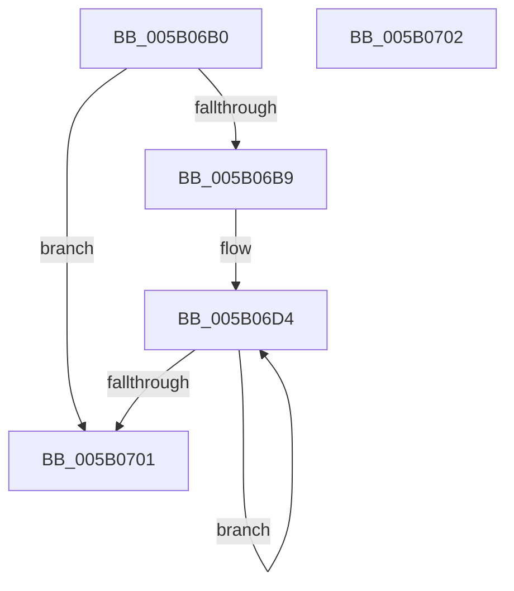

# KdEncodeDataBlock

- RVA: `0x005B06B0`–`0x005B0703` (길이 `83` bytes)
- VA: `0x00000001405B06B0`
- 실행 섹션: `.text`
- PDB 이름 있음: `예`; PDB Function 태그: `아니요`
- unwind 정보 RVA: `0x000DB714`
- 디코드: `20`개 명령, `83/83` bytes 표시
- 미해석 바이트: `0` (있으면 어셈블리에 `.byte`로 보존)

> 이 문서는 커널 이미지의 기계어와 PDB 기호를 분석해 생성했습니다. 4번과 5번은 함수 원형과 자료형을 바이너리 사용 방식에서 추정한 C 해석이며 원본 소스 복구 결과는 아닙니다.

## 1. Dependencies

- 직접 호출 지점: **0**; 고유 호출 대상: **0**
- 직접 호출자로 확인된 함수: **2**
- RIP 상대 이미지 참조: **6**

### Outgoing calls
- 직접 디코드된 call 명령이 없습니다.

### Direct callers
- [IopLiveDumpCollectPages](../59/IopLiveDumpCollectPages_function_0059B328.md) at `0x0059B642`
- [KeInitSystem](../../init/C7/KeInitSystem_function_00C71660.md) at `0x00C719F2`

### Static image references
- `0x005B06B0` → RVA `0x00E0AA1D` (`.data`; read)
- `0x005B06B9` → RVA `0x00FC6F78` (`ALMOSTRO`; read)
- `0x005B06C0` → RVA `0x00E01060` (`.data`; read)
- `0x005B06C7` → RVA `0x00E663E8` (`.data`; write)
- `0x005B06D7` → RVA `0x00E663E8` (`.data`; read)
- `0x005B06DE` → RVA `0x00FC7250` (`ALMOSTRO`; read)

## 2. Other-region calls and transfers

- 다른 실행 섹션으로 향하는 call: **0**
- 별도 외부 분기/꼬리 이동을 확인하지 못했습니다.

## 3. Assembly (complete function range)

```asm
005B06B0  80 3D 66 A3 85 00 00            cmp byte ptr [rip + 0x85a366], 0
005B06B7  74 48                           je 0x1405b0701
005B06B9  4C 8B 0D B8 68 A1 00            mov r9, qword ptr [rip + 0xa168b8]
005B06C0  48 8D 15 99 09 85 00            lea rdx, [rip + 0x850999]
005B06C7  C6 05 1A 5D 8B 00 01            mov byte ptr [rip + 0x8b5d1a], 1
005B06CE  41 B8 74 00 00 00               mov r8d, 0x74
005B06D4  48 8B 02                        mov rax, qword ptr [rdx]
005B06D7  48 8D 0D 0A 5D 8B 00            lea rcx, [rip + 0x8b5d0a]
005B06DE  48 33 05 6B 6B A1 00            xor rax, qword ptr [rip + 0xa16b6b]
005B06E5  48 0F C8                        bswap rax
005B06E8  48 33 C1                        xor rax, rcx
005B06EB  41 8B C9                        mov ecx, r9d
005B06EE  48 D3 C8                        ror rax, cl
005B06F1  49 33 C1                        xor rax, r9
005B06F4  48 89 02                        mov qword ptr [rdx], rax
005B06F7  48 8D 52 08                     lea rdx, [rdx + 8]
005B06FB  41 83 C0 FF                     add r8d, -1
005B06FF  75 D3                           jne 0x1405b06d4
005B0701  C3                              ret
005B0702  CC                              int3
```

## 4. C-style interpretation (structured pseudocode)

```c
__int64 __fastcall KdEncodeDataBlock(void)
{
    __int64 result;

    if ((*(unsigned __int8 *)(v_rip + 8758118)) == 0) goto loc_005B0701;
    *(unsigned __int8 *)(v_rip + 9133338) = 1;
loc_005B06D4:
    result = (*(unsigned __int64 *)(v_rip + 8718745)) ^ (*(unsigned __int64 *)(v_rip + 10578795));
    result = (result) ^ (v_rip + 9133322);
    result = (result) ^ (*(unsigned __int64 *)(v_rip + 10578104));
    *(unsigned __int64 *)(v_rip + 8718745) = result;
    a3 = (unsigned int)((116) + (-1));
    if (condition_is_not_equal) goto loc_005B06D4;
loc_005B0701:
    return result;
}
```

## 5. (Beta) C Style

```c
void KdEncodeDataBlock(void)
{
    int64_t result;

    if ((*(uint8_t *)(v_rip + 0x85A366)) == 0) goto loc_005B0701;
    *(uint8_t *)(v_rip + 0x8B5D1A) = 1;
loc_005B06D4:
    result = (*(uint64_t *)(v_rip + 0x850999)) ^ (*(uint64_t *)(v_rip + 0xA16B6B));
    result = (result) ^ (v_rip + 9133322);
    result = (result) ^ (*(uint64_t *)(v_rip + 0xA168B8));
    *(uint64_t *)(v_rip + 0x850999) = result;
    a3 = (uint32_t)((116) + (-1));
    if (condition_is_not_equal) goto loc_005B06D4;
loc_005B0701:
    return result;
}
```

## 6. Execution-region graph

[열기: 2D/3D 그래프와 함수 탐색 컨트롤 패널](../../../control-panel.html?section=text&rva=0x005B06B0&view=graph)

- 2D 그래프는 위에서 아래로 흐르고, 3D 그래프는 빈 공간을 드래그해 회전합니다. Shift+드래그는 이동, 휠은 확대·축소, 함수 노드 선택은 대상 보고서 이동입니다.

### Static fallback


