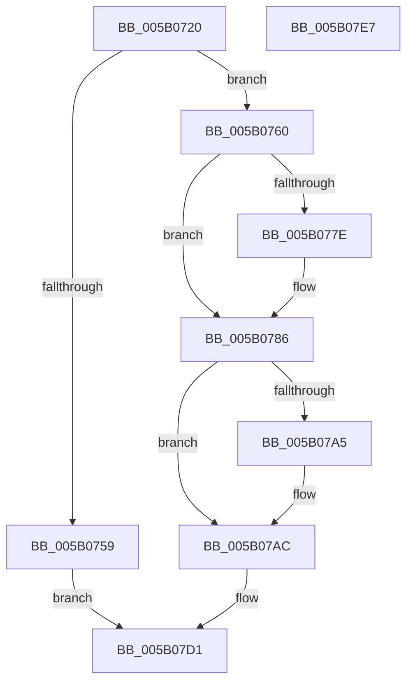

# KdRegisterPowerHandler

- RVA: `0x005B0720`–`0x005B07E8` (길이 `200` bytes)
- VA: `0x00000001405B0720`
- 실행 섹션: `.text`
- PDB 이름 있음: `예`; PDB Function 태그: `아니요`
- unwind 정보 RVA: `0x0006F978`
- 디코드: `50`개 명령, `200/200` bytes 표시
- 미해석 바이트: `0` (있으면 어셈블리에 `.byte`로 보존)

> 이 문서는 커널 이미지의 기계어와 PDB 기호를 분석해 생성했습니다. 4번과 5번은 함수 원형과 자료형을 바이너리 사용 방식에서 추정한 C 해석이며 원본 소스 복구 결과는 아닙니다.

## 1. Dependencies

- 직접 호출 지점: **4**; 고유 호출 대상: **4**
- 직접 호출자로 확인된 함수: **0**
- RIP 상대 이미지 참조: **5**

### Outgoing calls
- `0x005B074C` → [ExAllocatePool2](../../poolcode/B8/ExAllocatePool2_function_00B820F0.md) (function, `0x00B820F0`)
- `0x005B0781` → [KiRaiseIrqlProcessIrqlFlags](../4F/KiRaiseIrqlProcessIrqlFlags_function_004F56FC.md) (function, `0x004F56FC`)
- `0x005B078D` → [KeAcquireSpinLockAtDpcLevel](../20/KeAcquireSpinLockAtDpcLevel_function_00208430.md) (function, `0x00208430`)
- `0x005B07C7` → [KeReleaseSpinLock](../39/KeReleaseSpinLock_function_00392BA0.md) (function, `0x00392BA0`)

### Direct callers
- 이 함수 시작 RVA로 연결되는 직접 call은 확인되지 않았습니다. 간접 호출은 완전히 역산할 수 없습니다.

### Static image references
- `0x005B0775` → RVA `0x00FC6D20` (`ALMOSTRO`; read)
- `0x005B0786` → RVA `0x00E664A0` (`.data`; read)
- `0x005B0792` → RVA `0x00F55C98` (`.data`; read)
- `0x005B0799` → RVA `0x00F55C90` (`.data`; read)
- `0x005B07C0` → RVA `0x00F55C98` (`.data`; write)

## 2. Other-region calls and transfers

- 다른 실행 섹션으로 향하는 call: **1**
  - `0x005B074C` → [ExAllocatePool2](../../poolcode/B8/ExAllocatePool2_function_00B820F0.md) (`.text` → `POOLCODE`)
- 별도 외부 분기/꼬리 이동을 확인하지 못했습니다.

## 3. Assembly (complete function range)

```asm
005B0720  48 89 5C 24 08                  mov qword ptr [rsp + 8], rbx
005B0725  48 89 74 24 10                  mov qword ptr [rsp + 0x10], rsi
005B072A  48 89 7C 24 18                  mov qword ptr [rsp + 0x18], rdi
005B072F  41 56                           push r14
005B0731  48 83 EC 20                     sub rsp, 0x20
005B0735  48 8B FA                        mov rdi, rdx
005B0738  4D 8B F0                        mov r14, r8
005B073B  BA 20 00 00 00                  mov edx, 0x20
005B0740  48 8B F1                        mov rsi, rcx
005B0743  41 B8 4B 64 49 6F               mov r8d, 0x6f49644b
005B0749  8D 4A 20                        lea ecx, [rdx + 0x20]
005B074C  E8 9F 19 5D 00                  call 0x140b820f0
005B0751  48 8B D8                        mov rbx, rax
005B0754  48 85 C0                        test rax, rax
005B0757  75 07                           jne 0x1405b0760
005B0759  B8 9A 00 00 C0                  mov eax, 0xc000009a
005B075E  EB 71                           jmp 0x1405b07d1
005B0760  48 89 70 10                     mov qword ptr [rax + 0x10], rsi
005B0764  48 89 78 18                     mov qword ptr [rax + 0x18], rdi
005B0768  44 0F 20 C7                     mov rdi, cr8
005B076C  BA 0F 00 00 00                  mov edx, 0xf
005B0771  44 0F 22 C2                     mov cr8, rdx
005B0775  83 3D A4 65 A1 00 00            cmp dword ptr [rip + 0xa165a4], 0
005B077C  74 08                           je 0x1405b0786
005B077E  40 8A CF                        mov cl, dil
005B0781  E8 76 4F F4 FF                  call 0x1404f56fc
005B0786  48 8D 0D 13 5D 8B 00            lea rcx, [rip + 0x8b5d13]
005B078D  E8 9E 7C C5 FF                  call 0x140208430
005B0792  48 8B 05 FF 54 9A 00            mov rax, qword ptr [rip + 0x9a54ff]
005B0799  48 8D 0D F0 54 9A 00            lea rcx, [rip + 0x9a54f0]
005B07A0  48 39 08                        cmp qword ptr [rax], rcx
005B07A3  74 07                           je 0x1405b07ac
005B07A5  B9 03 00 00 00                  mov ecx, 3
005B07AA  CD 29                           int 0x29
005B07AC  48 89 0B                        mov qword ptr [rbx], rcx
005B07AF  40 8A D7                        mov dl, dil
005B07B2  48 89 43 08                     mov qword ptr [rbx + 8], rax
005B07B6  48 8D 0D E3 5C 8B 00            lea rcx, [rip + 0x8b5ce3]
005B07BD  48 89 18                        mov qword ptr [rax], rbx
005B07C0  48 89 1D D1 54 9A 00            mov qword ptr [rip + 0x9a54d1], rbx
005B07C7  E8 D4 23 DE FF                  call 0x140392ba0
005B07CC  33 C0                           xor eax, eax
005B07CE  49 89 1E                        mov qword ptr [r14], rbx
005B07D1  48 8B 5C 24 30                  mov rbx, qword ptr [rsp + 0x30]
005B07D6  48 8B 74 24 38                  mov rsi, qword ptr [rsp + 0x38]
005B07DB  48 8B 7C 24 40                  mov rdi, qword ptr [rsp + 0x40]
005B07E0  48 83 C4 20                     add rsp, 0x20
005B07E4  41 5E                           pop r14
005B07E6  C3                              ret
005B07E7  CC                              int3
```

## 4. C-style interpretation (structured pseudocode)

```c
__int64 __fastcall KdRegisterPowerHandler(__int64 a1, __int64 a2, __int64 a3)
{
    __int64 result;
    __int64 v_rsp;
    unsigned __int64 v_stack_p10;
    unsigned __int64 v_stack_p18;
    unsigned __int64 v_stack_p8;

    v_stack_p8 = v_rbx;
    v_stack_p10 = v_rsi;
    v_stack_p18 = v_rdi;
    v_rsp = (v_rsp) - (32);
    result = ExAllocatePool2(32 + 32, 32, (unsigned int)(0x6F49644BULL), a4);
    if (result != 0) goto loc_005B0760;
    goto loc_005B07D1;
loc_005B0760:
    *(unsigned __int64 *)((unsigned int)(0xC000009AULL) + 16) = a1;
    *(unsigned __int64 *)((unsigned int)(0xC000009AULL) + 24) = a2;
    result = (unsigned int)(0xC000009AULL);
    if ((*(unsigned int *)(v_rip + 10577316)) != 0) {
        a1 = (unsigned __int8)(v_cr8);
        result = KiRaiseIrqlProcessIrqlFlags(a1, 15, (unsigned int)(0x6F49644BULL), a4);
    }
    result = KeAcquireSpinLockAtDpcLevel(v_rip + 9133331, 15, (unsigned int)(0x6F49644BULL), a4);
    if ((*(unsigned __int64 *)(*(unsigned __int64 *)(v_rip + 10114303))) != (v_rip + 10114288)) {
        a1 = 3;
    }
    *(unsigned __int64 *)(result) = a1;
    *(unsigned __int64 *)(result + 8) = *(unsigned __int64 *)(v_rip + 10114303);
    *(unsigned __int64 *)(*(unsigned __int64 *)(v_rip + 10114303)) = result;
    *(unsigned __int64 *)(v_rip + 10114257) = result;
    result = KeReleaseSpinLock(v_rip + 9133283, (unsigned __int8)(v_cr8), (unsigned int)(0x6F49644BULL), a4);
    result = 0;
    *(unsigned __int64 *)(a3) = 0;
loc_005B07D1:
    v_rsp = (v_rsp) + (32);
    return result;
}
```

## 5. (Beta) C Style

```c
int64_t KdRegisterPowerHandler(int64_t Arg1, int64_t Arg2, void *Arg3)
{
    uint8_t *arg3 = (uint8_t *)Arg3;

    int64_t result;
    int64_t local_rsp;
    uint64_t v_stack_p10;
    uint64_t v_stack_p18;
    uint64_t v_stack_p8;

    v_stack_p8 = local_rbx;
    v_stack_p10 = local_rsi;
    v_stack_p18 = local_rdi;
    local_rsp = (local_rsp) - (32);
    result = ExAllocatePool2(32 + 32, 32, (uint32_t)(0x6F49644BULL), a4);
    if (result != 0) goto loc_005B0760;
    goto loc_005B07D1;
loc_005B0760:
    *(uint64_t *)((uint32_t)(0xC000009AULL) + 0x10) = Arg1;
    *(uint64_t *)((uint32_t)(0xC000009AULL) + 0x18) = Arg2;
    result = (uint32_t)(0xC000009AULL);
    if ((*(uint32_t *)(v_rip + 0xA165A4)) != 0) {
        Arg1 = (uint8_t)(v_cr8);
        result = KiRaiseIrqlProcessIrqlFlags(Arg1, 15, (uint32_t)(0x6F49644BULL), a4);
    }
    result = KeAcquireSpinLockAtDpcLevel(v_rip + 9133331, 15, (uint32_t)(0x6F49644BULL), a4);
    if ((*(uint64_t *)(*(uint64_t *)(v_rip + 0x9A54FF))) != (v_rip + 10114288)) {
        Arg1 = 3;
    }
    *(uint64_t *)(result) = Arg1;
    *(uint64_t *)(result + 0x8) = *(uint64_t *)(v_rip + 0x9A54FF);
    *(uint64_t *)(*(uint64_t *)(v_rip + 0x9A54FF)) = result;
    *(uint64_t *)(v_rip + 0x9A54D1) = result;
    result = KeReleaseSpinLock(v_rip + 9133283, (uint8_t)(v_cr8), (uint32_t)(0x6F49644BULL), a4);
    result = 0;
    *(uint64_t *)(arg3) = 0;
loc_005B07D1:
    local_rsp = (local_rsp) + (32);
    return result;
}
```

### 관측된 메모리 오프셋

구조체 형식이 확인되지 않은 접근은 인자 기준의 오프셋으로만 기록했습니다.

| 기준 인자 | 오프셋 표현 | 폭 (bit) | 접근 |
|---|---:|---:|---|
| `Arg3` | `+ 0x0` | `64` | `W` |

## 6. Execution-region graph

[열기: 2D/3D 그래프와 함수 탐색 컨트롤 패널](../../../control-panel.html?section=text&rva=0x005B0720&view=graph)

- 2D 그래프는 위에서 아래로 흐르고, 3D 그래프는 빈 공간을 드래그해 회전합니다. Shift+드래그는 이동, 휠은 확대·축소, 함수 노드 선택은 대상 보고서 이동입니다.

### Static fallback


