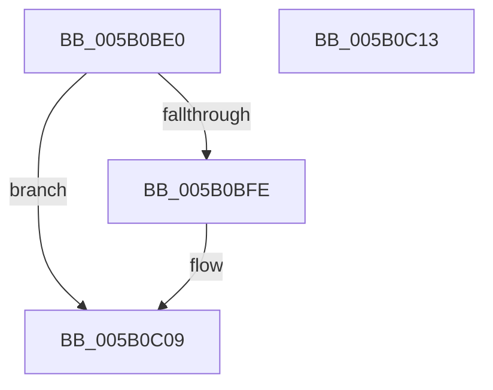

# KdReleaseDebuggerLock

- RVA: `0x005B0BE0`–`0x005B0C14` (길이 `52` bytes)
- VA: `0x00000001405B0BE0`
- 실행 섹션: `.text`
- PDB 이름 있음: `예`; PDB Function 태그: `아니요`
- unwind 정보 RVA: `0x0005CF00`
- 디코드: `15`개 명령, `52/52` bytes 표시
- 미해석 바이트: `0` (있으면 어셈블리에 `.byte`로 보존)

> 이 문서는 커널 이미지의 기계어와 PDB 기호를 분석해 생성했습니다. 4번과 5번은 함수 원형과 자료형을 바이너리 사용 방식에서 추정한 C 해석이며 원본 소스 복구 결과는 아닙니다.

## 1. Dependencies

- 직접 호출 지점: **2**; 고유 호출 대상: **2**
- 직접 호출자로 확인된 함수: **0**
- RIP 상대 이미지 참조: **2**

### Outgoing calls
- `0x005B0BF0` → [KxReleaseSpinLock](../20/KxReleaseSpinLock_function_00206670.md) (function, `0x00206670`)
- `0x005B0C04` → [KiLowerIrqlProcessIrqlFlags](../4F/KiLowerIrqlProcessIrqlFlags_function_004F5698.md) (function, `0x004F5698`)

### Direct callers
- 이 함수 시작 RVA로 연결되는 직접 call은 확인되지 않았습니다. 간접 호출은 완전히 역산할 수 없습니다.

### Static image references
- `0x005B0BE9` → RVA `0x00FCF280` (`CACHEALI`; read)
- `0x005B0BF5` → RVA `0x00FC6D20` (`ALMOSTRO`; read)

## 2. Other-region calls and transfers

- 다른 실행 섹션으로 향하는 call: **0**
- 별도 외부 분기/꼬리 이동을 확인하지 못했습니다.

## 3. Assembly (complete function range)

```asm
005B0BE0  40 53                           push rbx
005B0BE2  48 83 EC 20                     sub rsp, 0x20
005B0BE6  0F B6 D9                        movzx ebx, cl
005B0BE9  48 8D 0D 90 E6 A1 00            lea rcx, [rip + 0xa1e690]
005B0BF0  E8 7B 5A C5 FF                  call 0x140206670
005B0BF5  83 3D 24 61 A1 00 00            cmp dword ptr [rip + 0xa16124], 0
005B0BFC  74 0B                           je 0x1405b0c09
005B0BFE  44 0F 20 C1                     mov rcx, cr8
005B0C02  8A D3                           mov dl, bl
005B0C04  E8 8F 4A F4 FF                  call 0x1404f5698
005B0C09  44 0F 22 C3                     mov cr8, rbx
005B0C0D  48 83 C4 20                     add rsp, 0x20
005B0C11  5B                              pop rbx
005B0C12  C3                              ret
005B0C13  CC                              int3
```

## 4. C-style interpretation (structured pseudocode)

```c
__int64 __fastcall KdReleaseDebuggerLock(unsigned __int8 a1)
{
    __int64 result;
    __int64 v_rsp;

    v_rsp = (v_rsp) - (32);
    result = KxReleaseSpinLock(v_rip + 10610320, a2, a3, a4);
    if ((*(unsigned int *)(v_rip + 10576164)) != 0) {
        a1 = v_cr8;
        a2 = a1;
        result = KiLowerIrqlProcessIrqlFlags(a1, a2, a3, a4);
    }
    v_rsp = (v_rsp) + (32);
    return result;
}
```

## 5. (Beta) C Style

```c
int64_t KdReleaseDebuggerLock(uint8_t Arg1)
{
    int64_t result;
    int64_t local_rsp;

    local_rsp = (local_rsp) - (32);
    result = KxReleaseSpinLock(v_rip + 10610320, a2, a3, a4);
    if ((*(uint32_t *)(v_rip + 0xA16124)) != 0) {
        Arg1 = v_cr8;
        a2 = Arg1;
        result = KiLowerIrqlProcessIrqlFlags(Arg1, a2, a3, a4);
    }
    local_rsp = (local_rsp) + (32);
    return result;
}
```

## 6. Execution-region graph

[열기: 2D/3D 그래프와 함수 탐색 컨트롤 패널](../../../control-panel.html?section=text&rva=0x005B0BE0&view=graph)

- 2D 그래프는 위에서 아래로 흐르고, 3D 그래프는 빈 공간을 드래그해 회전합니다. Shift+드래그는 이동, 휠은 확대·축소, 함수 노드 선택은 대상 보고서 이동입니다.

### Static fallback


