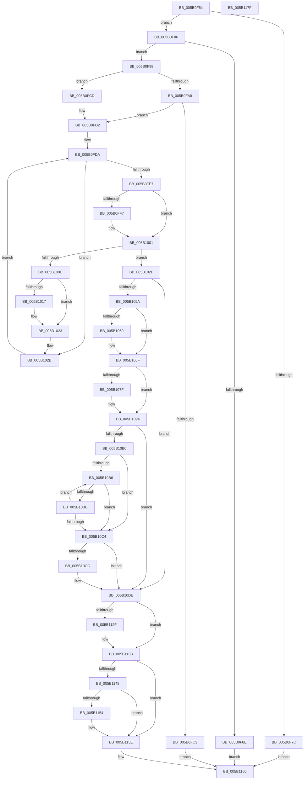

# KdSetDbgPrintBufferSize

- RVA: `0x005B0F54`–`0x005B1180` (길이 `556` bytes)
- VA: `0x00000001405B0F54`
- 실행 섹션: `.text`
- PDB 이름 있음: `예`; PDB Function 태그: `아니요`
- unwind 정보 RVA: `0x0005FEF8`
- 디코드: `146`개 명령, `556/556` bytes 표시
- 미해석 바이트: `0` (있으면 어셈블리에 `.byte`로 보존)

> 이 문서는 커널 이미지의 기계어와 PDB 기호를 분석해 생성했습니다. 4번과 5번은 함수 원형과 자료형을 바이너리 사용 방식에서 추정한 C 해석이며 원본 소스 복구 결과는 아닙니다.

## 1. Dependencies

- 직접 호출 지점: **9**; 고유 호출 대상: **6**
- 직접 호출자로 확인된 함수: **2**
- RIP 상대 이미지 참조: **16**

### Outgoing calls
- `0x005B0FB6` → [ExAllocatePool2](../../poolcode/B8/ExAllocatePool2_function_00B820F0.md) (function, `0x00B820F0`)
- `0x005B0FFC` → [KiRaiseIrqlProcessIrqlFlags](../4F/KiRaiseIrqlProcessIrqlFlags_function_004F56FC.md) (function, `0x004F56FC`)
- `0x005B101E` → [KiLowerIrqlProcessIrqlFlags](../4F/KiLowerIrqlProcessIrqlFlags_function_004F5698.md) (function, `0x004F5698`)
- `0x005B108F` → [memcpy](../6C/memcpy_function_006C6840.md) (function, `0x006C6840`)
- `0x005B109E` → [memcpy](../6C/memcpy_function_006C6840.md) (function, `0x006C6840`)
- `0x005B10D9` → [memcpy](../6C/memcpy_function_006C6840.md) (function, `0x006C6840`)
- `0x005B10ED` → [memset](../6C/memset_function_006C6C40.md) (function, `0x006C6C40`)
- `0x005B1136` → [KiLowerIrqlProcessIrqlFlags](../4F/KiLowerIrqlProcessIrqlFlags_function_004F5698.md) (function, `0x004F5698`)
- `0x005B1159` → [ExFreePoolWithTag](../../poolcode/B8/ExFreePoolWithTag_function_00B82870.md) (function, `0x00B82870`)

### Direct callers
- [sub_00B3F842](../../page/B3/Unknown_function_00B3F842.md) at `0x00B3FA79`
- [MiInitSystem](../../init/C5/MiInitSystem_function_00C5E6C0.md) at `0x00C5E844`

### Static image references
- `0x005B0F71` → RVA `0x00E0AA1C` (`.data`; read)
- `0x005B0F9D` → RVA `0x00F47600` (`.data`; read)
- `0x005B0FDB` → RVA `0x00E664C0` (`.data`; read)
- `0x005B0FEF` → RVA `0x00FC6D20` (`ALMOSTRO`; read)
- `0x005B103A` → RVA `0x00E0AA54` (`.data`; read)
- `0x005B1040` → RVA `0x00E07090` (`.data`; read)
- `0x005B104A` → RVA `0x00E664C8` (`.data`; write)
- `0x005B105A` → RVA `0x00E07098` (`.data`; read)
- `0x005B1069` → RVA `0x00F475FC` (`.data`; write)
- `0x005B1075` → RVA `0x00F475FC` (`.data`; read)
- `0x005B10F2` → RVA `0x00F48608` (`.data`; read/write)
- `0x005B10FA` → RVA `0x00E664C8` (`.data`; read/write)
- `0x005B1102` → RVA `0x00E07090` (`.data`; write)
- `0x005B1109` → RVA `0x00E0AA54` (`.data`; write)
- `0x005B110F` → RVA `0x00E07098` (`.data`; write)
- `0x005B1120` → RVA `0x00E664C0` (`.data`; read/write)

## 2. Other-region calls and transfers

- 다른 실행 섹션으로 향하는 call: **2**
  - `0x005B0FB6` → [ExAllocatePool2](../../poolcode/B8/ExAllocatePool2_function_00B820F0.md) (`.text` → `POOLCODE`)
  - `0x005B1159` → [ExFreePoolWithTag](../../poolcode/B8/ExFreePoolWithTag_function_00B82870.md) (`.text` → `POOLCODE`)
- 별도 외부 분기/꼬리 이동을 확인하지 못했습니다.

## 3. Assembly (complete function range)

```asm
005B0F54  48 8B C4                        mov rax, rsp
005B0F57  48 89 58 08                     mov qword ptr [rax + 8], rbx
005B0F5B  48 89 68 10                     mov qword ptr [rax + 0x10], rbp
005B0F5F  48 89 70 18                     mov qword ptr [rax + 0x18], rsi
005B0F63  48 89 78 20                     mov qword ptr [rax + 0x20], rdi
005B0F67  41 54                           push r12
005B0F69  41 56                           push r14
005B0F6B  41 57                           push r15
005B0F6D  48 83 EC 20                     sub rsp, 0x20
005B0F71  80 3D A4 9A 85 00 00            cmp byte ptr [rip + 0x859aa4], 0
005B0F78  8B E9                           mov ebp, ecx
005B0F7A  74 0A                           je 0x1405b0f86
005B0F7C  B8 54 03 00 C0                  mov eax, 0xc0000354
005B0F81  E9 DA 01 00 00                  jmp 0x1405b1160
005B0F86  81 FD 00 00 00 01               cmp ebp, 0x1000000
005B0F8C  76 0A                           jbe 0x1405b0f98
005B0F8E  B8 EF 00 00 C0                  mov eax, 0xc00000ef
005B0F93  E9 C8 01 00 00                  jmp 0x1405b1160
005B0F98  B8 00 10 00 00                  mov eax, 0x1000
005B0F9D  48 8D 0D 5C 66 99 00            lea rcx, [rip + 0x99665c]
005B0FA4  3B E8                           cmp ebp, eax
005B0FA6  76 25                           jbe 0x1405b0fcd
005B0FA8  48 8B D5                        mov rdx, rbp
005B0FAB  B9 42 00 00 00                  mov ecx, 0x42
005B0FB0  41 B8 4B 64 50 62               mov r8d, 0x6250644b
005B0FB6  E8 35 11 5D 00                  call 0x140b820f0
005B0FBB  48 8B F0                        mov rsi, rax
005B0FBE  48 85 C0                        test rax, rax
005B0FC1  75 0F                           jne 0x1405b0fd2
005B0FC3  B8 17 00 00 C0                  mov eax, 0xc0000017
005B0FC8  E9 93 01 00 00                  jmp 0x1405b1160
005B0FCD  8B E8                           mov ebp, eax
005B0FCF  48 8B F1                        mov rsi, rcx
005B0FD2  BB 0F 00 00 00                  mov ebx, 0xf
005B0FD7  8D 7B F2                        lea edi, [rbx - 0xe]
005B0FDA  90                              nop
005B0FDB  48 8B 05 DE 54 8B 00            mov rax, qword ptr [rip + 0x8b54de]
005B0FE2  48 85 C0                        test rax, rax
005B0FE5  75 44                           jne 0x1405b102b
005B0FE7  45 0F 20 C7                     mov r15, cr8
005B0FEB  44 0F 22 C3                     mov cr8, rbx
005B0FEF  39 05 2B 5D A1 00               cmp dword ptr [rip + 0xa15d2b], eax
005B0FF5  74 0A                           je 0x1405b1001
005B0FF7  8A D3                           mov dl, bl
005B0FF9  41 8A CF                        mov cl, r15b
005B0FFC  E8 FB 46 F4 FF                  call 0x1404f56fc
005B1001  33 C0                           xor eax, eax
005B1003  F0 48 0F B1 3D B4 54 8B 00      lock cmpxchg qword ptr [rip + 0x8b54b4], rdi
005B100C  74 21                           je 0x1405b102f
005B100E  83 3D 0B 5D A1 00 00            cmp dword ptr [rip + 0xa15d0b], 0
005B1015  74 0C                           je 0x1405b1023
005B1017  44 0F 20 C1                     mov rcx, cr8
005B101B  41 8A D7                        mov dl, r15b
005B101E  E8 75 46 F4 FF                  call 0x1404f5698
005B1023  41 0F B6 C7                     movzx eax, r15b
005B1027  44 0F 22 C0                     mov cr8, rax
005B102B  F3 90                           pause
005B102D  EB AB                           jmp 0x1405b0fda
005B102F  65 48 8B 04 25 20 00 00 00      mov rax, qword ptr gs:[0x20]
005B1038  33 FF                           xor edi, edi
005B103A  8B 0D 14 9A 85 00               mov ecx, dword ptr [rip + 0x859a14]
005B1040  4C 8B 35 49 60 85 00            mov r14, qword ptr [rip + 0x856049]
005B1047  44 8B E5                        mov r12d, ebp
005B104A  48 89 05 77 54 8B 00            mov qword ptr [rip + 0x8b5477], rax
005B1051  4C 3B E1                        cmp r12, rcx
005B1054  0F 86 84 00 00 00               jbe 0x1405b10de
005B105A  48 8B 05 37 60 85 00            mov rax, qword ptr [rip + 0x856037]
005B1061  49 2B C6                        sub rax, r14
005B1064  48 3B C1                        cmp rax, rcx
005B1067  72 06                           jb 0x1405b106f
005B1069  89 3D 8D 65 99 00               mov dword ptr [rip + 0x99658d], edi
005B106F  48 1B DB                        sbb rbx, rbx
005B1072  48 23 D8                        and rbx, rax
005B1075  8B 05 81 65 99 00               mov eax, dword ptr [rip + 0x996581]
005B107B  85 C0                           test eax, eax
005B107D  74 15                           je 0x1405b1094
005B107F  48 8B F9                        mov rdi, rcx
005B1082  4A 8D 14 33                     lea rdx, [rbx + r14]
005B1086  48 2B FB                        sub rdi, rbx
005B1089  48 8B CE                        mov rcx, rsi
005B108C  4C 8B C7                        mov r8, rdi
005B108F  E8 AC 57 11 00                  call 0x1406c6840
005B1094  48 8D 0C 3E                     lea rcx, [rsi + rdi]
005B1098  4C 8B C3                        mov r8, rbx
005B109B  49 8B D6                        mov rdx, r14
005B109E  E8 9D 57 11 00                  call 0x1406c6840
005B10A3  8B 05 53 65 99 00               mov eax, dword ptr [rip + 0x996553]
005B10A9  48 03 FB                        add rdi, rbx
005B10AC  85 C0                           test eax, eax
005B10AE  74 2E                           je 0x1405b10de
005B10B0  33 C0                           xor eax, eax
005B10B2  38 06                           cmp byte ptr [rsi], al
005B10B4  74 0E                           je 0x1405b10c4
005B10B6  48 3B C7                        cmp rax, rdi
005B10B9  73 09                           jae 0x1405b10c4
005B10BB  48 FF C0                        inc rax
005B10BE  80 3C 06 00                     cmp byte ptr [rsi + rax], 0
005B10C2  75 F2                           jne 0x1405b10b6
005B10C4  48 FF C0                        inc rax
005B10C7  48 3B C7                        cmp rax, rdi
005B10CA  73 12                           jae 0x1405b10de
005B10CC  48 2B F8                        sub rdi, rax
005B10CF  48 8D 14 06                     lea rdx, [rsi + rax]
005B10D3  4C 8B C7                        mov r8, rdi
005B10D6  48 8B CE                        mov rcx, rsi
005B10D9  E8 62 57 11 00                  call 0x1406c6840
005B10DE  48 8D 1C 3E                     lea rbx, [rsi + rdi]
005B10E2  4C 2B E7                        sub r12, rdi
005B10E5  4D 8B C4                        mov r8, r12
005B10E8  48 8B CB                        mov rcx, rbx
005B10EB  33 D2                           xor edx, edx
005B10ED  E8 4E 5B 11 00                  call 0x1406c6c40
005B10F2  FF 05 10 75 99 00               inc dword ptr [rip + 0x997510]
005B10F8  33 C0                           xor eax, eax
005B10FA  48 83 25 C6 53 8B 00 00         and qword ptr [rip + 0x8b53c6], 0
005B1102  48 89 35 87 5F 85 00            mov qword ptr [rip + 0x855f87], rsi
005B1109  89 2D 45 99 85 00               mov dword ptr [rip + 0x859945], ebp
005B110F  48 89 1D 82 5F 85 00            mov qword ptr [rip + 0x855f82], rbx
005B1116  C7 05 DC 64 99 00 00 00 00 00   mov dword ptr [rip + 0x9964dc], 0
005B1120  87 05 9A 53 8B 00               xchg dword ptr [rip + 0x8b539a], eax
005B1126  83 3D F3 5B A1 00 00            cmp dword ptr [rip + 0xa15bf3], 0
005B112D  74 0C                           je 0x1405b113b
005B112F  44 0F 20 C1                     mov rcx, cr8
005B1133  41 8A D7                        mov dl, r15b
005B1136  E8 5D 45 F4 FF                  call 0x1404f5698
005B113B  41 0F B6 C7                     movzx eax, r15b
005B113F  44 0F 22 C0                     mov cr8, rax
005B1143  4D 85 F6                        test r14, r14
005B1146  74 16                           je 0x1405b115e
005B1148  48 8D 05 B1 64 99 00            lea rax, [rip + 0x9964b1]
005B114F  4C 3B F0                        cmp r14, rax
005B1152  74 0A                           je 0x1405b115e
005B1154  33 D2                           xor edx, edx
005B1156  49 8B CE                        mov rcx, r14
005B1159  E8 12 17 5D 00                  call 0x140b82870
005B115E  33 C0                           xor eax, eax
005B1160  48 8B 5C 24 40                  mov rbx, qword ptr [rsp + 0x40]
005B1165  48 8B 6C 24 48                  mov rbp, qword ptr [rsp + 0x48]
005B116A  48 8B 74 24 50                  mov rsi, qword ptr [rsp + 0x50]
005B116F  48 8B 7C 24 58                  mov rdi, qword ptr [rsp + 0x58]
005B1174  48 83 C4 20                     add rsp, 0x20
005B1178  41 5F                           pop r15
005B117A  41 5E                           pop r14
005B117C  41 5C                           pop r12
005B117E  C3                              ret
005B117F  CC                              int3
```

## 4. C-style interpretation (structured pseudocode)

```c
__int64 __fastcall KdSetDbgPrintBufferSize(int a1)
{
    __int64 result;
    __int64 v_r12;
    __int64 v_rbx;
    __int64 v_rdi;
    __int64 v_rsp;
    unsigned __int64 v_stack_p10;
    unsigned __int64 v_stack_p18;
    unsigned __int64 v_stack_p20;
    unsigned __int64 v_stack_p8;

    *(unsigned __int64 *)(v_rsp + 8) = v_rbx;
    *(unsigned __int64 *)(v_rsp + 16) = v_rbp;
    *(unsigned __int64 *)(v_rsp + 24) = v_rsi;
    *(unsigned __int64 *)(v_rsp + 32) = v_rdi;
    v_rsp = (v_rsp) - (32);
    if ((*(unsigned __int8 *)(v_rip + 8755876)) == 0) goto loc_005B0F86;
    goto loc_005B1160;
loc_005B0F86:
    if (((unsigned int)((unsigned int)(a1))) <= 0x1000000ULL) goto loc_005B0F98;
    goto loc_005B1160;
loc_005B0F98:
    if (((unsigned int)((unsigned int)(a1))) <= ((unsigned int)((unsigned int)(0x1000ULL)))) goto loc_005B0FCD;
    result = ExAllocatePool2(66, (unsigned int)(a1), (unsigned int)(0x6250644BULL), a4);
    if (result != 0) goto loc_005B0FD2;
    goto loc_005B1160;
loc_005B0FCD:
loc_005B0FD2:
loc_005B0FDA:
    if (*(unsigned __int64 *)(v_rip + 9131230) != 0) goto loc_005B102B;
    result = *(unsigned __int64 *)(v_rip + 9131230);
    if ((*(unsigned int *)(v_rip + 10575147)) != ((unsigned int)(*(unsigned __int64 *)(v_rip + 9131230)))) {
        a2 = 15;
        a1 = (unsigned __int8)(v_cr8);
        result = KiRaiseIrqlProcessIrqlFlags(a1, a2, (unsigned int)(0x6250644BULL), a4);
    }
    result = 0;
    if (condition_is_equal) goto loc_005B102F;
    if ((*(unsigned int *)(v_rip + 10575115)) != 0) {
        a1 = 15;
        a2 = (unsigned __int8)(v_cr8);
        result = KiLowerIrqlProcessIrqlFlags(a1, a2, (unsigned int)(0x6250644BULL), a4);
    }
loc_005B102B:
    goto loc_005B0FDA;
loc_005B102F:
    v_rdi = 0;
    *(unsigned __int64 *)(v_rip + 9131127) = *(unsigned __int64 *)(gs_base + (0 + 32));
    if (((unsigned int)((unsigned int)((unsigned int)((unsigned int)((unsigned int)(0xC0000017ULL)))))) <= ((unsigned int)(*(unsigned int *)(v_rip + 8755732)))) goto loc_005B10DE;
    result = (*(unsigned __int64 *)(v_rip + 8740919)) - (*(unsigned __int64 *)(v_rip + 8740937));
    if (result >= ((unsigned int)(*(unsigned int *)(v_rip + 8755732)))) {
        *(unsigned int *)(v_rip + 10053005) = 0;
    }
    v_rbx = (15) & (result);
    result = (unsigned int)(*(unsigned int *)(v_rip + 10052993));
    if ((unsigned int)((unsigned int)(*(unsigned int *)(v_rip + 10052993))) != 0) {
        v_rdi = (unsigned int)(*(unsigned int *)(v_rip + 8755732));
        a2 = v_rbx + *(unsigned __int64 *)(v_rip + 8740937) * 1;
        v_rdi = (v_rdi) - (v_rbx);
        a1 = 66;
        a3 = v_rdi;
        result = memcpy(a1, a2, a3, a4);
    }
    result = memcpy(66 + v_rdi * 1, *(unsigned __int64 *)(v_rip + 8740937), v_rbx, a4);
    v_rdi = (v_rdi) + (v_rbx);
    if ((unsigned int)((unsigned int)(*(unsigned int *)(v_rip + 10052947))) == 0) goto loc_005B10DE;
    result = 0;
    if ((*(unsigned __int8 *)(66)) == 0) goto loc_005B10C4;
loc_005B10B6:
    if (0 >= v_rdi) goto loc_005B10C4;
    result = (result) + 1;
    if ((*(unsigned __int8 *)(66 + result * 1)) != 0) goto loc_005B10B6;
loc_005B10C4:
    result = (result) + 1;
    if (result < v_rdi) {
        v_rdi = (v_rdi) - (result);
        a2 = 66 + result * 1;
        a3 = v_rdi;
        a1 = 66;
        result = memcpy(a1, a2, a3, a4);
    }
    v_r12 = ((unsigned int)((unsigned int)((unsigned int)((unsigned int)((unsigned int)(0xC0000017ULL)))))) - (v_rdi);
    a2 = 0;
    result = memset(66 + v_rdi * 1, a2, v_r12, a4);
    result = 0;
    *(unsigned __int64 *)(v_rip + 8740743) = 66;
    *(unsigned int *)(v_rip + 8755525) = (unsigned int)((unsigned int)((unsigned int)((unsigned int)(0xC0000017ULL))));
    *(unsigned __int64 *)(v_rip + 8740738) = 66 + v_rdi * 1;
    *(unsigned int *)(v_rip + 10052828) = 0;
    if ((*(unsigned int *)(v_rip + 10574835)) != 0) {
        a1 = (unsigned __int8)(v_cr8);
        a2 = (unsigned __int8)(v_cr8);
        result = KiLowerIrqlProcessIrqlFlags(a1, a2, v_r12, a4);
    }
    if (*(unsigned __int64 *)(v_rip + 8740937) == 0) goto loc_005B115E;
    result = v_rip + 10052785;
    if ((*(unsigned __int64 *)(v_rip + 8740937)) != (v_rip + 10052785)) {
        a2 = 0;
        a1 = *(unsigned __int64 *)(v_rip + 8740937);
        result = ExFreePoolWithTag(a1, a2, v_r12, a4);
    }
    result = 0;
loc_005B1160:
    v_rsp = (v_rsp) + (32);
    return result;
}
```

## 5. (Beta) C Style

```c
int64_t KdSetDbgPrintBufferSize(int32_t Arg1)
{
    int64_t result;
    int64_t local_r12;
    int64_t local_rbx;
    int64_t local_rdi;
    int64_t local_rsp;
    uint64_t v_stack_p10;
    uint64_t v_stack_p18;
    uint64_t v_stack_p20;
    uint64_t v_stack_p8;

    *(uint64_t *)(local_rsp + 0x8) = local_rbx;
    *(uint64_t *)(local_rsp + 0x10) = local_rbp;
    *(uint64_t *)(local_rsp + 0x18) = local_rsi;
    *(uint64_t *)(local_rsp + 0x20) = local_rdi;
    local_rsp = (local_rsp) - (32);
    if ((*(uint8_t *)(v_rip + 0x859AA4)) == 0) goto loc_005B0F86;
    goto loc_005B1160;
loc_005B0F86:
    if (((uint32_t)((uint32_t)(Arg1))) <= 0x1000000ULL) goto loc_005B0F98;
    goto loc_005B1160;
loc_005B0F98:
    if (((uint32_t)((uint32_t)(Arg1))) <= ((uint32_t)((uint32_t)(0x1000ULL)))) goto loc_005B0FCD;
    result = ExAllocatePool2(66, (uint32_t)(Arg1), (uint32_t)(0x6250644BULL), a4);
    if (result != 0) goto loc_005B0FD2;
    goto loc_005B1160;
loc_005B0FCD:
loc_005B0FD2:
loc_005B0FDA:
    if (*(uint64_t *)(v_rip + 0x8B54DE) != 0) goto loc_005B102B;
    result = *(uint64_t *)(v_rip + 0x8B54DE);
    if ((*(uint32_t *)(v_rip + 0xA15D2B)) != ((uint32_t)(*(uint64_t *)(v_rip + 0x8B54DE)))) {
        a2 = 15;
        Arg1 = (uint8_t)(v_cr8);
        result = KiRaiseIrqlProcessIrqlFlags(Arg1, a2, (uint32_t)(0x6250644BULL), a4);
    }
    result = 0;
    if (condition_is_equal) goto loc_005B102F;
    if ((*(uint32_t *)(v_rip + 0xA15D0B)) != 0) {
        Arg1 = 15;
        a2 = (uint8_t)(v_cr8);
        result = KiLowerIrqlProcessIrqlFlags(Arg1, a2, (uint32_t)(0x6250644BULL), a4);
    }
loc_005B102B:
    goto loc_005B0FDA;
loc_005B102F:
    local_rdi = 0;
    *(uint64_t *)(v_rip + 0x8B5477) = *(uint64_t *)(gs_base + (0 + 0x20));
    if (((uint32_t)((uint32_t)((uint32_t)((uint32_t)((uint32_t)(0xC0000017ULL)))))) <= ((uint32_t)(*(uint32_t *)(v_rip + 0x859A14)))) goto loc_005B10DE;
    result = (*(uint64_t *)(v_rip + 0x856037)) - (*(uint64_t *)(v_rip + 0x856049));
    if (result >= ((uint32_t)(*(uint32_t *)(v_rip + 0x859A14)))) {
        *(uint32_t *)(v_rip + 0x99658D) = 0;
    }
    local_rbx = (15) & (result);
    result = (uint32_t)(*(uint32_t *)(v_rip + 0x996581));
    if ((uint32_t)((uint32_t)(*(uint32_t *)(v_rip + 0x996581))) != 0) {
        local_rdi = (uint32_t)(*(uint32_t *)(v_rip + 0x859A14));
        a2 = local_rbx + *(uint64_t *)(v_rip + 0x856049) * 1;
        local_rdi = (local_rdi) - (local_rbx);
        Arg1 = 66;
        a3 = local_rdi;
        result = memcpy(Arg1, a2, a3, a4);
    }
    result = memcpy(66 + local_rdi * 1, *(uint64_t *)(v_rip + 0x856049), local_rbx, a4);
    local_rdi = (local_rdi) + (local_rbx);
    if ((uint32_t)((uint32_t)(*(uint32_t *)(v_rip + 0x996553))) == 0) goto loc_005B10DE;
    result = 0;
    if ((*(uint8_t *)(66)) == 0) goto loc_005B10C4;
loc_005B10B6:
    if (0 >= local_rdi) goto loc_005B10C4;
    result = (result) + 1;
    if ((*(uint8_t *)(66 + result * 1)) != 0) goto loc_005B10B6;
loc_005B10C4:
    result = (result) + 1;
    if (result < local_rdi) {
        local_rdi = (local_rdi) - (result);
        a2 = 66 + result * 1;
        a3 = local_rdi;
        Arg1 = 66;
        result = memcpy(Arg1, a2, a3, a4);
    }
    local_r12 = ((uint32_t)((uint32_t)((uint32_t)((uint32_t)((uint32_t)(0xC0000017ULL)))))) - (local_rdi);
    a2 = 0;
    result = memset(66 + local_rdi * 1, a2, local_r12, a4);
    result = 0;
    *(uint64_t *)(v_rip + 0x855F87) = 66;
    *(uint32_t *)(v_rip + 0x859945) = (uint32_t)((uint32_t)((uint32_t)((uint32_t)(0xC0000017ULL))));
    *(uint64_t *)(v_rip + 0x855F82) = 66 + local_rdi * 1;
    *(uint32_t *)(v_rip + 0x9964DC) = 0;
    if ((*(uint32_t *)(v_rip + 0xA15BF3)) != 0) {
        Arg1 = (uint8_t)(v_cr8);
        a2 = (uint8_t)(v_cr8);
        result = KiLowerIrqlProcessIrqlFlags(Arg1, a2, local_r12, a4);
    }
    if (*(uint64_t *)(v_rip + 0x856049) == 0) goto loc_005B115E;
    result = v_rip + 10052785;
    if ((*(uint64_t *)(v_rip + 0x856049)) != (v_rip + 10052785)) {
        a2 = 0;
        Arg1 = *(uint64_t *)(v_rip + 0x856049);
        result = ExFreePoolWithTag(Arg1, a2, local_r12, a4);
    }
    result = 0;
loc_005B1160:
    local_rsp = (local_rsp) + (32);
    return result;
}
```

## 6. Execution-region graph

[열기: 2D/3D 그래프와 함수 탐색 컨트롤 패널](../../../control-panel.html?section=text&rva=0x005B0F54&view=graph)

- 2D 그래프는 위에서 아래로 흐르고, 3D 그래프는 빈 공간을 드래그해 회전합니다. Shift+드래그는 이동, 휠은 확대·축소, 함수 노드 선택은 대상 보고서 이동입니다.

### Static fallback


