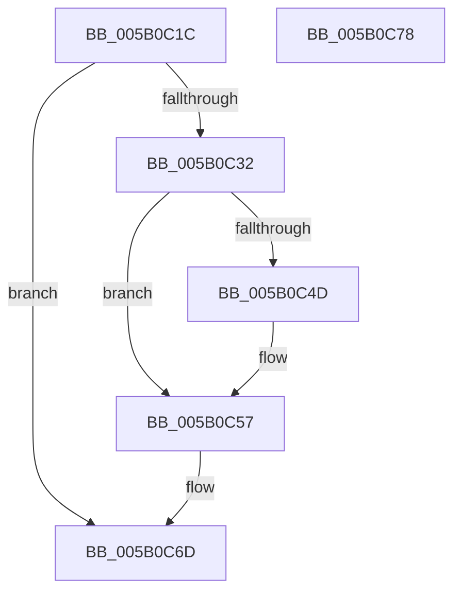

# KdUpdateTimeSlipEvent

- RVA: `0x005B0C1C`–`0x005B0C79` (길이 `93` bytes)
- VA: `0x00000001405B0C1C`
- 실행 섹션: `.text`
- PDB 이름 있음: `예`; PDB Function 태그: `아니요`
- unwind 정보 RVA: `0x0005CAAC`
- 디코드: `23`개 명령, `93/93` bytes 표시
- 미해석 바이트: `0` (있으면 어셈블리에 `.byte`로 보존)

> 이 문서는 커널 이미지의 기계어와 PDB 기호를 분석해 생성했습니다. 4번과 5번은 함수 원형과 자료형을 바이너리 사용 방식에서 추정한 C 해석이며 원본 소스 복구 결과는 아닙니다.

## 1. Dependencies

- 직접 호출 지점: **3**; 고유 호출 대상: **3**
- 직접 호출자로 확인된 함수: **1**
- RIP 상대 이미지 참조: **4**

### Outgoing calls
- `0x005B0C39` → [KeAcquireSpinLockRaiseToDpc](../20/KeAcquireSpinLockRaiseToDpc_function_00208470.md) (function, `0x00208470`)
- `0x005B0C52` → [ObfDereferenceObjectWithTag](../2F/ObfDereferenceObjectWithTag_function_002F78E0.md) (function, `0x002F78E0`)
- `0x005B0C68` → [KeReleaseSpinLock](../39/KeReleaseSpinLock_function_00392BA0.md) (function, `0x00392BA0`)

### Direct callers
- [NtSetSystemInformation](../../page/AF/NtSetSystemInformation_function_00AF4A60.md) at `0x00AF5245`

### Static image references
- `0x005B0C26` → RVA `0x00E0AA1C` (`.data`; read)
- `0x005B0C32` → RVA `0x00E664B0` (`.data`; read)
- `0x005B0C3E` → RVA `0x00E664B8` (`.data`; read)
- `0x005B0C5A` → RVA `0x00E664B8` (`.data`; write)

## 2. Other-region calls and transfers

- 다른 실행 섹션으로 향하는 call: **0**
- 별도 외부 분기/꼬리 이동을 확인하지 못했습니다.

## 3. Assembly (complete function range)

```asm
005B0C1C  48 89 5C 24 08                  mov qword ptr [rsp + 8], rbx
005B0C21  57                              push rdi
005B0C22  48 83 EC 20                     sub rsp, 0x20
005B0C26  80 3D EF 9D 85 00 00            cmp byte ptr [rip + 0x859def], 0
005B0C2D  48 8B D9                        mov rbx, rcx
005B0C30  75 3B                           jne 0x1405b0c6d
005B0C32  48 8D 0D 77 58 8B 00            lea rcx, [rip + 0x8b5877]
005B0C39  E8 32 78 C5 FF                  call 0x140208470
005B0C3E  48 8B 0D 73 58 8B 00            mov rcx, qword ptr [rip + 0x8b5873]
005B0C45  40 8A F8                        mov dil, al
005B0C48  48 85 C9                        test rcx, rcx
005B0C4B  74 0A                           je 0x1405b0c57
005B0C4D  BA 44 66 6C 74                  mov edx, 0x746c6644
005B0C52  E8 89 6C D4 FF                  call 0x1402f78e0
005B0C57  40 8A D7                        mov dl, dil
005B0C5A  48 89 1D 57 58 8B 00            mov qword ptr [rip + 0x8b5857], rbx
005B0C61  48 8D 0D 48 58 8B 00            lea rcx, [rip + 0x8b5848]
005B0C68  E8 33 1F DE FF                  call 0x140392ba0
005B0C6D  48 8B 5C 24 30                  mov rbx, qword ptr [rsp + 0x30]
005B0C72  48 83 C4 20                     add rsp, 0x20
005B0C76  5F                              pop rdi
005B0C77  C3                              ret
005B0C78  CC                              int3
```

## 4. C-style interpretation (structured pseudocode)

```c
__int64 __fastcall KdUpdateTimeSlipEvent(__int64 a1)
{
    __int64 result;
    __int64 v_rsp;
    unsigned __int64 v_stack_p8;

    v_stack_p8 = v_rbx;
    v_rsp = (v_rsp) - (32);
    if ((*(unsigned __int8 *)(v_rip + 8756719)) != 0) goto loc_005B0C6D;
    result = KeAcquireSpinLockRaiseToDpc(v_rip + 9132151, a2, a3, a4);
    if (*(unsigned __int64 *)(v_rip + 9132147) != 0) {
        a2 = 0x746C6644ULL;
        result = ObfDereferenceObjectWithTag(*(unsigned __int64 *)(v_rip + 9132147), a2, a3, a4);
    }
    *(unsigned __int64 *)(v_rip + 9132119) = a1;
    result = KeReleaseSpinLock(v_rip + 9132104, (unsigned __int8)((unsigned __int8)(result)), a3, a4);
loc_005B0C6D:
    v_rsp = (v_rsp) + (32);
    return result;
}
```

## 5. (Beta) C Style

```c
int64_t KdUpdateTimeSlipEvent(int64_t Arg1)
{
    int64_t result;
    int64_t local_rsp;
    uint64_t v_stack_p8;

    v_stack_p8 = local_rbx;
    local_rsp = (local_rsp) - (32);
    if ((*(uint8_t *)(v_rip + 0x859DEF)) != 0) goto loc_005B0C6D;
    result = KeAcquireSpinLockRaiseToDpc(v_rip + 9132151, a2, a3, a4);
    if (*(uint64_t *)(v_rip + 0x8B5873) != 0) {
        a2 = 0x746C6644ULL;
        result = ObfDereferenceObjectWithTag(*(uint64_t *)(v_rip + 0x8B5873), a2, a3, a4);
    }
    *(uint64_t *)(v_rip + 0x8B5857) = Arg1;
    result = KeReleaseSpinLock(v_rip + 9132104, (uint8_t)((uint8_t)(result)), a3, a4);
loc_005B0C6D:
    local_rsp = (local_rsp) + (32);
    return result;
}
```

## 6. Execution-region graph

[열기: 2D/3D 그래프와 함수 탐색 컨트롤 패널](../../../control-panel.html?section=text&rva=0x005B0C1C&view=graph)

- 2D 그래프는 위에서 아래로 흐르고, 3D 그래프는 빈 공간을 드래그해 회전합니다. Shift+드래그는 이동, 휠은 확대·축소, 함수 노드 선택은 대상 보고서 이동입니다.

### Static fallback


