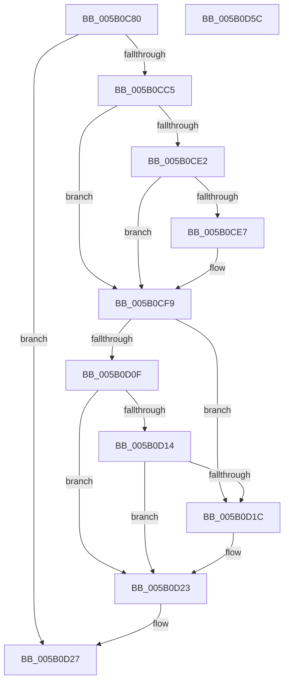

# KdpGetContextEx

- RVA: `0x005B0C80`–`0x005B0D5D` (길이 `221` bytes)
- VA: `0x00000001405B0C80`
- 실행 섹션: `.text`
- PDB 이름 있음: `예`; PDB Function 태그: `아니요`
- unwind 정보 RVA: `0x00066400`
- 디코드: `62`개 명령, `221/221` bytes 표시
- 미해석 바이트: `0` (있으면 어셈블리에 `.byte`로 보존)

> 이 문서는 커널 이미지의 기계어와 PDB 기호를 분석해 생성했습니다. 4번과 5번은 함수 원형과 자료형을 바이너리 사용 방식에서 추정한 C 해석이며 원본 소스 복구 결과는 아닙니다.

## 1. Dependencies

- 직접 호출 지점: **3**; 고유 호출 대상: **3**
- 직접 호출자로 확인된 함수: **1**
- RIP 상대 이미지 참조: **3**

### Outgoing calls
- `0x005B0CB6` → [KdpGetContext](../../pagekd/B8/KdpGetContext_function_00B872F8.md) (function, `0x00B872F8`)
- `0x005B0CF4` → [KdpQuickMoveMemory](../../pagekd/B8/KdpQuickMoveMemory_function_00B85490.md) (function, `0x00B85490`)
- `0x005B0D3B` → `kdcom.dll!KdSendPacket` (import, 간접 대상; import `kdcom.dll!KdSendPacket`)

### Direct callers
- [KdpSendWaitContinue](../../pagekd/B8/KdpSendWaitContinue_function_00B8A32C.md) at `0x00B8A4DE`

### Static image references
- `0x005B0D1C` → RVA `0x00F475D0` (`.data`; write)
- `0x005B0D27` → RVA `0x00F475E0` (`.data`; read)
- `0x005B0D3B` → RVA `0x001516C0` (`kdcom.dll!KdSendPacket (IAT)`; read)

## 2. Other-region calls and transfers

- 다른 실행 섹션으로 향하는 call: **2**
  - `0x005B0CB6` → [KdpGetContext](../../pagekd/B8/KdpGetContext_function_00B872F8.md) (`.text` → `PAGEKD`)
  - `0x005B0CF4` → [KdpQuickMoveMemory](../../pagekd/B8/KdpQuickMoveMemory_function_00B85490.md) (`.text` → `PAGEKD`)
- 별도 외부 분기/꼬리 이동을 확인하지 못했습니다.

## 3. Assembly (complete function range)

```asm
005B0C80  48 8B C4                        mov rax, rsp
005B0C83  48 89 58 08                     mov qword ptr [rax + 8], rbx
005B0C87  48 89 68 10                     mov qword ptr [rax + 0x10], rbp
005B0C8B  48 89 70 18                     mov qword ptr [rax + 0x18], rsi
005B0C8F  57                              push rdi
005B0C90  48 83 EC 30                     sub rsp, 0x30
005B0C94  8B 71 10                        mov esi, dword ptr [rcx + 0x10]
005B0C97  0F 57 C0                        xorps xmm0, xmm0
005B0C9A  8B 69 14                        mov ebp, dword ptr [rcx + 0x14]
005B0C9D  48 8B DA                        mov rbx, rdx
005B0CA0  0F 11 40 E8                     movups xmmword ptr [rax - 0x18], xmm0
005B0CA4  B8 38 00 00 00                  mov eax, 0x38
005B0CA9  48 89 4C 24 28                  mov qword ptr [rsp + 0x28], rcx
005B0CAE  66 89 44 24 20                  mov word ptr [rsp + 0x20], ax
005B0CB3  48 8B F9                        mov rdi, rcx
005B0CB6  E8 3D 66 5D 00                  call 0x140b872f8
005B0CBB  83 67 18 00                     and dword ptr [rdi + 0x18], 0
005B0CBF  83 7F 08 00                     cmp dword ptr [rdi + 8], 0
005B0CC3  75 62                           jne 0x1405b0d27
005B0CC5  44 0F B7 0B                     movzx r9d, word ptr [rbx]
005B0CC9  41 3B F1                        cmp esi, r9d
005B0CCC  45 8B D1                        mov r10d, r9d
005B0CCF  44 0F 42 D6                     cmovb r10d, esi
005B0CD3  45 2B CA                        sub r9d, r10d
005B0CD6  41 3B E9                        cmp ebp, r9d
005B0CD9  44 0F 46 CD                     cmovbe r9d, ebp
005B0CDD  45 85 D2                        test r10d, r10d
005B0CE0  74 17                           je 0x1405b0cf9
005B0CE2  45 85 C9                        test r9d, r9d
005B0CE5  74 12                           je 0x1405b0cf9
005B0CE7  48 8B 4B 08                     mov rcx, qword ptr [rbx + 8]
005B0CEB  45 8B C1                        mov r8d, r9d
005B0CEE  41 8B D2                        mov edx, r10d
005B0CF1  48 03 D1                        add rdx, rcx
005B0CF4  E8 97 47 5D 00                  call 0x140b85490
005B0CF9  44 89 57 10                     mov dword ptr [rdi + 0x10], r10d
005B0CFD  0F B7 03                        movzx eax, word ptr [rbx]
005B0D00  89 47 14                        mov dword ptr [rdi + 0x14], eax
005B0D03  44 89 4F 18                     mov dword ptr [rdi + 0x18], r9d
005B0D07  0F B7 0B                        movzx ecx, word ptr [rbx]
005B0D0A  44 3B C9                        cmp r9d, ecx
005B0D0D  74 0D                           je 0x1405b0d1c
005B0D0F  45 85 C9                        test r9d, r9d
005B0D12  74 0F                           je 0x1405b0d23
005B0D14  43 8D 04 11                     lea eax, [r9 + r10]
005B0D18  3B C1                           cmp eax, ecx
005B0D1A  75 07                           jne 0x1405b0d23
005B0D1C  C6 05 AD 68 99 00 01            mov byte ptr [rip + 0x9968ad], 1
005B0D23  66 44 89 0B                     mov word ptr [rbx], r9w
005B0D27  4C 8D 0D B2 68 99 00            lea r9, [rip + 0x9968b2]
005B0D2E  4C 8B C3                        mov r8, rbx
005B0D31  48 8D 54 24 20                  lea rdx, [rsp + 0x20]
005B0D36  B9 02 00 00 00                  mov ecx, 2
005B0D3B  48 FF 15 7E 09 BA FF            call qword ptr [rip - 0x45f682]
005B0D42  0F 1F 44 00 00                  nop dword ptr [rax + rax]
005B0D47  48 8B 5C 24 40                  mov rbx, qword ptr [rsp + 0x40]
005B0D4C  48 8B 6C 24 48                  mov rbp, qword ptr [rsp + 0x48]
005B0D51  48 8B 74 24 50                  mov rsi, qword ptr [rsp + 0x50]
005B0D56  48 83 C4 30                     add rsp, 0x30
005B0D5A  5F                              pop rdi
005B0D5B  C3                              ret
005B0D5C  CC                              int3
```

## 4. C-style interpretation (structured pseudocode)

```c
__int64 __fastcall KdpGetContextEx(__int64 a1, __int64 a2)
{
    __int64 result;
    __int64 v_r10;
    __int64 v_rsp;
    unsigned __int64 v_stack_m10;
    unsigned __int16 v_stack_m18;
    unsigned __int64 v_stack_p10;
    unsigned __int64 v_stack_p18;
    unsigned __int64 v_stack_p8;

    *(unsigned __int64 *)(v_rsp + 8) = v_rbx;
    *(unsigned __int64 *)(v_rsp + 16) = v_rbp;
    *(unsigned __int64 *)(v_rsp + 24) = v_rsi;
    v_rsp = (v_rsp) - (48);
    *(unsigned __int64 *)(v_rsp - 24) = v_xmm0;
    v_stack_m10 = a1;
    v_stack_m18 = 56;
    result = KdpGetContext(a1, a2, a3, a4);
    if ((*(unsigned int *)(a1 + 8)) != 0) goto loc_005B0D27;
    v_r10 = (unsigned int)((unsigned int)(*(unsigned __int16 *)(a2)));
    if (((unsigned int)((unsigned int)(*(unsigned int *)(a1 + 16)))) < ((unsigned int)(*(unsigned __int16 *)(a2)))) { v_r10 = (unsigned int)((unsigned int)(*(unsigned int *)(a1 + 16))); }
    a4 = (unsigned int)((*(unsigned __int16 *)(a2)) - ((unsigned int)(v_r10)));
    if (((unsigned int)((unsigned int)(*(unsigned int *)(a1 + 20)))) <= ((unsigned int)(a4))) { a4 = (unsigned int)((unsigned int)(*(unsigned int *)(a1 + 20))); }
    if ((unsigned int)(v_r10) == 0) goto loc_005B0CF9;
    if ((unsigned int)(a4) != 0) {
        a1 = *(unsigned __int64 *)(a2 + 8);
        a3 = (unsigned int)(a4);
        a2 = (unsigned int)(v_r10);
        a2 = (a2) + (a1);
        result = KdpQuickMoveMemory(a1, a2, a3, a4);
    }
    *(unsigned int *)(a1 + 16) = (unsigned int)(v_r10);
    *(unsigned int *)(a1 + 20) = (unsigned int)(*(unsigned __int16 *)(a2));
    *(unsigned int *)(a1 + 24) = (unsigned int)(a4);
    if (((unsigned int)(a4)) == ((unsigned int)(*(unsigned __int16 *)(a2)))) goto loc_005B0D1C;
    if ((unsigned int)(a4) == 0) goto loc_005B0D23;
    if (((unsigned int)(a4 + v_r10 * 1)) == ((unsigned int)(*(unsigned __int16 *)(a2)))) {
        *(unsigned __int8 *)(v_rip + 10053805) = 1;
    }
    *(unsigned __int16 *)(a2) = (unsigned __int16)(a4);
loc_005B0D27:
    result = kdcom_dll_KdSendPacket(2, v_stack_m18, a2, v_rip + 10053810);
    v_rsp = (v_rsp) + (48);
    return result;
}
```

## 5. (Beta) C Style

```c
int64_t KdpGetContextEx(void *Arg1, void *Arg2)
{
    uint8_t *arg1 = (uint8_t *)Arg1;
    uint8_t *arg2 = (uint8_t *)Arg2;

    int64_t result;
    int64_t local_r10;
    int64_t local_rsp;
    uint64_t v_stack_m10;
    uint16_t v_stack_m18;
    uint64_t v_stack_p10;
    uint64_t v_stack_p18;
    uint64_t v_stack_p8;

    *(uint64_t *)(local_rsp + 0x8) = local_rbx;
    *(uint64_t *)(local_rsp + 0x10) = local_rbp;
    *(uint64_t *)(local_rsp + 0x18) = local_rsi;
    local_rsp = (local_rsp) - (48);
    *(uint64_t *)(local_rsp - 0x18) = v_xmm0;
    v_stack_m10 = Arg1;
    v_stack_m18 = 56;
    result = KdpGetContext(Arg1, Arg2, a3, a4);
    if ((*(uint32_t *)(arg1 + 0x8)) != 0) goto loc_005B0D27;
    local_r10 = (uint32_t)((uint32_t)(*(uint16_t *)(arg2)));
    if (((uint32_t)((uint32_t)(*(uint32_t *)(arg1 + 0x10)))) < ((uint32_t)(*(uint16_t *)(arg2)))) { local_r10 = (uint32_t)((uint32_t)(*(uint32_t *)(arg1 + 0x10))); }
    a4 = (uint32_t)((*(uint16_t *)(arg2)) - ((uint32_t)(local_r10)));
    if (((uint32_t)((uint32_t)(*(uint32_t *)(arg1 + 0x14)))) <= ((uint32_t)(a4))) { a4 = (uint32_t)((uint32_t)(*(uint32_t *)(arg1 + 0x14))); }
    if ((uint32_t)(local_r10) == 0) goto loc_005B0CF9;
    if ((uint32_t)(a4) != 0) {
        Arg1 = *(uint64_t *)(arg2 + 0x8);
        a3 = (uint32_t)(a4);
        Arg2 = (uint32_t)(local_r10);
        Arg2 = (Arg2) + (Arg1);
        result = KdpQuickMoveMemory(Arg1, Arg2, a3, a4);
    }
    *(uint32_t *)(arg1 + 0x10) = (uint32_t)(local_r10);
    *(uint32_t *)(arg1 + 0x14) = (uint32_t)(*(uint16_t *)(arg2));
    *(uint32_t *)(arg1 + 0x18) = (uint32_t)(a4);
    if (((uint32_t)(a4)) == ((uint32_t)(*(uint16_t *)(arg2)))) goto loc_005B0D1C;
    if ((uint32_t)(a4) == 0) goto loc_005B0D23;
    if (((uint32_t)(a4 + local_r10 * 1)) == ((uint32_t)(*(uint16_t *)(arg2)))) {
        *(uint8_t *)(v_rip + 0x9968AD) = 1;
    }
    *(uint16_t *)(arg2) = (uint16_t)(a4);
loc_005B0D27:
    result = kernel_indirect_call(2, v_stack_m18, Arg2, v_rip + 10053810);
    local_rsp = (local_rsp) + (48);
    return result;
}
```

### 관측된 메모리 오프셋

구조체 형식이 확인되지 않은 접근은 인자 기준의 오프셋으로만 기록했습니다.

| 기준 인자 | 오프셋 표현 | 폭 (bit) | 접근 |
|---|---:|---:|---|
| `Arg1` | `+ 0x8` | `32` | `R` |
| `Arg1` | `+ 0x10` | `32` | `R` |
| `Arg1` | `+ 0x10` | `32` | `W` |
| `Arg1` | `+ 0x14` | `32` | `R` |
| `Arg1` | `+ 0x14` | `32` | `W` |
| `Arg1` | `+ 0x18` | `32` | `R/W` |
| `Arg1` | `+ 0x18` | `32` | `W` |
| `Arg2` | `+ 0x0` | `16` | `R` |
| `Arg2` | `+ 0x0` | `16` | `W` |
| `Arg2` | `+ 0x8` | `64` | `R` |

## 6. Execution-region graph

[열기: 2D/3D 그래프와 함수 탐색 컨트롤 패널](../../../control-panel.html?section=text&rva=0x005B0C80&view=graph)

- 2D 그래프는 위에서 아래로 흐르고, 3D 그래프는 빈 공간을 드래그해 회전합니다. Shift+드래그는 이동, 휠은 확대·축소, 함수 노드 선택은 대상 보고서 이동입니다.

### Static fallback


