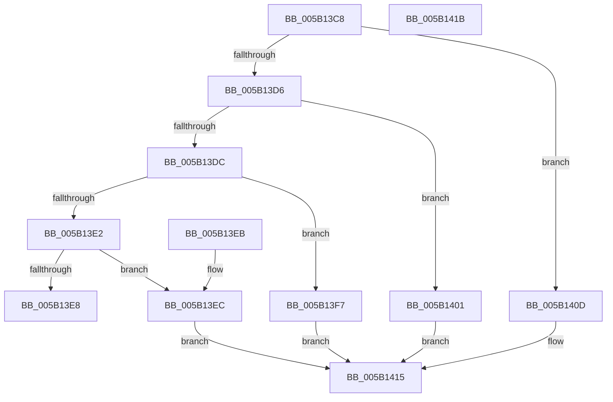

# KdpIsBreakpoint

- RVA: `0x005B13C8`–`0x005B141C` (길이 `84` bytes)
- VA: `0x00000001405B13C8`
- 실행 섹션: `.text`
- PDB 이름 있음: `예`; PDB Function 태그: `아니요`
- unwind 정보 RVA: `0x000DB714`
- 디코드: `32`개 명령, `84/84` bytes 표시
- 미해석 바이트: `0` (있으면 어셈블리에 `.byte`로 보존)

> 이 문서는 커널 이미지의 기계어와 PDB 기호를 분석해 생성했습니다. 4번과 5번은 함수 원형과 자료형을 바이너리 사용 방식에서 추정한 C 해석이며 원본 소스 복구 결과는 아닙니다.

## 1. Dependencies

- 직접 호출 지점: **0**; 고유 호출 대상: **0**
- 직접 호출자로 확인된 함수: **2**
- RIP 상대 이미지 참조: **0**

### Outgoing calls
- 직접 디코드된 call 명령이 없습니다.

### Direct callers
- [KdpLowRestoreBreakpoint](../../pagekd/B8/KdpLowRestoreBreakpoint_function_00B89A54.md) at `0x00B89A9B`
- [KdpLowWriteContent](../../pagekd/B8/KdpLowWriteContent_function_00B89B0C.md) at `0x00B89B58`
- [KdpLowWriteContent](../../pagekd/B8/KdpLowWriteContent_function_00B89B0C.md) at `0x00B89B95`

### Static image references
- 디코드된 RIP-relative 메모리 참조가 없습니다.

## 2. Other-region calls and transfers

- 다른 실행 섹션으로 향하는 call: **0**
- 별도 외부 분기/꼬리 이동을 확인하지 못했습니다.

## 3. Assembly (complete function range)

```asm
005B13C8  44 0F B6 41 24                  movzx r8d, byte ptr [rcx + 0x24]
005B13CD  4C 8B CA                        mov r9, rdx
005B13D0  41 83 E8 01                     sub r8d, 1
005B13D4  74 37                           je 0x1405b140d
005B13D6  41 83 E8 01                     sub r8d, 1
005B13DA  74 25                           je 0x1405b1401
005B13DC  41 83 E8 02                     sub r8d, 2
005B13E0  74 15                           je 0x1405b13f7
005B13E2  41 83 F8 04                     cmp r8d, 4
005B13E6  74 04                           je 0x1405b13ec
005B13E8  33 C0                           xor eax, eax
005B13EA  C3                              ret
005B13EB  CC                              int3
005B13EC  48 8B 41 10                     mov rax, qword ptr [rcx + 0x10]
005B13F0  33 D2                           xor edx, edx
005B13F2  49 39 01                        cmp qword ptr [r9], rax
005B13F5  EB 1E                           jmp 0x1405b1415
005B13F7  8B 41 10                        mov eax, dword ptr [rcx + 0x10]
005B13FA  33 D2                           xor edx, edx
005B13FC  41 39 01                        cmp dword ptr [r9], eax
005B13FF  EB 14                           jmp 0x1405b1415
005B1401  0F B7 41 10                     movzx eax, word ptr [rcx + 0x10]
005B1405  33 D2                           xor edx, edx
005B1407  66 41 39 01                     cmp word ptr [r9], ax
005B140B  EB 08                           jmp 0x1405b1415
005B140D  8A 49 10                        mov cl, byte ptr [rcx + 0x10]
005B1410  33 D2                           xor edx, edx
005B1412  41 38 09                        cmp byte ptr [r9], cl
005B1415  0F 94 C2                        sete dl
005B1418  8B C2                           mov eax, edx
005B141A  C3                              ret
005B141B  CC                              int3
```

## 4. C-style interpretation (structured pseudocode)

```c
__int64 __fastcall KdpIsBreakpoint(__int64 a1, __int64 a2)
{
    __int64 result;

    a3 = (unsigned int)((*(unsigned __int8 *)(a1 + 36)) - (1));
    if (condition_is_equal) goto loc_005B140D;
    a3 = (unsigned int)((a3) - (1));
    if (condition_is_equal) goto loc_005B1401;
    a3 = (unsigned int)((a3) - (2));
    if (condition_is_equal) goto loc_005B13F7;
    if (((unsigned int)(a3)) == 4) goto loc_005B13EC;
    result = 0;
    return result;
loc_005B13EC:
    a2 = 0;
    goto loc_005B1415;
loc_005B13F7:
    a2 = 0;
    goto loc_005B1415;
loc_005B1401:
    a2 = 0;
    goto loc_005B1415;
loc_005B140D:
    a2 = 0;
loc_005B1415:
    a2 = ((*(unsigned __int8 *)(a2)) == ((unsigned __int8)(*(unsigned __int8 *)(a1 + 16)))) ? 1 : 0;
    return (unsigned int)((unsigned int)(a2));
}
```

## 5. (Beta) C Style

```c
int64_t KdpIsBreakpoint(void *Arg1, void *Arg2)
{
    uint8_t *arg1 = (uint8_t *)Arg1;
    uint8_t *arg2 = (uint8_t *)Arg2;

    int64_t result;

    a3 = (uint32_t)((*(uint8_t *)(arg1 + 0x24)) - (1));
    if (condition_is_equal) goto loc_005B140D;
    a3 = (uint32_t)((a3) - (1));
    if (condition_is_equal) goto loc_005B1401;
    a3 = (uint32_t)((a3) - (2));
    if (condition_is_equal) goto loc_005B13F7;
    if (((uint32_t)(a3)) == 4) goto loc_005B13EC;
    result = 0;
    return result;
loc_005B13EC:
    Arg2 = 0;
    goto loc_005B1415;
loc_005B13F7:
    Arg2 = 0;
    goto loc_005B1415;
loc_005B1401:
    Arg2 = 0;
    goto loc_005B1415;
loc_005B140D:
    Arg2 = 0;
loc_005B1415:
    Arg2 = ((*(uint8_t *)(arg2)) == ((uint8_t)(*(uint8_t *)(arg1 + 0x10)))) ? 1 : 0;
    return (uint32_t)((uint32_t)(Arg2));
}
```

### 관측된 메모리 오프셋

구조체 형식이 확인되지 않은 접근은 인자 기준의 오프셋으로만 기록했습니다.

| 기준 인자 | 오프셋 표현 | 폭 (bit) | 접근 |
|---|---:|---:|---|
| `Arg1` | `+ 0x10` | `8` | `R` |
| `Arg1` | `+ 0x10` | `16` | `R` |
| `Arg1` | `+ 0x10` | `32` | `R` |
| `Arg1` | `+ 0x10` | `64` | `R` |
| `Arg1` | `+ 0x24` | `8` | `R` |
| `Arg2` | `+ 0x0` | `8` | `R` |
| `Arg2` | `+ 0x0` | `16` | `R` |
| `Arg2` | `+ 0x0` | `32` | `R` |
| `Arg2` | `+ 0x0` | `64` | `R` |

## 6. Execution-region graph

[열기: 2D/3D 그래프와 함수 탐색 컨트롤 패널](../../../control-panel.html?section=text&rva=0x005B13C8&view=graph)

- 2D 그래프는 위에서 아래로 흐르고, 3D 그래프는 빈 공간을 드래그해 회전합니다. Shift+드래그는 이동, 휠은 확대·축소, 함수 노드 선택은 대상 보고서 이동입니다.

### Static fallback


